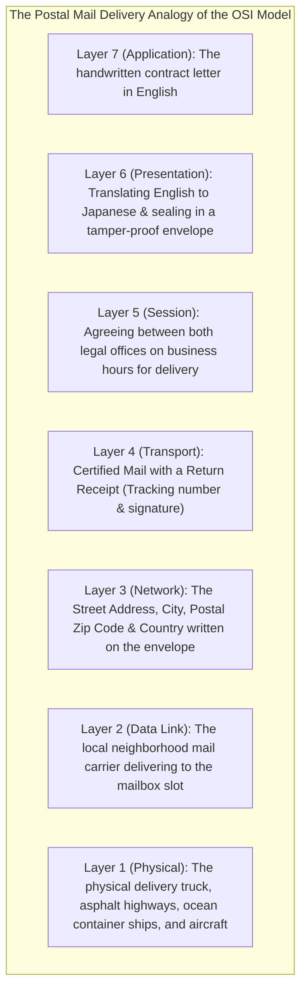
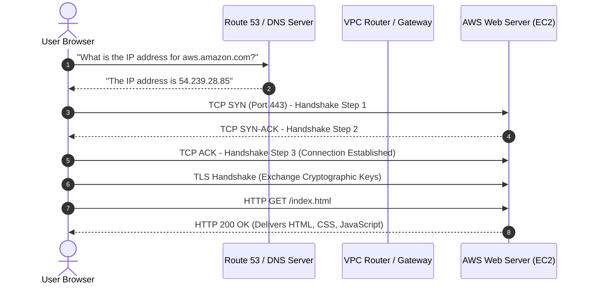
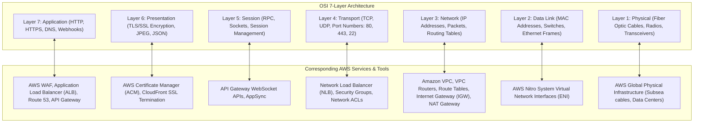
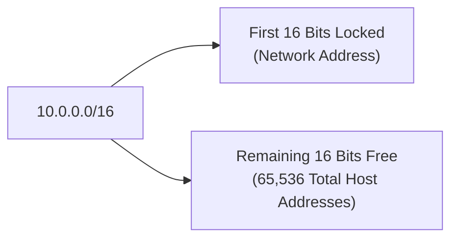
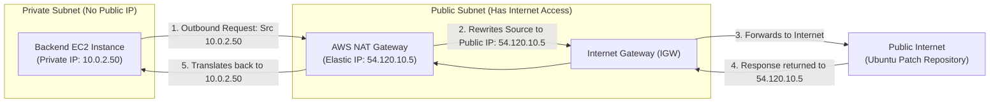
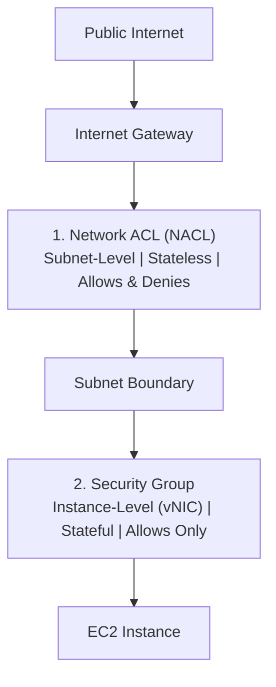

# 02. Networking & The OSI Model Prerequisite

> **Module:** Prerequisites & Foundational Computer Science Concepts  
> **Course:** AWS Certified Cloud Practitioner (`CLF-C02`)  
> **Target Audience:** Trainees, students, and career switchers entering cloud computing without prior networking background.

---

## 🧭 Executive Summary & Core Objective

In cloud computing, **Virtual Private Cloud (Amazon VPC)** is the virtual network container where all your compute instances, databases, and load balancers live. If you do not understand IP addresses, subnets, ports, and routing, concepts like Security Groups, Internet Gateways, NAT Gateways, and Route 53 will feel like random magic.

This guide builds your networking knowledge from the physical wire up to the application layer using clear, intuitive analogies and concrete mathematical examples.

---

## 🏛️ Pillar 1: The Intuitive Real-World Analogy

Imagine sending an important, certified legal contract from New York to Tokyo via postal mail:

- When you write your message, that is **Layer 7 (Application)**.
- Making sure the recipient can read the language and encrypting it is **Layer 6 (Presentation)**.
- Ensuring both parties are ready to converse is **Layer 5 (Session)**.
- Giving the letter a certified tracking number that confirms every page arrived without loss is **Layer 4 (Transport / TCP)**.
- Writing the unique street address and postal zip code so global sorting facilities know which city to route it to is **Layer 3 (Network / IP)**.
- The mail carrier in the local neighborhood delivering to the exact physical door slot is **Layer 2 (Data Link / MAC address)**.
- The physical delivery truck, highway asphalt, and airplane cargo hold are **Layer 1 (Physical wire, fiber optic light, or radio frequency)**.

---

## ⚙️ Pillar 2: First-Principles Networking Mechanics

### 1. What Happens When You Request a Web Page?
When you open a web browser and type `https://aws.amazon.com`, your computer performs a multi-step sequence within milliseconds:

1. **DNS Lookup:** Your computer does not know what "aws.amazon.com" means geographically; it only understands IP addresses. It queries a **DNS server** to resolve the name to `54.239.28.85`.
2. **TCP 3-Way Handshake (Layer 4):** Your computer establishes a reliable connection with the web server by sending synchronization packets (`SYN` $\rightarrow$ `SYN-ACK` $\rightarrow$ `ACK`).
3. **TLS Encryption Handshake (Layer 6):** Both machines negotiate a secure symmetric key to encrypt the session so eavesdroppers on Wi-Fi or fiber cables cannot read credit card numbers or passwords.
4. **HTTP Request/Response (Layer 7):** The browser sends an `HTTP GET` request, and the server returns the requested web page data.

### 2. TCP vs. UDP: Reliable vs. Fast
At the Transport Layer (Layer 4), two distinct protocols govern how packets travel:

| Dimension | Transmission Control Protocol (TCP) | User Datagram Protocol (UDP) |
|:---|:---|:---|
| **Connection Style** | **Connection-Oriented** (Requires a 3-way handshake before transmitting data). | **Connectionless** ("Fire and forget"; sends packets without establishing a session). |
| **Reliability & Guarantees** | **100% Guaranteed Delivery.** Retransmits lost packets and reorders packets that arrive out of sequence. | **No Delivery Guarantee.** Lost packets are ignored; no retransmission. |
| **Speed & Overhead** | Slower; higher header overhead due to tracking numbers, checksums, and acknowledgments. | Extremely fast; ultra-lightweight headers with zero acknowledgment overhead. |
| **Typical Use-Cases** | Web browsing (HTTP/HTTPS), email (SMTP), file transfers (FTP/SFTP), SSH terminal access. | Live video streaming (Zoom, Twitch), VoIP phone calls, multiplayer online gaming, DNS queries. |
| **AWS Analogy** | **Application Load Balancer (ALB)**, EC2 web servers, RDS database connections. | **AWS Global Accelerator**, DNS queries to **Amazon Route 53**, media live-streaming. |

### 3. Port Numbers: Apartment Numbers for Applications
An IP address identifies a **computer**, but a computer runs hundreds of programs simultaneously. How does the operating system know whether an incoming packet is meant for your web server, your email client, or your database?
- **Ports** act as apartment numbers inside an address building.
- Common standard ports every cloud practitioner must know:
  - **Port 80 (HTTP):** Unencrypted web traffic.
  - **Port 443 (HTTPS):** Encrypted secure web traffic (SSL/TLS).
  - **Port 22 (SSH / SFTP):** Secure Shell remote terminal login for Linux servers.
  - **Port 3389 (RDP):** Remote Desktop Protocol for graphical login to Windows servers.
  - **Port 53 (DNS):** Domain Name System address resolution queries.
  - **Port 3306 (MySQL):** Default port for MySQL and Amazon Aurora relational databases.
  - **Port 5432 (PostgreSQL):** Default port for PostgreSQL databases.

---

## 🗺️ Pillar 3: The OSI 7-Layer Model Mapped to AWS

Understanding the OSI model is essential because AWS services and security boundaries operate at specific layers:

### Key Architectural Takeaways for AWS:
1. **Layer 7 (Application-Aware):**
   - An **Application Load Balancer (ALB)** inspects HTTP headers, cookies, and URL paths (e.g., routing requests for `/api` to one cluster and `/images` to another).
   - **AWS WAF (Web Application Firewall)** inspects application payloads to block SQL Injection (SQLi) and Cross-Site Scripting (XSS).
2. **Layer 4 (Transport / Connection-Aware):**
   - A **Network Load Balancer (NLB)** does not care about URLs or cookies; it operates strictly on IP addresses, TCP/UDP protocols, and ports, handling tens of millions of requests per second with ultra-low sub-millisecond latency.
   - **Security Groups** operate at Layer 4: you configure rules like "Allow inbound TCP traffic on Port 443".
3. **Layer 3 (Network / Routing-Aware):**
   - **Route Tables** in Amazon VPC operate at Layer 3: they read destination IP addresses and direct packets to an Internet Gateway (`0.0.0.0/0`), a Virtual Private Gateway (VPN), or a VPC Peering connection.

---

## 🔢 Pillar 4: IP Addressing & The Mathematics of CIDR Subnetting

### 1. IPv4 Architecture
An **IPv4 address** is a 32-bit binary number represented in human-readable format as **4 decimal octets separated by dots** (e.g., `192.168.1.1`):
- Each octet represents 8 bits: $8 \times 4 = 32$ total bits.
- Each octet ranges from 0 (`00000000` in binary) to 255 (`11111111` in binary).
- The total global IPv4 address space is $2^{32} \approx 4.29 \text{ billion addresses}$.

### 2. Classless Inter-Domain Routing (CIDR) Demystified
In the early days of networking, IP addresses were assigned in rigid, wasteful classes (Class A, B, C). Today, the entire internet and Amazon VPC use **CIDR notation** (e.g., `10.0.0.0/16`).

The number after the slash (`/prefix`) tells you **how many bits are locked for the network prefix**. The remaining bits are available for individual host/instance addresses:

$$\text{Available Host Bits} = 32 - \text{Prefix}$$
$$\text{Total IP Addresses} = 2^{(32 - \text{Prefix})}$$

#### Step-by-Step Calculation Table:

| CIDR Prefix | Host Bits ($32 - \text{Prefix}$) | Total IP Addresses ($2^{\text{Bits}}$) | Usable AWS IPs (Minus 5 Reserved) | Typical AWS Usage |
|:---:|:---:|:---:|:---:|:---|
| **/16** | $32 - 16 = 16$ | $2^{16} = \mathbf{65,536}$ | 65,531 | Standard Amazon VPC Size |
| **/20** | $32 - 20 = 12$ | $2^{12} = \mathbf{4,096}$ | 4,091 | Large Production Subnet |
| **/24** | $32 - 24 = 8$ | $2^8 = \mathbf{256}$ | 251 | Standard Development Subnet |
| **/28** | $32 - 28 = 4$ | $2^4 = \mathbf{16}$ | 11 | Minimum Subnet Size in AWS |
| **/32** | $32 - 32 = 0$ | $2^0 = \mathbf{1}$ | 1 (Single Host) | Security Group Rule for 1 Admin IP |

> [!IMPORTANT]
> **The 5 AWS Reserved IPs in Every Subnet:**  
> In traditional networking, only 2 addresses are reserved per subnet (Network and Broadcast). **AWS reserves 5 IP addresses in EVERY subnet.**  
> For example, in a `10.0.1.0/24` subnet:
> 1. `10.0.1.0`: **Network Address** (identifies the subnet wire).
> 2. `10.0.1.1`: **VPC Router** (default gateway for the subnet).
> 3. `10.0.1.2`: **DNS Server** (AmazonProvidedDNS / Route 53 Resolver).
> 4. `10.0.1.3`: **Future AWS Use** (reserved by AWS).
> 5. `10.0.1.255`: **Network Broadcast Address** (AWS VPC does not support broadcast, but reserves this for standard network compatibility).
>
> *Formula for exam calculations:* **$\text{Usable IPs} = 2^{(32 - \text{Prefix})} - 5$**.  
> If an exam question asks: *"How many usable IP addresses are in a `/28` subnet in AWS?"*  
> Calculation: $2^{(32-28)} = 2^4 = 16$. Then $16 - 5 = \mathbf{11 \text{ usable IPs}}$.

---

## 🌐 Pillar 5: Public vs. Private IPs & Network Address Translation (NAT)

### 1. RFC 1918 Private IP Address Ranges
Because the world ran out of public IPv4 addresses, the Internet Engineering Task Force (IETF) set aside three private address ranges in **RFC 1918**:
- `10.0.0.0` to `10.255.255.255` (`10.0.0.0/8` — 16.7 million IPs)
- `172.16.0.0` to `172.31.255.255` (`172.16.0.0/12` — 1 million IPs)
- `192.168.0.0` to `192.168.255.255` (`192.168.0.0/16` — 65,536 IPs)

**The Core Rule of Private IPs:** Private IP addresses are **NEVER routable across the public internet**. Thousands of companies can use `10.0.0.0/16` inside their private VPCs without conflicting with each other, because traffic stays inside private network boundaries.

### 2. How NAT (Network Address Translation) Works
If your backend database or application server has a private IP address (`10.0.2.50`), it cannot communicate directly with the internet. But what happens when that Linux server needs to download security patches from `ubuntu.com`?

This is where **Network Address Translation (NAT)** comes in:

- **Outbound-Only Protection:** Instances in private subnets can initiate outbound requests to download updates or API data, but **external hackers on the public internet CANNOT initiate an inbound connection to the private instance**.
- In AWS, this is provided as a fully managed, auto-scaling service: **AWS NAT Gateway**.

---

## 🛡️ Security Groups vs. Network ACLs (NACLs)

In Amazon VPC, you control traffic using two distinct firewall layers:

### Comprehensive Distinction Matrix

| Feature | Security Group (SG) | Network Access Control List (NACL) |
|:---|:---|:---|
| **Operating Level** | **Instance Level** (attached to the virtual network interface / ENI). | **Subnet Level** (acts as a perimeter guard for the entire subnet). |
| **Rule Capabilities** | **ALLOW rules only.** (You cannot explicitly DENY an IP address; all traffic is implicitly denied unless allowed). | **ALLOW and DENY rules.** (Used to block specific malicious IP addresses or CIDR blocks). |
| **State Tracking** | **Stateful:** If traffic is allowed inbound, response traffic is automatically allowed outbound, regardless of outbound rules. | **Stateless:** Return traffic must be explicitly allowed by an outbound rule (including ephemeral ports 1024–65535). |
| **Rule Processing Order** | **All rules evaluated simultaneously.** No priority numbering. | **Rules evaluated in strict numerical order** (lowest number first, e.g., Rule 100 before Rule 200). First match wins. |
| **Default Configuration** | Blocks all inbound traffic; allows all outbound traffic. | Default NACL allows all inbound and all outbound traffic. Custom NACL blocks all until configured. |

---

## 🎯 Exam Scenario Decryption & Traps (CLF-C02)

### 1. Key Exam Trigger Phrases

| Exam Trigger Phrase | Correct AWS Networking Service | Distractor Trap to Avoid |
|:---|:---|:---|
| *"Block a single malicious IP address from attacking your application"* | **Network ACL (NACL)** | Traps lure you into picking Security Groups. Security Groups *cannot deny* specific IP addresses! |
| *"Allow instances in a private subnet to securely download software updates from the internet"* | **AWS NAT Gateway** | Do not pick Internet Gateway; an Internet Gateway allows bidirectional internet traffic to public instances. |
| *"Dedicated, private physical fiber connection from on-prem datacenter to AWS bypassing internet"* | **AWS Direct Connect (DX)** | Do not pick Site-to-Site VPN. VPN travels over the public internet and has variable latency. |
| *"Low-cost, encrypted IPsec tunnel over the public internet between on-prem and AWS"* | **AWS Site-to-Site VPN** | Contrasted with Direct Connect. VPN is fast to setup and inexpensive. |
| *"Connect hundreds of VPCs and on-premises networks in a central hub-and-spoke topology"* | **AWS Transit Gateway** | Do not pick VPC Peering. Full-mesh VPC peering becomes unmanageable at scale ($N(N-1)/2$ connections). |

### 2. Sample Exam Question Walkthrough

> **Scenario Question:**  
> A company hosts an ecommerce application in an Amazon VPC. Security administrators notice that a specific IP address (`198.51.100.24`) is conducting brute-force password attacks against several web servers.  
> Which AWS networking mechanism should the company use to immediately block all traffic originating from this specific IP address?
>
> - [A] Add an outbound rule to the web servers' Security Group
> - [B] Add a deny rule to the subnet's Network Access Control List (NACL)
> - [C] Detach the Internet Gateway from the VPC
> - [D] Modify the route table to point `198.51.100.24` to a blackhole route

**Detailed Answer Rationale:**
- **Correct Answer: [B] Add a deny rule to the subnet's Network Access Control List (NACL)**  
  *Why:* Network ACLs operate at the subnet boundary and support explicit **DENY rules**. By adding a rule (e.g., Rule 50: DENY `198.51.100.24/32`), packets from this malicious IP are dropped before they ever reach the EC2 instances.
- **Why [A] is Wrong:** Security Groups do NOT support DENY rules. They are permit-lists (ALLOW only). You cannot block a specific IP in a Security Group if the port is open to the public (`0.0.0.0/0`).
- **Why [C] is Wrong:** Detaching the Internet Gateway would disconnect the entire VPC from the internet, taking the ecommerce application offline for all legitimate customers worldwide.
- **Why [D] is Wrong:** Route tables in AWS VPC do not support arbitrary host-level blackhole routing for inbound public traffic coming through an Internet Gateway.

---

## 📝 Retention Self-Check Exercises

1. *How many usable IP addresses exist inside an AWS VPC subnet configured with `10.0.2.0/24`, and why is that number different from a traditional on-premises network?*
2. *Explain the difference between a stateful firewall (Security Group) and a stateless firewall (Network ACL) using a real-world building security analogy.*
3. *Why would an enterprise choose AWS Direct Connect over an AWS Site-to-Site VPN, and vice versa?*
4. *An application server in a private subnet needs to query an external weather API. What two components are required in the VPC to allow this outbound traffic without making the server publicly accessible?*

---

*Next Prerequisite Module: [03_Storage_Paradigms.md](./03_Storage_Paradigms.md)*
