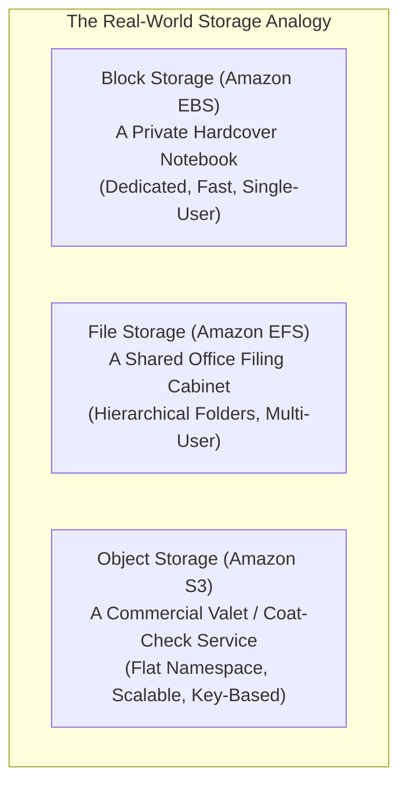
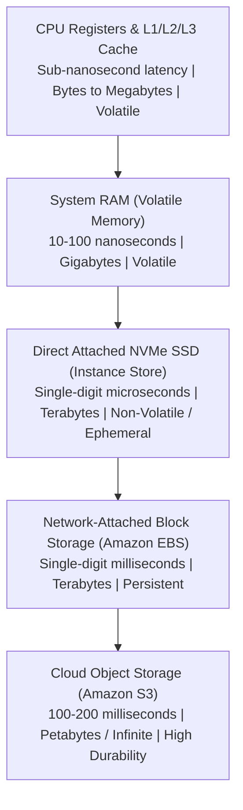
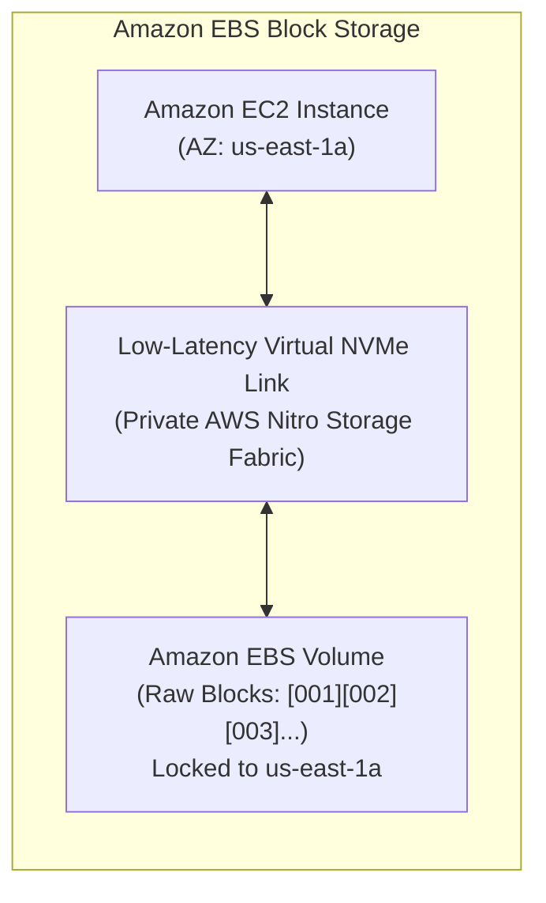
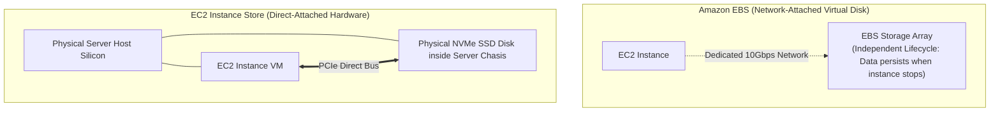
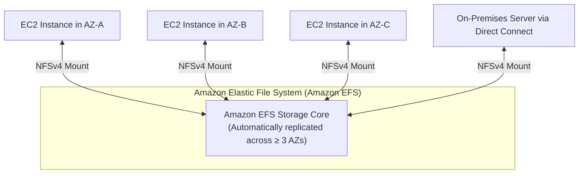
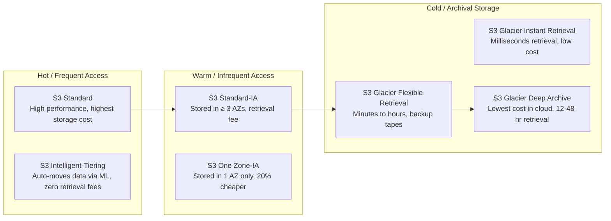

# 03. Storage Paradigms Prerequisite: Block, File, and Object

> **Module:** Prerequisites & Foundational Computer Science Concepts  
> **Course:** AWS Certified Cloud Practitioner (`CLF-C02`)  
> **Target Audience:** Trainees, students, and career switchers entering cloud computing without prior storage engineering background.

---

## 🧭 Executive Summary & Core Objective

Data storage in the cloud is not "one size fits all." If you attach an expensive database volume to store PDF invoices, you will burn thousands of dollars needlessly. If you store a relational database on object storage, your application will crash due to latency bottlenecks.

To succeed in AWS, you must master the fundamental differences between the three core storage paradigms: **Block Storage (Amazon EBS)**, **File Storage (Amazon EFS)**, and **Object Storage (Amazon S3)**.

---

## 🏛️ Pillar 1: The Intuitive Real-World Analogy

Imagine three distinct ways to store and organize physical documents in an office:

1. **Block Storage (Amazon EBS) = A Hardcover Notebook in Your Personal Desk:**
   - The notebook sits right next to you on your desk (directly attached to your computer).
   - You can write individual characters or numbers into specific lines instantly with zero delay (raw block access).
   - Only **one person** can hold the pen and write in that notebook at a time. If you move to another building (another Availability Zone), your notebook cannot magically be in both places at once.
2. **File Storage (Amazon EFS) = A Shared Filing Cabinet in the Hallway:**
   - The filing cabinet has drawers, folders, sub-folders, and color-coded tabs (hierarchical file directory tree: `/finance/2026/q1/invoices.pdf`).
   - Multiple coworkers from different offices across the floor can walk over, open different folders, and read or write files at the exact same time over the local office network (**NFS protocol**).
3. **Object Storage (Amazon S3) = A Massive Coat-Check Room or Valet Parking:**
   - When you hand over your jacket, the attendant does not put it in a nested filing cabinet. They hang it on an infinite automated rack, clip a barcode tag to it containing metadata (color, brand, owner name), and hand you a unique claim ticket (**The Key / URI**).
   - Whenever you want your jacket back, you present your ticket via the front counter (**HTTP GET request**). You cannot reach in and modify a single button on the coat; if you want to change it, you take the whole coat back, sew the button, and hand it back as a brand new version.

---

## ⚙️ Pillar 2: First-Principles Storage Mechanics

### 1. The Storage Hierarchy & Latency Pyramid
Computers trade speed for capacity and cost. Fast memory is outrageously expensive and volatile; persistent storage is cheaper and larger, but slower:

### 2. The Two Critical Storage Metrics: IOPS vs. Throughput
Students frequently confuse these two foundational measurements:

- **IOPS (Input/Output Operations Per Second):**
  - Measures the *frequency* of individual read or write operations per second.
  - Analogy: A delivery courier delivering 5,000 tiny envelopes to 5,000 different houses across town.
  - Critical For: **Transactional databases** (MySQL, PostgreSQL, Oracle), virtual machine boot drives, and low-latency random reads/writes.
- **Throughput (Megabytes or Gigabytes per Second - MB/s or GB/s):**
  - Measures the *raw volume* of data transported per unit of time.
  - Analogy: A massive gravel dump truck unloading 20 tons of rock in one spot.
  - Critical For: **Big data analytics** (Hadoop, Apache Spark), video streaming, log aggregation, and continuous sequential backups.

---

## 🧱 Pillar 3: Block Storage in AWS: Amazon EBS & Instance Store

### 1. What is Block Storage?
In block storage, the raw storage volume is carved into fixed-size chunks called **blocks** (e.g., 4 KB or 8 KB sectors). The storage volume does not understand what a "PDF" or a "JPEG" is; it only understands raw hexadecimal data written to block addresses. The operating system formats these raw blocks with a **file system** (such as NTFS on Windows, or ext4/XFS on Linux).

### 2. The Critical Architectural Rule: The Availability Zone Boundary
An Amazon EBS volume is a virtual disk living inside a specific AWS datacenter facility. Therefore:
- **An EBS volume is strictly bound to a SINGLE Availability Zone (AZ).**
- An EBS volume in `us-east-1a` can ONLY attach to an EC2 instance in `us-east-1a`.
- **How to move an EBS volume to another AZ:** You take an **EBS Snapshot**. Snapshots are automatically copied to Amazon S3 (which is geographically redundant across all AZs). You can then restore that snapshot as a brand new EBS volume in `us-east-1b`.

### 3. Amazon EBS Volume Types (CLF-C02 High-Yield)

| Volume Category | Volume Type API Name | Target Workload | Key Exam Trigger Words |
|:---|:---|:---|:---|
| **General Purpose SSD** | **`gp3`** / `gp2` | System boot volumes, virtual desktops, medium dev/test databases. | *"Balanced price and performance"*, *"Default EC2 boot volume"*. |
| **Provisioned IOPS SSD** | **`io2` Block Express** / `io1` | Mission-critical, high-transaction relational databases (SAP HANA, Oracle, MS SQL). | *"Highest performance"*, *"Sub-millisecond latency"*, *"Over 16,000 IOPS"*, *"Critical transactional DB"*. |
| **Throughput Optimized HDD** | **`st1`** | Frequently accessed, large sequential datasets, big data, data warehousing, log processing. | *"Low-cost magnetic HDD"*, *"Large sequential throughput"*, *"Big data / Hadoop"*, *"Cannot be boot volume"*. |
| **Cold HDD** | **`sc1`** | Lowest cost magnetic storage for infrequently accessed file archives. | *"Lowest cost block storage"*, *"Infrequently accessed file archives"*. |

### 4. Amazon EBS vs. EC2 Instance Store (Ephemeral Storage)
This is one of the most heavily tested distinctions in AWS certifications:

- **Amazon EBS (Network-Attached):** Data persists independently of the instance. If you stop the instance, your data remains safely stored on EBS. You can detach it and attach it to a new instance.
- **Instance Store (Physical Ephemeral Disk):** Physical NVMe disks physically mounted inside the host computer blade running your VM.
  - **Advantage:** Blazing fast; zero network latency.
  - **Fatal Risk:** **EPHEMERAL (Temporary).** If the instance is stopped or underlying hardware fails, **ALL DATA IS PERMANENTLY ERASED**.
  - **Use Case:** Temporary cache, scratch space, session state, pre-replicated database buffers.

---

## 📁 Pillar 4: File Storage in AWS: Amazon EFS & Amazon FSx

### 1. What is File Storage?
File storage organizes data in a hierarchical directory tree (Folders → Sub-folders → Files). Applications access files using standard operating system file sharing protocols:
- **NFS (Network File System):** Standard protocol for Linux / Unix environments.
- **SMB (Server Message Block):** Standard protocol for Microsoft Windows environments.

### 2. Amazon Elastic File System (Amazon EFS)
- Fully managed, cloud-native file storage for Linux workloads.
- **Multi-AZ Concurrent Access:** Hundreds of EC2 instances across different Availability Zones can mount the same file system simultaneously.
- **Elastic Auto-Scaling:** You never provision capacity in advance. If you store 1 GB, you pay for 1 GB. If you add 5 TB of files, it expands instantly. When you delete files, it shrinks automatically.
- **POSIX Compliant:** Supports standard Linux file permissions (`chmod`, `chown`, read/write locks).

### 3. Amazon FSx Family (Specialized Workloads)
When workloads require non-Linux native file systems:
- **Amazon FSx for Windows File Server:** Native Windows file system integrating directly with **Microsoft Active Directory (AD)**, supporting SMB protocols and Windows NTFS ACLs.
- **Amazon FSx for Lustre:** Ultra-high performance parallel file system designed for compute-intensive High-Performance Computing (HPC), machine learning training, and financial modeling.

---

## 🪣 Pillar 5: Object Storage in AWS: Amazon S3

### 1. What is Object Storage?
Object storage treats data not as discrete blocks on a disk or folders in a tree, but as discrete **objects** stored in a flat namespace called a **bucket**.
- Every object in S3 consists of four elements:
  1. **Key:** The unique name / path identifier (e.g., `photos/2026/vacation.jpg`).
  2. **Data (Payload):** The raw binary content (from 0 bytes up to a maximum of **5 Terabytes** per single object).
  3. **Metadata:** Key-value pairs describing the file (e.g., `content-type: image/jpeg`, `date-created`, `author`, custom tags).
  4. **Version ID:** A string identifying the unique revision if S3 Versioning is enabled.

### 2. The RESTful HTTP/HTTPS Architecture
Unlike EBS or EFS, you do not "mount" Amazon S3 to an operating system drive letter (`C:\` or `/mnt/data`). S3 is an internet-native cloud storage service accessed via standard **REST APIs** over HTTPS:
- `GET /my-bucket/contract.pdf` (Download an object)
- `PUT /my-bucket/invoice.pdf` (Upload an object)
- `DELETE /my-bucket/temp.log` (Delete an object)

### 3. Extreme Scale & 99.999999999% (11 9s) Durability
Amazon S3 is designed for **11 9s of data durability**:
- What does 11 9s mean? If you store 10,000,000 objects in Amazon S3, you can expect on average to lose a single object once every 10,000 years!
- How does AWS achieve this? S3 automatically synchronously replicates every object across **a minimum of 3 geographically separated physical Availability Zones** within the AWS Region.

### 4. Amazon S3 Storage Classes (Exam High-Yield)

| S3 Storage Class | Durability | Availability | Availability Zones | Retrieval Time | Best Used For |
|:---|:---:|:---:|:---:|:---|:---|
| **S3 Standard** | 11 9s | 99.99% | ≥ 3 AZs | Milliseconds | Active web assets, dynamic websites, frequent data access. |
| **S3 Intelligent-Tiering** | 11 9s | 99.9% | ≥ 3 AZs | Milliseconds | Data with unknown or unpredictable access patterns (zero retrieval fee). |
| **S3 Standard-IA** | 11 9s | 99.9% | ≥ 3 AZs | Milliseconds | Long-term backups, disaster recovery files accessed less than once a month. |
| **S3 One Zone-IA** | 11 9s | 99.5% | **Only 1 AZ** | Milliseconds | Secondary, reproducible backup copies that do not require multi-AZ resilience. |
| **S3 Glacier Instant** | 11 9s | 99.9% | ≥ 3 AZs | Milliseconds | Medical records, news archives accessed quarterly but needed instantly. |
| **S3 Glacier Flexible** | 11 9s | 99.9% | ≥ 3 AZs | 1 min to 12 hours | Traditional tape replacement, annual regulatory archives. |
| **S3 Glacier Deep Archive** | 11 9s | 99.9% | ≥ 3 AZs | 12 to 48 hours | 7-10 year compliance records (financial/healthcare) where retrieval delay is acceptable. Lowest cost cloud storage. |

---

## ⚖️ Comprehensive Storage Decision Matrix

| Dimension | Amazon EBS | Amazon EC2 Instance Store | Amazon EFS | Amazon S3 |
|:---|:---|:---|:---|:---|
| **Storage Paradigm** | **Block Storage** | **Block Storage** | **File Storage** | **Object Storage** |
| **Access Protocol** | Virtual NVMe / SCSI block | Physical NVMe PCIe | Network File System (NFSv4) | REST APIs over HTTPS (GET/PUT) |
| **Resilience Scope** | **Single Availability Zone** | **Single Physical Server Blade** | **Regional (Multi-AZ)** | **Regional (Multi-AZ)** |
| **Durability SLA** | 99.8% – 99.999% | None (Hardware dependent) | Designed for 11 9s | **99.999999999% (11 9s)** |
| **Multi-Instance Sharing** | 1 EC2 instance (EBS Multi-Attach limited to single AZ cluster) | 1 EC2 instance only | **Hundreds of EC2 instances concurrently** | **Infinite concurrent readers via web** |
| **Data Persistence** | **Persistent** (independent lifecycle) | **Ephemeral** (lost on stop/failure) | **Persistent** | **Persistent** |
| **Typical Use-Case** | OS boot drive, transactional DBs (RDS, MySQL) | High-speed cache, buffer, scratch processing | Shared content management (WordPress), Linux analytics | Static media, big data lake, legal compliance archives |

---

## 🎯 Exam Scenario Decryption & Traps (CLF-C02)

### 1. Key Exam Trigger Phrases

| Exam Trigger Phrase | Correct Storage Service | Distractor Trap to Avoid |
|:---|:---|:---|
| *"Shared file storage accessible across multiple Linux instances simultaneously in different AZs"* | **Amazon EFS** | Do not pick EBS; EBS volumes are locked to a single AZ. |
| *"Temporary scratch space with ultra-low latency where data loss on instance stop is acceptable"* | **Instance Store** | Do not pick EBS; EBS persists data. Instance Store is ephemeral. |
| *"Store data with unknown or shifting access patterns without operational overhead or retrieval fees"* | **S3 Intelligent-Tiering** | Do not pick S3 Standard-IA; Standard-IA charges retrieval fees if access spikes unexpectedly. |
| *"Extremely low-cost archival storage for 7-year regulatory retention where retrieval can take hours"* | **S3 Glacier Deep Archive** | Do not pick S3 Standard or EBS; Deep Archive is 95% cheaper. |
| *"Virtual boot disk for an Amazon EC2 instance requiring persistent storage"* | **Amazon EBS** | Instance Store can be used for some AMIs, but standard persistent boot drives require EBS. |

### 2. Sample Exam Question Walkthrough

> **Scenario Question:**  
> A digital media company needs to store video assets for a content streaming website. The assets must be accessible via standard web APIs (HTTPS), scale automatically to several petabytes, and offer 99.999999999% durability across multiple physical facilities.  
> Which AWS storage service should the company select?
>
> - [A] Amazon Elastic Block Store (Amazon EBS)
> - [B] Amazon Elastic File System (Amazon EFS)
> - [C] Amazon Simple Storage Service (Amazon S3)
> - [D] EC2 Instance Store

**Detailed Answer Rationale:**
- **Correct Answer: [C] Amazon Simple Storage Service (Amazon S3)**  
  *Why:* Amazon S3 is an object storage service designed specifically for web-accessible media assets via HTTPS APIs. It provides infinite elasticity to petabytes and natively guarantees 99.999999999% (11 9s) of durability by replicating across multiple physical facilities (Availability Zones).
- **Why [A] is Wrong:** EBS is block storage locked to a single Availability Zone, formatted with a private OS filesystem, and not accessible directly over HTTPS by external web clients.
- **Why [B] is Wrong:** EFS is a POSIX network file system mounted by Linux instances via NFS. It is significantly more expensive per gigabyte than S3 and is not meant for direct public internet streaming.
- **Why [D] is Wrong:** Instance Store is ephemeral block storage physically tied to a single server chassis; data is erased if the host stops.

---

## 📝 Retention Self-Check Exercises

1. *Why can an Amazon EBS volume in `us-east-1a` NOT be directly attached to an Amazon EC2 instance in `us-east-1b`, and what exact steps are required to move its data over?*
2. *If an application requires sub-millisecond storage access for temporary cache files that can easily be rebuilt if the computer reboots, should you choose Amazon EBS or an EC2 Instance Store? Explain why.*
3. *What are the four components of an object in Amazon S3?*
4. *Explain the financial and operational advantage of S3 Intelligent-Tiering over manually configuring S3 Standard-IA.*

---

*Next Prerequisite Module: [04_Security_and_Cryptography.md](./04_Security_and_Cryptography.md)*
