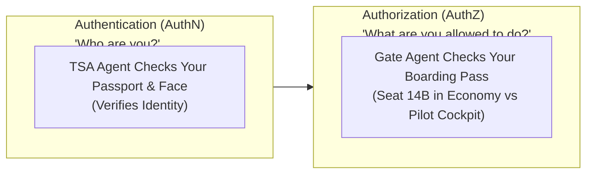
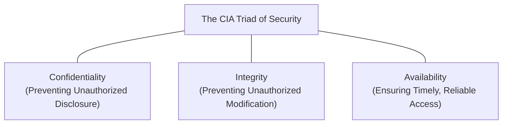
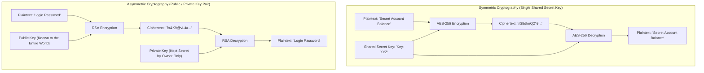
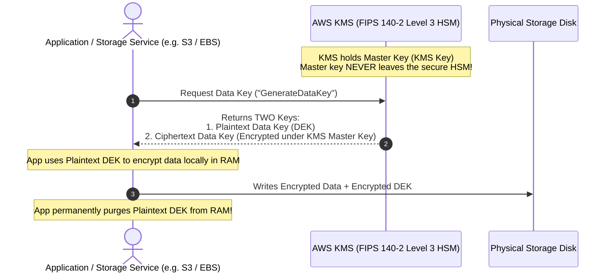

# 04. Security & Cryptography Foundations Prerequisite

> **Module:** Prerequisites & Foundational Computer Science Concepts  
> **Course:** AWS Certified Cloud Practitioner (`CLF-C02`)  
> **Target Audience:** Trainees, students, and career switchers entering cloud computing without prior cybersecurity background.

---

## 🧭 Executive Summary & Core Objective

Security is **"Job Zero"** at AWS. More than 30% of the entire AWS Certified Cloud Practitioner exam directly evaluates your understanding of security, identity governance, access policies, compliance frameworks, and encryption.

Before you can understand **AWS Identity and Access Management (IAM)**, **AWS KMS (Key Management Service)**, or **AWS Shield**, you must master foundational cybersecurity concepts: the **CIA Triad**, the vital distinction between **Authentication** and **Authorization**, **Symmetric vs. Asymmetric encryption**, and how **Envelope Encryption** safeguards petabytes of enterprise data in the cloud.

---

## 🏛️ Pillar 1: The Intuitive Real-World Analogies

### 1. Authentication (AuthN) vs. Authorization (AuthZ): The Airport Analogy
Students frequently confuse these two distinct security checkpoints:

- **Authentication (AuthN):** Proving *who you are*. When you present your government passport to the TSA security screener, they match your face to the photo. They do not care which flight you are taking; they are solely verifying your identity.
  - *In AWS:* Entering your root email and password, supplying an MFA code, or presenting an SSH private key.
- **Authorization (AuthZ):** Determining *what you are allowed to access*. Once inside the airport terminal, you walk up to Flight 104. The gate agent scans your boarding pass. It authorizes you to enter the plane and sit in seat 14B. It does NOT authorize you to enter the cockpit, steer the airplane, or open the cargo hold.
  - *In AWS:* An **IAM Policy** evaluating whether your verified user is permitted to read an S3 bucket (`s3:GetObject`) or terminate a virtual server (`ec2:TerminateInstances`).

### 2. Symmetric vs. Asymmetric Encryption: The Padlock vs. The Street Mailbox
- **Symmetric Encryption = A Heavy Steel Padlock with Duplicate Brass Keys:**
  - You lock a wooden chest with a padlock. Your trusted partner has an identical copy of the key. You can lock it; they can unlock it.
  - *Advantage:* Fast and simple.
  - *Fatal Flaw:* How do you safely deliver the physical brass key to a business partner in Tokyo without a courier stealing it along the way?
- **Asymmetric Encryption = A Public Street Mailbox Slot:**
  - The mailbox on the street corner has an open drop slot (**The Public Key**). Anyone walking down the street can drop a confidential letter inside the box.
  - However, once the letter drops through the slot, no passerby on the street can reach back in to read it.
  - Only the authorized postal carrier with the unique physical master key (**The Private Key**) can open the back door and retrieve the mail.

---

## ⚙️ Pillar 2: First-Principles Cybersecurity Mechanics

### 1. The CIA Triad of Information Security
Every security control in computer science exists to protect one or more pillars of the **CIA Triad**:

- **Confidentiality:** Keeping secret data secret. Only authorized identities can view the data.
  - *AWS Mechanisms:* Encryption at rest (KMS), encryption in transit (TLS/HTTPS), IAM least-privilege policies, S3 Block Public Access.
- **Integrity:** Ensuring data has not been corrupted, altered, or tampered with by malicious actors or network glitches.
  - *AWS Mechanisms:* Cryptographic checksums (SHA-256, MD5), S3 Object Lock (WORM - Write Once, Read Many), AWS CloudTrail immutable audit logs.
- **Availability:** Ensuring authorized users have uninterrupted access to applications and data when needed.
  - *AWS Mechanisms:* Multi-Availability Zone architectures, Auto Scaling Groups, Elastic Load Balancers, AWS Shield DDoS mitigation.

### 2. Cryptographic Primitives: Hashing vs. Encryption
Students often use "hashing" and "encryption" interchangeably. They are fundamentally different mathematical operations:

| Dimension | Cryptographic Hashing | Encryption |
|:---|:---|:---|
| **Mathematical Nature** | **One-Way Function.** Impossible to reverse mathematically. | **Two-Way Function.** Plaintext $\leftrightarrow$ Ciphertext reversible with a key. |
| **Output Size** | **Fixed Length** regardless of input size (e.g., SHA-256 always produces a 256-bit string). | **Variable Length** proportional to input data size. |
| **Key Required?** | **No key required** (deterministic mathematical algorithm). | **Secret Key required** for encryption and decryption. |
| **Primary Purpose** | Verifying **Integrity** and storing password hashes securely. | Guaranteeing **Confidentiality** across networks or disks. |
| **Example Algorithms** | SHA-256, SHA-3, MD5. | AES-256, RSA-4096, ECC. |
| **AWS Usage** | S3 object ETag checksums, API request signatures (SigV4). | AWS KMS, EBS volume encryption, TLS certificates. |

---

## 🔐 Pillar 3: Symmetric vs. Asymmetric Cryptography

### Deep Comparison

| Dimension | Symmetric Encryption | Asymmetric Encryption |
|:---|:---|:---|
| **Keys Involved** | **1 Single Key** (Used for both encryption and decryption). | **2 Keys (A Key Pair)** (Public Key encrypts; Private Key decrypts). |
| **Computational Speed** | **Blazing Fast.** Minimal CPU mathematical overhead. | **Slow.** 100 to 1,000 times slower than symmetric encryption. |
| **Primary Purpose** | **Bulk Data Encryption at Rest** (encrypting terabytes of databases, disk volumes, files). | **Key Exchange, Digital Signatures & Identity Verification** (TLS handshakes, SSH logins). |
| **Standard Algorithms** | **AES-256** (Advanced Encryption Standard with 256-bit keys), ChaCha20. | **RSA** (2048/4096-bit), **ECC** (Elliptic Curve Cryptography). |
| **AWS Usage** | **Amazon S3 SSE-S3**, Amazon EBS volume encryption, Amazon RDS encryption. | **AWS Certificate Manager (ACM)**, EC2 Key Pairs (`.pem` files for SSH). |

---

## 🌐 Pillar 4: Data in Transit vs. Data at Rest

In enterprise cloud security audits, data is categorized into two distinct states:

### 1. Data at Rest
- **Definition:** Data sitting persistently on physical storage media (EBS block volumes, S3 buckets, RDS database tables, EFS file systems, or backup tapes).
- **The Threat:** Physical theft of disks from a datacenter, or unauthorized low-level hardware inspection.
- **How AWS Protects Data at Rest:**
  - Automated hardware-level encryption using **AES-256**.
  - Integrated with **AWS Key Management Service (AWS KMS)**.
  - Zero performance impact on modern hardware due to dedicated crypto-processors in the **AWS Nitro System**.

### 2. Data in Transit (Data in Motion)
- **Definition:** Data traveling across physical network cables, public internet backbones, or between AWS microservices.
- **The Threat:** "Man-in-the-Middle" (MitM) eavesdropping, packet sniffing on public Wi-Fi, or rogue network router inspection.
- **How AWS Protects Data in Transit:**
  - **Transport Layer Security (TLS / HTTPS):** Encrypts web traffic between end users and AWS services using SSL/TLS digital certificates issued by **AWS Certificate Manager (ACM)**.
  - **IPsec VPN:** Encrypted virtual tunnels for hybrid connections (**AWS Site-to-Site VPN**).
  - **Inter-Region Encryption:** All traffic traveling between AWS Regions across the AWS global fiber backbone is automatically encrypted at the physical link layer.

---

## 📦 Pillar 5: How AWS Implements Encryption: Envelope Encryption & AWS KMS

### The Architectural Problem with Centralized Encryption
Imagine an enterprise with 500 terabytes of database backups in Amazon S3. If S3 had to transmit all 500 TB over the network to a central security server just to encrypt or decrypt the data:
1. Network bandwidth would completely saturate.
2. The security server CPU would melt under the mathematical load.
3. Transmitting raw master keys across the internal network would create an enormous security vulnerability.

### The Solution: Envelope Encryption
AWS solves this problem using **Envelope Encryption** powered by **AWS Key Management Service (AWS KMS)**:

### The 5 Steps of Envelope Encryption:
1. **The KMS Master Key Stays Locked:** AWS KMS stores customer master keys inside dedicated **Hardware Security Modules (HSMs)**. The plaintext master key **NEVER leaves the physical HSM hardware**.
2. **KMS Generates a Data Key:** When an instance or S3 bucket wants to encrypt a file, it calls KMS: `GenerateDataKey`. KMS returns:
   - A **Plaintext Data Key (DEK)**.
   - A **Ciphertext Data Key** (the DEK encrypted under the master KMS key).
3. **Local Encryption in Memory:** The application uses the *Plaintext DEK* to encrypt the large file locally in RAM with blazing-fast AES-256 symmetric encryption.
4. **Purging the Plaintext Key:** The moment encryption finishes, the application **permanently deletes the Plaintext DEK from RAM**.
5. **Storing the Envelope:** The *Ciphertext DEK* (the encrypted key) is stored directly alongside the encrypted data file on disk.
   - *To Decrypt:* The application sends the Ciphertext DEK back to KMS. KMS decrypts the key inside its hardware and returns the plaintext key so the application can read the file.

---

## ⚖️ AWS Security Tools Comparison: The "Four Guardians"

Students frequently confuse the distinct security services in AWS. This comparison table clarifies their specific operational roles:

| Security Service | Primary Role & Layer | How It Works Under the Hood | Key Exam Trigger Words |
|:---|:---|:---|:---|
| **AWS KMS** | **Cryptographic Key Management** | Multi-tenant managed service generating and controlling encryption keys (FIPS 140-2 Level 2/3). | *"Envelope encryption"*, *"Encrypt EBS/S3 data at rest"*, *"Customer Managed Keys"*. |
| **AWS CloudHSM** | **Dedicated Hardware Appliance** | Single-tenant physical Hardware Security Module dedicated entirely to you. You maintain exclusive admin control. | *"Dedicated single-tenant hardware"*, *"FIPS 140-2 Level 3 compliance"*, *"Corporate policy requires exclusive key control"*. |
| **AWS Secrets Manager** | **Credential Storage & Auto-Rotation** | Stores, retrieves, and automatically rotates database passwords, API tokens, and OAuth keys. | *"Rotate database credentials automatically"*, *"RDS password rotation without code changes"*. |
| **Systems Manager Parameter Store** | **Configuration & String Storage** | Hierarchical key-value store for license codes, environment configs, and plain/encrypted strings (no automatic rotation). | *"Store license keys / environment variables"*, *"Low-cost configuration storage"*. |
| **AWS WAF** | **Layer 7 Web Application Firewall** | Filters malicious web requests (SQL Injection, Cross-Site Scripting, IP rate limits) on CloudFront, ALB, API Gateway. | *"Block SQL Injection (SQLi)"*, *"Block Cross-Site Scripting (XSS)"*, *"Layer 7 web filtering"*. |
| **AWS Shield** | **Layer 3 / 4 DDoS Protection** | Defends against Distributed Denial of Service attacks. Shield Standard is free; Shield Advanced includes 24/7 DDoS Response Team (SRT). | *"DDoS mitigation"*, *"SYN floods / UDP reflection attacks"*, *"DDoS cost protection"*. |
| **Amazon GuardDuty** | **Intelligent Threat Detection** | Analyzes VPC Flow Logs, CloudTrail Management Events, and DNS logs using Machine Learning to detect compromised accounts or crypto-mining. | *"Intelligent threat detection"*, *"Detect compromised instances or unauthorized behavior using ML"*. |
| **Amazon Inspector** | **Automated Vulnerability Scanning** | Scans EC2 instances, ECR container images, and Lambda functions for software vulnerabilities (CVEs) and unintended network exposure. | *"Automated vulnerability management"*, *"Scan EC2 for software CVEs and open ports"*. |
| **Amazon Macie** | **Data Privacy & PII Discovery** | Scans Amazon S3 buckets using pattern matching and ML to discover sensitive Personally Identifiable Information (PII) like credit cards. | *"Discover sensitive data in S3"*, *"Identify Personally Identifiable Information (PII)"*, *"GDPR compliance"*. |

---

## 🎯 Exam Scenario Decryption & Traps (CLF-C02)

### 1. Key Exam Trigger Phrases

| Exam Trigger Phrase | Correct Security Service | Distractor Trap to Avoid |
|:---|:---|:---|
| *"Automatically rotate database credentials without requiring application downtime"* | **AWS Secrets Manager** | Do not pick Parameter Store; Parameter Store does not natively rotate credentials. |
| *"Scan Amazon S3 buckets to identify exposed Personally Identifiable Information (PII) such as credit card numbers"* | **Amazon Macie** | Do not pick GuardDuty or Inspector; Macie specifically searches S3 object data for PII. |
| *"Continuous automated security assessments of EC2 instances to check for known software vulnerabilities (CVEs)"* | **Amazon Inspector** | Do not pick GuardDuty; GuardDuty detects active threats/attacks. Inspector scans code/packages for known bugs. |
| *"Protect web applications from common web exploits like SQL Injection and Cross-Site Scripting"* | **AWS WAF** | Do not pick Shield; Shield protects against volumetric DDoS attacks, not application-layer code exploits. |
| *"Dedicated, single-tenant physical hardware security module compliant with strict government regulations"* | **AWS CloudHSM** | Do not pick KMS; standard KMS is a multi-tenant managed service. |

### 2. Sample Exam Question Walkthrough

> **Scenario Question:**  
> A healthcare company stores patient intake records in an Amazon S3 bucket. Compliance officers are concerned that unencrypted records containing sensitive patient health information (PHI) and credit card numbers might be exposed to unauthorized users.  
> Which AWS service should the company use to automatically discover, classify, and protect sensitive personal data stored across its S3 buckets?
>
> - [A] Amazon GuardDuty
> - [B] Amazon Inspector
> - [C] Amazon Macie
> - [D] AWS Shield Advanced

**Detailed Answer Rationale:**
- **Correct Answer: [C] Amazon Macie**  
  *Why:* Amazon Macie is a fully managed data security and privacy service that uses machine learning and pattern matching to discover, monitor, and protect sensitive Personally Identifiable Information (PII) and protected health information (PHI) stored in Amazon S3 buckets.
- **Why [A] is Wrong:** Amazon GuardDuty monitors network telemetry (VPC Flow Logs, DNS logs, CloudTrail) to detect active threats like compromised credentials or crypto-mining malware; it does not read S3 object text to classify PII.
- **Why [B] is Wrong:** Amazon Inspector scans operating system packages on EC2 instances, container images, and Lambda code for known software vulnerabilities (CVEs); it does not scan S3 buckets for sensitive personal data.
- **Why [D] is Wrong:** AWS Shield Advanced provides enterprise protection against volumetric Layer 3 and Layer 4 Distributed Denial of Service (DDoS) attacks; it has no relationship with data privacy or S3 classification.

---

## 📝 Retention Self-Check Exercises

1. *Using the airport security analogy, explain the difference between Authentication (AuthN) and Authorization (AuthZ) in AWS.*
2. *Why does AWS KMS use Envelope Encryption rather than directly transmitting large files over the network to be encrypted by the master key?*
3. *What is the difference between AWS WAF and AWS Shield in terms of the OSI layers they defend and the types of attacks they prevent?*
4. *A financial institution requires automated rotation of its database administrator passwords every 30 days. Which AWS service should they choose, and why is Systems Manager Parameter Store not the ideal choice?*

---

*Next Prerequisite Module: [05_Cloud_Economics_and_FinOps.md](./05_Cloud_Economics_and_FinOps.md)*
