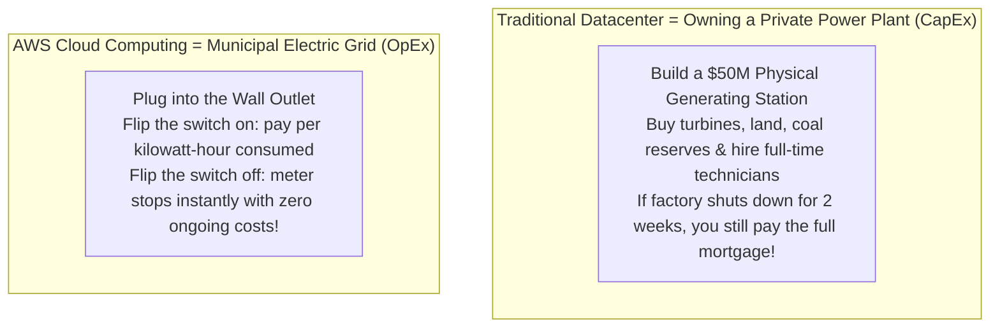
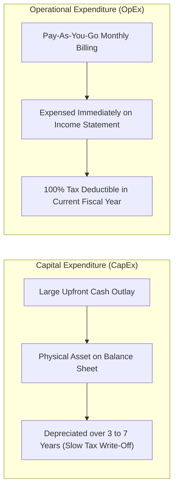
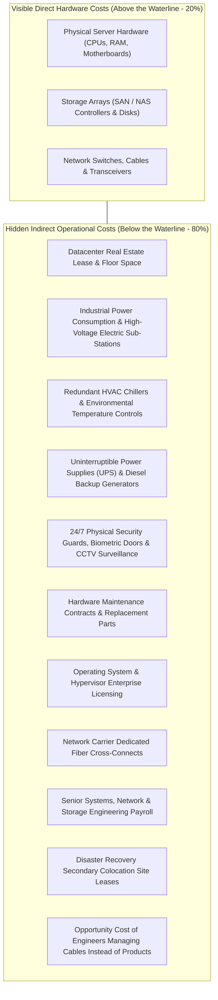
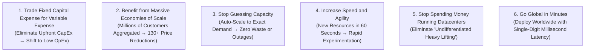
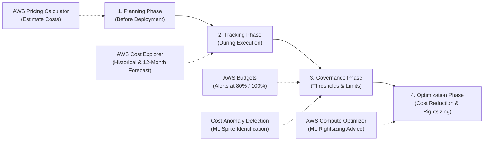

# 05. Cloud Economics & FinOps Prerequisite

> **Module:** Prerequisites & Foundational Computer Science Concepts  
> **Course:** AWS Certified Cloud Practitioner (`CLF-C02`)  
> **Target Audience:** Trainees, students, and career switchers entering cloud computing without prior corporate finance or cloud accounting background.

---

## 🧭 Executive Summary & Core Objective

Cloud computing is not merely an engineering revolution; it is fundamentally a **financial and operational transformation**. Technology executives do not migrate to AWS simply because virtual machines are exciting; they migrate because the cloud completely rewrites how corporate capital is allocated, how infrastructure risk is managed, and how fast a business can innovate.

Domain 4 of the CLF-C02 exam (Billing, Pricing, and Support) accounts for **12% to 16%** of your test score, but economic principles appear in every single domain. This prerequisite provides you with a rock-solid foundation in **CapEx vs. OpEx**, the **Total Cost of Ownership (TCO)** iceberg, the **6 Financial Advantages of AWS**, and the core cloud financial management (**FinOps**) tools.

---

## 🏛️ Pillar 1: The Intuitive Real-World Analogies

### 1. Municipal Electric Utility vs. Owning a Private Coal Power Plant

- **The Traditional Datacenter Model:** Imagine every factory had to construct its own private electrical power plant before manufacturing a single product. You would spend millions of dollars upfront buying turbines, purchasing land, and hiring round-the-clock maintenance engineers. If product demand collapsed, you were stuck with an expensive, depreciating power plant.
- **The AWS Cloud Model:** In the modern world, you do not build power plants; you plug your equipment into the wall outlet. When you need power, you flip the switch and pay a tiny fee per kilowatt-hour. When you turn the machine off, **the meter stops spinning immediately**. This is utility computing.

### 2. Buying a 50-Passenger Bus vs. Taking the City Subway
- If a startup needs to transport 3 employees to a meeting, they do not buy a 50-passenger charter bus (paying for vehicle financing, insurance, maintenance, and gas for 47 empty seats). They buy 3 individual subway tickets. As the team grows to 100 people, they simply buy more subway tickets. This is **elastic consumption**.

---

## ⚙️ Pillar 2: First-Principles Corporate Financial Mechanics

### 1. Capital Expenditures (CapEx) vs. Operational Expenditures (OpEx)
Corporate finance categorizes all enterprise spending into two fundamental accounting buckets:

#### Detailed Accounting & Financial Comparison

| Dimension | Capital Expenditure (CapEx) | Operational Expenditure (OpEx) |
|:---|:---|:---|
| **Accounting Definition** | Funds used by a company to acquire, upgrade, and maintain physical assets such as property, buildings, or datacenter hardware. | Day-to-day operating expenses incurred in the normal course of running a business. |
| **Payment Schedule** | **Heavy Upfront Investment.** Large lump-sum cash drain before production begins. | **Pay-As-You-Go.** Continuous, variable operational payments as services are consumed. |
| **Balance Sheet Impact** | Recorded as a **Fixed Asset** on the corporate balance sheet. | Recorded as an **Operating Expense** on the income statement. |
| **Tax Treatment** | Cannot be fully deducted in year one; must be **depreciated** over its useful economic lifetime (typically 3 to 5 years). | **100% deductible** from revenues in the current fiscal tax year, immediately reducing taxable corporate income. |
| **Capacity Risk** | **Extreme Financial Risk.** Sunk cost bias. If the project fails, the hardware cannot easily be liquidated at purchase value. | **Near-Zero Financial Risk.** If a project fails or traffic drops, terminate the virtual instances and all billing stops immediately. |
| **AWS Analogy** | Building an on-premises physical datacenter; purchasing Dell/HP server racks, SAN storage, and Cisco routers. | Provisioning Amazon EC2 instances, Amazon S3 storage, and Amazon RDS on-demand. |

---

## 🏔️ Pillar 3: Total Cost of Ownership (TCO) & The Datacenter Iceberg

When executive leadership compares the cost of on-premises servers to AWS, novice managers often make a fatal mistake: they only compare the price of a physical server to an EC2 instance. This ignores the **Total Cost of Ownership (TCO) Iceberg**:

### Direct Costs vs. Indirect Costs:
- **Direct Costs (The Tip of the Iceberg):** The invoice for physical servers, network switches, and hard drives.
- **Indirect & Operational Costs (The Submerged Mass):** 
  - Electricity ($/kWh) required to run servers 24/7/365.
  - Electricity required to power giant HVAC cooling units to keep server rooms from melting.
  - Periodic diesel fuel delivery and generator load-bank testing.
  - The massive annual salaries of systems engineers whose time is wasted swapping bad hard drives, running cat-6 cables, and troubleshooting power supplies instead of writing customer-facing software features (**Opportunity Cost**).
- **The AWS Advantage:** AWS absorbs 100% of the hidden submerged costs, delivering fully managed infrastructure through a simple, transparent usage bill.

---

## 🏆 Pillar 4: The 6 Core Financial & Strategic Advantages of AWS Cloud

Every cloud practitioner must memorize and understand the official **6 Advantages of Cloud Computing**:

### Detailed Breakdown of the 6 Advantages:

1. **Trade Fixed Capital Expense for Variable Expense:**
   - Rather than investing millions of dollars into physical datacenter construction before writing a single line of business code, you pay only for the compute and storage resources you actually consume.
2. **Benefit from Massive Economies of Scale:**
   - Because AWS aggregates hundreds of thousands of active customers across 30+ geographic regions, AWS purchases computer chips, server hardware, and utility power at massive wholesale discounts that no single private corporation could ever achieve. AWS systematically passes these savings back to customers (resulting in **over 130+ voluntary price cuts** since AWS was founded).
3. **Stop Guessing Capacity:**
   - In on-premises datacenters, you must forecast capacity years in advance:
     - If you *underestimate* demand, your servers crash during Black Friday, resulting in catastrophic lost revenue and customer defection.
     - If you *overestimate* demand, you burn capital paying for 90% idle servers.
   - In AWS, applications automatically scale up during traffic spikes and scale back down when traffic subsides (**Elasticity**).
4. **Increase Speed and Agility:**
   - Procuring a physical server in an enterprise takes 10 to 16 weeks. In AWS, an engineer can spin up 500 virtual servers with a single API call or CLI command in **less than 60 seconds**. This reduces the cost of business experimentation to near zero.
5. **Stop Spending Money Running and Maintaining Datacenters:**
   - Amazon refers to the physical chores of hardware management (racking servers, cabling patch panels, replacing burned-out power supplies, cooling rooms) as **"undifferentiated heavy lifting."** These tasks do not give your company a competitive edge. By offloading hardware management to AWS, your engineering talent focuses exclusively on software and customer innovation.
6. **Go Global in Minutes:**
   - AWS operates a global footprint spanning dozens of geographic **Regions** connected by dedicated private subsea fiber optic networks. With a few clicks, an application developed in Virginia can be deployed simultaneously to Tokyo, Frankfurt, Sydney, and São Paulo, delivering ultra-low latency to global customers without establishing foreign legal entities or physical infrastructure.

---

## 🛠️ Pillar 5: AWS Cloud Financial Management (FinOps) Tools

AWS provides a dedicated suite of tools to help organizations plan, monitor, and optimize cloud spending:

### Deep Tool Comparison Matrix

| FinOps Tool | Primary Purpose | How It Works Under the Hood | When to Use (Exam Trigger) |
|:---|:---|:---|:---|
| **AWS Pricing Calculator** | **Pre-deployment cost estimation** | A free, public web modeling tool that allows you to calculate estimated monthly AWS bills before launching a single resource. | *"Estimate architecture costs before deploying to AWS"*, *"Model what-if pricing scenarios"*. |
| **AWS Cost Explorer** | **Historical analysis & spending forecasting** | Provides intuitive visual dashboards to filter, group, and analyze your AWS spending by service, tag, or region. Forecasts future spend up to **12 months in advance**. | *"Analyze historical spending patterns"*, *"Forecast cloud costs for the next 12 months"*, *"Visualize spending by tag"*. |
| **AWS Budgets** | **Spending limits & threshold alerting** | Allows you to define custom monthly budgets (dollars, usage, or reservation coverage). Sends automated notifications (Email / SNS) when actual or forecasted spend crosses threshold percentages (e.g. 80%). | *"Send email alert when spending exceeds a predefined monthly threshold"*, *"Track reservation utilization"*. |
| **AWS Cost Anomaly Detection** | **Automated anomaly alerting** | An advanced machine learning feature that continuously analyzes billing telemetry to detect unusual spending spikes (e.g., a misconfigured script spawning hundreds of unintended instances) and pinpoints root cause. | *"Automatically detect unusual billing spikes using machine learning"*, *"Identify root cause of unexpected cost jumps"*. |
| **AWS Compute Optimizer** | **Automated rightsizing recommendations** | Uses machine learning to evaluate historical CloudWatch utilization metrics (CPU, memory, storage) and recommends optimal instance types to eliminate over-provisioned waste. | *"Recommend optimal instance types to reduce cost without sacrificing performance"*, *"Rightsizing advice via ML"*. |

---

## 🎯 Exam Scenario Decryption & Traps (CLF-C02)

### 1. Key Exam Trigger Phrases

| Exam Trigger Phrase | Correct FinOps Tool / Advantage | Distractor Trap to Avoid |
|:---|:---|:---|
| *"Estimate monthly infrastructure costs for a proposed cloud migration before provisioning resources"* | **AWS Pricing Calculator** | Do not pick Cost Explorer; Cost Explorer requires historical spending data! |
| *"Forecast cloud expenditures up to 12 months in advance based on historical usage patterns"* | **AWS Cost Explorer** | Do not pick Pricing Calculator; Cost Explorer generates automated predictive forecasts. |
| *"Send an alert to finance managers when monthly spending is projected to exceed \$10,000"* | **AWS Budgets** | Do not pick Cost Explorer or CloudWatch Billing Alarms alone; Budgets allows complex threshold modeling. |
| *"Identify over-provisioned EC2 instances that can be downsized to save money"* | **AWS Compute Optimizer** | Do not pick Cost Explorer; Compute Optimizer uses machine learning to recommend specific instance size changes. |
| *"Eliminate the need to forecast server demand years in advance"* | **Stop guessing capacity** | One of the official 6 Advantages of Cloud Computing. |

### 2. Sample Exam Question Walkthrough

> **Scenario Question:**  
> A startup is designing a new mobile backend and wants to project its monthly infrastructure costs across Amazon EC2, Amazon S3, and Amazon DynamoDB before launching the system in production.  
> Which AWS tool should the startup use to generate these financial projections?
>
> - [A] AWS Cost Explorer
> - [B] AWS Budgets
> - [C] AWS Pricing Calculator
> - [D] AWS Compute Optimizer

**Detailed Answer Rationale:**
- **Correct Answer: [C] AWS Pricing Calculator**  
  *Why:* The AWS Pricing Calculator is a free, interactive web-based planning tool designed specifically for modeling prospective architecture costs and generating detailed monthly financial estimates **before** any AWS resources are launched.
- **Why [A] is Wrong:** AWS Cost Explorer is an analytics tool that operates on *historical* billing data and past usage trends. A startup that has not yet deployed resources has zero historical data in Cost Explorer.
- **Why [B] is Wrong:** AWS Budgets is an operational alerting and governance tool used to monitor live accounts and trigger alerts when live spending crosses thresholds; it does not calculate initial architecture build estimates.
- **Why [D] is Wrong:** AWS Compute Optimizer requires active, running workloads with historical CloudWatch telemetry to evaluate CPU and memory utilization and recommend rightsizing changes.

---

## 📝 Retention Self-Check Exercises

1. *What is the fundamental difference between Capital Expenditures (CapEx) and Operational Expenditures (OpEx) from both an accounting balance sheet and tax perspective?*
2. *Describe the "Datacenter Iceberg" and name at least four indirect operational costs that on-premises datacenters require that AWS eliminates.*
3. *Recite the 6 Core Financial and Strategic Advantages of AWS Cloud Computing from memory.*
4. *If a project manager wants to know how much an architecture will cost next month before building it, which tool do they use? If they want to know how much the architecture cost over the last 6 months, which tool do they use?*

---

*Prerequisites Module Complete! Proceed to Core Course Curriculum: [03_Lectures/Lecture_01_Introduction_to_Cloud_and_Global_Infra.md](../03_Lectures/Lecture_01_Introduction_to_Cloud_and_Global_Infra.md)*
