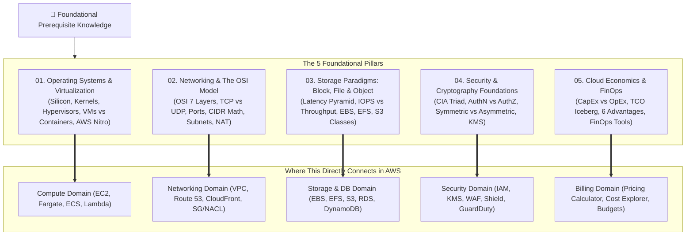

# 🧱 Cloud Practitioner (CLF-C02) Prerequisite Knowledge Guide

> **Module:** Prerequisites & Foundational Computer Science Concepts  
> **Course:** AWS Certified Cloud Practitioner (`CLF-C02`)  
> **Target Audience:** Trainees, students, and career switchers entering cloud computing without prior systems engineering, networking, or corporate finance background.  
> **Pedagogical Standard:** Full 6-Pillar Deep-Explanation Framework (Real-World Analogies, First-Principles Mechanics, Historical Context, AWS Under-the-Hood Engineering, Trade-Off Matrices, and Exam Scenario Decryptions).

---

## 🧭 Welcome & Learning Orientation

Welcome to the **Prerequisite Foundations** for the AWS Certified Cloud Practitioner certification!

Many students fail or struggle with cloud certifications not because AWS services are complicated, but because AWS services are built on top of **fundamental computer science and enterprise IT concepts** that courses often assume you already know. 

If you do not understand what a CPU register or a hypervisor does, Amazon EC2 and AWS Fargate will feel abstract. If you do not understand IP addresses, CIDR blocks, and ports, Amazon VPC and Security Groups will seem intimidating. If you do not understand the difference between CapEx and OpEx, cloud pricing models will look like arbitrary numbers.

This module levels the playing field. Whether you have an English literature degree, a background in marketing, or are a seasoned executive, these five guides build your technical intuition from the ground up using **real-world physical analogies, first-principles mechanics, and zero unexplained jargon**.

---

## 🗺️ Foundational Concepts Visual Mindmap

---

## 🔍 Self-Diagnostic: "Do I Need to Study the Prerequisites?"

Ask yourself the following 5 questions. If you cannot answer any one of them with absolute confidence, study that specific prerequisite document before advancing to the core lectures:

1. **Systems Architecture:** *What is the fundamental difference between what a Virtual Machine virtualizes versus what a Docker container virtualizes?*  
   → If unsure, read [**01_Operating_Systems_and_Virtualization.md**](./01_Operating_Systems_and_Virtualization.md).
2. **Networking:** *In AWS, why does a `/24` subnet yield exactly 251 usable IP addresses instead of 256, and what is the difference between a stateful Security Group and a stateless Network ACL?*  
   → If unsure, read [**02_Networking_and_OSI_Model.md**](./02_Networking_and_OSI_Model.md).
3. **Storage:** *Why can an Amazon EBS volume in `us-east-1a` NOT be attached to an EC2 instance in `us-east-1b`, and why would an enterprise choose S3 Intelligent-Tiering over Standard-IA?*  
   → If unsure, read [**03_Storage_Paradigms.md**](./03_Storage_Paradigms.md).
4. **Security:** *Using a real-world analogy, explain the difference between Authentication (AuthN) and Authorization (AuthZ), and how AWS KMS Envelope Encryption works.*  
   → If unsure, read [**04_Security_and_Cryptography.md**](./04_Security_and_Cryptography.md).
5. **Economics:** *What is the difference between CapEx and OpEx from both a corporate balance sheet and income tax perspective, and what are the hidden costs of the "Datacenter Iceberg"?*  
   → If unsure, read [**05_Cloud_Economics_and_FinOps.md**](./05_Cloud_Economics_and_FinOps.md).

---

## 📚 Prerequisite Modules Detailed Directory

| Document | Topic | What You Will Learn | Primary Real-World Analogy | Target AWS Services |
|:---|:---|:---|:---|:---|
| **[01_Operating_Systems_and_Virtualization.md](./01_Operating_Systems_and_Virtualization.md)** | Systems Architecture & Virtualization | Von Neumann architecture, CPU rings, bare-metal pain, Type-1 vs Type-2 hypervisors, VMs vs Containers, AWS Nitro System architecture, EC2 tenancy options. | Single-family house vs Apartment complex vs Capsule hotel | **Amazon EC2**, **AWS Nitro**, **AWS Fargate**, **Amazon ECS/EKS** |
| **[02_Networking_and_OSI_Model.md](./02_Networking_and_OSI_Model.md)** | Computer Networking & Protocols | The OSI 7-layer model, TCP 3-way handshake vs UDP, port numbers, IPv4 structure, CIDR subnetting math, 5 AWS reserved IPs, Public vs Private RFC 1918 IPs, NAT Gateways, Security Groups vs NACLs. | Postal mail delivery with tracking numbers and zip codes | **Amazon VPC**, **Subnets**, **Route Tables**, **Security Groups**, **NACLs**, **Route 53** |
| **[03_Storage_Paradigms.md](./03_Storage_Paradigms.md)** | Storage Architecture | Memory latency hierarchy, IOPS vs Throughput, Block vs File vs Object, EBS volume types (`gp3`/`io2`), Instance Store ephemeral risk, EFS multi-AZ NFS mounts, S3 object architecture, S3 storage tiers, 11 9s durability. | Personal notebook vs Shared office filing cabinet vs Coat-check valet | **Amazon EBS**, **Instance Store**, **Amazon EFS**, **Amazon S3** |
| **[04_Security_and_Cryptography.md](./04_Security_and_Cryptography.md)** | Information Security & Cryptography | The CIA Triad, Hashing vs Encryption, AuthN vs AuthZ, Symmetric AES-256 vs Asymmetric RSA, Data at Rest vs In Transit, AWS KMS Envelope Encryption, Security Guardians comparison (KMS vs CloudHSM vs WAF vs Shield vs GuardDuty vs Inspector vs Macie). | Airport Security (Passport vs Boarding Pass) & Brass padlock vs Street mailbox | **AWS IAM**, **AWS KMS**, **AWS CloudHSM**, **AWS WAF**, **AWS Shield**, **Amazon GuardDuty** |
| **[05_Cloud_Economics_and_FinOps.md](./05_Cloud_Economics_and_FinOps.md)** | Cloud Financial Management | CapEx vs OpEx accounting, balance sheet depreciation, Total Cost of Ownership (TCO) Iceberg, the 6 Financial Advantages of Cloud, AWS Pricing Calculator vs Cost Explorer vs Budgets vs Compute Optimizer. | Private coal power plant vs Municipal electric wall outlet | **AWS Pricing Calculator**, **AWS Cost Explorer**, **AWS Budgets**, **AWS Compute Optimizer** |

---

## 🎯 How to Study This Module Effectively

Follow this recommended 3-step reading approach:
1. **Read the Analogies First:** Focus on the real-world physical parallels to anchor your mental model.
2. **Review the Trade-Off Matrices:** Study the side-by-side comparison tables. The CLF-C02 exam tests your ability to choose the *best* option for a given scenario based on cost, latency, or compliance.
3. **Solve the Exam Scenario Walkthroughs:** Read the sample exam question at the end of each document and explain *why* each distractor is wrong before checking the answer rationale.

---

*Once you have completed these foundational prerequisite modules, you are ready to begin the core lecture curriculum: [../03_Lectures/Lecture_01_Introduction_to_Cloud_and_Global_Infra.md](../03_Lectures/Lecture_01_Introduction_to_Cloud_and_Global_Infra.md)*
