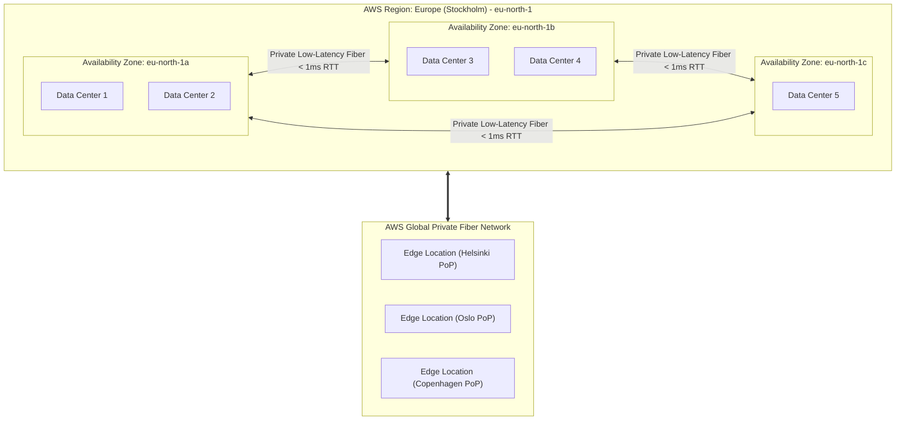

# Lecture 01: Introduction to Cloud Computing, Economics & Global Infrastructure

> **Course Track:** AWS Certified Cloud Practitioner (`CLF-C02`)  
> **Target Exam Domain:** Domain 1: Cloud Concepts (24% of Exam Blueprint)  
> **Estimated Delivery Duration:** 90 Minutes  
> **Associated Slide Deck:** [`04_Slides/Module_01_Cloud_Concepts_and_Architecture_Slides.md`](../04_Slides/Module_01_Cloud_Concepts_and_Architecture_Slides.md)  
> **Target Hands-On Lab:** [`07_Hands_On_Labs/00_Account_Creation_Walkthrough.md`](../07_Hands_On_Labs/00_Account_Creation_Walkthrough.md)  
> **Student Explanations:** [`06_Explanations/01_Cloud_Concepts/`](../06_Explanations/01_Cloud_Concepts/)

---

## 📚 Prescribed Literature Grounding & Reading Assignments

Before teaching or attending this lecture, review the assigned chapters across our canonical 2026 literature library:
* **Tom Taulli (*O'Reilly 2026, 1st Ed.*):**
  * Chapter 1: *Introduction to the AWS Certified Cloud Practitioner Exam* (pp. 1–12)
  * Chapter 2: *Getting Started with AWS: Free Tier & Console* (pp. 15–24)
  * Chapter 3: *Cloud Computing Foundations: IaaS, PaaS, SaaS, Deployment Models* (pp. 25–40)
  * Chapter 4: *Fundamentals of AWS: TCO, CapEx vs OpEx, 6 Rs, CAF, Well-Architected* (pp. 41–64)
  * Chapter 8: *AWS Global Infrastructure: Regions, AZs, Edge Locations, Local Zones* (pp. 115–132)
* **Rajesh Daswani (*Packt 2026, 2nd Ed.*):**
  * Chapter 1: *Real-World Application – Customer Scenario ("Belly Brew Co.")* (pp. 3–18)
  * Chapter 2: *What Is Cloud Computing? The 6 Advantages* (pp. 19–36)
  * Chapter 3: *Introduction to AWS and the Global Infrastructure* (pp. 37–56)
* **Gaurav H Kankaria (*Orange Education 2026, 2nd Ed.*):**
  * Chapter 1: *Introduction to AWS Cloud Practitioner Exam* (pp. 1–14)
  * Chapter 2: *Understanding Cloud Computing* (pp. 15–28)
  * Chapter 3: *Introduction to AWS and Global Infrastructure* (pp. 29–46)

---

## ⏱️ Detailed 90-Minute Delivery Schedule & Pacing

```text
00:00 - 00:15 | Welcome, Course Roadmap, Exam Blueprint Anatomy (65Q, 90 mins, 700/1000 scaled score)
00:15 - 00:35 | What is Cloud Computing? Traditional IT vs AWS & The 6 Advantages (Physical Analogies)
00:35 - 00:50 | Cloud Economics: CapEx to OpEx, TCO Iceberg Formula & Undifferentiated Heavy Lifting
00:50 - 01:10 | AWS Global Infrastructure: Regions, AZs, Edge Locations, Local Zones & Outposts
01:10 - 01:25 | Enterprise Governance: AWS CAF 3.0 (6 Perspectives) & The 7 Rs of Migration
01:25 - 01:30 | Socratic Knowledge Check & Transition to Lab 00 (Account Creation & Security Baseline)
```

---

## 🗣️ Instructor Delivery Talking Points & Storytelling

### 1. The Real-World Customer Anchor: "Belly Brew Co." (Daswani Ch 1)
* **Instructor Story:** Open the lecture by introducing a legacy manufacturing and beverage company, *Belly Brew Co.* They host their e-commerce storefront, distributor ordering system, and factory IoT analytics inside a basement server room in their headquarters.
* **The Business Crisis:** A sudden viral marketing campaign creates a 10x traffic spike on Black Friday. Their on-premises web server crashes under load because the IT team couldn't purchase, cable, and configure extra physical servers in time. Meanwhile, an overhead air conditioning line in the server room leaks, dripping water onto their core storage array and destroying three blade servers.
* **The Cloud Pivot:** Walk students through how migrating to AWS transforms their business from a fragile physical liability into an agile software-driven operation:
  1. *Stop Guessing Capacity:* Auto Scaling handles the Black Friday spike dynamically and shrinks back when traffic subsides.
  2. *Trade CapEx for OpEx:* Instead of paying \$200,000 upfront for replacement hardware, they pay variable pennies per hour for compute.
  3. *Eliminate Undifferentiated Heavy Lifting:* AWS maintains power, HVAC cooling, generator maintenance, and physical security.

---

### 2. Deep-Dive on the 6 Advantages of Cloud Computing
Grounded explanations to teach students the core business drivers tested on the exam:

1. **Trade fixed capital expense for variable expense (CapEx to OpEx):**
   * *Physical Analogy:* Booking a hotel suite vs buying an entire condominium. With a hotel, you have no 30-year mortgage, no property taxes, and no furniture purchases. You pay strictly for the nights you occupy the room.
   * *Exam Focus:* Eliminating large upfront infrastructure investments before knowing if a product will succeed.
2. **Benefit from massive economies of scale:**
   * *Teaching Point:* AWS aggregates demand across millions of active customers. This gives AWS unmatched purchasing power to buy servers, fiber optic cables, and utility power at massive wholesale discounts. AWS systematically passes these savings back to customers through **over 130+ proactive price reductions** since 2006.
3. **Stop guessing capacity:**
   * *The On-Premises Trap:* Traditional IT always forces a painful compromise: either overprovision (wasting corporate capital on idle servers 11 months a year) or underprovision (website crashes during peak seasonal sales). Cloud elasticity matches demand dynamically in real time.
4. **Increase speed and agility:**
   * *Teaching Point:* Contrast IT procurement lead time (12 to 16 weeks of purchase orders, supply chain delays, racking, and OS cabling) versus AWS API provisioning (< 60 seconds). Experimentation cost drops to near zero.
5. **Stop spending money running and maintaining data centers:**
   * *Key Concept:* *"Undifferentiated Heavy Lifting"*—tasks like replacing burned-out power supplies, maintaining diesel generators, and running copper patch cables cost immense engineering overhead but offer **zero competitive advantage** to a bakery, a fintech company, or a hospital.
6. **Go global in minutes:**
   * *Teaching Point:* A single developer sitting in Stockholm can deploy a production-grade multi-tier web application to Tokyo (`ap-northeast-1`) in under 5 minutes with single-digit millisecond latency to local Asian customers.

---

### 3. Whiteboard Architecture: Region vs. Availability Zone vs. Edge Location

Draw this architecture diagram on the classroom whiteboard:



#### Core Rules to Drill into Students:
* **Rule 1: An AWS Region is NOT a single data center.** It is a physical geographic location in the world containing at least **three discrete, isolated Availability Zones**.
* **Rule 2: An Availability Zone is NOT a single server.** An AZ consists of **one or more physical data centers**, each with independent power, cooling, water mains, and physical security.
* **Rule 3: AZs are physically separated by distance.** They are separated by tens of kilometers (far enough to prevent a localized disaster like a flood or power grid collapse from taking down multiple AZs), but close enough to maintain **sub-millisecond latency** over dedicated private fiber connections.
* **Rule 4: Edge Locations are NOT for hosting EC2 instances.** They are caching endpoints for **Amazon CloudFront (CDN)** and DNS resolution for **Amazon Route 53**, deployed in hundreds of metropolitan cities globally to serve content closer to end users.

---

### 4. Edge Extension Constructs: Local Zones, Wavelength, and Outposts
When applications cannot tolerate the transit latency back to a full AWS Region:
* **AWS Local Zones:** Places compute, storage, and database services close to large population or industrial centers where no full AWS Region currently exists (e.g., Chicago, Dallas, Amsterdam, Bangkok), delivering sub-10ms latency for media streaming and local video editing.
* **AWS Wavelength:** Embeds AWS compute and storage hardware directly inside telecommunications 5G networks (e.g., Verizon, Vodafone), enabling single-digit millisecond latency for mobile gaming, autonomous vehicles, and AR/VR.
* **AWS Outposts:** Physical server racks manufactured, shipped, and maintained by AWS that are deployed directly inside the customer's on-premises private data center. Provides consistent AWS APIs and hardware on-premises.

---

### 5. Enterprise Governance: AWS CAF 3.0 & The 7 Rs of Migration

#### The AWS Cloud Adoption Framework (CAF 3.0) — 6 Perspectives:
1. **Business:** Business model innovation, ROI modeling, and customer value realization.
2. **People:** Workforce evolution, cross-functional agile teams, and cloud skills development.
3. **Governance:** Portfolio management, program management, and cloud financial management (FinOps).
4. **Platform:** Landing zones, cloud architecture standards, and Infrastructure as Code (IaC).
5. **Security:** Compliance auditing (HIPAA, PCI-DSS, GDPR), IAM least privilege, and automated guardrails.
6. **Operations:** Meeting business SLAs, incident management, observability, and disaster recovery.

#### The Four Phases of AWS CAF Transformation Journey:
1. **Envision:** Demonstrate how cloud accelerates business outcomes and align executive sponsors around prioritized transformation opportunities.
2. **Align:** Identify capability gaps across all 6 CAF perspectives, resolve cross-organizational dependencies, and build an actionable roadmap.
3. **Launch:** Deliver production pilot initiatives to demonstrate incremental business value quickly and refine processes before scaling.
4. **Scale:** Expand validated production pilots enterprise-wide to realize full business value at scale.

#### The 7 Rs of Cloud Migration:
1. **Rehost ("Lift and Shift"):** Move applications to EC2 without code changes using **AWS Application Migration Service (MGN)**. Fastest migration with lowest risk.
2. **Replatform ("Lift, Tinker and Shift"):** Make small core optimizations without changing application code (e.g., moving self-hosted MySQL to Amazon RDS).
3. **Repurchase ("Drop and Shop"):** Retire existing legacy software in favor of SaaS or AWS Marketplace offerings.
4. **Refactor / Re-architect:** Completely rewrite legacy code to take advantage of cloud-native serverless microservices (Lambda, Fargate, DynamoDB).
5. **Retain:** Keep legacy applications on-premises due to compliance or technical debt until ready to migrate.
6. **Retire:** Identify and decommission unneeded, redundant applications.
7. **Relocate:** Shift virtual machines at the hypervisor level to VMware Cloud on AWS without modifying operating systems or configurations.

---

## ❓ Socratic Classroom Check Questions (Ask Students Live)

1. *"A multinational healthcare enterprise operates in Sweden and must legally ensure customer medical records never leave national borders. Which AWS architectural choice guarantees compliance?"*
   * **Expected Answer:** Selecting the **Stockholm Region (`eu-north-1`)**. Emphasize: AWS never replicates customer data across regions without explicit customer configuration.
2. *"A business analyst claims that migrating to the cloud will automatically make their application fault-tolerant. Is that true?"*
   * **Instructor Response:** False! Under the Shared Responsibility Model, AWS provides resilient building blocks (Multi-AZ infrastructure), but the customer must actively architect their application across multiple AZs to achieve fault tolerance.
3. *"Which migration strategy offers the fastest path to cloud migration with the lowest technical risk?"*
   * **Expected Answer:** **Rehost (Lift-and-Shift)** using AWS Application Migration Service (MGN).

---

## 🎯 Authentic Exam Practice & Case Scenarios

> High-yield scenario questions from the authentic candidate practice pool reinforcing the core competencies of this lecture.

### Scenario Practice 1: CLF-C02-ET-Q025
**Question:**  
Which design principles are included in the reliability pillar of the AWS Well-Architected Framework? (Choose two.)

**Options:**
- [A] Automatically recover from failure.
- [B] Grant everyone access to increase AWS service quotas.
- [C] Stop guessing capacity.
- [D] Design applications to run in a single Availability Zone.
- [E] Plan to increase AWS service quotas first in a secondary AWS Region.

<details>
<summary><b>View Verified Answer & Complete Distractor Analysis</b></summary>

**Correct Answer:** `A` and `C`  
**Peer Consensus:** `100%` agreement.

**Architectural Rationale:**
- **Why [A] is Correct:** "Automatically recover from failure" is a foundational design principle of the Reliability pillar. Workloads should monitor Key Performance Indicators (KPIs) and trigger automated remediation (such as Auto Scaling or Route 53 health check failovers) without waiting for human intervention.
- **Why [C] is Correct:** "Stop guessing capacity" is explicitly listed in both the Reliability and Performance Efficiency pillars. In traditional IT, failure occurs when demand exceeds provisioned capacity; in AWS, monitoring demand and automating elasticity prevents outages.

**Distractor Analysis (Why other options are wrong):**
- **Why [B] is Wrong:** Granting everyone access violates the **Security Pillar** (Principle of Least Privilege). Service quotas should be managed centrally by authorized administrators via Service Quotas or AWS Organizations.
- **Why [D] is Wrong:** Designing applications to run in a single Availability Zone is an architectural anti-pattern that creates a single point of failure (SPOF), directly violating the Reliability pillar. Applications must be deployed across **multiple Availability Zones** for high availability.
- **Why [E] is Wrong:** Quotas must be planned and requested in the **primary Region** where production workloads execute. Requesting quotas only in a secondary region does not ensure reliability for active production traffic.

</details>

---

### Scenario Practice 2: CLF-C02-ET-Q029
**Question:**  
A company wants to deploy an application in multiple Availability Zones in a single AWS Region.  
Which benefit will this deployment provide to the company?

**Options:**
- [A] Improved connection performance for global customers
- [B] Resilient architecture and a highly available solution
- [C] Reduced overall data storage costs
- [D] Ability to shut down an Availability Zone during periods of low demand

<details>
<summary><b>View Verified Answer & Complete Distractor Analysis</b></summary>

**Correct Answer:** `B`  
**Peer Consensus:** `100%` agreement.

**Architectural Rationale:**
- **Why [B] is Correct:** Deploying across multiple Availability Zones protects the application against data center failures, power outages, and localized physical disruptions. If AZ-A suffers an outage, the application continues serving traffic seamlessly from AZ-B, delivering a **resilient and highly available (HA)** architecture.

**Distractor Analysis (Why other options are wrong):**
- **Why [A] is Wrong:** Multiple AZs within the *same* Region do not reduce latency for global users on other continents. To improve performance for global customers, you must use **Amazon CloudFront Edge Locations**, **AWS Global Accelerator**, or multi-Region deployments.
- **Why [C] is Wrong:** Multi-AZ deployments do not reduce storage costs; replicating data across multiple AZs (or running duplicate compute instances) slightly increases infrastructure cost in exchange for high availability.
- **Why [D] is Wrong:** Individual AWS customers do NOT have the ability to "shut down an Availability Zone." Availability Zones are managed exclusively by AWS infrastructure operations.

</details>

---

### Scenario Practice 3: CLF-C02-ET-Q097
**Question:**  
A company is designing workloads in the AWS Cloud. The company wants the workloads to perform their intended function correctly and consistently throughout their lifecycle.  
Which pillar of the AWS Well-Architected Framework does this goal represent?

**Options:**
- [A] Operational excellence
- [B] Security
- [C] Reliability
- [D] Performance efficiency

<details>
<summary><b>View Verified Answer & Complete Distractor Analysis</b></summary>

**Correct Answer:** `C`  
**Peer Consensus:** `100%` agreement.

**Architectural Rationale:**
- **Why [C] is Correct:** The official definition of the **Reliability Pillar** in the AWS Well-Architected Framework is: *"The ability of a workload to perform its intended function correctly and consistently when it’s expected to."* This encompasses foundational requirements, workload architecture, change management, and failure recovery.

**Distractor Analysis (Why other options are wrong):**
- **Why [A] is Wrong:** The Operational Excellence pillar focuses on running and monitoring systems to deliver business value, and continually improving processes and procedures (e.g., executing changes as code, learning from failures).
- **Why [B] is Wrong:** The Security pillar focuses on protecting data, systems, and assets through confidentiality, integrity checks, and privilege controls.
- **Why [D] is Wrong:** The Performance Efficiency pillar focuses on using computing resources efficiently to meet system requirements and maintaining that efficiency as demand changes and technologies evolve.

</details>

---

## 🚀 Post-Lecture Student Transition
* Direct students to read [`06_Explanations/01_Cloud_Concepts/Cloud_Economics_and_TCO.md`](../06_Explanations/01_Cloud_Concepts/Cloud_Economics_and_TCO.md) and [`06_Explanations/01_Cloud_Concepts/Global_Infrastructure.md`](../06_Explanations/01_Cloud_Concepts/Global_Infrastructure.md).
* Transition to hands-on practice: [`07_Hands_On_Labs/00_Account_Creation_Walkthrough.md`](../07_Hands_On_Labs/00_Account_Creation_Walkthrough.md).
