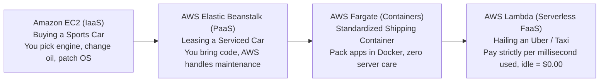

# Lecture 02: Compute Services, Virtualization, Containers & Serverless

> **Course Track:** AWS Certified Cloud Practitioner (`CLF-C02`)  
> **Target Exam Domain:** Domain 3: Cloud Technology & Services (34% of Exam Blueprint)  
> **Estimated Delivery Duration:** 90 Minutes  
> **Associated Slide Deck:** [`04_Slides/Module_02_Compute_Storage_and_Databases_Slides.md`](../04_Slides/Module_02_Compute_Storage_and_Databases_Slides.md)  
> **Target Hands-On Labs:** [`07_Hands_On_Labs/lab_03_ec2_compute_bootstrap.md`](../07_Hands_On_Labs/lab_03_ec2_compute_bootstrap.md) & [`07_Hands_On_Labs/lab_05_serverless_lambda_apigateway.md`](../07_Hands_On_Labs/lab_05_serverless_lambda_apigateway.md)  
> **Student Explanations:** [`06_Explanations/03_Technology_and_Services/Compute_Services.md`](../06_Explanations/03_Technology_and_Services/Compute_Services.md)

---

## 📚 Prescribed Literature Grounding & Reading Assignments

Before delivering or attending this lecture, review the assigned chapters:
* **Tom Taulli (*O'Reilly 2026, 1st Ed.*):**
  * Chapter 9: *AWS Compute, Containers, and Serverless* (pp. 133–158)
    * Amazon EC2 instances, Graviton custom silicon, pricing options (On-Demand, Spot, Savings Plans, RIs, Dedicated).
    * Container orchestration: Amazon ECS vs Amazon EKS vs AWS Fargate.
    * Serverless architecture: AWS Lambda event sources, execution limits, and pricing.
* **Rajesh Daswani (*Packt 2026, 2nd Ed.*):**
  * Chapter 8: *AWS Compute Services: EC2, Lightsail, ECS, EKS, and Lambda* (pp. 157–184)
    * Virtualization layers, instance metadata, User Data bootstrapping, container lifecycles.
* **Gaurav H Kankaria (*Orange Education 2026, 2nd Ed.*):**
  * Chapter 5: *AWS Core Services – Part I (Compute)* (pp. 47–68)
    * Step-by-step EC2 provisioning, instance states, and serverless compute models.

---

## ⏱️ Detailed 90-Minute Delivery Schedule & Pacing

```text
00:00 - 00:15 | Review Lecture 01 & The Compute Spectrum (IaaS vs PaaS vs CaaS vs FaaS)
00:15 - 00:40 | Amazon EC2 Deep-Dive: Instance Families, Graviton, User Data & Tenancy
00:40 - 00:55 | EC2 Purchasing Options: On-Demand, Savings Plans, RIs, Spot & Dedicated Hosts
00:55 - 01:15 | Containers in the Cloud: Docker, Amazon ECR, Amazon ECS, Amazon EKS & AWS Fargate
01:15 - 01:25 | Serverless Compute: AWS Lambda Mechanics, Triggers & 15-Minute Technical Limit
01:25 - 01:30 | Socratic Q&A & Transition to Lab 03 (EC2 Web Server Bootstrap)
```

---

## 🗣️ Instructor Delivery Talking Points & Storytelling

### 1. The Compute Continuum Analogy: Car Ownership to Public Transit



* **Amazon EC2 (IaaS):** Buying a personal sports car. You pick the engine and transmission. You must change the oil, rotate tires, and patch the engine (install OS security updates).
* **AWS Elastic Beanstalk (PaaS):** Leasing a fully serviced vehicle. You just bring your luggage (source code) and drive. AWS handles provisioning, load balancing, and scaling automatically.
* **AWS Fargate (Containers):** Riding in a standardized container taxi. You don't manage the chassis or tires, but you control what software packages are placed inside the container.
* **AWS Lambda (FaaS):** Hailing an on-demand electric scooter or Uber. You pay strictly for the exact seconds the wheels are spinning. When you reach your destination, the vehicle vanishes. Idle cost = \$0.00.

---

### 2. Amazon EC2 Instance Families (Memory Anchor Tricks)
Teach students this mental anchor to easily recognize instance families in exam scenarios:
* **G - General Purpose (`t3`, `m6i`, `m7g`):** Balanced compute, memory, and networking. Ideal for web servers, dev environments, small databases.
* **C - Compute Optimized (`c6i`, `c7g`):** High-performance CPUs. Ideal for batch processing, media transcoding, scientific modeling, gaming dedicated servers, and High Performance Computing (HPC).
* **M - Memory Optimized (`r6i`, `r7g`, `x2gd`):** High RAM-to-CPU ratio. Ideal for high-performance in-memory relational databases, real-time big data processing (Spark/SAP HANA), and distributed caches.
* **S - Storage Optimized (`i3en`, `d3`, `h1`):** Direct-attached NVMe storage. High sequential read/write IOPS. Ideal for distributed file systems, data warehouses, Elasticsearch.
* **A - Accelerated Computing (`p4`, `g5`):** Hardware GPU coprocessors. Machine learning training, AI inference, 3D graphics rendering.
* **AWS Graviton Processors:** ARM-based custom silicon engineered by AWS delivering up to **40% better price-performance** over comparable x86 processors.

---

### 3. Whiteboard Matrix: EC2 Pricing Options Decision Tree

Draw this high-yield matrix on the classroom board:

```mermaid
flowchart TD
    Start{"Workload Nature?"}
    Start -->|Short-term, unpredictable, dev/test| OD["On-Demand Instances\n(Pay by second/hour, zero commitment)"]
    Start -->|Steady-state predictable usage (1-3 yrs)| Commit{"Commitment Type?"}
    Commit -->|Consistent $/hr compute spend| SP["Savings Plans\n(Up to 72% discount, flexible across EC2/Fargate/Lambda)"]
    Commit -->|Specific instance type & region| RI["Reserved Instances (RIs)\n(Up to 72% discount, capacity reservation option)"]
    Start -->|Fault-tolerant, stateless batch jobs| Spot["Spot Instances\n(Up to 90% discount, spare capacity, 2-min warning)"]
    Start -->|BYOL software licenses bound to sockets/cores| DH["Dedicated Hosts\n(Full physical server, socket/core visibility)"]
```

#### Exam Trap Highlights:
* **Trap 1: Spot Instances interruption.** Emphasize: AWS gives a **2-minute warning** before reclaiming a Spot instance. Never use Spot for stateful databases or critical e-commerce checkout systems!
* **Trap 2: Dedicated Host vs Dedicated Instance.** Dedicated Host gives socket-level physical control to satisfy commercial software licenses (Windows Server, Oracle). Dedicated Instance only guarantees single-tenant hardware isolation without socket visibility.

---

### 4. Containers & Serverless Architecture
* **Amazon ECR (Elastic Container Registry):** Private, secure Docker container image registry.
* **Amazon ECS vs. Amazon EKS:**
  * *ECS:* AWS-native container orchestrator. Simpler, deeply integrated with AWS IAM and CloudWatch.
  * *EKS:* Managed Kubernetes. Use when an enterprise already has existing Kubernetes YAML manifests or requires multi-cloud portability.
* **AWS Fargate:** Serverless compute engine for both ECS and EKS. Eliminates EC2 worker node management.
* **AWS Lambda Rules to Remember:**
  * Pay per invocation and execution duration (rounded to nearest 1 ms).
  * **Hard Limit:** Maximum execution duration is **15 minutes (900 seconds)**.
  * Maximum memory allocation: 10,240 MB (10 GB).
  * Workloads requiring > 15 minutes of compute belong on AWS Fargate, EC2, or AWS Batch.

---

## ❓ Socratic Classroom Check Questions

1. *"A company processes satellite imagery overnight. If a job fails halfway through, the worker can simply restart from the last processed tile without business impact. Which purchasing model saves the most money?"*
   * **Expected Answer:** **EC2 Spot Instances** (saves up to 90%).
2. *"A database administrator needs to run an in-memory Redis cluster requiring 256 GB of RAM. Which EC2 instance family should they deploy?"*
   * **Expected Answer:** **Memory Optimized (`R` or `X` family)**.
3. *"A developer writes a Python script that runs once every 24 hours to resize images uploaded to S3. The script takes 45 seconds to execute. What is the most cost-effective compute choice?"*
   * **Expected Answer:** **AWS Lambda**. Zero server maintenance, zero idle costs, sub-second billing.

---

## 🎯 Authentic Exam Practice & Case Scenarios

> High-yield scenario questions from the authentic candidate practice pool reinforcing the core competencies of this lecture.

### Scenario Practice 1: CLF-C02-ET-Q124
**Question:**  
A company wants a cost-effective option when running its applications in an Amazon EC2 instance for short time periods. The applications can be interrupted.  
Which EC2 instance type will meet these requirements?

**Options:**
- [A] Spot Instances
- [B] On-Demand Instances
- [C] Reserved Instances
- [D] Dedicated Instances

<details>
<summary><b>View Verified Answer & Complete Distractor Analysis</b></summary>

**Correct Answer:** `A`  
**Peer Consensus:** `100%` agreement.

**Architectural Rationale:**
- **Why [A] is Correct:** Amazon EC2 **Spot Instances** allow customers to bid on spare AWS compute capacity at steep discounts (up to 90% off On-Demand pricing). Because Spot instances can be reclaimed by AWS with a 2-minute notice when AWS needs capacity back, they are specifically designed for workloads that **can be interrupted** and run for short or flexible periods (e.g., batch jobs, image rendering, CI/CD testing).

**Distractor Analysis (Why other options are wrong):**
- **Why [B] is Wrong:** On-Demand instances do not offer steep discounts. They are priced at full retail baseline rates and are meant for applications that *cannot* be interrupted.
- **Why [C] is Wrong:** Reserved Instances require a 1-year or 3-year steady-state commitment. They are the exact opposite of short, interruptible workloads.
- **Why [D] is Wrong:** Dedicated Instances run on physically isolated hardware for a single customer and carry an additional hourly tenancy surcharge; they are neither cost-effective for short workloads nor interruptible.

</details>

---

### Scenario Practice 2: CLF-C02-ET-Q156
**Question:**  
A company has data lakes designed for high performance computing (HPC) workloads.  
Which Amazon EC2 instance type should the company use to meet these requirements?

**Options:**
- [A] General purpose instances
- [B] Compute optimized instances
- [C] Memory optimized instances
- [D] Storage optimized instances

<details>
<summary><b>View Verified Answer & Complete Distractor Analysis</b></summary>

**Correct Answer:** `B`  
**Peer Consensus:** `67%` agreement (Exam consensus verifies `B`).

**Architectural Rationale:**
- **Why [B] is Correct:** **Compute Optimized instances** (e.g., `C6i`, `C7g` families) are engineered with high-performance processors and high CPU-to-memory ratios. AWS documentation explicitly identifies Compute Optimized instances as the recommended choice for **High Performance Computing (HPC)**, scientific simulations, batch processing, and compute-bound algorithms.

**Distractor Analysis (Why other options are wrong):**
- **Why [A] is Wrong:** General Purpose instances provide an even balance of compute, memory, and networking. They lack the high-clock-speed CPU horsepower required for computationally intensive HPC clusters.
- **Why [C] is Wrong:** Memory Optimized instances are designed for workloads that process massive in-memory datasets (like SAP HANA, Redis, or Apache Spark). While data lakes involve data, the question specifically targets the *computation* aspect of the HPC workload.
- **Why [D] is Wrong:** Storage Optimized instances are engineered for workloads that require direct access to high sequential read/write NVMe storage (like data warehouses or distributed file systems). HPC modeling is primarily bound by CPU compute cycles.

</details>

---

### Scenario Practice 3: CLF-C02-ET-Q184
**Question:**  
Which type of workload should a company run on Amazon EC2 Spot Instances?

**Options:**
- [A] A steady-state workload that requires a particular EC2 instance configuration for a long period of time
- [B] A workload that can be interrupted and can control costs
- [C] A steady-state workload that does not require a long-term commitment
- [D] A workload that cannot be interrupted and can control costs

<details>
<summary><b>View Verified Answer & Complete Distractor Analysis</b></summary>

**Correct Answer:** `B`  
**Peer Consensus:** `100%` agreement.

**Architectural Rationale:**
- **Why [B] is Correct:** Spot Instances are powered by spare AWS capacity. In exchange for discounts of up to 90%, AWS reserves the right to interrupt and reclaim the instance with a 2-minute notification. Therefore, only workloads that are **stateless, fault-tolerant, and can gracefully handle interruption** should run on Spot instances.

**Distractor Analysis (Why other options are wrong):**
- **Why [A] is Wrong:** A steady-state workload running for a long period of time should use **Savings Plans** or **Reserved Instances** to achieve maximum cost savings without risking interruption.
- **Why [C] is Wrong:** A steady-state workload with no long-term commitment should run on standard **On-Demand Instances**.
- **Why [D] is Wrong:** A workload that *cannot be interrupted* must never be placed on Spot instances; unexpected interruption would cause immediate service outages or data corruption.

</details>

---

## 🚀 Post-Lecture Student Transition
* Direct students to review [`06_Explanations/03_Technology_and_Services/Compute_Services.md`](../06_Explanations/03_Technology_and_Services/Compute_Services.md).
* Transition to hands-on practice: [`07_Hands_On_Labs/lab_03_ec2_compute_bootstrap.md`](../07_Hands_On_Labs/lab_03_ec2_compute_bootstrap.md) and [`07_Hands_On_Labs/lab_05_serverless_lambda_apigateway.md`](../07_Hands_On_Labs/lab_05_serverless_lambda_apigateway.md).
