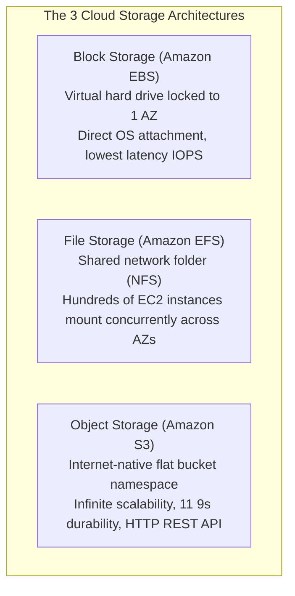
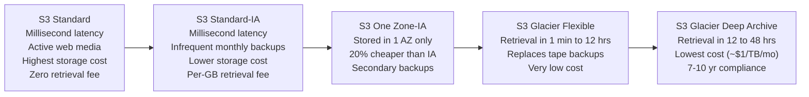

# Lecture 03: Storage Paradigms & Database Architectures

> **Course Track:** AWS Certified Cloud Practitioner (`CLF-C02`)  
> **Target Exam Domain:** Domain 3: Cloud Technology & Services (34% of Exam Blueprint)  
> **Estimated Delivery Duration:** 90 Minutes  
> **Associated Slide Deck:** [`04_Slides/Module_02_Compute_Storage_and_Databases_Slides.md`](../04_Slides/Module_02_Compute_Storage_and_Databases_Slides.md)  
> **Target Hands-On Labs:** [`07_Hands_On_Labs/lab_07_s3_storage_lifecycle.md`](../07_Hands_On_Labs/lab_07_s3_storage_lifecycle.md), [`07_Hands_On_Labs/lab_08_ebs_efs_storage.md`](../07_Hands_On_Labs/lab_08_ebs_efs_storage.md), [`07_Hands_On_Labs/lab_09_rds_database_ha.md`](../07_Hands_On_Labs/lab_09_rds_database_ha.md), [`07_Hands_On_Labs/lab_10_dynamodb_nosql_dax.md`](../07_Hands_On_Labs/lab_10_dynamodb_nosql_dax.md)  
> **Student Explanations:** [`06_Explanations/03_Technology_and_Services/Storage_Services.md`](../06_Explanations/03_Technology_and_Services/Storage_Services.md) & [`06_Explanations/03_Technology_and_Services/Database_Services.md`](../06_Explanations/03_Technology_and_Services/Database_Services.md)

---

## 📚 Prescribed Literature Grounding & Reading Assignments

Before delivering or attending this lecture, review the assigned chapters:
* **Tom Taulli (*O'Reilly 2026, 1st Ed.*):**
  * Chapter 10: *AWS Storage Services* (pp. 159–180)
    * Object (S3), Block (EBS), File (EFS, FSx), and Hybrid Storage (Storage Gateway, Snow Family).
    * S3 storage tiering, lifecycle rules, S3 Intelligent-Tiering, and Object Lock.
  * Chapter 11: *AWS Database Services* (pp. 181–202)
    * Relational (RDS, Aurora), NoSQL (DynamoDB), In-Memory (ElastiCache), Data Warehousing (Redshift), Graph (Neptune), and DocumentDB.
* **Rajesh Daswani (*Packt 2026, 2nd Ed.*):**
  * Chapter 6: *Amazon Simple Storage Service (Amazon S3)* (pp. 111–130)
  * Chapter 8: *EBS & EFS Storage Systems* (pp. 175–184)
  * Chapter 9: *Databases on AWS: RDS, Aurora, and DynamoDB* (pp. 185–204)
* **Gaurav H Kankaria (*Orange Education 2026, 2nd Ed.*):**
  * Chapter 5: *AWS Core Services – Part I (Storage)* (pp. 58–68)
  * Chapter 6: *AWS Core Services – Part II (Databases)* (pp. 69–86)

---

## ⏱️ Detailed 90-Minute Delivery Schedule & Pacing

```text
00:00 - 00:15 | Storage Fundamentals: Block vs Object vs File Storage
00:15 - 00:35 | Amazon S3 Deep-Dive: Durability (11 9s), Storage Classes, Lifecycle Rules & Versioning
00:35 - 00:50 | File & Block Storage: Amazon EBS vs Amazon EFS vs Amazon FSx (Windows/Lustre)
00:50 - 01:10 | Relational Databases: Amazon RDS Engines, Multi-AZ Failover & Read Replicas vs Aurora
01:10 - 01:25 | Specialized Databases: DynamoDB (NoSQL), ElastiCache (In-Memory), Redshift (Data Warehouse)
01:25 - 01:30 | Socratic Knowledge Check & Transition to Lab 07 (S3 Lifecycle) and Lab 09 (RDS Multi-AZ)
```

---

## 🗣️ Instructor Delivery Talking Points & Storytelling

### 1. Storage Comparison Matrix: The 3 Core Storage Types



* **Block Storage (Amazon EBS):**
  * *Analogy:* The internal hard drive inside your desktop PC. Fast, formatted with a file system, but hard-wired to one computer in one room (Availability Zone).
  * *Exam Point:* EBS is attached to **one EC2 instance in the exact same AZ**. To back it up, create **EBS Snapshots** which are stored in S3 across multiple AZs.
* **File Storage (Amazon EFS & FSx):**
  * *Analogy:* A shared company Wi-Fi network drive (NAS). Hundreds of computers can open, edit, and save files simultaneously.
  * *EFS:* Managed POSIX-compliant shared file system for Linux EC2 instances. Scales elastically. Multi-AZ.
  * *FSx for Windows File Server:* Native Windows Server SMB file shares with Active Directory integration.
  * *FSx for Lustre:* Ultra-high-speed POSIX storage for high-performance computing (HPC), machine learning, and video rendering.
* **Object Storage (Amazon S3):**
  * *Analogy:* A giant valet parking garage. You hand a photo, video, or backup to the valet, receive a unique claim ticket (URL / Key), and retrieve it from anywhere in the world over HTTPS.
  * *Durability:* Designed for **99.999999999% (11 9s) of durability**. If you store 10 million objects, you would expect to lose one object every 10,000 years!

---

### 2. S3 Storage Classes Spectrum (Cost vs. Access Frequency)



* **S3 Intelligent-Tiering:** Automatically monitors data access patterns and moves objects between frequent, infrequent, and archive access tiers without operational overhead or retrieval fees. Ideal when access patterns are unpredictable.
* **S3 Transfer Acceleration:** Uses **Amazon CloudFront's globally distributed Edge Locations** to route uploads over AWS's private high-speed global fiber backbone instead of traversing the congested public internet.

---

### 3. Database Selection: OLTP vs. OLAP vs. NoSQL

| Workload Type | Database Category | Primary AWS Service | Key Architectural Feature |
| :--- | :--- | :--- | :--- |
| **Transactional (OLTP)** | Managed Relational | **Amazon RDS** (PostgreSQL, MySQL, Oracle, SQL Server) | Synchronous **Multi-AZ** failover for disaster recovery; asynchronous **Read Replicas** for read-scaling. |
| **High-Performance Relational** | Cloud-Native Relational | **Amazon Aurora** | Up to **5x MySQL / 3x PostgreSQL** throughput. Auto-replicates 6 copies across 3 AZs. Aurora Serverless v2. |
| **Key-Value / Document (NoSQL)** | Serverless Non-Relational | **Amazon DynamoDB** | Single-digit millisecond latency at any scale. Microsecond latency with **DAX (DynamoDB Accelerator)**. |
| **In-Memory Caching** | Sub-Millisecond Cache | **Amazon ElastiCache** | Redis or Memcached engines. Caches database queries to prevent database read bottlenecks. |
| **Analytical / BI (OLAP)** | Columnar Data Warehouse | **Amazon Redshift** | Petabyte-scale SQL queries across historical data. Columnar storage and parallel execution. |
| **Interactive S3 SQL Querying** | Serverless SQL on S3 | **Amazon Athena** | Run standard SQL queries directly against CSV, JSON, Parquet files in S3 without loading into a database. |

---

## ❓ Socratic Classroom Check Questions

1. *"A company stores 50 TB of PDF invoices. Customers download invoices frequently during the first 30 days. After 30 days, invoices are rarely accessed, but must be retrieved in milliseconds if audited. Which S3 feature automates this cost reduction?"*
   * **Expected Answer:** **S3 Lifecycle Rules** transitioning objects from S3 Standard to S3 Standard-IA after 30 days.
2. *"What is the primary architectural difference between Amazon RDS Multi-AZ deployments and RDS Read Replicas?"*
   * **Expected Answer:** **Multi-AZ** is for **High Availability and Disaster Recovery** (synchronous standby in another AZ). **Read Replicas** are for **Performance and Read Scaling** (asynchronous replication to offload read queries).
3. *"A gaming app needs to record 500,000 player leaderboard score updates per second with single-digit millisecond response times. Which database should they choose?"*
   * **Expected Answer:** **Amazon DynamoDB**.

---

## 🎯 Authentic Exam Practice & Case Scenarios

> High-yield scenario questions from the authentic candidate practice pool reinforcing the core competencies of this lecture.

### Scenario Practice 1: CLF-C02-ET-Q010
**Question:**  
A company needs to quickly and securely move files over long distances between its client and an Amazon S3 bucket.  
Which S3 feature will meet this requirement?

**Options:**
- [A] S3 Versioning
- [B] S3 Transfer Acceleration
- [C] S3 ACLs
- [D] S3 Intelligent-Tiering

<details>
<summary><b>View Verified Answer & Complete Distractor Analysis</b></summary>

**Correct Answer:** `B`  
**Peer Consensus:** `100%` agreement.

**Architectural Rationale:**
- **Why [B] is Correct:** **Amazon S3 Transfer Acceleration** enables fast, easy, and secure transfers of files over long geographic distances between your client and your Amazon S3 bucket. It accomplishes this by utilizing **Amazon CloudFront's globally distributed Edge Locations**. As data arrives at an edge location near the user, it is routed to the target S3 bucket over the congestion-free, optimized **AWS private global network backbone**.

**Distractor Analysis (Why other options are wrong):**
- **Why [A] is Wrong:** S3 Versioning is a data protection feature that preserves multiple revisions of an object in the same bucket to protect against accidental deletion or overwrite; it does not accelerate data transfer speeds.
- **Why [C] is Wrong:** S3 Access Control Lists (ACLs) are a legacy security mechanism used to define read/write permissions on buckets and objects; they have no impact on network transfer performance.
- **Why [D] is Wrong:** S3 Intelligent-Tiering is a storage class designed to optimize storage costs by automatically moving data between frequent and infrequent tiers based on access patterns; it does not accelerate uploads.

</details>

---

### Scenario Practice 2: CLF-C02-ET-Q016
**Question:**  
A company needs to use SQL syntax to perform a direct query of objects in an Amazon S3 bucket.  
Which AWS service can the company use to meet this requirement?

**Options:**
- [A] AWS Glue
- [B] Amazon Athena
- [C] AWS Lambda
- [D] Amazon Kinesis

<details>
<summary><b>View Verified Answer & Complete Distractor Analysis</b></summary>

**Correct Answer:** `B`  
**Peer Consensus:** `100%` agreement.

**Architectural Rationale:**
- **Why [B] is Correct:** **Amazon Athena** is an interactive, serverless query service that makes it easy to analyze data directly in Amazon S3 using **standard SQL syntax**. With Athena, there are no databases or clusters to manage or provision; you simply point Athena at your S3 data (CSV, JSON, ORC, Parquet), run your SQL query, and pay only for the volume of data scanned by your queries.

**Distractor Analysis (Why other options are wrong):**
- **Why [A] is Wrong:** AWS Glue is a serverless data integration and ETL (Extract, Transform, Load) service used to discover, clean, and catalog data; it is not an interactive SQL querying engine.
- **Why [C] is Wrong:** AWS Lambda is a serverless compute service that runs code in response to events; it does not provide an interactive SQL query interface for S3 data lakes.
- **Why [D] is Wrong:** Amazon Kinesis is an ingestion service designed for collecting and processing real-time streaming data (such as IoT telemetry and video feeds); it is not an interactive SQL tool.

</details>

---

### Scenario Practice 3: CLF-C02-ET-Q017
**Question:**  
A company uses Amazon RDS for a product database. The company wants to ensure the database is highly available.  
Which feature of Amazon RDS will meet this requirement?

**Options:**
- [A] Read replicas
- [B] Blue/green deployment
- [C] Multi-AZ deployment
- [D] Reserved Instances

<details>
<summary><b>View Verified Answer & Complete Distractor Analysis</b></summary>

**Correct Answer:** `C`  
**Peer Consensus:** `100%` agreement.

**Architectural Rationale:**
- **Why [C] is Correct:** **Amazon RDS Multi-AZ deployments** provide high availability (HA) and disaster recovery (DR) for database instances. When you enable Multi-AZ, Amazon RDS automatically provisions and maintains a **synchronous standby replica** in a different physical Availability Zone. In the event of planned maintenance, database engine failure, or an AZ disruption, RDS automatically fails over to the standby instance with zero manual administrative intervention.

**Distractor Analysis (Why other options are wrong):**
- **Why [A] is Wrong:** Read Replicas use *asynchronous* replication to scale read throughput for read-heavy workloads. They are not an automated high-availability failover mechanism (though they can be manually promoted to a primary database in a disaster recovery scenario).
- **Why [B] is Wrong:** Blue/green deployments are a release management technique used to update database versions with minimal downtime by creating staging environments; they do not provide continuous high-availability protection against physical datacenter failures.
- **Why [D] is Wrong:** Reserved Instances are a financial purchasing and billing commitment that provides discounts for 1-year or 3-year steady-state usage; they provide zero technical high-availability capabilities.

</details>

---

## 🚀 Post-Lecture Student Transition
* Direct students to review [`06_Explanations/03_Technology_and_Services/Storage_Services.md`](../06_Explanations/03_Technology_and_Services/Storage_Services.md) and [`06_Explanations/03_Technology_and_Services/Database_Services.md`](../06_Explanations/03_Technology_and_Services/Database_Services.md).
* Transition to hands-on practice: [`07_Hands_On_Labs/lab_07_s3_storage_lifecycle.md`](../07_Hands_On_Labs/lab_07_s3_storage_lifecycle.md) and [`07_Hands_On_Labs/lab_09_rds_database_ha.md`](../07_Hands_On_Labs/lab_09_rds_database_ha.md).
