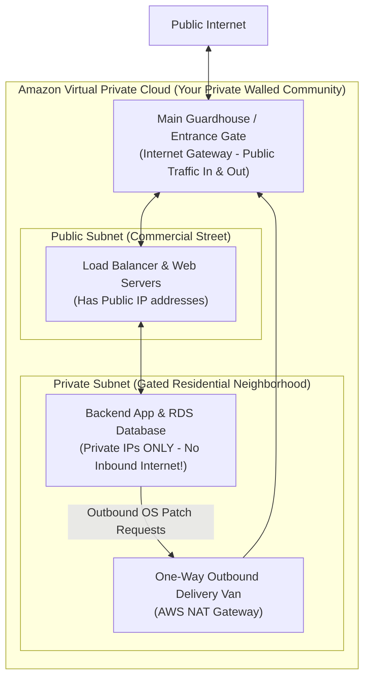

# Lecture 04: Networking, Perimeter Security & Identity Governance

> **Course Track:** AWS Certified Cloud Practitioner (`CLF-C02`)  
> **Target Exam Domains:** Domain 2: Security & Compliance (30%) & Domain 3: Networking (34%)  
> **Estimated Delivery Duration:** 90 Minutes  
> **Associated Slide Deck:** [`04_Slides/Module_03_Networking_Security_and_Identity_Slides.md`](../04_Slides/Module_03_Networking_Security_and_Identity_Slides.md)  
> **Target Hands-On Labs:** [`07_Hands_On_Labs/lab_01_vpc_networking.md`](../07_Hands_On_Labs/lab_01_vpc_networking.md), [`07_Hands_On_Labs/lab_02_vpc_security_controls.md`](../07_Hands_On_Labs/lab_02_vpc_security_controls.md), [`07_Hands_On_Labs/lab_11_route53_cloudfront_edge.md`](../07_Hands_On_Labs/lab_11_route53_cloudfront_edge.md)  
> **Student Explanations:** [`06_Explanations/02_Security_and_Compliance/`](../06_Explanations/02_Security_and_Compliance/) & [`06_Explanations/03_Technology_and_Services/Networking_and_Content_Delivery.md`](../06_Explanations/03_Technology_and_Services/Networking_and_Content_Delivery.md)

---

## 📚 Prescribed Literature Grounding & Reading Assignments

Before delivering or attending this lecture, review the assigned chapters:
* **Tom Taulli (*O'Reilly 2026, 1st Ed.*):**
  * Chapter 6: *AWS Identity and Access Management (IAM)* (pp. 79–98)
    * Users, Groups, Roles, Policies, STS, MFA, Passwordless, Credential Reports, IAM Access Analyzer.
  * Chapter 7: *Security: Defense-in-Depth* (pp. 99–114)
    * Edge protection (Route 53 DNS Firewall, CloudFront, Shield, WAF), Inbound firewalls (NACLs, SGs, Network Firewall), Data encryption (KMS, CloudHSM, ACM, Secrets Manager).
  * Chapter 12: *AWS Networking Services* (pp. 203–224)
    * VPC CIDR blocks, Subnets, Internet Gateways, NAT Gateways, Peering, Transit Gateway, Route 53, Direct Connect, VPN.
* **Rajesh Daswani (*Packt 2026, 2nd Ed.*):**
  * Chapter 4: *AWS Accounts, Multi-Account Strategies, and AWS Organizations* (pp. 57–82)
  * Chapter 5: *AWS Access Management (IAM)* (pp. 83–110)
  * Chapter 7: *AWS Networking Services: VPCs & Subnets* (pp. 131–156)
  * Chapter 12: *Security & Compliance Deep Dive* (pp. 245–276)
* **Gaurav H Kankaria (*Orange Education 2026, 2nd Ed.*):**
  * Chapter 6: *AWS Core Services – Part II (Networking)* (pp. 87–104)
  * Chapter 7: *Security and Identity Governance* (pp. 105–124)

---

## ⏱️ Detailed 90-Minute Delivery Schedule & Pacing

```text
00:00 - 00:20 | Amazon VPC Foundations: CIDR Blocks, Public vs Private Subnets & Internet Routing
00:20 - 00:40 | Network Defense-in-Depth: Security Groups (Stateful) vs Network ACLs (Stateless)
00:40 - 00:55 | Edge Delivery & Acceleration: Amazon CloudFront (CDN), Route 53 (DNS) & Global Accelerator
00:55 - 01:15 | AWS Identity & Access Management (IAM): Root User Lockdown, Users, Groups, Roles & Policies
01:15 - 01:25 | Perimeter Security & Cryptography: AWS WAF, AWS Shield, KMS vs CloudHSM
01:25 - 01:30 | Socratic Q&A & Transition to Lab 01 (VPC) and Lab 02 (Security Controls)
```

---

## 🗣️ Instructor Delivery Talking Points & Storytelling

### 1. The Gated Suburb Analogy for Amazon VPC



* **Amazon VPC:** A private, walled residential community that you exclusively own in the cloud.
* **Public Subnet:** The main commercial storefront street. Delivery trucks (internet traffic) can enter directly via the **Internet Gateway (IGW)**.
* **Private Subnet:** The secluded residential houses behind a second gate. Servers here have NO public IP addresses and cannot receive unsolicited inbound internet connections.
* **NAT Gateway:** A guarded, one-way outgoing neighborhood delivery van. It allows private servers to initiate outbound connections (e.g., to download Linux security patches), but blocks anyone on the public internet from discovering or entering the private servers.

---

### 2. High-Yield Distinction: Security Groups vs. Network ACLs
Spend 10 minutes drilling this exact matrix into students—it accounts for 3–5 questions on the CLF-C02 exam:

| Architectural Feature | Security Groups (SG) | Network ACLs (NACL) |
| :--- | :--- | :--- |
| **Operating Layer** | Operates at the **Instance / Virtual NIC (ENI)** level | Operates at the **Subnet** boundary perimeter |
| **State Tracking** | **Stateful:** Return traffic is automatically allowed regardless of inbound rules | **Stateless:** Return traffic must be explicitly allowed on ephemeral ports (1024–65535) |
| **Rule Types Supported** | **ALLOW rules only** (Everything not allowed is denied by default) | **ALLOW and DENY rules** (Processed in ascending numerical order) |
| **Rule Processing** | Evaluates **all rules** before making an allow decision | Evaluates rules in **strict numerical order** (lowest number first; first match wins) |
| **Default Rules** | Denies all inbound; allows all outbound | Default NACL allows all inbound & all outbound |

---

### 3. IAM Principles: Root Lockdown & Role Delegation
* **The Root User Golden Rule:**
  * Created when the AWS account is registered. Has full, unrestricted administrative permissions.
  * *Best Practice:* Delete root access keys, enable Multi-Factor Authentication (MFA), lock away the password, and **never use root for daily tasks**. Create an IAM admin user or IAM Identity Center user instead!
* **IAM Users vs. IAM Roles:**
  * *IAM User:* A human person with a permanent username, password, and optional access keys.
  * *IAM Role:* A temporary hat that can be worn by an authorized entity (an EC2 instance, a Lambda function, or a cross-account user). It issues **temporary security credentials via AWS STS (Security Token Service)** that expire automatically.
  * *Exam Trap:* If an EC2 instance needs to access S3, NEVER hardcode access keys in application code. Always attach an **IAM Role to an EC2 Instance Profile**!

---

### 4. Edge Protection: Shield vs. WAF vs. Firewall Manager
* **AWS Shield Standard:** Free, automatic Layer 3/4 protection against volumetric DDoS attacks (SYN floods, UDP reflection) enabled on all public AWS endpoints.
* **AWS Shield Advanced:** \$3,000/month subscription providing 24/7 access to the AWS DDoS Response Team (SRT), advanced telemetry, and financial reimbursement for cost spikes caused by a DDoS attack.
* **AWS WAF (Web Application Firewall):** Layer 7 firewall inspecting HTTP/HTTPS payloads for **SQL Injection (SQLi)**, **Cross-Site Scripting (XSS)**, and application layer request floods.
* **AWS Firewall Manager:** Centralized management tool to enforce WAF, Shield, and Security Group policies across all accounts in an AWS Organization.

---

## ❓ Socratic Classroom Check Questions

1. *"A company needs to block a specific malicious IP address (`203.0.113.50`) from reaching their web tier. Which AWS networking construct should they configure?"*
   * **Expected Answer:** **Network ACL (NACL)**. (Security Groups only support ALLOW rules; only Network ACLs support explicit DENY rules).
2. *"An application on an EC2 instance needs to write files to an Amazon S3 bucket. What is the AWS-recommended security best practice?"*
   * **Expected Answer:** Attach an **IAM Role** to the EC2 instance profile granting S3 write permissions (never hardcode access keys).
3. *"Which AWS service protects an Application Load Balancer from a Cross-Site Scripting (XSS) attack?"*
   * **Expected Answer:** **AWS WAF**.

---

## 🎯 Authentic Exam Practice & Case Scenarios

> High-yield scenario questions from the authentic candidate practice pool reinforcing the core competencies of this lecture.

### Scenario Practice 1: CLF-C02-ET-Q467
**Question:**  
A company wants to generate a list of IAM users. The company also wants to view the status of various credentials that are associated with the users, such as password, access keys, and multi-factor authentication (MFA) devices.  
Which AWS service or feature will meet these requirements?

**Options:**
- [A] IAM credential report
- [B] AWS IAM Identity Center (AWS Single Sign-On)
- [C] AWS Identity and Access Management Access Analyzer
- [D] AWS Cost and Usage Report

<details>
<summary><b>View Verified Answer & Complete Distractor Analysis</b></summary>

**Correct Answer:** `A`  
**Peer Consensus:** `100%` agreement.

**Architectural Rationale:**
- **Why [A] is Correct:** An **IAM Credential Report** is a downloadable CSV audit document that lists all IAM users in your AWS account and the status of their various credentials—including password last used date, password age, active access keys, access key rotation dates, and whether Multi-Factor Authentication (MFA) is enabled. It is the primary security auditing tool used by compliance officers to verify password compliance and identify stale credentials.

**Distractor Analysis (Why other options are wrong):**
- **Why [B] is Wrong:** AWS IAM Identity Center (formerly AWS SSO) is an authentication portal used to manage single sign-on access across multiple AWS accounts and business applications; it is not a credential audit report generator for IAM users.
- **Why [C] is Wrong:** IAM Access Analyzer evaluates resource-based policies (such as S3 bucket policies or KMS key policies) to identify resources that are accessible from outside your AWS account; it does not audit user passwords or MFA devices.
- **Why [D] is Wrong:** The AWS Cost and Usage Report (CUR) provides detailed billing line items and usage metadata; it contains zero security credential or IAM telemetry.

</details>

---

### Scenario Practice 2: CLF-C02-ET-Q051
**Question:**  
Which of the following actions are controlled with AWS Identity and Access Management (IAM)? (Choose two.)

**Options:**
- [A] Control access to AWS service APIs and to other specific resources.
- [B] Provide intelligent threat detection and continuous monitoring.
- [C] Protect the AWS environment using multi-factor authentication (MFA).
- [D] Grant users access to AWS data centers.
- [E] Provide firewall protection for applications from common web attacks.

<details>
<summary><b>View Verified Answer & Complete Distractor Analysis</b></summary>

**Correct Answer:** `A` and `C`  
**Peer Consensus:** `100%` agreement.

**Architectural Rationale:**
- **Why [A] is Correct:** IAM is fundamentally an authorization and access control service. Through **IAM Policies**, administrators define permissions that govern which users or roles can make API calls against specific AWS services and resources (e.g. `s3:CreateBucket`, `ec2:RunInstances`).
- **Why [C] is Correct:** IAM provides built-in support for **Multi-Factor Authentication (MFA)**, requiring users to supply a physical or virtual TOTP token in addition to their username and password, protecting against compromised credentials.

**Distractor Analysis (Why other options are wrong):**
- **Why [B] is Wrong:** Intelligent threat detection and continuous monitoring is the responsibility of **Amazon GuardDuty**, which analyzes network and API event logs using machine learning.
- **Why [D] is Wrong:** Physical access to AWS data centers is strictly managed and restricted by AWS security operations under the Shared Responsibility Model; customer IAM policies cannot grant physical access to AWS data centers.
- **Why [E] is Wrong:** Firewall protection against web application attacks (like SQL injection or cross-site scripting) is provided by **AWS WAF (Web Application Firewall)**, not IAM.

</details>

---

### Scenario Practice 3: CLF-C02-ET-Q053
**Question:**  
A company is using AWS Identity and Access Management (IAM).  
Who can manage the access keys of the AWS account root user?

**Options:**
- [A] IAM users in the same account that have been granted permission
- [B] IAM roles in any account that have been granted permission
- [C] IAM users and roles that have been granted permission
- [D] The AWS account owner

<details>
<summary><b>View Verified Answer & Complete Distractor Analysis</b></summary>

**Correct Answer:** `D`  
**Peer Consensus:** `100%` agreement.

**Architectural Rationale:**
- **Why [D] is Correct:** Under AWS security architecture, the **AWS account root user** represents the ultimate account owner (authenticated via the email address used to create the account). IAM users and roles—regardless of how broad their administrative permissions are—**CANNOT** view, modify, or rotate the access keys or credentials of the root user. Only the **AWS account owner** logged in directly as the root user has the authority to manage root access keys.

**Distractor Analysis (Why other options are wrong):**
- **Why [A] is Wrong:** Even an IAM user attached to the `AdministratorAccess` policy cannot access the root user credentials page in the AWS Management Console or generate root access keys.
- **Why [B] is Wrong:** IAM roles (whether within the account or assumed from external accounts) have no administrative authority over root credentials.
- **Why [C] is Wrong:** Combines incorrect options [A] and [B].

</details>

---

## 🚀 Post-Lecture Student Transition
* Direct students to review [`06_Explanations/02_Security_and_Compliance/AWS_IAM_and_Identity.md`](../06_Explanations/02_Security_and_Compliance/AWS_IAM_and_Identity.md) and [`06_Explanations/02_Security_and_Compliance/Shield_and_WAF.md`](../06_Explanations/02_Security_and_Compliance/Shield_and_WAF.md).
* Transition to hands-on practice: [`07_Hands_On_Labs/lab_01_vpc_networking.md`](../07_Hands_On_Labs/lab_01_vpc_networking.md) and [`07_Hands_On_Labs/lab_02_vpc_security_controls.md`](../07_Hands_On_Labs/lab_02_vpc_security_controls.md).
