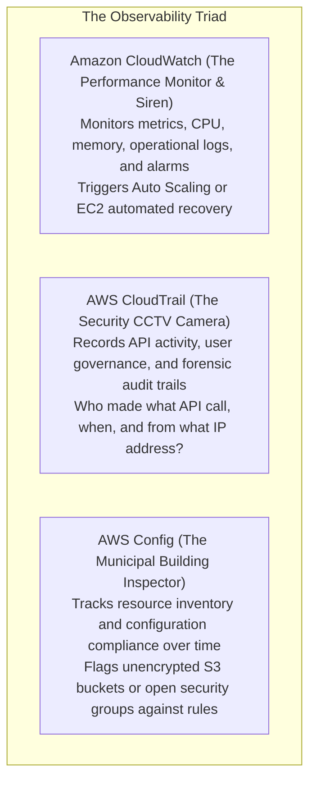

# Lecture 05: Observability, Auditing, Compliance & DevOps Governance

> **Course Track:** AWS Certified Cloud Practitioner (`CLF-C02`)  
> **Target Exam Domains:** Domain 2: Security & Compliance (30%) & Domain 3: Technology (DevOps)  
> **Estimated Delivery Duration:** 90 Minutes  
> **Associated Slide Deck:** [`04_Slides/Module_04_Monitoring_Governance_and_DevOps_Slides.md`](../04_Slides/Module_04_Monitoring_Governance_and_DevOps_Slides.md)  
> **Target Hands-On Labs:** [`07_Hands_On_Labs/lab_12_sqs_sns_eventbridge_messaging.md`](../07_Hands_On_Labs/lab_12_sqs_sns_eventbridge_messaging.md) & [`07_Hands_On_Labs/lab_13_observability_cloudwatch_cloudtrail_config.md`](../07_Hands_On_Labs/lab_13_observability_cloudwatch_cloudtrail_config.md)  
> **Student Explanations:** [`06_Explanations/02_Security_and_Compliance/Threat_Detection_and_Compliance.md`](../06_Explanations/02_Security_and_Compliance/Threat_Detection_and_Compliance.md) & [`06_Explanations/03_Technology_and_Services/Management_and_Observability.md`](../06_Explanations/03_Technology_and_Services/Management_and_Observability.md)

---

## 📚 Prescribed Literature Grounding & Reading Assignments

Before delivering or attending this lecture, review the assigned chapters:
* **Tom Taulli (*O'Reilly 2026, 1st Ed.*):**
  * Chapter 5: *AWS Compliance and Governance* (pp. 65–78)
    * Regulatory compliance programs (PCI DSS, HIPAA, SOC 1/2/3, ISO 27001), AWS Artifact, AWS Audit Manager.
    * Governance services: AWS Organizations, Service Control Policies (SCPs), AWS Control Tower, AWS Config.
  * Chapter 7: *Security Monitoring and Threat Detection* (pp. 108–114)
    * Amazon GuardDuty (intelligent threat detection), Amazon Inspector (vulnerability scans), Amazon Macie (PII discovery in S3), AWS Security Hub.
  * Chapter 14: *Developer Tools and Management Services* (pp. 241–256)
    * AWS CloudFormation (IaC), AWS Systems Manager, Amazon EventBridge, Amazon SNS, Amazon SQS.
* **Rajesh Daswani (*Packt 2026, 2nd Ed.*):**
  * Chapter 4: *AWS Accounts, Multi-Account Strategies, and AWS Organizations* (pp. 57–82)
  * Chapter 11: *Monitoring, Auditing, and Automation* (pp. 229–244)
  * Chapter 12: *Security, Governance, and Compliance* (pp. 245–276)
* **Gaurav H Kankaria (*Orange Education 2026, 2nd Ed.*):**
  * Chapter 7: *Security Services (GuardDuty, Inspector, Macie)* (pp. 115–124)
  * Chapter 8: *Management and Governance Services* (pp. 125–140)

---

## ⏱️ Detailed 90-Minute Delivery Schedule & Pacing

```text
00:00 - 00:20 | The Observability Triad: Amazon CloudWatch vs AWS CloudTrail vs AWS Config
00:20 - 00:40 | Intelligent Threat Detection: GuardDuty vs Inspector vs Macie vs Security Hub
00:40 - 00:55 | Multi-Account Enterprise Governance: AWS Organizations, OUs, and Service Control Policies (SCPs)
00:55 - 01:15 | Automated Infrastructure & Messaging: AWS CloudFormation (IaC), Amazon SQS, Amazon SNS & EventBridge
01:15 - 01:25 | Systems Operations: AWS Systems Manager (Patch Manager & Session Manager) & AWS Artifact
01:25 - 01:30 | Socratic Q&A & Transition to Lab 12 (Messaging) and Lab 13 (Observability)
```

---

## 🗣️ Instructor Delivery Talking Points & Storytelling

### 1. The Observability Triad: "Metrics vs. CCTV vs. Building Inspector"
Students constantly confuse CloudWatch, CloudTrail, and Config. Drill this mental anchor into the room:



* **Amazon CloudWatch (The Performance Monitor & Smoke Alarm):**
  * *Role:* Monitors **performance metrics, operational logs, and alarms**.
  * *Analogy:* A smart dashboard monitoring room temperature (CPU utilization) and network water pressure. If smoke is detected, it triggers a loud siren (CloudWatch Alarm) and can automatically turn on fire sprinklers (Auto Scaling / EC2 recovery).
* **AWS CloudTrail (The Security CCTV Camera):**
  * *Role:* Records **API activity, user governance, and security forensics**.
  * *Analogy:* The building security video recording the entrance 24/7. When an incident occurs, the auditor watches the tape to see: *Who came in (IAM username), What door was opened (API call `TerminateInstances`), When it happened (Timestamp), and from What IP address (`198.51.100.12`).*
* **AWS Config (The Municipal Building Inspector):**
  * *Role:* Evaluates **resource compliance against organizational rules and tracks configuration history over time**.
  * *Analogy:* The inspector who walks through the building with a clipboard verifying that every room has an up-to-code fire extinguisher and unblocked exit doors. If someone unencrypts an S3 bucket or opens SSH to `0.0.0.0/0`, Config flags the resource as non-compliant and can trigger automated remediation via Systems Manager.

---

### 2. High-Yield Threat Detection Comparison Matrix

| Security Service | What It Detects / Evaluates | Primary Data Sources Analyzed | Real-World Exam Keyword |
| :--- | :--- | :--- | :--- |
| **Amazon GuardDuty** | **Intelligent threat detection** (compromised accounts, crypto-mining, reconnaissance) | Analyzes AWS CloudTrail events, VPC Flow Logs, and DNS logs using machine learning | *"Compromised EC2 instances communicating with known malicious IP addresses"*, *"Intelligent threat detection"* |
| **Amazon Inspector** | **Vulnerability assessment** (known software CVEs, exposed network ports) | Scans Amazon EC2 instance operating systems, container images in Amazon ECR, and Lambda functions | *"Software package vulnerabilities and unintended network exposure"*, *"CVE scanning"* |
| **Amazon Macie** | **Sensitive data discovery & PII protection** (credit cards, passport numbers, SSNs) | Scans Amazon S3 object storage using pattern-matching and machine learning | *"Discover Personally Identifiable Information (PII) stored in S3 buckets"*, *"GDPR compliance"* |
| **AWS Security Hub** | **Central security posture dashboard & compliance scoring** | Ingests findings from GuardDuty, Inspector, Macie, IAM Access Analyzer, and partner tools | *"Single-pane-of-glass dashboard for CIS AWS Foundations Benchmark compliance"* |

---

### 3. Multi-Account Governance: AWS Organizations & SCPs
* **AWS Organizations:** Centrally manages and governs multiple AWS accounts from a single management account.
* **Consolidated Billing:** Aggregates usage across all member accounts to achieve bulk tier volume discounts.
* **Service Control Policies (SCPs):**
  * *Crucial Teaching Point:* SCPs are **guardrails**, not permission-granting policies! An SCP specifies the maximum permissions that member accounts and IAM users/roles can exercise.
  * Even the `AdministratorAccess` user in a member account CANNOT perform an action if an SCP attached to their Organizational Unit (OU) has an explicit `Deny`.
  * *Root Exception:* The root account of the *Management Account* is exempt from SCPs.

---

### 4. Messaging & Application Decoupling
* **Amazon SQS (Simple Queue Service):**
  * *Model:* **Pull-based** message queue. Components pull messages when ready.
  * *Value:* Decouples tightly coupled architectures. Prevents web servers from crashing if the backend database processing pipeline is overwhelmed.
  * *Standard vs FIFO:* Standard has nearly unlimited throughput with at-least-once delivery; FIFO (First-In, First-Out) guarantees strictly once delivery and exact ordering.
* **Amazon SNS (Simple Notification Service):**
  * *Model:* **Push-based** Publisher/Subscriber (Pub/Sub) messaging.
  * *Value:* One-to-many fan-out. A single topic publication pushes instant alerts to multiple subscribers via SMS, email, SQS queues, or HTTP webhooks.
* **Amazon EventBridge:**
  * *Model:* Serverless event bus. Connects AWS services, custom microservices, and third-party SaaS apps (Zendesk, Shopify, Datadog) using rule-based filtering.

---

## ❓ Socratic Classroom Check Questions

1. *"A security team receives an alert that an EC2 instance is communicating with a known cryptocurrency mining pool. Which AWS service generated this alert?"*
   * **Expected Answer:** **Amazon GuardDuty**.
2. *"A financial auditor needs to download AWS SOC 2 and PCI-DSS compliance reports to submit to government regulators. Where can they obtain these documents?"*
   * **Expected Answer:** **AWS Artifact** (the free self-service portal for AWS compliance reports and agreements).
3. *"An enterprise wants to prevent developers from launching EC2 instances in any region outside of Europe (`eu-*`). What AWS mechanism enforces this across all accounts?"*
   * **Expected Answer:** A **Service Control Policy (SCP)** applied in **AWS Organizations**.

---

## 🎯 Authentic Exam Practice & Case Scenarios

> High-yield scenario questions from the authentic candidate practice pool reinforcing the core competencies of this lecture.

### Scenario Practice 1: CLF-C02-ET-Q297
**Question:**  
A company needs to centrally configure and manage Amazon VPC security groups across multiple AWS accounts within an organization in AWS Organizations.  
Which AWS service should the company use to meet these requirements?

**Options:**
- [A] AWS Firewall Manager
- [B] Amazon GuardDuty
- [C] Amazon Detective
- [D] AWS WAF

<details>
<summary><b>View Verified Answer & Complete Distractor Analysis</b></summary>

**Correct Answer:** `A`  
**Peer Consensus:** `100%` agreement.

**Architectural Rationale:**
- **Why [A] is Correct:** **AWS Firewall Manager** is a centralized security management service that enables administrators to centrally configure, manage, and enforce firewall rules across all accounts and applications in an organization created in **AWS Organizations**. It can automatically audit and enforce VPC Security Groups, AWS WAF rules, AWS Shield Advanced protections, and Amazon Route 53 Resolver DNS Firewall rules across member accounts.

**Distractor Analysis (Why other options are wrong):**
- **Why [B] is Wrong:** Amazon GuardDuty is an intelligent threat detection service that monitors logs for malicious behavior; it does not configure or manage VPC security groups.
- **Why [C] is Wrong:** Amazon Detective is an automated root-cause analysis and investigation tool that helps security analysts isolate the scope of security incidents using graph models; it does not deploy firewall rules.
- **Why [D] is Wrong:** AWS WAF is a Layer 7 web application firewall used to inspect HTTP/HTTPS payloads for exploits; while Firewall Manager can deploy WAF rules, WAF itself does not manage VPC Layer 4 Security Groups across multiple accounts.

</details>

---

### Scenario Practice 2: CLF-C02-ET-Q026
**Question:**  
A company is using Amazon DynamoDB.  
Which task is the company’s responsibility, according to the AWS shared responsibility model?

**Options:**
- [A] Patch the operating system.
- [B] Provision hosts.
- [C] Manage database access permissions.
- [D] Secure the operating system.

<details>
<summary><b>View Verified Answer & Complete Distractor Analysis</b></summary>

**Correct Answer:** `C`  
**Peer Consensus:** `100%` agreement.

**Architectural Rationale:**
- **Why [C] is Correct:** Amazon DynamoDB is a fully managed serverless NoSQL database service. Under the **AWS Shared Responsibility Model**, AWS manages the underlying physical hosts, the operating system, database software patching, high availability, and hardware maintenance (Security "OF" the Cloud). The customer is strictly responsible for their data and access governance—specifically **managing database access permissions** via IAM policies and securing their application data (Security "IN" the Cloud).

**Distractor Analysis (Why other options are wrong):**
- **Why [A] is Wrong:** In a fully managed serverless service like DynamoDB, customers do not have access to the underlying operating system. AWS automatically patches and maintains the OS.
- **Why [B] is Wrong:** Host provisioning, capacity allocation, and server hardware lifecycle management for DynamoDB are handled entirely by AWS.
- **Why [D] is Wrong:** Operating system security hardening is the sole responsibility of AWS for managed database services.

</details>

---

### Scenario Practice 3: CLF-C02-ET-Q318
**Question:**  
A company needs to continuously record and log all account activity and API operations across its AWS infrastructure for security auditing and compliance review.  
Which AWS service should the company use to fulfill this requirement?

**Options:**
- [A] Amazon CloudWatch
- [B] AWS CloudTrail
- [C] AWS Config
- [D] AWS Trusted Advisor

<details>
<summary><b>View Verified Answer & Complete Distractor Analysis</b></summary>

**Correct Answer:** `B`  
**Peer Consensus:** `100%` agreement.

**Architectural Rationale:**
- **Why [B] is Correct:** **AWS CloudTrail** is an auditing, compliance monitoring, and governance service that continuously records and retains an event history of actions taken by a user, role, or an AWS service. CloudTrail captures actions taken through the AWS Management Console, AWS SDKs, and command line tools, logging the identity of the caller, the time of the event, the source IP address, and request/response elements.

**Distractor Analysis (Why other options are wrong):**
- **Why [A] is Wrong:** Amazon CloudWatch monitors performance metrics (CPU, disk I/O, network), application logs, and generates operational alarms; it does not record user API management activity for governance.
- **Why [C] is Wrong:** AWS Config evaluates whether resources comply with specific configuration rules and tracks resource state changes over time; it does not record the full historical audit trail of API calls made by users.
- **Why [D] is Wrong:** AWS Trusted Advisor is an automated optimization tool that scans your account against best practices in cost optimization, performance, security, fault tolerance, and service quotas; it does not record API activity logs.

</details>

---

## 🚀 Post-Lecture Student Transition
* Direct students to review [`06_Explanations/02_Security_and_Compliance/Threat_Detection_and_Compliance.md`](../06_Explanations/02_Security_and_Compliance/Threat_Detection_and_Compliance.md) and [`06_Explanations/03_Technology_and_Services/Management_and_Observability.md`](../06_Explanations/03_Technology_and_Services/Management_and_Observability.md).
* Transition to hands-on practice: [`07_Hands_On_Labs/lab_12_sqs_sns_eventbridge_messaging.md`](../07_Hands_On_Labs/lab_12_sqs_sns_eventbridge_messaging.md) and [`07_Hands_On_Labs/lab_13_observability_cloudwatch_cloudtrail_config.md`](../07_Hands_On_Labs/lab_13_observability_cloudwatch_cloudtrail_config.md).
