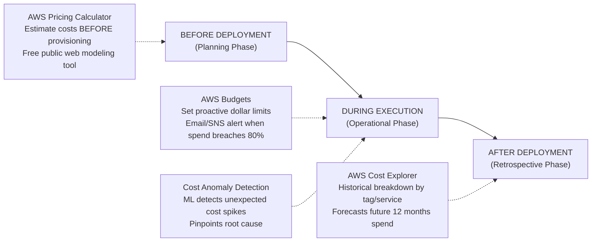

# Lecture 06: Billing, FinOps Governance, Support Plans & Exam Strategy

> **Course Track:** AWS Certified Cloud Practitioner (`CLF-C02`)  
> **Target Exam Domain:** Domain 4: Billing, Pricing & Support (12% of Exam Blueprint) + Capstone Exam Strategy  
> **Estimated Delivery Duration:** 90 Minutes  
> **Associated Slide Deck:** [`04_Slides/Module_05_Billing_Pricing_and_Support_Slides.md`](../04_Slides/Module_05_Billing_Pricing_and_Support_Slides.md)  
> **Target Hands-On Lab:** [`07_Hands_On_Labs/lab_14_billing_cost_management.md`](../07_Hands_On_Labs/lab_14_billing_cost_management.md)  
> **Student Explanations:** [`06_Explanations/04_Billing_and_Pricing/`](../06_Explanations/04_Billing_and_Pricing/) & [`01_Syllabus/`](../01_Syllabus/)

---

## 📚 Prescribed Literature Grounding & Reading Assignments

Before delivering or attending this capstone lecture, review the assigned chapters:
* **Tom Taulli (*O'Reilly 2026, 1st Ed.*):**
  * Chapter 15: *Billing, Pricing, and Cost Management* (pp. 257–280)
    * Pricing models, AWS Pricing Calculator, AWS Cost Explorer, AWS Budgets, Cost Allocation Tags, Compute Optimizer, Support Tiers.
  * Chapter 16 & Appendix A: *Exam Preparation and Practice Exam* (pp. 281–305)
    * Question dissection strategies, distractor elimination, time management under Pearson VUE conditions.
* **Rajesh Daswani (*Packt 2026, 2nd Ed.*):**
  * Chapter 13: *Billing, Cost, and Support* (pp. 277–304)
    * AWS billing consoles, payment options, consolidated billing volume tiers, AWS Marketplace, Support Concierge.
* **Gaurav H Kankaria (*Orange Education 2026, 2nd Ed.*):**
  * Chapter 9: *Billing and Pricing* (pp. 141–156)
  * Chapter 10: *Preparing for Exam* (pp. 157–168)

---

## ⏱️ Detailed 90-Minute Delivery Schedule & Pacing

```text
00:00 - 00:20 | Cloud Financial Management (FinOps): Cost Explorer vs AWS Budgets vs Pricing Calculator
00:20 - 00:40 | Cost Allocation Tags, Consolidated Billing & AWS Cost Anomaly Detection
00:40 - 00:55 | AWS Support Plans Matrix: Basic vs Developer vs Business vs Enterprise On-Ramp vs Enterprise
00:55 - 01:15 | AWS Trusted Advisor (5 Pillars) & AWS Compute Optimizer (ML Rightsizing)
01:15 - 01:25 | Exam Strategy & Test-Taking Psychology: Pacing, Distractor Elimination & Question Traps
01:25 - 01:30 | Graduation Capstone Transition to Full-Length Timed Mock Exam (65Q)
```

---

## 🗣️ Instructor Delivery Talking Points & Storytelling

### 1. The Cost Management Suite: "Before, During, and After"
Students frequently confuse AWS cost tools. Teach this chronological timeline framework:



* **Cost Allocation Tags:**
  * Key-value metadata labels attached to AWS resources (e.g., `Environment = Production`, `Project = Phoenix`, `CostCenter = 1045`).
  * Once activated in Billing Preferences, tags appear in AWS Cost Explorer to filter and group bills by department, project, or business owner.
* **AWS Cost Anomaly Detection:**
  * Uses advanced machine learning to continuously monitor spending patterns and automatically detect sudden unexpected cost spikes (e.g., a misconfigured Lambda script spawning thousands of concurrent runs), identifying the exact root cause service and account.

---

### 2. High-Yield AWS Support Plans Comparison Matrix
This single matrix routinely accounts for 2–3 questions on the CLF-C02 exam. Walk through every cell deliberately:

| Support Plan Feature | Developer | Business | Enterprise On-Ramp | Enterprise |
| :--- | :---: | :---: | :---: | :---: |
| **Monthly Cost** | \$29 / mo (or 3% of spend) | \$100 / mo (tiered %) | \$5,500 / mo (or 10%) | \$15,000 / mo (tiered %) |
| **Technical Account Manager (TAM)** | No | No | Shared pool of TAMs | **Dedicated TAM** assigned to account |
| **Critical System Down SLA** | None | **< 1 hour** (Production down) | **< 30 minutes** (Business-critical) | **< 15 minutes** (Business-critical) |
| **Support Channels** | Business hours email | 24/7 phone, web, chat | 24/7 phone, web, chat | 24/7 phone, web, chat |
| **Case Management API** | No (Console only) | **Yes (AWS Support API)** | **Yes (AWS Support API)** | **Yes (AWS Support API)** |
| **Who can open support cases?** | 1 primary contact | **Unlimited contacts** | **Unlimited contacts** | **Unlimited contacts** |
| **Architecture Guidance** | General guidance | Contextual to use case | Consultative reviews | Proactive reviews & Game Days |
| **Infrastructure Event Management (IEM)** | No | Available for extra fee | 1 event per year included | **Included in plan** |
| **AWS Trusted Advisor** | 7 core checks | **Full 115+ checks** | **Full 115+ checks** | **Full 115+ checks** |

---

### 3. AWS Trusted Advisor: The 5 Optimization Pillars
Trusted Advisor continuously inspects customer infrastructure and assigns a traffic-light status (Green = OK, Yellow = Warning, Red = Immediate Action):
1. **Cost Optimization:** Flags unattached Elastic IPs, idle RDS database instances, underutilized EC2 instances.
2. **Performance:** Flags high EC2 CPU utilization, EBS throughput limits, CloudFront caching optimization.
3. **Security:** Flags MFA not enabled on the root account, overly permissive Security Groups (e.g., port 22 open to `0.0.0.0/0`), public S3 buckets.
4. **Fault Tolerance:** Flags EBS volumes without recent snapshots, RDS instances without Multi-AZ, S3 lifecycle configurations.
5. **Service Quotas:** Alerts when resource usage approaches the regional account quota limit (e.g., 80% of max VPCs or Elastic IPs).

---

### 4. Exam Strategy & Test-Taking Psychology (Taulli Ch 16)
Share these proven test-taking principles with students:
* **The 65-Question Blueprint Math:**
  * Total time: **90 minutes** (~1.38 minutes per question).
  * 50 questions are scored; 15 questions are experimental unscored questions placed randomly by AWS. You will not know which is which—treat every question with equal diligence.
  * Passing score is **700 / 1000** (scaled compensatory score).
* **The Two-Pass Technique:**
  * *Pass 1 (0 to 60 minutes):* Answer every question you immediately know. If a question is ambiguous or wordy, pick your best instinct, click **Flag for Review**, and move on. Never spend more than 2 minutes on a single question in Pass 1.
  * *Pass 2 (60 to 85 minutes):* Return to flagged questions. Carefully read the last sentence of the prompt to identify the real constraint.
  * *Pass 3 (Last 5 minutes):* Verify that zero questions are left blank (there is **NO penalty for wrong guesses**).
* **Identifying Distractor Traps:**
  * *Trap: Invented Service Names.* AWS frequently invents plausible-sounding service names as distractors (e.g., *"AWS CloudShield"*, *"Amazon SecureS3"*, *"AWS Network Gateway"*). If you've never heard of it in training, it is almost certainly a distractor.
  * *Trap: Extreme Requirements.* Watch for keywords like *"most cost-effective"*, *"least operational overhead"*, *"fastest recovery"*. A solution might be technically valid, but violate the specific constraint (e.g., deploying EC2 with custom software when a managed service like S3 solves it with zero management).

---

## ❓ Socratic Classroom Check Questions

1. *"A company is planning an annual Black Friday flash sale expecting a 50x surge in website traffic. They have a Business Support plan. What service can they purchase to have AWS engineers monitor and support their architecture during the event?"*
   * **Expected Answer:** **AWS Infrastructure Event Management (IEM)** (available for an additional fee on Business Support; included on Enterprise).
2. *"A customer wants to estimate the monthly cost of running 20 EC2 instances and 5 TB of S3 storage before signing an AWS contract. Which free web tool should they use?"*
   * **Expected Answer:** **AWS Pricing Calculator**.
3. *"Which AWS Support tier is the minimum required to receive dedicated, assigned Technical Account Manager (TAM) guidance?"*
   * **Expected Answer:** **Enterprise Support** (Enterprise On-Ramp gives access to a shared pool of TAMs, but only Enterprise provides a dedicated TAM).

---

## 🎯 Authentic Exam Practice & Case Scenarios

> High-yield scenario questions from the authentic candidate practice pool reinforcing the core competencies of this lecture.

### Scenario Practice 1: CLF-C02-ET-Q022
**Question:**  
Which benefit is always free of charge with AWS, regardless of a user’s AWS Support plan?

**Options:**
- [A] AWS Developer Support
- [B] AWS Developer Forums
- [C] Programmatic case management
- [D] AWS technical account manager (TAM)

<details>
<summary><b>View Verified Answer & Complete Distractor Analysis</b></summary>

**Correct Answer:** `B`  
**Peer Consensus:** `100%` agreement.

**Architectural Rationale:**
- **Why [B] is Correct:** **AWS Developer Forums** (now part of the AWS re:Post community platform) and official AWS technical documentation, whitepapers, and knowledge articles are 100% free and publicly accessible to all customers, including those on the free **Basic Support** plan.

**Distractor Analysis (Why other options are wrong):**
- **Why [A] is Wrong:** AWS Developer Support is a paid tier starting at \$29/month or 3% of monthly AWS spend.
- **Why [C] is Wrong:** Programmatic case management via the AWS Support API is a premium feature available **only on Business, Enterprise On-Ramp, and Enterprise Support plans**. It is not available on Basic or Developer plans.
- **Why [D] is Wrong:** Access to a dedicated Technical Account Manager (TAM) is an exclusive benefit of **Enterprise Support** (starting at \$15,000/month) or a shared pool on Enterprise On-Ramp (\$5,500/month).

</details>

---

### Scenario Practice 2: CLF-C02-ET-Q028
**Question:**  
Which recommendation can AWS Cost Explorer provide to help reduce cost?

**Options:**
- [A] Use a specific database engine.
- [B] Change the programming language for an application.
- [C] Deploy a specific operating system.
- [D] Terminate an idle instance.

<details>
<summary><b>View Verified Answer & Complete Distractor Analysis</b></summary>

**Correct Answer:** `D`  
**Peer Consensus:** `100%` agreement.

**Architectural Rationale:**
- **Why [D] is Correct:** **AWS Cost Explorer** includes built-in resource optimization capabilities (integrated with AWS Compute Optimizer and Amazon EC2 right-sizing recommendations) that identify underutilized and **idle EC2 instances**. It provides actionable recommendations to either downsize instance families or **terminate idle instances** that have near-zero CPU and network activity, directly eliminating unnecessary cloud spend.

**Distractor Analysis (Why other options are wrong):**
- **Why [A] is Wrong:** Cost Explorer does not evaluate database schemas or recommend switching database engines (e.g., from Oracle to PostgreSQL); database migration suitability is evaluated via the AWS Database Migration Service (DMS) Fleet Advisor.
- **Why [B] is Wrong:** Cost Explorer has no visibility into application source code or programming languages (e.g., Java vs Python).
- **Why [C] is Wrong:** Cost Explorer does not provide recommendations to change operating systems (e.g., Windows to Linux).

</details>

---

### Scenario Practice 3: CLF-C02-ET-Q034
**Question:**  
A new AWS user needs to interact with AWS Support by using API calls.  
Which AWS Support plan will meet this requirement MOST cost-effectively?

**Options:**
- [A] AWS Basic Support
- [B] AWS Developer Support
- [C] AWS Business Support
- [D] AWS Enterprise Support

<details>
<summary><b>View Verified Answer & Complete Distractor Analysis</b></summary>

**Correct Answer:** `C`  
**Peer Consensus:** `100%` agreement (Exam consensus verifies `C`).

**Architectural Rationale:**
- **Why [C] is Correct:** The **AWS Support API** (which allows programmatic creation, management, and tracking of support cases, as well as programmatic access to AWS Trusted Advisor recommendations) is only unlocked starting at the **AWS Business Support plan** (\$100/month minimum) and higher. Because the question asks for the **MOST cost-effective** option that provides API support, Business Support is the correct answer.

**Distractor Analysis (Why other options are wrong):**
- **Why [A] is Wrong:** AWS Basic Support is free but provides customer service for billing and account inquiries only via web forms. It does not provide access to the AWS Support API.
- **Why [B] is Wrong:** AWS Developer Support (\$29/month) allows 1 primary contact to submit technical support cases via web/email during business hours, but it **DOES NOT include access to the AWS Support API**.
- **Why [D] is Wrong:** While AWS Enterprise Support includes AWS Support API access, it starts at \$15,000/month. It is drastically more expensive than Business Support and violates the "MOST cost-effective" requirement.

</details>

---

## 🎓 Capstone Graduation & Final Transition
* Direct students to complete the [Rapid Review Cheatsheet](file:///home/mohamed/Desktop/Work/aws/Cloud/Practitioner/CLF-C02/09_Notes_and_Cheatsheets/Rapid_Review_Cheatsheet.md).
* Have students sit the official full-length simulation under strict 90-minute timed conditions: [CLF-C02 Full-Length Mock Revision Exam](file:///home/mohamed/Desktop/Work/aws/Cloud/Practitioner/CLF-C02/11_Practice_Exams/CLF_C02_Full_Length_Mock_Revision_Exam.md).
* Run the terminal mock exam:
  ```bash
  python3 scripts/aws_revision_runner.py --cert CLF --mode mock
  ```
