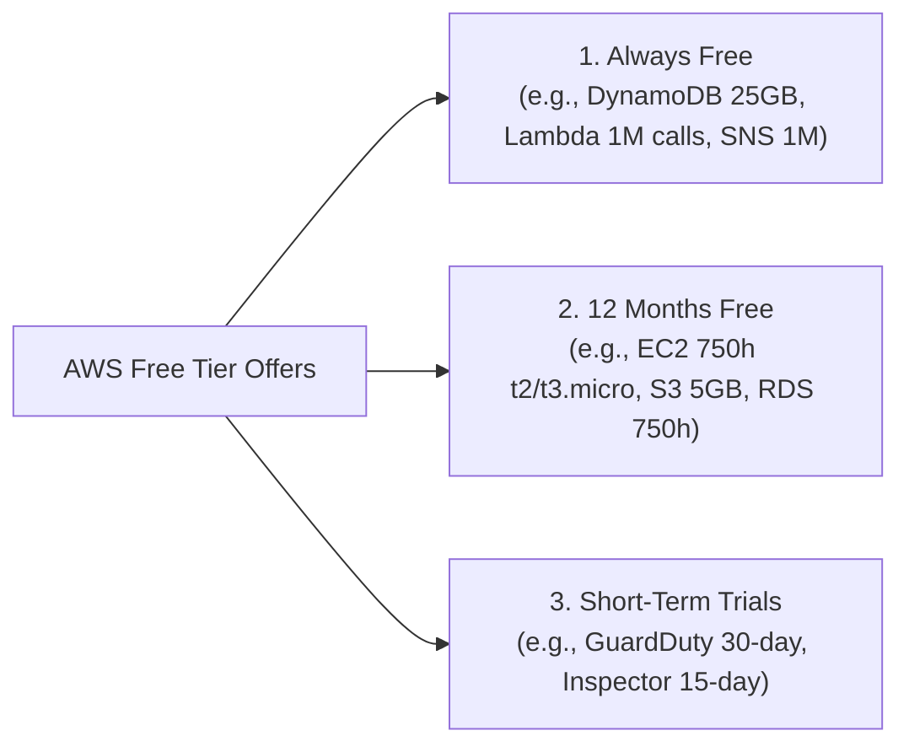

# AWS Certified Cloud Practitioner
## Module 5: Billing, Pricing Models & Support Plans
**Domain 4: Billing, Pricing, and Support (16% of Blueprint)**

*Instructor Delivery Deck & Student Lecture Notes*

---

# AWS Fundamentals of Pricing

AWS operates on three fundamental billing principles:

1. **Pay-as-you-go:** Pay only for what you use; terminate resources when finished.
2. **Pay less when you reserve:** Save up to **72%** with 1- or 3-year commitments (Savings Plans & Reserved Instances).
3. **Pay even less per unit by using more:** Benefit from tiered volume discounts (e.g., S3 storage cost per GB drops as stored volume exceeds 50 TB, 450 TB, 500 TB).

### What Do You Pay For?
- **Compute:** Clock seconds/hours instances or functions run.
- **Storage:** Gigabytes stored per month.
- **Data Transfer Out (DTO):** Data transferred *out* of AWS to the internet. *(Inbound data transfer into AWS is always FREE!)*.

---

# AWS Free Tier Categories

AWS offers three distinct types of Free Tier offers:

- **Always Free:** Available indefinitely to all AWS accounts (e.g., 25 GB of DynamoDB storage, 1 Million Lambda requests per month).
- **12 Months Free:** Available for 12 months following initial AWS signup (e.g., 750 hours/month of Linux/Windows `t2.micro` or `t3.micro`, 5 GB standard S3 storage).
- **Short-Term Trials:** Free trial periods activating upon first service usage (e.g., Amazon SageMaker, Amazon Inspector).

---

# Cost Planning & Forecasting Tools

### 1. AWS Pricing Calculator
- Web-based planning tool (`calculator.aws`) to **estimate the monthly cost of an AWS architecture before deploying it**.
- Models instances, storage, bandwidth, and commitment discounts.

### 2. AWS Cost Explorer
- Interactive visual tool to **analyze, view, and forecast historical and future AWS spending**.
- Displays trends over the past 12 months and forecasts costs for the next 12 months based on historical usage patterns.

### 3. AWS Budgets
- Set custom spending or usage limits and receive proactive alerts via **email or SNS** when actual or forecasted costs exceed your set threshold (e.g., alert at 80% of budget).

---

# Consolidated Billing & Cost Allocation

### Consolidated Billing (via AWS Organizations)
- **One Single Invoice:** Combines billing for all member accounts into the management account.
- **Volume Discounts:** Aggregates usage across accounts to reach lower pricing tiers faster (e.g., combining 3 accounts storing 20 TB each to qualify for the 50 TB+ S3 discount tier).
- **Shared Savings:** Unused Reserved Instances or Savings Plans in one account are automatically applied to matching usage in another member account!

### Cost Allocation Tags
- Key-value pairs (`CostCenter: Marketing`, `Project: Alpha`) assigned to AWS resources.
- Activate tags in the Billing Console to track and break down costs by department, environment, or project team in Cost Explorer.

---

# AWS Support Plans Comparison Matrix

| Plan | Monthly Cost | Primary Channel & Response Time | Key Features |
| :--- | :--- | :--- | :--- |
| **Basic** | Free | Web billing cases only (Zero tech support). | 7 Trusted Advisor checks, Health Dashboard. |
| **Developer** | $29/mo (or 3%) | Email during business hours (<12–24h). | 1 primary contact, building-block architecture guidance. |
| **Business** | $100/mo (or %) | **24/7 Phone, Chat, Email (<1h for Prod Down)**. | **Full Trusted Advisor library**, third-party software support. |
| **Enterprise** | $15,000/mo (or %) | **24/7 Phone/Chat (<15 min for Critical Down)**. | **Dedicated Technical Account Manager (TAM)**, Concierge, IEM included. |

---

# Summary & Exam Checklist

1. **Estimating vs. Tracking:**
   - **Pricing Calculator:** Estimate costs *before* deploying.
   - **Cost Explorer:** Analyze and forecast costs *after* deploying.
   - **AWS Budgets:** Alert when costs breach thresholds.
2. **Data Transfer Rule:** Inbound data is FREE; Outbound data to internet costs money.
3. **Consolidated Billing:** Provides one invoice, aggregates volume discounts, and shares RIs across accounts.
4. **Support Plan Memorization:**
   - Business Support = Minimum tier for 24/7 phone/chat and full Trusted Advisor.
   - Enterprise Support = Only tier with a designated TAM and 15-minute response SLA.

---

# Module 5 Student Review Quiz

1. **A finance director wants to visualize historical AWS spending patterns over the past 12 months and generate predictive cost forecasts for the next quarter. Which tool should they use?**
   * A) AWS Pricing Calculator
   * B) AWS Cost Explorer *(Correct — historical 12-month analytics and predictive forecasting)*
   * C) AWS Budgets
   * D) AWS Billing Conductor

2. **An e-commerce company runs batch data processing jobs that can tolerate unexpected interruptions. Which EC2 purchasing option offers up to a 90% discount compared to On-Demand rates?**
   * A) EC2 Reserved Instances
   * B) EC2 Spot Instances *(Correct — spare EC2 capacity with 2-minute termination notice)*
   * C) EC2 Savings Plans
   * D) EC2 Dedicated Hosts

3. **Which AWS Support tier is the MINIMUM plan that provides 24/7 technical phone, email, and chat access with a 1-hour response SLA for production system outages?**
   * A) Basic Support
   * B) Developer Support
   * C) Business Support *(Correct — 24/7 access, 1-hr production response, full Trusted Advisor)*
   * D) Enterprise On-Ramp Support

