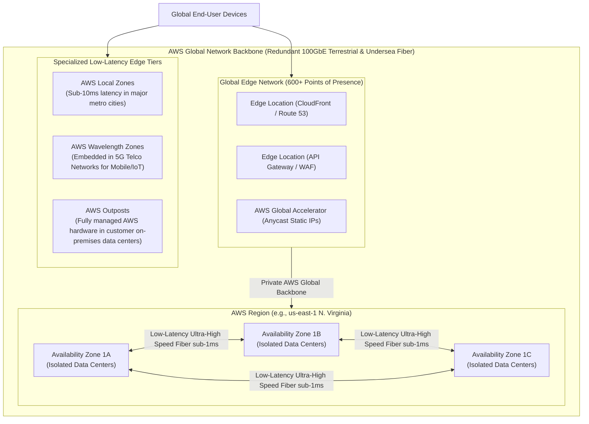

# Master Architecture Blueprint: AWS Global Infrastructure

> **Category:** Global Architecture & Resilience  
> **Course:** AWS Certified Cloud Practitioner (CLF-C02) / SAA-C03  
> **Tags:** `#diagram` `#global-infra` `#architecture`

### Key Conceptual Anchors:
- **Region:** Physical geographical area containing 3 or more isolated Availability Zones connected via low-latency private fiber.
- **Availability Zone (AZ):** One or more discrete data centers with redundant power, networking, and cooling; designed for fault domain isolation.
- **Points of Presence (PoPs):** CloudFront Edge Locations and Regional Edge Caches distributed across 90+ cities in 50+ countries.
- **Local Zones:** Extends AWS compute, storage, and database services to large urban centers (e.g., Los Angeles, Chicago) for latency-sensitive workloads.
- **Wavelength:** Deploys AWS hardware inside telecommunications providers’ 5G data centers for ultra-low latency mobile gaming and autonomous vehicles.
- **Outposts:** AWS racks shipped to physical customer data centers for true hybrid consistency.
