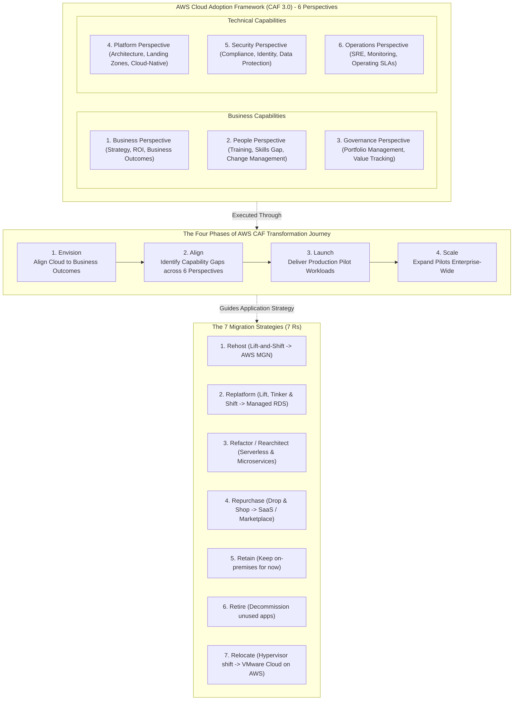

# Master Architecture Blueprint: AWS Cloud Adoption Framework & Migration

> **Category:** Cloud Adoption & Migration Strategy  
> **Course:** AWS Certified Cloud Practitioner (CLF-C02)  
> **Tags:** `#diagram` `#caf` `#migration` `#7rs`

