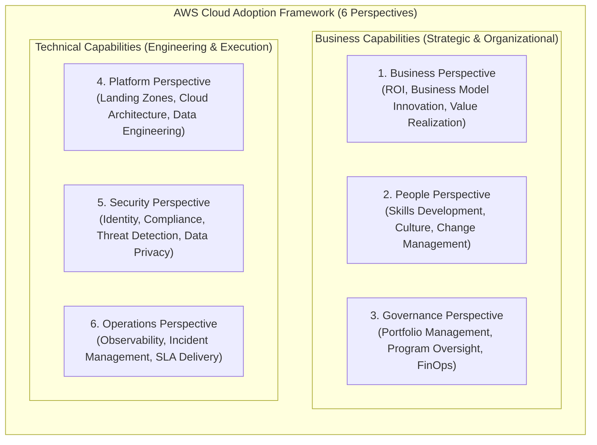
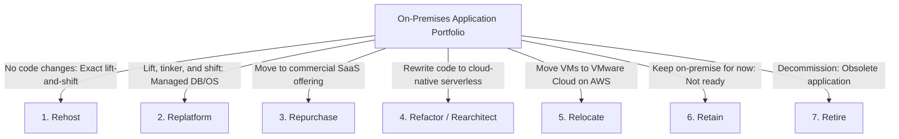

# AWS Cloud Adoption Framework (AWS CAF) & Migration Strategies

> **Knowledge Area:** Cloud Concepts (Domain 1.3) & Migration (Domain 3.8)  
> **Relevant Certifications:** [CLF-C02](../../01_Syllabus/CLF-C02_Master_Blueprint.md), SAA-C03  
> **Tags:** `#aws/concepts` `#aws/migration` `#clf-c02`

---

## 💡 The Real-World Analogy (ELI5)

> **Constructing a Modern Metropolis from the Ground Up:**
> - **Business Perspective:** The mayor, city treasurer, and economic council determining *why* the city is expanding, calculating tax return on investment (ROI), attracting new commercial industries, and securing budget capital.
> - **People Perspective:** The university professors, vocational training centers, and human resources recruiters retraining industrial factory workers to become software engineers and digital civil managers.
> - **Governance Perspective:** The city planning commission establishing municipal zoning laws, program oversight, portfolio roadmaps, and financial guardrails to ensure projects do not exceed their allocated budgets.
> - **Platform Perspective:** The civil engineers and architects designing the foundational physical infrastructure: paved highways, electrical substations, water aqueducts, and modular landing zones (VPCs, accounts, and cloud architecture).
> - **Security Perspective:** The police department, fire marshal, building inspectors, and cyber defense teams enforcing safety codes, biometric access gates, and data protection statutes.
> - **Operations Perspective:** The daily municipal utilities (power maintenance, emergency dispatch, waste management) monitoring telemetry 24/7/365 to ensure drinking water flows smoothly and traffic lights operate without interruption.

---

## 1. First-Principles Systems Transformation & Organizational Mechanics

Cloud migration is fundamentally an organizational and sociotechnical transformation, not merely a technical server relocation:

### 1.1 Conway's Law in Cloud Adoption
* **Conway's Law:** *"Organizations which design systems are constrained to produce designs which are copies of the communication structures of these organizations."*
* **The Cloud Implications:** If an enterprise maintains strictly segregated silos (Database Team, Storage Team, Network Team, Security Team), they will inevitably produce brittle, tightly coupled architectures with multi-month ticketing delays.
* **The Cloud Center of Excellence (CCoE):** AWS CAF advocates establishing a cross-functional Cloud Center of Excellence comprising executive sponsors, lead cloud architects, security officers, and FinOps practitioners to break organizational silos and establish reusable enterprise guardrails.

---

## 2. Historical IT Pain Points: The Pitfalls of Unstructured Cloud Migration

Before AWS codified the Cloud Adoption Framework and the 7 Rs of Migration, enterprise cloud transformations frequently stalled or failed:

| Migration Anti-Pattern | Traditional Unstructured Migration | AWS CAF & 7 Rs Structured Framework |
|---|---|---|
| **The "Throw Over the Wall" Lift-and-Shift** | Blindly copying physical virtual machines to the cloud without rightsizing or optimization, leading to unexpected **cloud bill shock**. | Assess workloads using **AWS Migration Evaluator**; evaluate the 7 Rs to determine whether to Rehost, Replatform, or Refactor. |
| **Workforce Skill Inertia & Resistance** | Engineers feared cloud automation would eliminate their jobs; lack of training led to misconfigurations and project sabotage. | The **People Perspective** builds structured learning paths, cloud certification programs, and cultural psychological safety. |
| **Lack of Financial Governance (FinOps)** | Teams spun up large GPU instances with zero budget tracking, resulting in massive month-end invoice overruns. | The **Governance Perspective** establishes automated AWS Budgets, Cost Allocation Tags, and Service Control Policies (SCPs). |
| **Security Blind Spots** | Migrating legacy perimeter security appliances to cloud without leveraging cloud-native IAM and KMS encryption. | The **Security Perspective** establishes Defense-in-Depth, automated compliance scanning (AWS Config), and identity boundaries. |

---

## 3. Deep-Dive: The 6 AWS CAF Perspectives

The AWS Cloud Adoption Framework (AWS CAF 3.0) structures transformation guidance into **6 Perspectives**, evenly balanced between Business and Technical domains:

### 3.1 Business Capabilities

1. **Business Perspective:**
   * *Target Stakeholders:* Chief Executive Officer (CEO), Chief Financial Officer (CFO), Chief Operating Officer (COO), Business Unit Leaders.
   * *Core Objective:* Ensures that cloud investments directly accelerate business outcomes, generate new revenue streams, optimize return on investment (ROI), and foster digital business model innovation.
   * *Key Capabilities:* Strategy formulation, product monetization, business insights, customer value realization.

2. **People Perspective:**
   * *Target Stakeholders:* Chief Human Resources Officer (CHRO), Training Directors, Change Management Leads, Talent Acquisition.
   * *Core Objective:* Serves as the bridge between technology and people, cultivating an agile cloud culture, closing cloud skills gaps through structured training and certifications, and overcoming organizational resistance to change.
   * *Key Capabilities:* Culture evolution, organizational design, cloud skills readiness, talent recruitment and retention.

3. **Governance Perspective:**
   * *Target Stakeholders:* Chief Information Officer (CIO), Chief Technology Officer (CTO), Program Managers, Enterprise Architects, FinOps Leaders.
   * *Core Objective:* Orchestrates cloud programs, aligns portfolio investments with corporate strategy, establishes cloud financial management (FinOps), and measures business value.
   * *Key Capabilities:* Portfolio management, program oversight, license management, cloud financial management (FinOps).

---

### 3.2 Technical Capabilities

4. **Platform Perspective:**
   * *Target Stakeholders:* Chief Technology Officer (CTO), Enterprise Architects, Cloud Solutions Architects, Infrastructure Engineers.
   * *Core Objective:* Designs, constructs, and modernizes the foundational cloud environment, scalable cloud architectures, multi-account landing zones (AWS Control Tower), and data platforms.
   * *Key Capabilities:* Cloud infrastructure architecture, data engineering, continuous integration and delivery (CI/CD), application modernization.

5. **Security Perspective:**
   * *Target Stakeholders:* Chief Information Security Officer (CISO), Security Architects, Compliance and Internal Audit Officers.
   * *Core Objective:* Establishes identity access controls, data confidentiality, threat detection, vulnerability management, and regulatory compliance (e.g., HIPAA, GDPR, PCI-DSS) across all cloud workloads.
   * *Key Capabilities:* Identity and access governance, incident response, vulnerability management, data protection, infrastructure defense.

6. **Operations Perspective:**
   * *Target Stakeholders:* Chief Operating Officer (COO), Site Reliability Engineering (SRE) Leaders, IT Service Management (ITSM) Directors.
   * *Core Objective:* Ensures that cloud workloads are delivered and operated at agreed-upon business Service Level Agreements (SLAs), managing system health, observability, release cadence, and business continuity.
   * *Key Capabilities:* Observability and performance monitoring, incident and event management, patch and release orchestration, business continuity.

---

## 4. The 7 Rs of Cloud Migration Strategies

When evaluating an existing enterprise portfolio of on-premises applications for cloud migration, AWS defines the **7 Rs Migration Framework**:

### Detailed Breakdown of the 7 Rs:
1. **Rehost ("Lift-and-Shift"):**
   * Moving applications from physical or virtualized on-premise servers to Amazon EC2 with **zero code modifications**.
   * *Best For:* Rapid datacenter evacuation timelines, legacy applications where source code is unavailable.
   * *Primary Tool:* **AWS Application Migration Service (AWS MGN)**.
2. **Replatform ("Lift, Tinker, and Shift"):**
   * Making minimal cloud optimizations to eliminate operational management overhead without modifying the core application code.
   * *Classic Example:* Migrating an on-premises self-managed Oracle database to **Amazon RDS for Oracle**, or moving an application to a managed container runtime (AWS Elastic Beanstalk or ECS).
3. **Repurchase ("Drop-and-Shop"):**
   * Replacing an existing custom or licensed legacy system with a commercial Software-as-a-Service (SaaS) platform.
   * *Classic Example:* Retiring an on-premises Microsoft Exchange email server in favor of a cloud SaaS solution, or adopting Salesforce.
4. **Refactor / Rearchitect:**
   * Completely reimagining and rewriting the application using cloud-native architectures (e.g., decomposing a monolithic Java application into serverless microservices using AWS Lambda, Amazon API Gateway, and Amazon DynamoDB).
   * *Best For:* High business value applications requiring extreme scalability, agility, and performance. Carries the highest upfront engineering effort.
5. **Relocate ("Hypervisor-Level Lift"):**
   * Moving virtual machines at the hypervisor layer without rewriting code, modifying OS configurations, or changing IP addresses (e.g., VMware Cloud on AWS).
6. **Retain ("Do Nothing for Now"):**
   * Keeping workloads on-premises because they were recently upgraded, have heavy physical dependencies, or are subject to unresolved regulatory mandates.
7. **Retire ("Decommission"):**
   * Turning off applications, servers, and storage volumes that are discovered to be obsolete, redundant, or no longer used by the business (typically 10%–20% of an enterprise portfolio).

---

## 5. Multi-Dimensional Migration & CAF Comparison Matrix

| The 7 Rs Strategy | Migration Speed | Engineering Effort | Upfront Cost | Long-Term Cloud Benefit | Primary AWS Service Driver |
|---|---|---|---|---|---|
| **Rehost** | **Fastest** | Minimal (No code changes) | Low | Low to Moderate (IaaS savings) | AWS Application Migration Service (MGN) |
| **Replatform** | Fast | Low (Minor configuration adjustments) | Moderate | Moderate to High (Reduced OS/DB patching) | Amazon RDS, AWS Elastic Beanstalk |
| **Repurchase** | Moderate | Low to Moderate (Data export/import) | Variable (SaaS licensing) | High (Zero infrastructure management) | AWS Marketplace, 3P SaaS solutions |
| **Refactor** | **Slowest** | **Highest** (Complete code rewrite) | High | **Highest** (Maximum elasticity & serverless agility) | AWS Lambda, Amazon ECS/EKS, DynamoDB |
| **Relocate** | Very Fast | Very Low (VMware hypervisor transfer) | Low | Moderate (Familiar tooling) | VMware Cloud on AWS |
| **Retain** | Zero | Zero | Zero | Zero (Workload remains on-prem) | AWS Outposts / AWS Storage Gateway |
| **Retire** | Instant | Minimal (Decommissioning) | **Negative** (Immediate cost savings) | High (Immediate waste elimination) | AWS Application Discovery Service |

---

## 6. Exam Traps & 'Clue-to-Answer' Decryption

| Question Scenario Keyword | Target Perspective / Migration Strategy | Exam Trap & Distractor Explanation |
|---|---|---|
| *"Upskilling employees, cloud training, change management, organizational readiness"* | **People Perspective** | Trap: Do not choose Governance or Business. Training and culture belong to People. |
| *"Measuring business outcomes, managing portfolio, FinOps financial governance"* | **Governance Perspective** | Trap: Do not choose Platform or Operations. Portfolio governance and FinOps belong to Governance. |
| *"Designing landing zones, cloud architecture, and data platform foundations"* | **Platform Perspective** | Trap: Do not confuse with Operations. Designing foundational architecture is Platform; daily monitoring is Operations. |
| *"Ensuring workloads comply with regulations, identity access control, threat detection"* | **Security Perspective** | Trap: Do not select Governance. Technical security, compliance controls, and IAM belong to Security. |
| *"Day-to-day service delivery, observability, monitoring, incident management"* | **Operations Perspective** | Trap: Do not choose Platform. Running and monitoring live systems is Operations. |
| *"Lift-and-shift migration without code modifications"* | **Rehost** | Trap: Do not choose Replatform or Refactor. Zero code change lift-and-shift is Rehost. |
| *"Moving self-managed database to Amazon RDS without modifying application code"* | **Replatform** | Trap: Do not choose Rehost. Adopting a managed service like RDS is Replatform (Lift, Tinker, and Shift). |
| *"Completely rewriting application using serverless microservices and AWS Lambda"* | **Refactor / Rearchitect** | Trap: Do not choose Replatform. Rewriting code into cloud-native serverless architecture is Refactor. |

---

## 7. Post-Topic Question Simulation & Retention Check

### Question 1
**Which perspective of the AWS Cloud Adoption Framework (AWS CAF) focuses on designing scalable cloud architectures, establishing multi-account landing zones, and modernizing data infrastructure?**
- A) People Perspective
- B) Platform Perspective
- C) Business Perspective
- D) Governance Perspective

<b>Click to View Answer & Detailed Distractor Analysis</b>

**Correct Answer:** **B) Platform Perspective**

* **Why it's correct:** The Platform Perspective focuses on the technical capabilities required to architect, provision, and modernize cloud environments, including building enterprise landing zones (AWS Control Tower), architecting scalable VPC networks, and implementing continuous integration and continuous delivery (CI/CD) pipelines.
* **Distractor Analysis:**
  - *A is incorrect:* The People Perspective focuses on organizational culture, cloud training programs, upskilling, and change management.
  - *C is incorrect:* The Business Perspective focuses on business model innovation, ROI calculations, and aligning cloud strategies with corporate monetization goals.
  - *D is incorrect:* The Governance Perspective focuses on portfolio prioritization, program management oversight, and cloud financial governance (FinOps).

---

### Question 2
**An enterprise is bridging the technical skills gap of its IT engineering workforce by implementing comprehensive AWS certification roadmaps and cultural hackathons. Which AWS CAF perspective encompasses this initiative?**
- A) Security Perspective
- B) Operations Perspective
- C) People Perspective
- D) Governance Perspective

<b>Click to View Answer & Detailed Distractor Analysis</b>

**Correct Answer:** **C) People Perspective**

* **Why it's correct:** The People Perspective centers on organizational readiness, workforce transformation, career transition paths, cloud education, and cultivating a forward-thinking culture of continuous learning.
* **Distractor Analysis:**
  - *A is incorrect:* The Security Perspective focuses on identity boundaries, cryptographic controls, compliance audits, and vulnerability mitigation.
  - *B is incorrect:* The Operations Perspective focuses on day-to-day service reliability, system health telemetry, and incident response.
  - *D is incorrect:* The Governance Perspective focuses on project portfolio management, FinOps financial accountability, and vendor licensing.

---

### Question 3
**Managing enterprise program portfolios, measuring business outcome realization, and enforcing cloud financial management (FinOps) best practices belongs to which AWS CAF perspective?**
- A) Governance Perspective
- B) Platform Perspective
- C) Operations Perspective
- D) Security Perspective

<b>Click to View Answer & Detailed Distractor Analysis</b>

**Correct Answer:** **A) Governance Perspective**

* **Why it's correct:** The Governance Perspective is responsible for orchestrating cloud transformation initiatives, prioritizing project portfolios, tracking business value realization, and instituting FinOps cost management processes.
* **Distractor Analysis:**
  - *B is incorrect:* The Platform Perspective focuses on technical architecture, landing zones, and compute/storage infrastructure.
  - *C is incorrect:* The Operations Perspective focuses on daily runtime observability, incident management, and meeting customer SLAs.
  - *D is incorrect:* The Security Perspective focuses on confidentiality, access permissions, threat detection, and regulatory audits.

---

### Question 4
**A company migrates an on-premises legacy web application to Amazon EC2 with zero modifications to the application code or operating system configuration. Which of the 7 Rs migration strategies does this represent?**
- A) Replatform
- B) Refactor
- C) Rehost
- D) Repurchase

<b>Click to View Answer & Detailed Distractor Analysis</b>

**Correct Answer:** **C) Rehost**

* **Why it's correct:** Rehost (commonly referred to as "Lift-and-Shift") involves moving applications directly from physical or on-premises virtualized environments into Amazon EC2 with no code changes, providing the fastest route to datacenter evacuation.
* **Distractor Analysis:**
  - *A is incorrect:* Replatform ("Lift, Tinker, and Shift") involves minor modifications to take advantage of managed services (e.g., switching from self-managed database to Amazon RDS) without core application rewrites.
  - *B is incorrect:* Refactor ("Rearchitect") entails completely rewriting the application code using cloud-native architectures such as serverless microservices.
  - *D is incorrect:* Repurchase ("Drop-and-Shop") involves replacing the application entirely with a third-party SaaS solution.

---

### Question 5
**An organization replaces a self-hosted custom customer relationship management (CRM) application with a third-party commercial Software-as-a-Service (SaaS) solution. Which migration strategy does this exemplify?**
- A) Retain
- B) Repurchase
- C) Replatform
- D) Relocate

<b>Click to View Answer & Detailed Distractor Analysis</b>

**Correct Answer:** **B) Repurchase**

* **Why it's correct:** The Repurchase strategy (also known as "Drop-and-Shop") involves retiring an internally developed or licensed legacy workload and replacing it with an established commercial Software-as-a-Service (SaaS) platform (e.g., Salesforce, Workday, or an AWS Marketplace SaaS product).
* **Distractor Analysis:**
  - *A is incorrect:* Retain involves keeping workloads in the on-premises environment without migrating them.
  - *C is incorrect:* Replatform involves modifying the platform layer (e.g., adopting managed databases or containers) while keeping the custom code.
  - *D is incorrect:* Relocate involves moving virtual machines at the hypervisor level (e.g., VMware Cloud on AWS) without changing code or OS configs.

