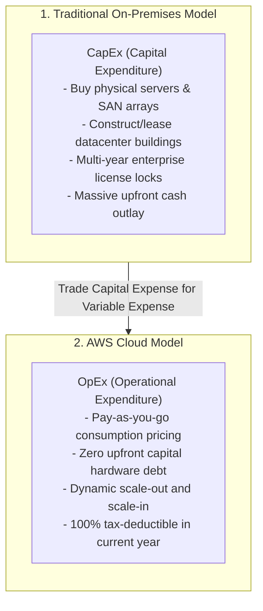
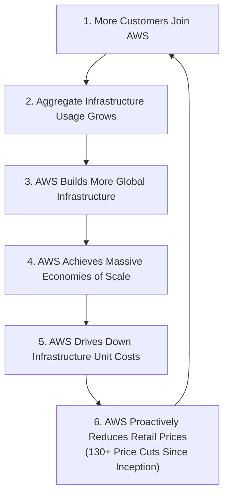
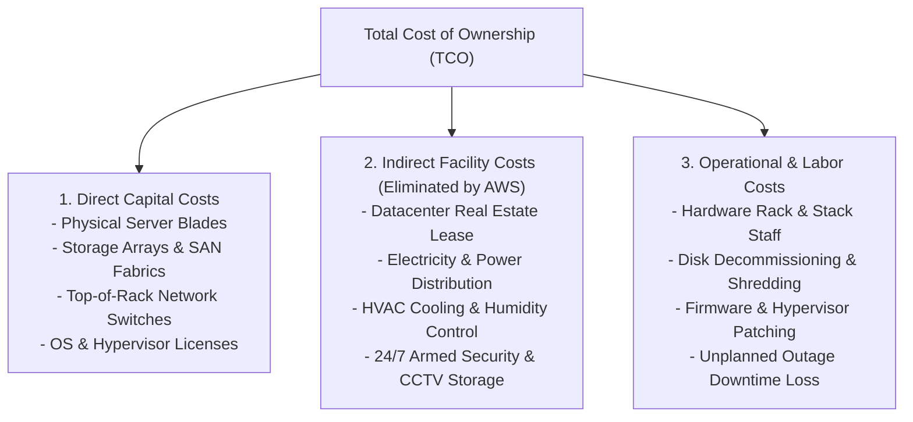
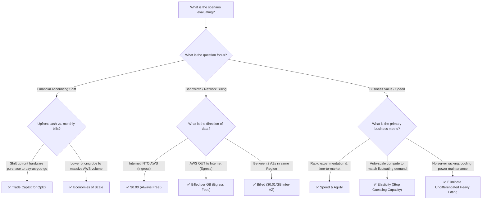

# Cloud Economics and AWS Pricing Principles

> **Knowledge Area:** Cloud Concepts (Domain 1.4) & Billing and Pricing (Domain 4.1)  
> **Relevant Certifications:** [CLF-C02](../../01_Syllabus/CLF-C02_Master_Blueprint.md), SAA-C03  
> **Tags:** `#aws/economics` `#aws/billing` `#clf-c02`

---

## 💡 The Real-World Analogy (ELI5)

> **Renting an Apartment on Airbnb vs. Buying a Condominium:**
> - **Traditional On-Premises (CapEx):** Buying a luxury condominium outright with cash. You must pay a massive upfront cash down payment (\$500,000), pay for property taxes, replace the roof when it leaks, maintain the heating furnace, and pay the electric bill every month whether you live there or travel abroad for 6 months. If your family grows and you need two more bedrooms, you must sell the condo, hire movers, and wait months to close on a larger house.
> - **AWS Cloud Computing (OpEx):** Booking a fully furnished luxury suite on Airbnb. Zero upfront down payment. You pay strictly for the exact nights you stay. Electricity, heating, maintenance, Wi-Fi, and physical security are bundled into the nightly rate. If you need 10 extra rooms for family visiting this weekend, you book 10 rooms instantly with a single click and check out Monday morning.

---

## 1. First-Principles Financial Economics & IT Resource Utilization

To understand the financial revolution of cloud computing, one must analyze the mathematical relationships between capacity planning, depreciation, and capital allocation:

### 1.1 The Mathematics of Hardware Utilization and Deadweight Loss
In traditional IT, servers must be provisioned to survive the **peak annual demand** (e.g., Black Friday or end-of-quarter financial closing):
$$\text{Average Capacity Utilization } (U) = \frac{\text{Mean Compute Demand}}{\text{Peak Provisioned Capacity}}$$
* **The Reality of Idle Compute:** In traditional datacenters, average CPU utilization hovers around **10%–15%**. The remaining 85% of server capacity represents **deadweight economic loss**—electricity, cooling, and capital depreciation expended on silicon doing zero productive work.
* **Elasticity eliminates deadweight loss:** With AWS Auto Scaling, provisioned capacity dynamically tracks actual demand in real time, shifting utilization toward 100% of active capacity and eliminating payments for idle capacity.

### 1.2 Depreciation vs. Operating Cash Flow
* **CapEx (Capital Expenditure):** Hardware purchases are treated as fixed assets on corporate balance sheets. Under accounting standards (GAAP/IFRS), physical servers are depreciated using straight-line amortization over 3 to 5 years:
  $$\text{Annual Depreciation Expense} = \frac{\text{Initial Capital Cost} - \text{Salvage Value}}{\text{Useful Life (Years)}}$$
  This locks corporate capital into rapidly depreciating silicon that becomes obsolete before it is fully amortized.
* **OpEx (Operational Expenditure):** Cloud consumption is billed as an ongoing day-to-day business operational expense. It does not tie up working capital, requires zero debt financing, and is immediately tax-deductible in the current operating year.

---

## 2. Historical IT Pain Points: Sunk Costs and Procurement Lag

Before AWS established on-demand cloud pricing, enterprise IT budgets were dominated by rigid procurement constraints:

| Enterprise Financial Challenge | Traditional On-Premises Data Center | AWS Cloud Economics Paradigm |
|---|---|---|
| **Capital Commitment & Budget Lag** | IT departments underwent **6-to-12 month budget approval cycles** before ordering physical server hardware. | Infrastructure provisioned in **seconds** via AWS APIs; approved through standard operational department budgets. |
| **Hardware Lead Times & Shipping** | Supply chain bottlenecks, server assembly, physical shipping, rack installation, and cabling took **3 to 6 months**. | Provision thousands of virtual CPU cores and petabytes of NVMe storage **instantly**. |
| **Sunk Cost Fallacy & Innovation Risk** | If a new software project failed, the company was still stuck with \$500,000 worth of purchased servers sitting in racks. | If an experimental project fails, **terminate all resources instantly**; total expense is limited to the pennies used during testing. |
| **Datacenter Real Estate & Facilities** | Enterprises carried long-term 10-to-20 year leases on physical datacenter buildings with expensive fixed cooling and power contracts. | **Zero facility commitments**. Turn workloads off when not in use; pay zero facility or electricity overhead. |

---

## 3. The AWS Virtuous Cycle & Economies of Scale

Because AWS aggregates the compute and storage demands of millions of active customers across 190+ countries, it achieves unprecedented purchasing power and operational efficiency:

* **The Virtuous Cycle:** Increased customer usage allows AWS to purchase custom silicon, optical fiber, and servers in colossal bulk volumes at steep discounts. AWS passes these operational savings directly back to customers through regular, proactive price reductions (over 130 price cuts since 2006) without requiring customers to renegotiate contracts.

---

## 4. Total Cost of Ownership (TCO): Direct vs. Indirect Costs

Evaluating the true financial cost of running IT infrastructure requires measuring the **Total Cost of Ownership (TCO)**, which includes both obvious hardware costs and hidden facility and operational overhead:

### 4.1 Cost Categories Analyzed in TCO:
1. **Server and Hardware Costs (Direct):** Server chassis, CPUs, RAM, power supplies, host bus adapters (HBAs), and multi-year maintenance service contracts.
2. **Storage and Networking Costs (Direct):** Fibre Channel switches, SAN storage controllers, hard disk replacement spares, network routers, and transit firewalls.
3. **Facilities and Utilities (Indirect — 100% Eliminated by AWS):**
   - Electrical power utility bills (running servers + running cooling).
   - Cooling infrastructure (chillers, cooling towers, computer room air handlers - CRAHs).
   - Real estate rent, raised floor space, fire suppression systems, and physical security guards.
4. **Operations and Administration (Labor):** Engineering hours spent on racking, cabling, swapping failed hard drives, updating BIOS firmware, and managing hypervisor licenses.
5. **Downtime and Business Opportunity Costs:** Lost e-commerce transactions, SLA breach penalties, and delayed product releases caused by capacity shortages.

---

## 5. AWS Fundamental Pricing Principles

AWS operates under three foundational pricing principles:
1. **Pay-as-you-go:** Pay only for the resources you actually consume. There are no minimum commitments, activation fees, or termination penalties.
2. **Pay less when you reserve:** Save up to 72% compared to On-Demand rates by committing to a consistent volume of compute usage for a 1-year or 3-year term (Savings Plans and Reserved Instances).
3. **Pay even less as AWS grows (Volume-based discounts):** Tiered pricing structures reduce the per-unit cost as usage scales (e.g., [Amazon S3](../../AWS_SERVICES_GLOSSARY.md#amazon-s3) storage cost per GB drops as stored data exceeds 50 TB and 500 TB).

### 5.1 Data Transfer Pricing Rules (Crucial Exam Concept!)
* **Inbound Data Transfer into AWS:** **Always 100% FREE** across all AWS services from the public internet. AWS never charges customers to upload data into the cloud.
* **Outbound Data Transfer (Internet Egress):** Billed per gigabyte (GB) on a tiered sliding scale (e.g., first 100 GB/month egress is free under AWS Free Tier; subsequent egress is charged at ~$0.09/GB in standard regions).
* **Data Transfer within the Same AZ:** Data transfer between EC2 instances in the exact same Availability Zone using private IP addresses is **FREE**.
* **Data Transfer Across AZs:** Billed at a nominal rate (typically \$0.01/GB in and \$0.01/GB out) for crossing AZ boundaries over private AWS dark fiber.
* **Data Transfer Across Regions:** Billed at standard inter-region data transfer rates.

### 5.2 AWS Free Tier Classifications
The AWS Free Tier offers three distinct tiers of free service access:
1. **Always Free:** Never expires; available to all active AWS customers indefinitely (e.g., [AWS Lambda](../../AWS_SERVICES_GLOSSARY.md#aws-lambda): 1,000,000 free requests/month; [Amazon DynamoDB](../../AWS_SERVICES_GLOSSARY.md#amazon-dynamodb): 25 GB of free NoSQL storage; [Amazon CloudWatch](../../AWS_SERVICES_GLOSSARY.md#amazon-cloudwatch): 10 free custom metrics and alarms).
2. **12 Months Free:** Available to new AWS accounts for 12 months following initial registration (e.g., 750 hours/month of Linux `t2.micro` or `t3.micro` EC2 instances; 5 GB of standard S3 storage; 750 hours/month of single-AZ RDS `db.t3.micro` database).
3. **Short-Term Trials:** Short trial periods beginning from the moment a specific service is first activated (e.g., [Amazon SageMaker](../../AWS_SERVICES_GLOSSARY.md#amazon-sagemaker) 2-month free trial; [Amazon Inspector](../../AWS_SERVICES_GLOSSARY.md#amazon-inspector) 15-day free trial; [Amazon GuardDuty](../../AWS_SERVICES_GLOSSARY.md#amazon-guardduty) 30-day free trial).

---

## 6. Multi-Dimensional Decision & Financial Trade-Off Matrix

| Financial & Operational Dimension | Capital Expenditure (CapEx) | Operational Expenditure (OpEx) | AWS Realization |
|---|---|---|---|
| **Upfront Financial Commitment** | Massive upfront cash payment before launching any application | Zero upfront commitment; pay only for actual runtime | Elastic On-Demand compute & storage |
| **Capacity Risk** | High: Risk of costly over-provisioning or business-halting under-provisioning | Zero: Dynamically expand and shrink resources as demand fluctuates | EC2 Auto Scaling, [AWS Lambda](../../AWS_SERVICES_GLOSSARY.md#aws-lambda) serverless |
| **Accounting & Tax Treatment** | Capitalized asset; depreciated on balance sheet over 3 to 7 years | Fully deductible operational expense against revenue in the current tax year | Monthly itemized billing invoice |
| **Agility & Innovation Speed** | Low: Experiments blocked by budget cycles and 6-month hardware lead times | High: Spin up thousands of experimental servers in minutes; terminate if unsuccessful | AWS Management Console & CloudFormation |
| **Physical Facilities Overhead** | Enterprise pays for power, cooling, physical security, and datacenter floor space | 100% absorbed by AWS in the per-unit service price | Security and compliance OF the cloud |

---

## 7. Exam Traps & 'Clue-to-Answer' Decryption

| Question Scenario Keyword | Target Financial Concept | Exam Trap & Distractor Explanation |
|---|---|---|
| *"Trade upfront capital expenditure for variable operational expenditure"* | **Trade CapEx for OpEx** | Trap: Do not confuse with "Stop guessing capacity" or "Economies of scale". CapEx vs OpEx is strictly the financial accounting shift. |
| *"How much does it cost to transfer 10 TB of data into [Amazon S3](../../AWS_SERVICES_GLOSSARY.md#amazon-s3) from on-premises?"* | **$0.00 (Inbound is Free)** | Trap: Inbound data transfer from the internet into AWS is always completely free. Charges apply only to outbound data transfer (egress). |
| *"AWS passes lower operating costs to customers via proactive price cuts"* | **Massive Economies of Scale** | Trap: Do not choose "Pay-as-you-go" or "Agility". Price cuts resulting from aggregate purchasing volume are driven by Economies of Scale. |
| *"Estimate the cost of migrating on-premises architecture to AWS before launching"* | **[AWS Pricing Calculator](../../AWS_SERVICES_GLOSSARY.md#aws-pricing-calculator)** | Trap: Do not choose [AWS Cost Explorer](../../AWS_SERVICES_GLOSSARY.md#aws-cost-explorer). Cost Explorer analyzes historical past usage; [AWS Pricing Calculator](../../AWS_SERVICES_GLOSSARY.md#aws-pricing-calculator) estimates future hypothetical costs. |
| *"Free Tier offering that never expires and remains free indefinitely"* | **Always Free** | Trap: Do not choose "12 Months Free". Always Free includes DynamoDB (25 GB) and Lambda (1M requests/mo) forever. |
| *"Eliminating physical data center cooling, power, and real estate costs"* | **Indirect TCO Savings** | Trap: Hardware purchase is direct; cooling, electricity, real estate, and physical guards are indirect TCO expenses. |

---

## 8. Post-Topic Question Simulation & Retention Check

### Question 1
**Which primary financial advantage of cloud computing allows businesses to eliminate multi-year hardware debt and pay strictly for computing resources as they are consumed?**
- A) Stopping guessing capacity needs
- B) Trading capital expenditure (CapEx) for operational expenditure (OpEx)
- C) Benefiting from massive economies of scale
- D) Increasing speed and agility

<b>Click to View Answer & Detailed Distractor Analysis</b>

**Correct Answer:** **B) Trading capital expenditure (CapEx) for operational expenditure (OpEx)**

* **Why it's correct:** Cloud computing fundamentally transforms corporate IT finance by replacing heavy upfront capital expenditures (CapEx)—buying physical servers, networking switches, and datacenter real estate—with variable operational expenditures (OpEx), paying strictly for consumed resources as an ongoing operational cost.
* **Distractor Analysis:**
  - *A is incorrect:* Stopping guessing capacity needs is an operational and elasticity benefit (using Auto Scaling to adapt to demand), not the financial balance sheet transformation of CapEx to OpEx.
  - *C is incorrect:* Benefiting from massive economies of scale refers to AWS lowering retail prices as global customer usage aggregates, not the customer's choice to pay on-demand.
  - *D is incorrect:* Increasing speed and agility refers to provisioning computing infrastructure in minutes via APIs rather than waiting months for procurement.

---

### Question 2
**Which of the following represents an indirect Total Cost of Ownership (TCO) expense that is completely eliminated when migrating on-premises physical servers to [Amazon EC2](../../AWS_SERVICES_GLOSSARY.md#amazon-ec2)?**
- A) Monthly outbound internet data transfer bandwidth fees
- B) Software engineering salaries for developing application features
- C) Physical data center electrical power, HVAC cooling, and raised floor space leasing
- D) Application code debugging and database schema optimization

<b>Click to View Answer & Detailed Distractor Analysis</b>

**Correct Answer:** **C) Physical data center electrical power, HVAC cooling, and raised floor space leasing**

* **Why it's correct:** Operating an on-premises enterprise facility involves extensive indirect operational overhead: electricity bills, industrial HVAC chillers, backup generators, physical security guards, and square footage lease payments. In AWS, 100% of these physical facility costs are absorbed by AWS as part of "Security OF the Cloud".
* **Distractor Analysis:**
  - *A is incorrect:* Outbound data transfer (internet egress) is an active, ongoing operational charge billed directly by AWS.
  - *B is incorrect:* Application software developer salaries are internal labor costs that remain the customer's ongoing responsibility.
  - *D is incorrect:* Application bug fixing, code maintenance, and database schema performance tuning are customer-owned application responsibilities.

---

### Question 3
**How does AWS continually lower retail pricing for compute, storage, and database services as global cloud adoption expands?**
- A) By mandating 3-year Enterprise Agreements for all active AWS accounts
- B) Through regular, proactive price reductions driven by massive economies of scale
- C) By charging premium subscription rates for inbound data transfer
- D) By requiring customers to manage and patch physical hypervisor servers

<b>Click to View Answer & Detailed Distractor Analysis</b>

**Correct Answer:** **B) Through regular, proactive price reductions driven by massive economies of scale**

* **Why it's correct:** Through the "AWS Virtuous Cycle," aggregate global usage across millions of customers allows AWS to achieve massive economies of scale, purchasing hardware in colossal quantities at lower unit costs and passing those operational efficiencies to customers via more than 130 proactive price reductions.
* **Distractor Analysis:**
  - *A is incorrect:* On-Demand pricing requires zero contracts, zero upfront commitments, and no minimum term agreements.
  - *C is incorrect:* Inbound data transfer into AWS from the internet is always 100% free of charge.
  - *D is incorrect:* AWS manages 100% of the physical hardware and virtualization hypervisors (AWS Nitro System); customers never manage physical hypervisors.

---

### Question 4
**A media agency uploads 50 Terabytes of raw 4K video footage from an on-premises studio into an [Amazon S3](../../AWS_SERVICES_GLOSSARY.md#amazon-s3) bucket located in the us-east-1 Region. How much will AWS invoice the customer for this inbound data transfer?**
- A) $0.09 per Gigabyte transferred
- B) $0.01 per Gigabyte transferred
- C) $0.00 (Inbound internet data transfer is completely free)
- D) A flat monthly fee based on total S3 bucket volume

<b>Click to View Answer & Detailed Distractor Analysis</b>

**Correct Answer:** **C) $0.00 (Inbound internet data transfer is completely free)**

* **Why it's correct:** Inbound data transfer into AWS across all services from the public internet is **always 100% free of charge**. Customers are only charged for storage capacity (per GB/month) and subsequent outbound data transfer (egress) when downloading or streaming files back out to the internet.
* **Distractor Analysis:**
  - *A is incorrect:* $0.09 per GB is an example tiered rate applied to outbound data transfer (egress) to the internet, not inbound transfer.
  - *B is incorrect:* $0.01 per GB is the standard charge for inter-AZ data transfer within a Region, not inbound internet ingress.
  - *D is incorrect:* AWS never charges flat monthly bandwidth fees; S3 charges strictly for storage volume, API requests, and outbound egress.

---

### Question 5
**An enterprise holds existing commercial software licenses for Microsoft Windows Server and SQL Server with active Software Assurance. Which AWS capability allows the company to migrate these workloads to AWS without purchasing new licenses?**
- A) Consolidated Billing
- B) Bring Your Own License (BYOL) managed via AWS License Manager
- C) AWS Free Tier
- D) [AWS Cost Explorer](../../AWS_SERVICES_GLOSSARY.md#aws-cost-explorer)

<b>Click to View Answer & Detailed Distractor Analysis</b>

**Correct Answer:** **B) Bring Your Own License (BYOL) managed via AWS License Manager**

* **Why it's correct:** Bring Your Own License (BYOL) permits customers to leverage their existing on-premises software investments on [Amazon EC2](../../AWS_SERVICES_GLOSSARY.md#amazon-ec2) (frequently on EC2 Dedicated Hosts), while AWS License Manager automates tracking and enforces licensing compliance rules to prevent costly audit violations.
* **Distractor Analysis:**
  - *A is incorrect:* Consolidated Billing is an [AWS Organizations](../../AWS_SERVICES_GLOSSARY.md#aws-organizations) feature that aggregates usage across multiple AWS accounts to achieve tiered volume discounts and provide a single payment invoice.
  - *C is incorrect:* The AWS Free Tier provides limited complimentary access to select AWS services for evaluation and testing.
  - *D is incorrect:* [AWS Cost Explorer](../../AWS_SERVICES_GLOSSARY.md#aws-cost-explorer) is a reporting tool used to visualize, track, and forecast historical and future cloud expenditure.

---

## 🧠 Master MCQ Solving Blueprint: Pattern Decryption & Elimination Tricks

> *This blueprint distills recurring patterns, keyword triggers, and trap options extracted from over 350 questions on Cloud Economics, TCO, and Cloud Value across the official CLF-C02 question bank.*

### 1. The "Clue-to-Service" Linguistic Decryption Matrix
When reading a question scenario, search for these exact phrasing triggers:

| If You See This Trigger Phrase in the Question Stem... | The Correct Concept / Service Is Almost Always... | Trap Distractor to Immediately Discard |
|---|---|---|
| *"Trade fixed upfront capital expenditure for variable ongoing cost"* | **Trade CapEx for OpEx** (Consumption Model) | *Increase CapEx* or *Fixed Cost Model* |
| *"Lower variable costs achieved due to aggregate usage from hundreds of thousands of customers"* | **Benefit from Massive Economies of Scale** | *Fixed Retail Pricing* or *Dedicated Hardware Mandates* |
| *"Eliminate waste from over-provisioning servers for peak traffic"* | **Stop Guessing Capacity** (Elasticity) | *Static Capacity Provisioning* |
| *"Deploy resources in minutes instead of waiting weeks/months for hardware procurement"* | **Increase Speed and Agility** | *High Availability* (Agility is about deployment speed!) |
| *"Focus engineering talent on business logic rather than racking servers, power, and cabling"* | **Eliminate Undifferentiated Heavy Lifting** | *Increase Operational Overhead* |
| *"Deploy applications to customers around the world with just a few clicks"* | **Go Global in Minutes** | *Local Hosting* |
| *"How much does AWS charge for inbound internet data transfer into S3 or EC2?"* | **$0.00 (ALWAYS 100% FREE)** | *$0.09/GB* or *Flat Monthly Bandwidth Fee* |
| *"Which cost is an indirect (soft) cost included in a Total Cost of Ownership (TCO) calculation?"* | **Datacenter power, HVAC cooling, physical security guards, facility real estate** | *Server hardware purchase invoice* (That's a direct cost!) |
| *"Bring existing on-premises software licenses (Windows / SQL Server) to AWS without rebuying"* | **Bring Your Own License (BYOL) / AWS License Manager** | *[AWS Marketplace](../../AWS_SERVICES_GLOSSARY.md#aws-marketplace)* or *Consolidated Billing* |

### 2. The 3-Step Rapid Elimination Heuristic
When evaluating a Cloud Economics or Cloud Value question:
1. **Step 1: Identify the 6 Advantages of Cloud Computing:**
   - Always remember the 6 official AWS Cloud Advantages:
     1. Trade capital expense for variable expense (CapEx → OpEx).
     2. Benefit from massive economies of scale (Virtuous cycle → lower prices).
     3. Stop guessing capacity (Elasticity → scale with demand).
     4. Increase speed and agility (Minutes to deploy).
     5. Stop spending money running and maintaining data centers (No undifferentiated heavy lifting).
     6. Go global in minutes (Worldwide AWS infrastructure).
   - *Any option that contradicts these 6 is an instant elimination decoy!*
2. **Step 2: Check Data Transfer Rules:**
   - **Inbound from the Internet:** ALWAYS **FREE**.
   - **Outbound to the Internet (Egress):** **CHARGED** per GB (tiered).
   - **Data transfer between AWS services in the SAME AZ:** **FREE** (using private IPs).
   - **Data transfer between different AZs in the same Region:** **CHARGED** ($0.01/GB each way).
   - **Data transfer between different AWS Regions:** **CHARGED** (Inter-region data transfer fee).
3. **Step 3: Distinguish Agility vs. Elasticity vs. Scalability:**
   - **Agility:** Time-to-market. How fast can you experiment, spin up a server, or try a new idea? (Minutes, not months).
   - **Elasticity:** Automatic stretching and shrinking. Does the system scale IN during the night to save money, and OUT during the day?
   - **Scalability:** Capacity ceiling. Can the system handle 10x or 100x larger user traffic without falling over?

### 3. High-Frequency Decoy Autopsy: Why AWS Tries to Trick You
* **Decoy #1: "Inbound Data Transfer" Fees**
  - *The Trap:* A company uploads 50 TB of data to AWS. How much does AWS charge for the transfer?
  - *The Autopsy:* AWS questions constantly test this. Candidates think massive data transfers must incur bandwidth charges. **Inbound ingress is ALWAYS \$0.00**. You only pay for the storage (S3 GB/mo) and any future downloads (egress).
* **Decoy #2: "Agility" vs. "Elasticity"**
  - *The Trap:* A startup wants to rapidly launch prototypes and shut down failed experiments within hours.
  - *The Autopsy:* The question asks which cloud benefit this represents. Many pick Elasticity because of the phrase "shut down". But the primary business benefit of rapid experimentation and reduced time-to-market is **Speed and Agility**.
* **Decoy #3: Direct vs. Indirect TCO Costs**
  - *The Trap:* Asking what factor makes cloud cheaper than on-premises besides server hardware.
  - *The Autopsy:* On-premises TCO must factor in **indirect costs**: physical building lease, electricity, cooling chillers, backup generator diesel, network engineers, storage administrators, and downtime losses. AWS covers all these in the base service price.

### 4. 10-Second Visual Decision Flowchart

