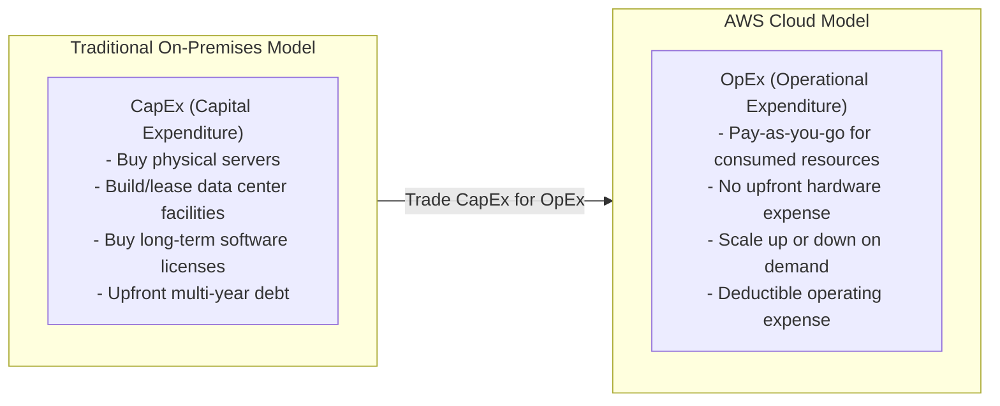
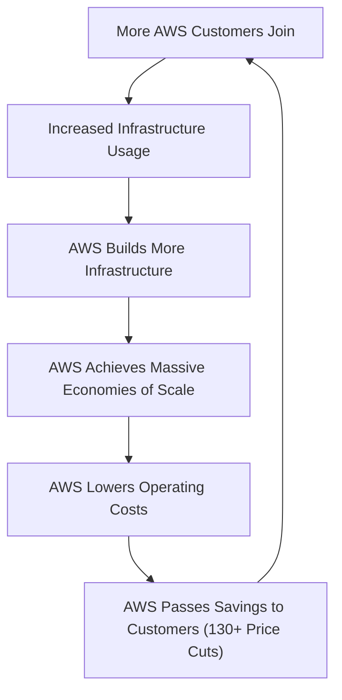
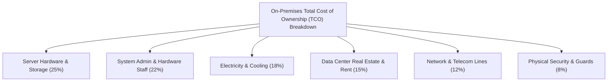
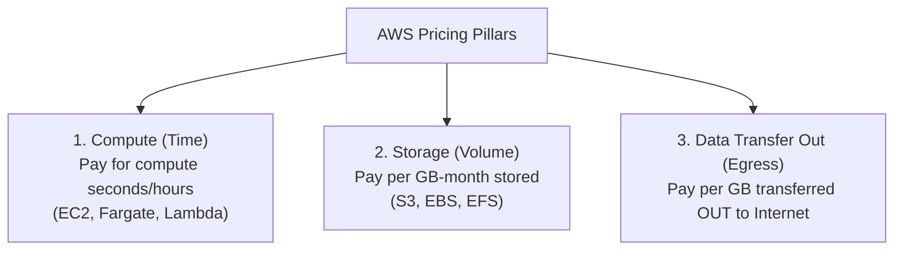

# Cloud Economics and AWS Pricing Principles

> **Knowledge Area:** Cloud Concepts (Domain 1.4) & Billing and Pricing (Domain 4.1)  
> **Relevant Certifications:** [CLF-C02](../../01_Syllabus/CLF-C02_Master_Blueprint.md), SAA-C03  
> **Tags:** `#aws/economics` `#aws/billing` `#clf-c02`

---

## 💡 The Real-World Analogy (ELI5)

> **Renting an Apartment vs. Buying a Condominium:**
> - **Traditional On-Premises (CapEx):** Buying a condo outright. You must pay a massive upfront cash down payment, pay for property taxes, replace the roof, maintain the boiler, and pay the electric bill every month whether you live there or travel. If your family grows, you must sell the condo and wait months to buy a bigger house.
> - **AWS Cloud Computing (OpEx):** Booking a fully furnished luxury suite on Airbnb. Zero upfront down payment. You pay strictly for the nights you stay. Electricity, heating, maintenance, and physical security are included in the nightly price. If you need 10 extra rooms for family visiting this weekend, you rent 10 rooms instantly and release them Monday morning.

---

## 1. Fundamental Financial Shift: CapEx vs. OpEx

Cloud computing transforms corporate finance by shifting IT spending from upfront capital investments to ongoing operational expenses:

| Dimension | Capital Expenditure (CapEx) | Operational Expenditure (OpEx) |
|---|---|---|
| **Payment Timing** | Heavy upfront payment before any business value is realized. | Pay as you consume; billed monthly based on usage. |
| **Capacity Risk** | High: Risk of over-provisioning (wasted money) or under-provisioning (crashed sites). | Zero: Scale compute resources in real time to match exact demand. |
| **Tax Treatment** | Depreciated as an asset over 3 to 7 years. | Fully deductible operating expense in the current tax year. |
| **Commitment** | Locked into physical hardware for years. | Terminate resources anytime with zero lingering penalties. |

---

## 2. Economies of Scale & The AWS Virtuous Cycle

Because AWS aggregates the usage of millions of customers globally, it achieves massive economies of scale that no single company can replicate.

* **Key Takeaway:** As AWS grows, purchasing and operational efficiencies allow AWS to continually reduce retail pricing for compute, storage, and networking services.

---

## 3. Total Cost of Ownership (TCO): Direct vs. Indirect Costs

When comparing on-premises IT costs with AWS Cloud costs, organizations must look beyond just server hardware prices:

### On-Premises Hidden Costs Eliminated by AWS:
1. **Facility Costs:** Land purchase, building construction, data center lease, fire suppression, diesel generators, UPS backup batteries.
2. **Environmental Costs:** Electricity consumption, heavy air conditioning / HVAC cooling units.
3. **Operational Overhead (Undifferentiated Heavy Lifting):** Server racking, physical cabling, failed disk replacements, motherboard swaps, firmware updates.
4. **Maintenance Staffing:** 24/7 on-site physical security guards, facility engineering personnel.

---

## 4. AWS 3 Fundamental Pricing Pillars

Across all AWS services, pricing adheres to three core charging rules:

### Data Transfer Rules (Critical Exam Rule):
* **Inbound Data Transfer:** **Always FREE!** (Transferring data INTO AWS from the internet costs \$0.00).
* **Outbound Data Transfer (Internet Egress):** **Charged per GB** (Aggregated and tiered monthly).
* **Intra-Region Data Transfer:** Data transferred between AWS services within the **same Region and same AZ** is generally **FREE**.
* **Cross-AZ Data Transfer:** Data transferred across AZs within the same Region incurs a small fee (\$0.01 per GB each way).
* **Cross-Region Data Transfer:** Data transferred from one AWS Region to another incurs standard inter-region transfer rates.

---

## 5. Software Licensing in the Cloud

AWS provides flexible licensing models to accommodate enterprise software:

| Licensing Model | Description | Best For | Supported Services |
|---|---|---|---|
| **License Included** | The software license (Windows Server, SQL Server, Red Hat) is bundled directly into the hourly/secondly AWS rate. No separate license purchase is required. | New workloads, dynamic auto-scaling fleets, testing. | Amazon EC2, Amazon RDS |
| **Bring Your Own License (BYOL)** | Customers use their existing on-premises software agreements (e.g., Microsoft Software Assurance) on AWS without paying for redundant licenses. | Long-standing enterprise contracts; saving software licensing costs. | Amazon EC2 (Dedicated Hosts / Dedicated Instances), AWS License Manager |

* **AWS License Manager:** Centrally manages, tracks, and automates software licenses (from Microsoft, SAP, Oracle, IBM) across AWS and on-premises environments, preventing licensing non-compliance fines.

---

## 6. Exam Tip Matrix

| Question Scenario | Correct Financial Concept |
|---|---|
| *"Trading large upfront hardware expenditures for low, variable monthly costs"* | **Trading CapEx for OpEx** |
| *"Why can AWS offer lower prices than a private on-premises data center?"* | **Massive Economies of Scale** |
| *"Customer wants to migrate existing Microsoft SQL Server licenses to EC2 to reduce costs"* | **Bring Your Own License (BYOL)** via **AWS License Manager** |
| *"Is there a charge for uploading 50 TB of data from an on-prem server to Amazon S3?"* | **No (Inbound Data Transfer into AWS is always free)** |
| *"Which costs are included in on-prem TCO that are eliminated when moving to AWS?"* | **Power, cooling, data center real estate, and hardware maintenance** |
---

## 7. Post-Topic Question Simulation & Retention Check

Test your understanding of Cloud Economics and TCO with these 5 exam-style questions:

## 🎯 Exam Traps & 'Clue-to-Answer' Trigger Words

| Exam Question Clue Keyword | Correct Concept | Exam Trap Tip |
| :--- | :--- | :--- |
| *'Heavy upfront investment', 'hardware procurement', 'depreciation'* | **Capital Expenditure (CapEx)** | On-premises traditional IT; cloud eliminates this. |
| *'Pay only for what you consume', 'utility billing', 'operational expense'* | **Operational Expenditure (OpEx)** | Core cloud economic model. |
| *'Overprovisioning to meet peak traffic', 'idle servers outside Christmas'* | **Stop Guessing Capacity** | Solved by EC2 Auto Scaling. |
| *'Lower prices over time due to aggregated customer volume'* | **Massive Economies of Scale** | Over 130+ proactive AWS price cuts historically. |
| *'Racking, stacking, server cabling, data center air conditioning'* | **Undifferentiated Heavy Lifting** | Tasks that cost money but deliver zero unique business value. |

---

### Question 1
**An enterprise is evaluating moving its on-premises data center to AWS. Which financial benefit allows the company to replace large upfront hardware capital investments with ongoing pay-as-you-go operational expenses?**
- A) Stopping guessing capacity
- B) Trading capital expense for operational expense
- C) Benefiting from massive economies of scale
- D) Increasing speed and agility

<b>Click to View Answer & Explanation</b>

**Correct Answer:** **B) Trading capital expense for operational expense**  
- **Why it's correct:** By moving to the cloud, organizations eliminate large upfront Capital Expenditures (CapEx) for physical servers, storage arrays, and data center facilities, replacing them with variable monthly Operational Expenditures (OpEx).
- **Distractor Analysis:**
  - *A is incorrect:* Stopping guessing capacity refers to elastic scaling, not the financial asset vs. operational cost model.
  - *C is incorrect:* Economies of scale refer to AWS lowering unit costs as aggregate customer usage grows.
  - *D is incorrect:* Speed and agility refer to provisioning resources in seconds instead of waiting weeks for procurement.
- **Exam Trigger:** *"Replace upfront capital investments with pay-as-you-go"* -> **Trade CapEx for OpEx**.

### Question 2
**Which of the following costs is an indirect Total Cost of Ownership (TCO) expense eliminated when migrating physical servers to Amazon EC2?**
- A) Monthly outbound internet data transfer
- B) Software development salaries
- C) Data center cooling, electricity, and floor real estate
- D) Application code bug fixes

<b>Click to View Answer & Explanation</b>

**Correct Answer:** **C) Data center cooling, electricity, and floor real estate**  
- **Why it's correct:** Running an on-premises data center involves extensive indirect physical overhead: HVAC chillers, electricity, raised floor space, and physical security guards. AWS manages 100% of these physical facilities.
- **Distractor Analysis:**
  - *A is incorrect:* Outbound internet data transfer (DTO) is an ongoing AWS operational cost.
  - *B & D are incorrect:* Software engineering and bug fixing remain the customer's responsibility.

### Question 3
**How does AWS pass operational efficiencies and purchasing advantages to customers as total global cloud usage grows?**
- A) By mandating 3-year Enterprise Agreements for all users
- B) Through regular, proactive price reductions driven by massive economies of scale
- C) By charging higher rates for inbound data transfer
- D) By requiring customer-managed virtualization hypervisors

<b>Click to View Answer & Explanation</b>

**Correct Answer:** **B) Through regular, proactive price reductions driven by massive economies of scale**  
- **Why it's correct:** Because AWS aggregates usage across millions of customers, it achieves unprecedented purchasing power with hardware suppliers, continually driving down infrastructure costs and passing these savings to customers (over 130 price cuts).
- **Distractor Analysis:**
  - *A is incorrect:* On-Demand pricing requires no contracts or commitments.
  - *C is incorrect:* Inbound data transfer into AWS is always free.
  - *D is incorrect:* AWS manages the virtualization hypervisor (Nitro System).

### Question 4
**A company uploads 20 TB of video files from an on-premises media studio into an Amazon S3 bucket located in the us-east-1 Region. How much will AWS charge for this data transfer?**
- A) $0.09 per GB
- B) $0.01 per GB
- C) $0.00 (Inbound data transfer is completely free)
- D) A flat fee based on bucket size

<b>Click to View Answer & Explanation</b>

**Correct Answer:** **C) $0.00 (Inbound data transfer is completely free)**  
- **Why it's correct:** Inbound data transfer into AWS from the internet across all AWS services is **always free of charge**.
- **Distractor Analysis:**
  - *A & B are incorrect:* Charges apply to outbound data transfer (egress to internet) or inter-AZ transfer, never inbound from the internet.

### Question 5
**An enterprise has existing software licenses for Microsoft Windows Server and SQL Server with active Software Assurance. Which AWS program or tool helps the company run these licenses on AWS without paying twice?**
- A) Consolidated Billing
- B) Bring Your Own License (BYOL) managed via AWS License Manager
- C) AWS Free Tier
- D) AWS Cost Explorer

<b>Click to View Answer & Explanation</b>

**Correct Answer:** **B) Bring Your Own License (BYOL) managed via AWS License Manager**  
- **Why it's correct:** BYOL allows organizations to migrate existing eligible enterprise software licenses to Amazon EC2 (often on Dedicated Hosts), while AWS License Manager tracks and enforces license usage to prevent compliance violations.
- **Distractor Analysis:**
  - *A is incorrect:* Consolidated Billing combines multi-account usage for volume discounts.
  - *C is incorrect:* Free Tier provides limited free usage for new accounts.
  - *D is incorrect:* Cost Explorer visualizes historical and forecasted costs.

