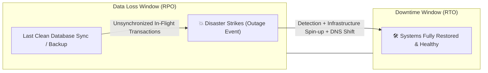
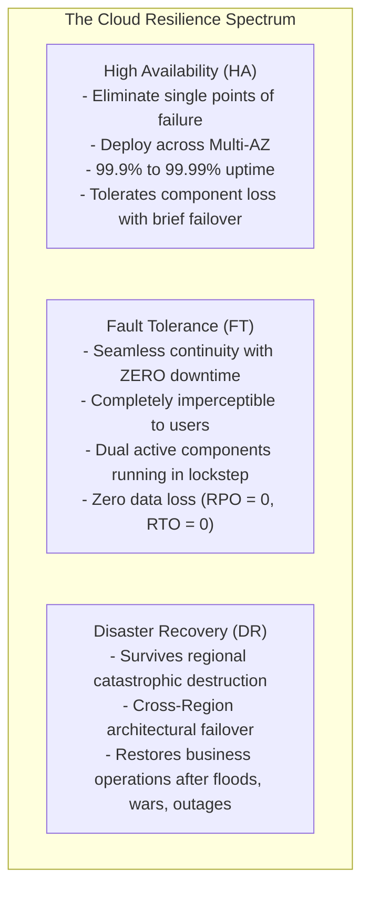
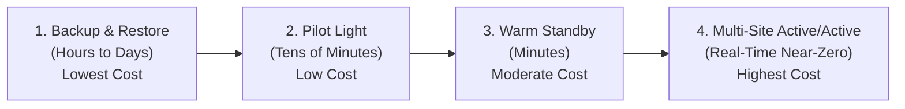

# Disaster Recovery and High Availability

> **Knowledge Area:** Cloud Concepts (Domain 1.1) & Technology (Domain 3.2, 3.6)  
> **Relevant Certifications:** [CLF-C02](../../01_Syllabus/CLF-C02_Master_Blueprint.md), SAA-C03, DVA-C02  
> **Tags:** `#aws/concepts` `#aws/resilience` `#clf-c02`

---

## 💡 The Real-World Analogy (ELI5)

> **The 4 Spare Tire Strategies for an Emergency Road Trip:**
> 1. **Backup & Restore (Hours to Days):** Carrying an uninflated tire patch kit and a manual bicycle hand pump in your trunk. It takes almost zero space and costs \$10, but if you get a flat on the highway in a thunderstorm, you must spend 3 hours on the roadside manually patching and pumping the tire.
> 2. **Pilot Light (Tens of Minutes):** Carrying an unmounted rim and an electric 12V air compressor in the trunk. The core metal wheel is ready, but when a blowout occurs, you must jack up the car, mount the tire, plug in the compressor, and inflate it before continuing.
> 3. **Warm Standby (Minutes):** Carrying a pre-inflated "donut" spare tire already mounted on a secondary wheel. When a blowout occurs, you quickly bolt on the donut tire. It runs at a lower speed (scaled-down capacity), but gets you moving in minutes while you slowly drive to the full repair facility.
> 4. **Multi-Site Active/Active (Zero Downtime / Near-Instant):** Driving an 18-wheel commercial semi-truck equipped with dual tires on every axle. If one tire blows out at 75 mph, the paired tire instantly carries the load without the truck even wobbling or slowing down.

---

## 1. First-Principles Computer Science & Distributed Systems Mechanics

Designing high-availability and disaster-recovery systems requires navigating the fundamental mathematical laws of distributed computing:

### 1.1 The CAP Theorem and PACELC in High Availability
* **The CAP Theorem:** In any distributed data store, you can only guarantee at most two out of three properties: **Consistency (C)**, **Availability (A)**, and **Partition Tolerance (P)**. Because physical network partitions ($P$) between datacenters are inevitable over time, distributed systems must choose between Consistency ($CP$) or Availability ($AP$).
* **Synchronous vs. Asynchronous Replication:**
  - **Synchronous Replication (Multi-AZ):** A database transaction is only confirmed as committed after the Write-Ahead Log (WAL) block has been written to disk in **both** Availability Zone A and Availability Zone B:
    $$T_{\text{commit}} = T_{\text{local}} + \text{RTT}_{\text{cross-AZ}} + T_{\text{remote-fsync}}$$
    Because AZs are connected via private dark fiber with $< 1\text{–}2\text{ ms}$ latency, synchronous replication is feasible without crippling database transaction throughput. **RPO = 0 (Zero data loss).**
  - **Asynchronous Replication (Cross-Region):** Across continental distances ($> 1{,}000\text{ km}$), network propagation delays ($> 50\text{ ms}$) make synchronous replication impossible without bringing transactional databases to a standstill. Cross-region data replication (e.g., RDS Read Replicas or S3 Cross-Region Replication) is therefore **asynchronous**. Transactions are committed locally first and shipped across regions milliseconds later. **RPO > 0 (Small data loss window).**

---

## 2. Historical IT Pain Points: The Legacy On-Premises Reality

Before automated cloud disaster recovery, enterprise business continuity was one of the most expensive and error-prone disciplines in IT:

| Enterprise DR Challenge | Traditional On-Premises Data Center | AWS Cloud Resilience Paradigm |
|---|---|---|
| **Tape Archiving & Off-Site Vaulting** | Nightly backup tapes were written manually, packed into metal boxes, and driven by courier truck to underground limestone vaults (Iron Mountain). Restoring from tape took **2 to 5 days**. | **Amazon S3 & AWS Backup**. Automated, continuous snapshot replication across 3+ AZs with instant restore APIs. |
| **Idle Secondary Data Centers** | Large enterprises built duplicate "hot sites" with identical hardware that sat $100\%$ idle 24/7/365, wasting tens of millions in capital expense. | **Cloud Elasticity**. With Infrastructure as Code (CloudFormation), secondary DR infrastructure can be spun up in minutes only when disaster strikes. |
| **Annual Failover Disasters** | Companies ran mandatory DR failover drills once a year on weekends. Inevitably, IP address conflicts, obsolete drivers, and configuration drift caused the test to fail. | **Automated Chaos Testing**. Test failovers continuously during normal business hours using AWS Fault Injection Service without impacting end users. |

---

## 3. Resilience Terminology: HA vs. FT vs. DR

To master AWS architectures, you must clearly distinguish between three distinct resilience paradigms:

* **High Availability (HA):** Architectural design that ensures systems operate continuously with minimal downtime (measured in "nines," e.g., 99.99% uptime = 52 minutes of downtime/year). Achieved by clustering components across **Multiple Availability Zones (Multi-AZ)** behind an Elastic Load Balancer.
* **Fault Tolerance (FT):** The ability of a system to continue operating without interruption even when components experience severe hardware failure. There is zero failover degradation and zero dropped user requests.
* **Disaster Recovery (DR):** The strategic processes, tools, and policies used to recover critical technology infrastructure and resume business operations after a catastrophic event (such as a regional power collapse or natural disaster). DR typically operates **across multiple AWS Regions**.

---

## 4. Fundamental Recovery Metrics: RPO vs. RTO

Every business disaster recovery plan is strictly defined by two foundational operational metrics:

| Metric | Full Name | Definition | Business Question Answered |
|---|---|---|---|
| **RPO** | **Recovery Point Objective** | The maximum acceptable volume of data loss measured in time backward from the point of failure. | *"How many minutes or hours of customer transactional data can the business afford to permanently lose?"* |
| **RTO** | **Recovery Time Objective** | The maximum acceptable duration of system downtime forward in time from the moment of outage until restoration. | *"How long can the application remain completely offline before business operations or reputation suffer catastrophic harm?"* |

> [!TIP]
> **High-Yield Memory Anchor:**
> - **RPO = Point in Time / Data Loss Window** (Yesterday's backup = 24 hours of lost transactions).
> - **RTO = Time to Restore / Downtime Duration** (Taking 4 hours to boot replacement servers = 4-hour RTO).

---

## 5. The 4 Disaster Recovery Strategies

AWS defines 4 standardized disaster recovery strategies spanning the spectrum from lowest cost / slowest recovery to highest cost / zero recovery time:

### 5.1 Strategy 1: Backup and Restore
* **How it works:** Data and snapshots are backed up regularly (using AWS Backup or Amazon S3 Cross-Region Replication) to a secondary AWS Region. No compute instances run in the DR region during normal operations.
* **Failover Process:** When a primary region fails, operations teams trigger automation templates (CloudFormation) to provision VPCs, launch EC2 fleets from AMIs, and restore databases from snapshots.
* **RPO & RTO:** RPO is measured in hours (time since last snapshot); RTO is measured in hours or days (time required to restore petabytes of disk blocks and initialize operating systems).
* **Cost Profile:** **Lowest Cost**. You pay only for cold storage of snapshots and AMIs.

### 5.2 Strategy 2: Pilot Light
* **How it works:** Analogous to a gas heater's pilot light, the core critical data storage engine is kept running live 24/7 in the secondary region. Databases continuously replicate transactions asynchronously. However, the heavy compute layer (web/app servers) is kept completely turned off.
* **Failover Process:** Upon primary region failure, Auto Scaling groups rapidly launch EC2 instances from pre-baked AMIs and attach to the live replicated database.
* **RPO & RTO:** RPO is measured in seconds to minutes (asynchronous database replication lag); RTO is measured in tens of minutes (time to spin up and register compute fleets).
* **Cost Profile:** **Low Cost**. You pay for the running secondary database instance and EBS storage, but zero compute server fleet costs.

### 5.3 Strategy 3: Warm Standby
* **How it works:** A fully functional, but **scaled-down** (minimal capacity) replica of the entire production stack runs live 24/7 in the secondary AWS Region (e.g., 2 small instances running instead of 20 large instances).
* **Failover Process:** When primary failure occurs, Amazon Route 53 health checks automatically shift traffic to the secondary region, while Auto Scaling immediately scales out the minimal fleet to full production capacity.
* **RPO & RTO:** RPO is near-zero (sub-second database sync); RTO is measured in minutes (time required for Auto Scaling to scale from 2 instances to 20).
* **Cost Profile:** **Moderate Cost**. You pay for running compute, storage, load balancers, and databases continuously in both regions.

### 5.4 Strategy 4: Multi-Site Active/Active
* **How it works:** A full-scale, fully provisioned production environment runs simultaneously in two or more AWS Regions. Global traffic is dynamically distributed across all regions using Amazon Route 53 weighted or latency-based routing. Data is synchronized bidirectionally in real time (e.g., Amazon DynamoDB Global Tables or Amazon Aurora Global Database).
* **Failover Process:** If one Region collapses, Route 53 health checks detect the failure in seconds and seamlessly divert all global traffic to the remaining healthy Region(s).
* **RPO & RTO:** **Near-zero RPO and near-zero RTO**. Zero perceived disruption to active users.
* **Cost Profile:** **Highest Cost**. You pay for dual full-scale production infrastructure running continuously.

---

## 6. Multi-Dimensional DR Strategy Comparison Matrix

| Disaster Recovery Strategy | RPO (Data Loss Window) | RTO (Downtime Duration) | Relative Financial Cost | Secondary Region Footprint | Failover Automation Complexity |
|---|---|---|---|---|---|
| **Backup and Restore** | Hours (snapshot schedule) | Hours to Days | **$** (Lowest) | Only cold S3/EBS storage snapshots | High manual or scripted restoration effort |
| **Pilot Light** | Seconds to Minutes | Tens of Minutes (10–30m) | **$$** (Low) | Live replicating database; zero compute instances | Moderate: automated EC2 launch & DNS repoint |
| **Warm Standby** | Sub-seconds to Minutes | Minutes (1–5m) | **$$$** (Medium-High) | Scaled-down live compute + full live database | Low: Auto Scaling scales existing live fleet |
| **Multi-Site Active/Active** | Near-Zero (milliseconds) | Near-Zero (seconds) | **$$$$$** (Highest) | Full-scale live production infrastructure in both regions | Minimal: automated Route 53 DNS failover |

---

## 7. Exam Traps & 'Clue-to-Answer' Decryption

| Question Scenario Keyword | Target DR Solution | Exam Trap & Distractor Explanation |
|---|---|---|
| *"Maximum acceptable data loss measured in time backward from disaster"* | **Recovery Point Objective (RPO)** | Trap: Do not choose RTO. RPO is about data loss; RTO is about time to restore. |
| *"Maximum acceptable downtime before system is restored"* | **Recovery Time Objective (RTO)** | Trap: Do not choose RPO. RTO is duration of downtime. |
| *"Core database replicates continuously, compute instances launched only during disaster"* | **Pilot Light** | Trap: Do not confuse with Warm Standby. Pilot Light has NO compute running; Warm Standby has a small scaled-down compute fleet running. |
| *"Scaled-down minimal production replica running 24/7 in secondary region"* | **Warm Standby** | Trap: Do not confuse with Pilot Light. The presence of running compute instances defines Warm Standby. |
| *"Zero downtime, real-time traffic served across multiple AWS Regions simultaneously"* | **Multi-Site Active/Active** | Trap: Do not choose Warm Standby. Active/Active serves production traffic from all regions simultaneously. |
| *"Automatic database failover within 60-120 seconds if an Availability Zone fails"* | **Amazon RDS Multi-AZ** | Trap: Do not choose Read Replica. Read Replicas are for read scalability; Multi-AZ is for synchronous disaster recovery and automated failover. |

---

## 8. Post-Topic Question Simulation & Retention Check

### Question 1
**An architecture requires high availability and automated synchronous database failover with zero data loss in the event that a power outage causes a physical data center facility failure. Which AWS configuration satisfies this requirement?**
- A) Deploying an Amazon RDS DB instance in a single Availability Zone with hourly automated snapshots
- B) Deploying an Amazon RDS Multi-AZ deployment across two Availability Zones
- C) Creating an asynchronous Amazon RDS Read Replica in a separate AWS Region
- D) Exporting database transaction logs daily to an Amazon S3 Glacier Flexible Retrieval vault

<b>Click to View Answer & Detailed Distractor Analysis</b>

**Correct Answer:** **B) Deploying an Amazon RDS Multi-AZ deployment across two Availability Zones**

* **Why it's correct:** Amazon RDS Multi-AZ synchronously replicates database transactions to a standby replica in a completely separate Availability Zone within the same Region. If the primary AZ experiences an infrastructure failure, RDS automatically triggers an unassisted DNS failover to the standby replica in 60–120 seconds with zero data loss (RPO = 0).
* **Distractor Analysis:**
  - *A is incorrect:* A single-AZ RDS instance represents a fatal single point of failure; if that AZ crashes, the database is offline until the hardware recovers or snapshots are manually restored.
  - *C is incorrect:* RDS Read Replicas utilize asynchronous replication primarily designed to scale read-heavy application query traffic, not to provide automated synchronous high-availability failover.
  - *D is incorrect:* Daily S3 Glacier exports result in up to 24 hours of permanent transactional data loss (RPO = 24 hours) and hours of retrieval latency.

---

### Question 2
**What is the defining architectural characteristic of a "Pilot Light" Disaster Recovery strategy?**
- A) A scaled-down version of the complete application fleet runs 24/7 in the secondary disaster recovery region
- B) Critical core database engines are kept running and continuously synchronized in the DR region, while compute servers remain turned off until failover is triggered
- C) Full-scale production workloads serve live customer traffic simultaneously from two AWS Regions
- D) Application data is backed up to tape archives and physically shipped to a disaster facility

<b>Click to View Answer & Detailed Distractor Analysis</b>

**Correct Answer:** **B) Critical core database engines are kept running and continuously synchronized in the DR region, while compute servers remain turned off until failover is triggered**

* **Why it's correct:** In a Pilot Light DR pattern, the core data layer (the "pilot flame") is kept running continuously in the secondary region to maintain low RPO through asynchronous replication, while heavy application compute instances (EC2) are kept off and launched only during a declared disaster event.
* **Distractor Analysis:**
  - *A is incorrect:* Running a scaled-down, live compute fleet 24/7 defines the **Warm Standby** strategy, not Pilot Light.
  - *C is incorrect:* Serving live traffic from multiple fully provisioned regions simultaneously defines the **Multi-Site Active/Active** strategy.
  - *D is incorrect:* Physical tape archiving describes obsolete on-premises legacy practices, completely contrary to cloud automation.

---

### Question 3
**An online banking application establishes a business policy stating that in the event of a catastrophic system failure, the maximum allowable transactional data loss cannot exceed 15 minutes. What metric does this represent?**
- A) Recovery Time Objective (RTO)
- B) Recovery Point Objective (RPO)
- C) Mean Time to Detect (MTTD)
- D) Service Level Agreement (SLA)

<b>Click to View Answer & Detailed Distractor Analysis</b>

**Correct Answer:** **B) Recovery Point Objective (RPO)**

* **Why it's correct:** Recovery Point Objective (RPO) measures the maximum acceptable amount of data loss backward in time from the point of failure. A 15-minute RPO mandates that data replication or backup snapshots must capture changes at least every 15 minutes.
* **Distractor Analysis:**
  - *A is incorrect:* Recovery Time Objective (RTO) measures the duration of downtime forward in time from the moment of outage until systems are restored.
  - *C is incorrect:* Mean Time to Detect (MTTD) measures how long it takes operational monitoring systems to discover that a failure has occurred.
  - *D is incorrect:* A Service Level Agreement (SLA) is a contractual commitment between a service provider and customer defining overall uptime availability percentages (e.g., 99.99%).

---

### Question 4
**Which database replication mechanism is utilized between the primary instance and the standby replica in an Amazon RDS Multi-AZ configuration?**
- A) Asynchronous batch replication executed once every 60 minutes
- B) Synchronous block-level replication across private dark-fiber AZ interconnects
- C) Client-side manual SQL dual-insert scripts
- D) Public internet batch replication via Amazon CloudFront

<b>Click to View Answer & Detailed Distractor Analysis</b>

**Correct Answer:** **B) Synchronous block-level replication across private dark-fiber AZ interconnects**

* **Why it's correct:** In RDS Multi-AZ, storage write operations are synchronously written at the physical storage block level to both the primary and standby disks across low-latency (< 1–2 ms) private dark-fiber networks before a transaction is acknowledged as committed to the client.
* **Distractor Analysis:**
  - *A is incorrect:* Synchronous replication occurs in real time per transaction, not in 60-minute asynchronous batches.
  - *C is incorrect:* Multi-AZ replication is handled completely under the hood by AWS storage infrastructure; application code requires zero dual-write logic.
  - *D is incorrect:* Multi-AZ traffic never traverses the public internet or CloudFront CDN edge locations; it remains strictly within AWS's private regional fiber network.

---

### Question 5
**Which Disaster Recovery strategy delivers near-zero RTO and near-zero RPO with production traffic actively served from multiple geographically separated AWS Regions simultaneously?**
- A) Pilot Light
- B) Warm Standby
- C) Backup and Restore
- D) Multi-Site Active/Active

<b>Click to View Answer & Detailed Distractor Analysis</b>

**Correct Answer:** **D) Multi-Site Active/Active**

* **Why it's correct:** Multi-Site Active/Active deploys full-scale production environments across multiple AWS Regions, actively serving live traffic simultaneously using Amazon Route 53 Anycast routing and bidirectional real-time database synchronization (e.g., DynamoDB Global Tables), achieving near-instantaneous failover with zero perceptible downtime.
* **Distractor Analysis:**
  - *A is incorrect:* Pilot Light runs zero compute in the secondary region and requires 10 to 30 minutes to launch instances.
  - *B is incorrect:* Warm Standby runs only a minimal scaled-down fleet in the secondary region and takes minutes to scale up to full production capacity.
  - *C is incorrect:* Backup and Restore requires hours or days to provision new infrastructure and restore data from cold storage.

