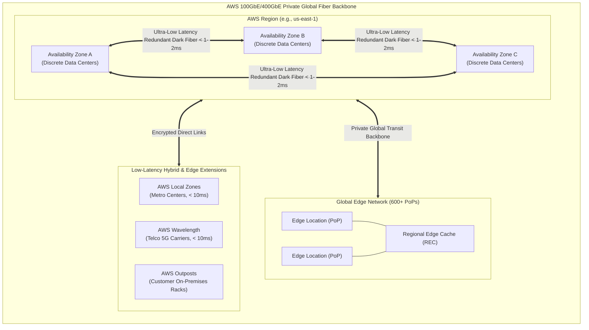
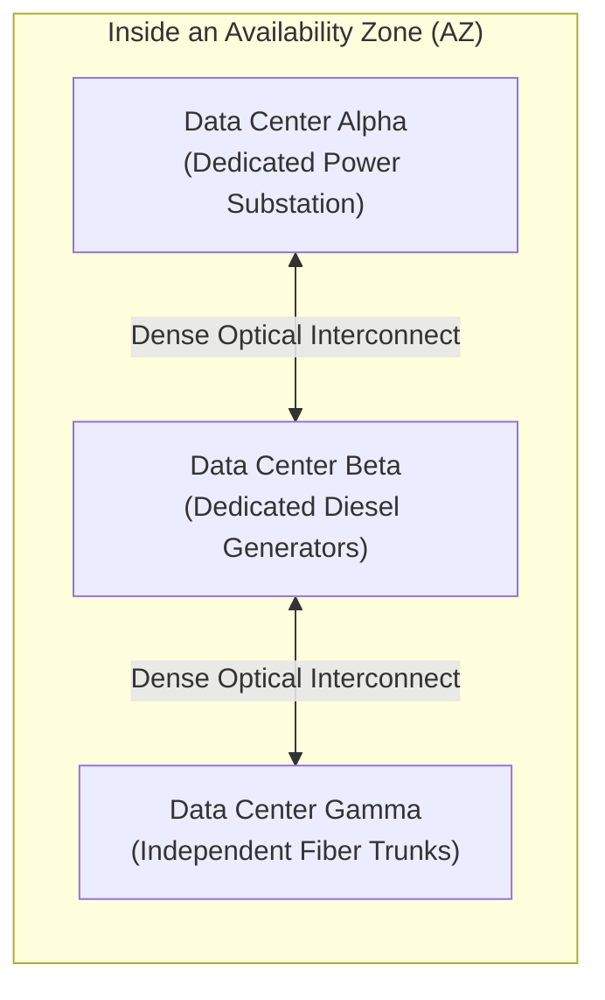
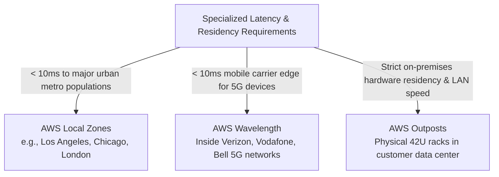

# AWS Global Infrastructure

> **Knowledge Area:** Cloud Concepts (Domain 1.1) & Cloud Technology (Domain 3.1)  
> **Relevant Certifications:** [CLF-C02](../../01_Syllabus/CLF-C02_Master_Blueprint.md), SAA-C03, AIF-C01  
> **Tags:** `#aws/concepts` `#aws/infrastructure` `#clf-c02`

---

## 💡 The Real-World Analogy (ELI5)

> **The Global Airport & Logistics Network:**
> - **AWS Region:** A major world metropolitan area (e.g., London, Tokyo, Frankfurt). It is an autonomous geographical entity containing multiple distinct airports and logistics facilities.
> - **Availability Zone (AZ):** An individual, fully functional international terminal (Terminal A, Terminal B, Terminal C) located tens of miles apart in that metropolitan area. Each terminal features its own dedicated power substation, emergency diesel turbine generators, independent municipal water cooling lines, and private flood protection. However, they are connected to each other via a high-speed underground transit system (private dark fiber) with near-instant transit times (< 1–2 milliseconds). If Terminal A experiences a catastrophic power outage, international passenger flights land at Terminal B without disruption.
> - **Edge Location (Point of Presence - PoP):** City-center satellite ticket offices, package pickup lockers, and express drop-off kiosks situated in over 600 locations worldwide. Travelers in Lisbon or Seattle can validate tickets or pick up cached parcels locally in milliseconds without traveling all the way to the main regional airport hub.
> - **AWS Local Zones & Wavelength:** Micro-terminals placed directly in metropolitan downtown centers (Local Zones) or inside 5G telecommunication towers (Wavelength), enabling instantaneous sub-millisecond reaction times for self-driving vehicles, live mobile rendering, and urban hospitals.
> - **AWS Outposts:** An official AWS delivery vehicle and secure automated conveyor belt leased and bolted directly inside your company's private basement mailroom.

---

## 1. First-Principles Computer Science & Physical Mechanics

To understand why AWS architectures are structured into Regions, Availability Zones, and Edge Locations, one must examine the physical realities of physics, networking, and fault domains:

### 1.1 The Physics of Latency: The Speed of Light in Fiber
Network communication relies on pulses of light traveling through silica glass fiber optic cables.
* **Refractive Index & Propagation Delay:** Light in a vacuum travels at approximately $300{,}000\text{ km/s}$. Inside standard single-mode optical fiber (refractive index $n \approx 1.468$), the speed drops by roughly 30%:
  $$\nu = \frac{c}{n} \approx \frac{300{,}000\text{ km/s}}{1.468} \approx 204{,}360\text{ km/s}$$
* **Round-Trip Time (RTT):** To transmit a data packet 100 km and receive an acknowledgment requires a theoretical minimum light-propagation delay of:
  $$\text{RTT} = \frac{2 \times 100\text{ km}}{204{,}360\text{ km/s}} \approx 0.978\text{ ms}$$
* **The Engineering Consequence:** You cannot maintain synchronous database replication (e.g., two-phase commit without transaction throughput collapse) across continents because transmitting packets across 8,000 km imposes an unavoidable physical latency of $> 80\text{ ms}$. This physical reality dictates why **Availability Zones** are geographically clustered within tens of kilometers to guarantee $< 1\text{–}2\text{ ms}$ latency for synchronous writes, whereas **Regions** are separated by hundreds or thousands of kilometers for catastrophic disaster recovery.

### 1.2 Fault Domains and Correlated Failure
In reliability engineering, a **fault domain** is a set of physical components that can fail together due to a single shared point of vulnerability:
* **Shared Power Grids:** Data centers connected to the same municipal utility substation can simultaneously lose power during a transformer explosion or blackout.
* **Shared Flood Plains & Seismic Faults:** Facilities on the same river basin or geological fault line face correlated environmental disruption.
* **AWS Architectural Mandate:** Every AWS Availability Zone is engineered on isolated power utility feeds, separate flood plain assessments, independent backup generator fuel lines, and dedicated municipal water infrastructure to guarantee that no single catastrophic physical failure propagates between AZs.

---

## 2. Historical IT Pain Points: The On-Premises Reality

Before global cloud infrastructure was accessible via on-demand APIs, deploying multi-datacenter resilient infrastructure was an agonizing, multi-million dollar challenge:

| On-Premises Multi-Site Challenge | Traditional Physical Enterprise | AWS Global Infrastructure Solution |
|---|---|---|
| **Procurement & Construction Lag** | Negotiating land purchases, environmental permits, utility easements, and concrete construction took **18 to 36 months**. | Provision multi-AZ or multi-Region production compute and databases in **under 60 seconds** via AWS APIs. |
| **Active-Active Capital Expenditure** | Building a secondary failover datacenter doubled hardware costs ($10M–$50M CapEx), with standby servers sitting idle at 10% CPU utilization. | **Zero upfront capital investment**. Pay strictly by the second for active or scaled-down standby resources (OpEx). |
| **Fiber Cuts & Transit Latency** | Enterprises leased expensive dedicated carrier telecom circuits. A single roadside backhoe cutting a fiber trunk caused widespread regional outages. | AWS owns and operates a **custom, redundant, high-capacity private global fiber network** that automatically routes traffic around fiber cuts. |
| **Global Data Residency Compliance** | Multinational businesses had to contract with dozens of disparate local datacenter providers across Europe, Asia, and the Americas to comply with local data laws. | Deploy into any of **30+ isolated AWS Regions** with absolute cryptographic guarantees that data never leaves the chosen geographic boundary. |

---

## 3. Deep-Dive: AWS Infrastructure Building Blocks

### 3.1 AWS Regions
An **AWS Region** is a physical geographical area in the world where AWS clusters multiple, physically separated Availability Zones.
* **Complete Independence:** Every Region is completely autonomous. A catastrophic regional power failure or telecommunications outage in `us-east-1` (N. Virginia) has zero operational impact on `eu-central-1` (Frankfurt) or `ap-northeast-1` (Tokyo).
* **Minimum of Three Availability Zones:** Modern AWS Regions contain at least **3** discrete Availability Zones (some have 6, such as `us-east-1`).
* **Data Sovereignty & Legal Jurisdiction:** Data placed in an AWS Region remains physically stored in that Region. AWS will never replicate customer data across national borders unless the customer explicitly configures automated cross-region replication (e.g., S3 Cross-Region Replication).

#### The 4 Critical Pillars of Region Selection:
1. **Compliance and Data Sovereignty (Highest Priority):** Regulatory statutes such as the EU General Data Protection Regulation (GDPR), the Health Insurance Portability and Accountability Act (HIPAA), or local financial acts mandate where citizen data must reside. *Compliance always overrides cost or latency considerations.*
2. **Proximity and Latency:** Selecting the geographic Region closest to the end-user base minimizes round-trip network hops and ensures sub-50ms web page response times.
3. **Service and Feature Availability:** AWS rolls out cutting-edge services (e.g., latest generative AI foundational models, specialized GPU EC2 instances) to primary tier-1 regions first before global general availability.
4. **Cost and Pricing Variations:** Infrastructure costs vary across countries due to local electrical power tariffs, land leasing rates, local taxes, and import tariffs on hardware. For example, `us-east-1` is generally less expensive than `sa-east-1` (São Paulo, Brazil).

### 3.2 Availability Zones (AZs)
An **Availability Zone (AZ)** consists of one or more discrete physical data centers, each equipped with independent redundant power (utility feeds and 48-hour diesel reserves), networking, and cooling, housed in physically separate buildings.
* **Separation Distance:** AZs within a single Region are separated by meaningful physical distance (typically tens of kilometers) to guarantee fault isolation from floods, earthquakes, and power substation blackouts.
* **Low-Latency Interconnect:** All AZs in a Region are interconnected through redundant, private, high-capacity dark-fiber optical links delivering single-digit millisecond latency ($< 1\text{–}2\text{ ms}$). This enables real-time synchronous data replication across multi-AZ databases (e.g., Amazon RDS Multi-AZ).
* **AZ Randomization / Mapping:** To prevent all customers from launching resources in `az1` and creating unbalanced load, AWS maps physical AZ identifiers randomly to account-specific AZ letters. Account A's `us-east-1a` may correspond to Account B's `us-east-1b`.

### 3.3 Edge Locations and Points of Presence (PoPs)
An **Edge Location** is an AWS datacenter site optimized not for heavy server compute, but for edge caching, high-speed routing, and perimeter network security.
* **Global Footprint:** Over 600+ Points of Presence distributed across major metropolitan population centers worldwide.
* **Services Hosted at the Edge:**
  - **Amazon CloudFront:** High-performance Content Delivery Network (CDN) caching static media, web scripts, dynamic API endpoints, and live streaming video.
  - **Amazon Route 53:** Globally distributed, latency-based, authoritative Anycast DNS service.
  - **AWS Shield Standard & AWS WAF:** Perimeter DDoS and Layer 7 web security filtering that drops malicious traffic at the edge before packets reach internal application servers.
  - **AWS Global Accelerator:** Routes end-user TCP/UDP traffic onto AWS's private global fiber network at the nearest edge PoP, bypassing congested public internet transit hops.
* **Regional Edge Caches (RECs):** Larger caching tiers positioned between CloudFront Edge Locations and customer origin servers to retain cached content longer and shield origins from cache-miss traffic storms.

---

## 4. Low-Latency Hybrid & Edge Extensions

For architectures that cannot tolerate the 20–50 ms latency of a regional facility, or require physical on-site equipment, AWS provides three edge extensions:

1. **AWS Local Zones:**
   * Places AWS compute, storage, and databases in major metropolitan, industrial, and digital centers where no full AWS Region exists (e.g., Los Angeles, Boston, Hamburg, Taipei).
   * Delivers single-digit millisecond latency ($< 10\text{ ms}$) for local end users executing video rendering, real-time CAD simulations, high-frequency trading, and local healthcare imaging.
2. **AWS Wavelength:**
   * Embeds AWS compute and storage hardware directly inside telecommunications providers' 5G mobile network data centers (e.g., Verizon, Vodafone, KDDI, SK Telecom).
   * Application traffic from 5G mobile devices reaches the Wavelength server directly from the cell tower without leaving the carrier's private network, eliminating internet routing hops and delivering $< 10\text{ ms}$ latency for autonomous vehicles, mobile AR/VR gaming, and smart factory robotics.
3. **AWS Outposts:**
   * Physical, fully assembled 42U server racks built and shipped by AWS, installed directly inside a customer's on-premises datacenter or colocation facility.
   * Customers run EC2, EBS, and container workloads on physical local hardware with local microsecond LAN access to existing on-prem mainframes and manufacturing plant-floor systems.
   * AWS manages, monitors, updates, and patches the physical Outpost hardware remotely via a dedicated secure link back to the parent AWS Region.

---

## 5. Multi-Dimensional Decision & Trade-Off Matrix

| Infrastructure Dimension | Scope / Footprint | Latency Target | Typical Workloads | Failure Blast Radius | Management Ownership |
|---|---|---|---|---|---|
| **AWS Region** | Autonomous geographic cluster ($\ge 3$ AZs) | 20–100 ms global | Full AWS catalog, primary database engines, enterprise storage | Confined to that Region; zero cross-region impact | AWS manages physical; Customer configures resources |
| **Availability Zone (AZ)** | 1+ isolated datacenters within a Region | $< 1\text{–}2\text{ ms}$ intra-AZ | EC2, VPC subnets, RDS Multi-AZ, EFS, EKS clusters | Isolated to single AZ; survive via Multi-AZ | AWS manages physical facilities and dark fiber |
| **Edge Location (PoP)** | 600+ metro points of presence | $< 10\text{ ms}$ to end users | CloudFront caching, Route 53 DNS, WAF/Shield perimeter security | Single PoP failure routes traffic to nearest alternate PoP | 100% managed by AWS |
| **AWS Local Zone** | Urban metro extension of a parent Region | Single-digit ms ($< 10\text{ ms}$) | Video editing, local healthcare apps, live media production | Localized to metro zone; connected to parent Region | Fully managed by AWS hardware engineering |
| **AWS Wavelength** | Embedded in telco 5G mobile edge | Single-digit ms to 5G devices | Connected autonomous vehicles (V2X), mobile gaming, drone control | Carrier network dependent; paired with parent Region | AWS manages compute; Carrier manages 5G network |
| **AWS Outposts** | Customer on-premise computer room | Sub-millisecond LAN speed | Manufacturing execution systems, strict data sovereignty | Customer facility power/cooling failure | AWS owns & patches hardware; Customer provides power/space |

---

## 6. Exam Traps & 'Clue-to-Answer' Decryption

| Question Scenario Keyword | Target Component | Exam Trap & Distractor Explanation |
|---|---|---|
| *"One or more discrete data centers with redundant power and networking"* | **Availability Zone (AZ)** | Trap: Do not select "Data Center" (an AZ can contain multiple data centers) or "AWS Region" (a Region contains $\ge 3$ AZs). |
| *"Geographic area consisting of multiple physically separated AZs"* | **AWS Region** | Trap: Do not confuse with an Edge Location. Edge Locations do not run primary VPC compute. |
| *"Deliver static and dynamic web content with lowest latency to global users"* | **Edge Location / CloudFront** | Trap: Do not launch EC2 instances across 20 global Regions when CloudFront edge caching solves the problem at a fraction of the cost. |
| *"Deploy AWS compute and storage hardware on customer premises"* | **AWS Outposts** | Trap: Do not choose Local Zones or Snowball. Local Zones are AWS-owned metropolitan facilities. |
| *"Single-digit millisecond latency for mobile devices connected to 5G networks"* | **AWS Wavelength** | Trap: Do not select AWS Outposts or Local Zones. Wavelength is specifically embedded within carrier 5G infrastructure. |
| *"Single-digit millisecond latency in urban centers without an AWS Region"* | **AWS Local Zones** | Trap: Local Zones are AWS-owned extensions for urban population centers, whereas Outposts resides on customer premises. |

---

## 7. Post-Topic Question Simulation & Retention Check

### Question 1
**An architecture requires high availability and automatic failover if a localized physical catastrophe (such as a power grid failure or flash flood) knocks out a data center facility. How should the application be deployed within an AWS Region?**
- A) Across multiple Edge Locations
- B) Across multiple Availability Zones (Multi-AZ)
- C) Inside a single AWS Local Zone
- D) In an AWS Outposts rack

<b>Click to View Answer & Detailed Distractor Analysis</b>

**Correct Answer:** **B) Across multiple Availability Zones (Multi-AZ)**

* **Why it's correct:** Each Availability Zone consists of one or more physically isolated data centers separated by a meaningful distance (tens of kilometers) on distinct floodplains and municipal power utility feeds. Deploying across Multi-AZ provides automatic fault isolation against localized physical disasters.
* **Distractor Analysis:**
  - *A is incorrect:* Edge Locations cache static and dynamic web content via Amazon CloudFront and handle Route 53 DNS queries; you cannot launch primary application workloads (such as EC2 instances or RDS databases) in Edge Locations.
  - *C is incorrect:* An AWS Local Zone is designed to bring single-digit millisecond latency to urban metropolitan centers, not to provide multi-AZ fault-tolerant cloud redundancy within an AWS Region.
  - *D is incorrect:* AWS Outposts installs physical AWS server hardware inside a customer's on-premises facility; it does not provide native Multi-AZ cloud resilience within an AWS Region.

---

### Question 2
**What is the fundamental architectural difference between an Availability Zone and an Edge Location?**
- A) Edge Locations host Amazon EC2 instances, while Availability Zones host Amazon S3 buckets.
- B) Availability Zones run primary compute and database workloads, while Edge Locations cache content and terminate perimeter connections closer to end users.
- C) Edge Locations are connected to AWS Regions strictly over the unencrypted public internet.
- D) Availability Zones are only constructed outside the continental United States.

<b>Click to View Answer & Detailed Distractor Analysis</b>

**Correct Answer:** **B) Availability Zones run primary compute and database workloads, while Edge Locations cache content and terminate perimeter connections closer to end users.**

* **Why it's correct:** Availability Zones are regional clusters of physical data centers where customers provision VPC subnets, EC2 virtual machines, and RDS databases. Edge Locations (Points of Presence) cache static/dynamic content (CloudFront), execute DNS queries (Route 53), and mitigate DDoS traffic (AWS Shield) at the perimeter of the global network.
* **Distractor Analysis:**
  - *A is incorrect:* EC2 virtual machine instances cannot be provisioned inside Edge Locations.
  - *C is incorrect:* Edge Locations are directly connected to AWS Regions via AWS's private high-speed, redundant 100GbE/400GbE global fiber optic backbone.
  - *D is incorrect:* Availability Zones are standard across all AWS Regions globally, including multiple regions within the United States (e.g., `us-east-1`, `us-west-2`).

---

### Question 3
**A hospital requires ultra-low latency (< 5 ms) processing on a manufacturing plant floor and must maintain physical custody of patient records on-site due to strict national data sovereignty legislation. Which AWS solution satisfies these constraints?**
- A) Amazon CloudFront
- B) AWS Outposts
- C) AWS Local Zones
- D) AWS Wavelength

<b>Click to View Answer & Detailed Distractor Analysis</b>

**Correct Answer:** **B) AWS Outposts**

* **Why it's correct:** AWS Outposts delivers physical, pre-configured AWS server racks directly into the customer's on-premises datacenter or local facility, enabling on-site data residency compliance and local LAN-speed processing while remaining centrally managed by AWS APIs.
* **Distractor Analysis:**
  - *A is incorrect:* Amazon CloudFront is a globally distributed content delivery network (CDN) that caches web files at edge locations, not an on-premises physical data storage solution.
  - *C is incorrect:* AWS Local Zones are public infrastructure facilities owned and operated by AWS in major metropolitan areas; they do not reside on customer-owned premises.
  - *D is incorrect:* AWS Wavelength embeds AWS compute infrastructure inside commercial telecommunications carriers' 5G mobile networks, not inside a private hospital facility.

---

### Question 4
**Which AWS extension embeds AWS compute and storage hardware directly within telecommunications providers' 5G networks to deliver single-digit millisecond latency to mobile applications?**
- A) AWS Outposts
- B) AWS Wavelength
- C) AWS Direct Connect
- D) AWS Transit Gateway

<b>Click to View Answer & Detailed Distractor Analysis</b>

**Correct Answer:** **B) AWS Wavelength**

* **Why it's correct:** AWS Wavelength allows developers to deploy ultra-low-latency applications for 5G mobile devices (such as real-time multi-player gaming, computer vision, and autonomous vehicle telemetry) by hosting compute directly inside telecommunication carrier 5G data centers, eliminating internet routing hops.
* **Distractor Analysis:**
  - *A is incorrect:* AWS Outposts brings AWS hardware into customer-owned on-premises datacenters, not into commercial mobile 5G carrier switching facilities.
  - *C is incorrect:* AWS Direct Connect is a dedicated private physical fiber link connecting an enterprise's on-premises network to an AWS Direct Connect location.
  - *D is incorrect:* AWS Transit Gateway is a centralized regional cloud virtual router used to interconnect hundreds of VPCs and on-premises networks in a hub-and-spoke topology.

---

### Question 5
**What is the minimum number of Availability Zones contained within every modern AWS Region?**
- A) Exactly 1 Availability Zone
- B) At least 3 Availability Zones (with some Regions containing up to 6)
- C) Exactly 5 Availability Zones
- D) A minimum of 10 Availability Zones

<b>Click to View Answer & Detailed Distractor Analysis</b>

**Correct Answer:** **B) At least 3 Availability Zones (with some Regions containing up to 6)**

* **Why it's correct:** To ensure true fault tolerance and enable multi-AZ high availability architectures, every modern AWS Region is architected with a minimum of three physically isolated Availability Zones (e.g., `us-east-1` features 6 AZs).
* **Distractor Analysis:**
  - *A is incorrect:* A single data center or single Availability Zone can never constitute an AWS Region, as it would represent a fatal single point of failure.
  - *C is incorrect:* While some regions have more than 3 AZs (e.g., `us-east-1` has 6), 5 is not the standard architectural minimum requirement.
  - *D is incorrect:* No AWS Region contains 10 Availability Zones; large regions scale up to 6 AZs, with additional capacity scaled horizontally across data centers within those AZs.

