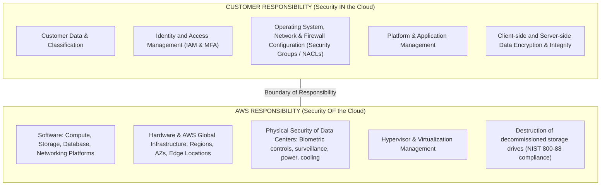
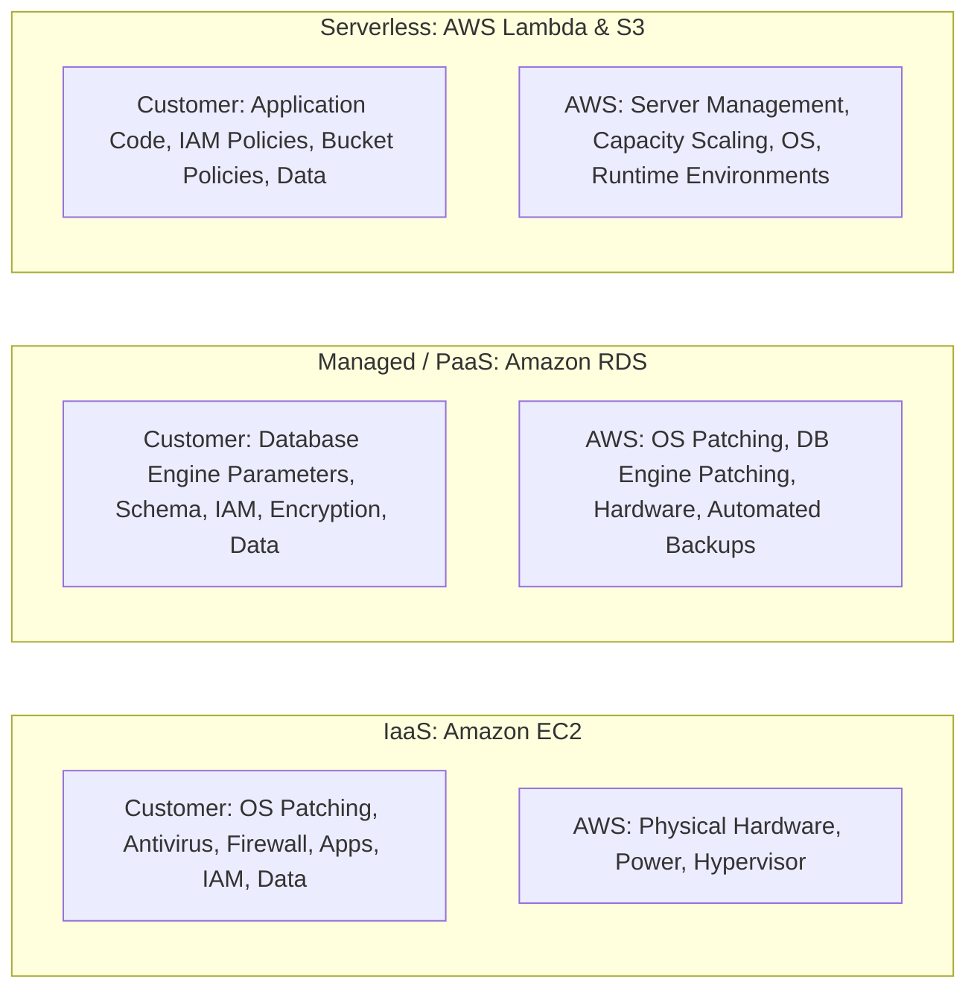
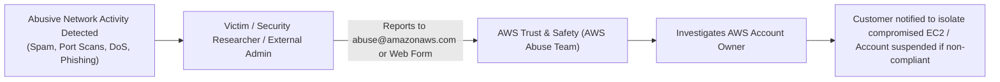

# AWS Shared Responsibility Model

> **Knowledge Area:** Security and Compliance (Domain 2.1)  
> **Relevant Certifications:** [CLF-C02](../../01_Syllabus/CLF-C02_Master_Blueprint.md), SAA-C03, AIF-C01  
> **Tags:** `#aws/security` `#aws/compliance` `#clf-c02`

---

## 💡 The Real-World Analogy (ELI5)

> **Renting an Apartment:**
> - **The Landlord (AWS — Security OF the Cloud):** The landlord is strictly responsible for the structural foundation of the building, the roof, exterior brick walls, common hallways, physical security cameras at the lobby entrance, plumbing, and electrical grid.
> - **The Tenant (You — Security IN the Cloud):** You are completely responsible for locking your front door, deciding who gets guest keys, closing your windows when it rains, keeping your private jewelry safe, and setting your home security alarm. If you leave your front door unlocked and invite a stranger in, you cannot blame the landlord!

---

## 1. Core Principle: Security OF the Cloud vs. Security IN the Cloud

Security and compliance are a **shared effort** between AWS and the customer:

* **AWS is responsible for "Security OF the Cloud":** Protecting the global infrastructure that runs all services offered in the AWS Cloud (hardware, software, networking, and physical facilities).
* **Customer is responsible for "Security IN the Cloud":** The security measures that the customer chooses to implement and configure for the services they launch (customer data, operating system updates, firewall configurations, IAM permissions, network routing).

---

## 2. How Responsibility Shifts Across Service Models (Crucial Exam Concept)

The level of customer responsibility depends on the type of service selected: **IaaS (EC2)** vs **PaaS/Managed (RDS)** vs **Serverless/Abstracted (S3 / Lambda)**.

### Detailed Responsibility Comparison:

| Responsibility Layer | Amazon EC2 (IaaS) | Amazon RDS (Managed) | AWS Lambda / S3 (Serverless) |
|---|:---:|:---:|:---:|
| **Physical Data Center & Hardware** | **AWS** | **AWS** | **AWS** |
| **Hypervisor & Virtualization** | **AWS** | **AWS** | **AWS** |
| **Operating System Patching** | **CUSTOMER** | **AWS** | **AWS** |
| **Database Engine Patching** | N/A (Customer if on EC2) | **AWS** | **AWS** |
| **Serverless Runtime Environment** | N/A | N/A | **AWS** |
| **Network Configuration (Subnets/Route Tables)**| **CUSTOMER** | **CUSTOMER** | **AWS** (Lambda handles VPC if configured) |
| **Firewall (Security Groups / NACLs)** | **CUSTOMER** | **CUSTOMER** | N/A (Bucket Policies / IAM) |
| **Identity & Access Management (IAM)** | **CUSTOMER** | **CUSTOMER** | **CUSTOMER** |
| **Application Code & Logic** | **CUSTOMER** | **CUSTOMER** | **CUSTOMER** |
| **Data Encryption & Customer Data** | **CUSTOMER** | **CUSTOMER** | **CUSTOMER** |

> [!IMPORTANT]
> **Golden Rule of Shared Responsibility:** Customer data and IAM permissions are **ALWAYS** 100% the customer's responsibility, regardless of whether you are using EC2, RDS, S3, or Lambda!

---

## 3. Shared Controls Classification

AWS categorizes controls into three distinct groups:

1. **Inherited Controls:** Controls that the customer fully inherits from AWS.
   - *Examples:* Physical security of facilities, environmental controls (cooling, fire suppression), biometric entry to data centers, hardware disposal.
2. **Shared Controls:** Controls that apply to both the infrastructure layer (managed by AWS) and customer-facing configurations (managed by the customer).
   - *Patch Management:* AWS is responsible for patching flaws on physical infrastructure and managed services; the customer is responsible for patching their EC2 guest operating systems and application code.
   - *Configuration Management:* AWS maintains the configuration of its cloud infrastructure; the customer maintains the configuration of their own guest operating systems, subnets, and applications.
   - *Awareness & Training:* AWS trains AWS employees; the customer trains their own staff on cloud security and compliance policies.
3. **Customer-Specific Controls:** Controls that are solely the responsibility of the customer based on application and regulatory needs.
   - *Examples:* Service and communications protection (e.g., zone security, network routing rules, VPC security groups), data classification, data retention policies.

---

## 4. AWS Acceptable Use Policy (AUP) & The AWS Abuse Team

Understanding what is strictly prohibited on AWS infrastructure and who investigates violations is a classic, high-frequency question area on the CLF-C02 exam.

### 1. The AWS Acceptable Use Policy (AUP)
The **AWS Acceptable Use Policy** stipulates what customers **cannot do** when using AWS services. Prohibited actions include:
* **Illegal, Harmful, or Offensive Use:** Hosting fraudulent content, pyramid schemes, child exploitation, or promoting hate speech.
* **Security Violations & Network Abuse:** Attempting to probe, scan, or test the vulnerability of external systems or networks without authorization; forging TCP-IP headers; generating denial of service (DoS) floods.
* **Spam & Email Abuse:** Distributing unsolicited mass commercial emails, violating anti-spam laws (CAN-SPAM), or operating open email relays.
* *Customer Responsibility:* Customers are 100% responsible for ensuring that all applications running in their AWS account adhere strictly to the AUP. If a customer's EC2 instance is hacked and turned into a botnet sending spam, the account is in direct violation of the AUP!

### 2. The AWS Abuse Team
* **Role:** Dedicated team that monitors, investigates, and responds to reports of abusive, suspicious, or illegal activity originating from AWS resources (IP addresses owned by AWS).
* **When to Contact the AWS Abuse Team:**
  - When you receive unsolicited spam or phishing emails sent from AWS IP ranges.
  - When your external firewall detects malicious port scanning or vulnerability probing from AWS EC2 instances.
  - When copyrighted content is hosted without permission on Amazon S3.
  - When an AWS resource is participating in a Distributed Denial of Service (DDoS) attack against your servers.
* **Reporting Channels:** Submit an abuse report via the online AWS Abuse Report form or email `abuse@amazonaws.com`.

---

## 5. Exam Scenarios & Trap Questions

| Question Statement | Who is Responsible / Correct Service? | Rationale |
|---|:---:|---|
| *"Who is responsible for updating the Linux kernel on an Amazon EC2 instance?"* | **Customer** | EC2 is IaaS; the customer manages the guest operating system. |
| *"Who is responsible for applying security updates to the MySQL database engine on Amazon RDS?"* | **AWS** | Amazon RDS is a managed service; AWS handles OS and database engine patch management. |
| *"Who is responsible for decommissioning and degaussing broken hard drives?"* | **AWS** | Physical media destruction (NIST 800-88 standard) is an inherited physical control managed by AWS. |
| *"Who is responsible for enabling Multi-Factor Authentication (MFA) on the root user?"* | **Customer** | Account credentials and access control belong entirely to the customer. |
| *"Who is responsible for configuring firewall rules for Amazon EC2 instances?"* | **Customer** | Security Groups and Network ACLs are customer-managed virtual firewalls. |
| *"Who is responsible for ensuring employee laptops connecting to AWS have antivirus installed?"* | **Customer** | Endpoint device security and client network connections are customer-specific controls. |
| *"Who is responsible for physical facility certifications such as SOC 1/2/3, ISO 27001, and PCI DSS compliance of data centers?"* | **AWS** | AWS maintains physical data center compliance; audit reports are downloadable via **AWS Artifact**. |
| *"A network administrator notices an external AWS IP address actively port scanning their corporate firewall. Who should they contact?"* | **AWS Abuse Team** | The AWS Abuse Team investigates unauthorized probing, hacking, and spam originating from AWS IPs. |
| *"Which document outlines prohibited activities on AWS infrastructure, such as distributed denial of service (DDoS) and spamming?"* | **AWS Acceptable Use Policy** | The AUP specifies terms regarding prohibited network and content practices. |
---

## 7. Post-Topic Question Simulation & Retention Check

Test your understanding of the AWS Shared Responsibility Model with these 5 exam-style questions:

## 🎯 Exam Traps & 'Clue-to-Answer' Trigger Words

| Task / Responsibility | Owner: AWS or Customer? | Exam Trap Tip |
| :--- | :---: | :--- |
| Physical data center security & biometric guards | **AWS** (Security OF the Cloud) | Customer can never touch physical servers. |
| Decommissioning and destroying retired hard drives | **AWS** (Security OF the Cloud) | AWS uses NIST 800-88 hardware sanitization. |
| Operating System patching on Amazon EC2 | **Customer** (Security IN the Cloud) | On EC2, customer owns the OS completely! |
| Operating System patching on Amazon RDS / DynamoDB | **AWS** (Security OF the Cloud) | RDS is a managed service; AWS patches the OS. |
| Configuring Security Groups and Network ACLs | **Customer** (Security IN the Cloud) | Customer defines all firewall rules. |
| Customer data encryption and IAM user passwords | **Customer** (Security IN the Cloud) | Customer always owns and controls their data. |

---

### Question 1
**Under the AWS Shared Responsibility Model, which of the following is considered "Security OF the Cloud" and is the exclusive responsibility of AWS?**
- A) Configuring IAM user password policies
- B) Patching the operating system on an Amazon EC2 instance
- C) Physical security of data centers and hardware disposal
- D) Encrypting client-side application data before uploading to S3

<b>Click to View Answer & Explanation</b>

**Correct Answer:** **C) Physical security of data centers and hardware disposal**  
- **Why it's correct:** AWS is responsible for "Security OF the Cloud": physical facilities, server hardware, virtualization layer, power, cooling, and certified media destruction (NIST 800-88).
- **Distractor Analysis:**
  - *A, B, & D are incorrect:* These are customer responsibilities ("Security IN the Cloud"). The customer controls IAM, OS patching on EC2, and data encryption.

### Question 2
**A company provisions an Amazon RDS for PostgreSQL database instance. Which security and maintenance task remains the customer's responsibility?**
- A) Installing operating system security patches on the database host server
- B) Replacing failed physical disks in the storage array
- C) Managing database user accounts, permissions, and network firewall access (Security Groups)
- D) Managing physical facility security

<b>Click to View Answer & Explanation</b>

**Correct Answer:** **C) Managing database user accounts, permissions, and network firewall access (Security Groups)**  
- **Why it's correct:** For managed PaaS database services like Amazon RDS, AWS manages host OS patching and disk maintenance, but the customer remains responsible for database credentials, user grants, schema design, and VPC Security Group firewall rules.
- **Distractor Analysis:**
  - *A & B are incorrect:* AWS automates OS patching and hardware replacement on RDS instances.

### Question 3
**Which of the following is an example of a "Shared Control" under the Shared Responsibility Model?**
- A) Physical data center perimeter fencing
- B) Patch management
- C) Customer IAM root user MFA setup
- D) Amazon S3 bucket naming

<b>Click to View Answer & Explanation</b>

**Correct Answer:** **B) Patch management**  
- **Why it's correct:** Patch management is a shared control: AWS is responsible for patching the physical infrastructure, hypervisor, and managed service runtimes (Lambda, RDS); the customer is responsible for patching guest operating systems and application code on IaaS (EC2).
- **Distractor Analysis:**
  - *A is incorrect:* Strictly AWS responsibility.
  - *C & D are incorrect:* Strictly customer responsibility.

### Question 4
**An application running on an Amazon EC2 instance is compromised due to an unpatched software vulnerability in the Linux guest operating system. Who is responsible for this failure?**
- A) AWS, because they manage the cloud infrastructure
- B) The customer, because guest OS patch management on EC2 is "Security IN the Cloud"
- C) Both AWS and the customer equally
- D) The third-party Linux distribution vendor

<b>Click to View Answer & Explanation</b>

**Correct Answer:** **B) The customer, because guest OS patch management on EC2 is "Security IN the Cloud"**  
- **Why it's correct:** Amazon EC2 is an Infrastructure as a Service (IaaS) offering. AWS provides the virtual machine, but the customer has root administrative control and is 100% responsible for patching and securing the guest OS.

### Question 5
**Which AWS service provides on-demand access to AWS security and compliance reports (such as SOC 2 and ISO 27001 certifications) to prove AWS's adherence to "Security OF the Cloud"?**
- A) AWS Trusted Advisor
- B) AWS Artifact
- C) Amazon Inspector
- D) AWS CloudTrail

<b>Click to View Answer & Explanation</b>

**Correct Answer:** **B) AWS Artifact**  
- **Why it's correct:** AWS Artifact is the central portal for downloading AWS compliance documentation, independent third-party auditor reports, and Business Associate Agreements (BAAs).
- **Distractor Analysis:**
  - *A is incorrect:* Trusted Advisor provides real-time best practice recommendations.
  - *C is incorrect:* Inspector scans EC2 and ECR container images for software vulnerabilities.
  - *D is incorrect:* CloudTrail records API calls for account activity auditing.

