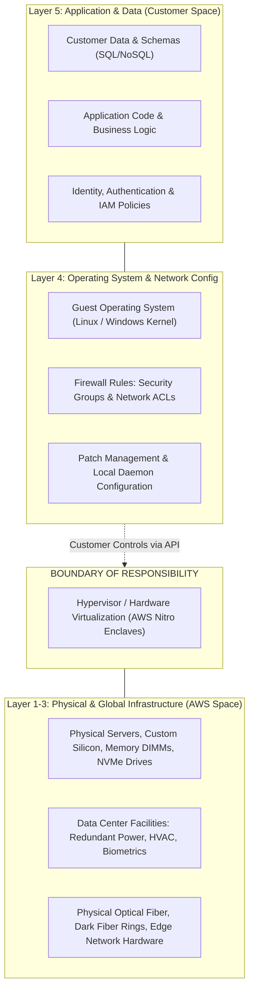
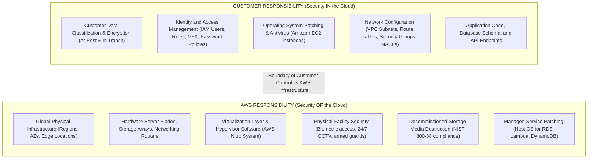
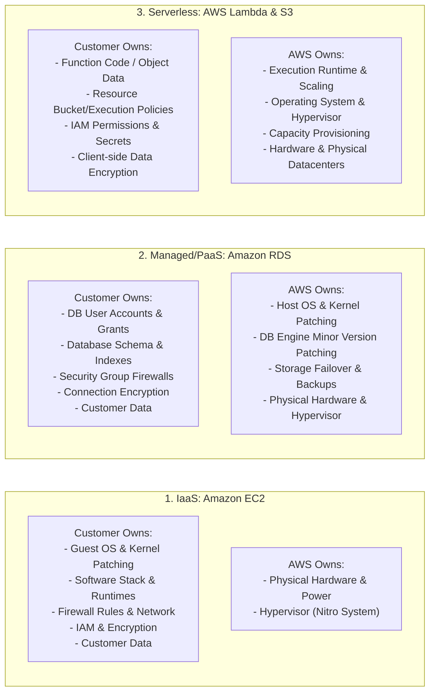
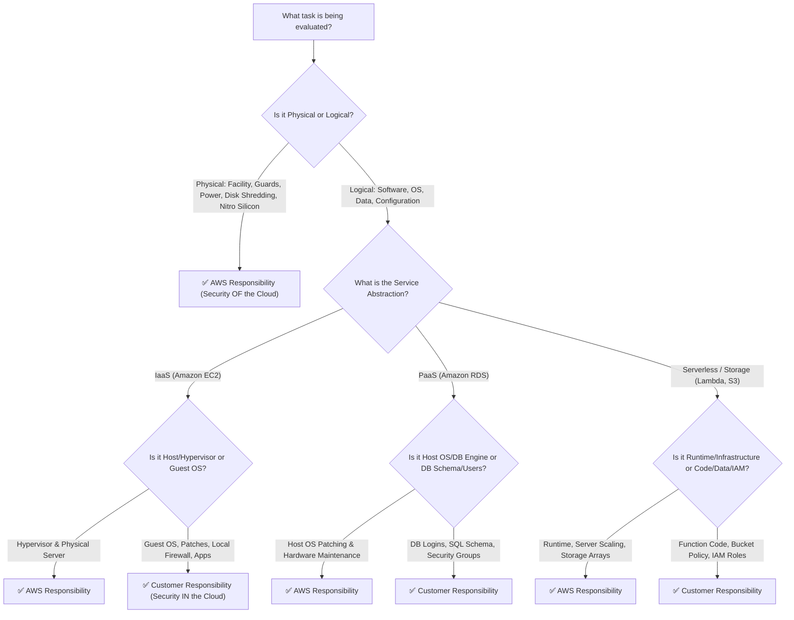

# AWS Shared Responsibility Model

> **Knowledge Area:** Security and Compliance (Domain 2.1)  
> **Relevant Certifications:** [CLF-C02](../../01_Syllabus/CLF-C02_Master_Blueprint.md), SAA-C03, AIF-C01  
> **Tags:** `#aws/security` `#aws/compliance` `#clf-c02`

---

## 💡 The Real-World Analogy (ELI5)

> **Renting an Apartment in a High-Security High-Rise:**
> - **The Landlord (AWS — Security OF the Cloud):** The building management company is solely responsible for the physical structural integrity of the high-rise: reinforced concrete foundations, fire sprinkler pipes in the walls, commercial HVAC chillers, backup diesel generators in the sub-basement, biometric turnstiles in the lobby, armed security guards at the perimeter gates, and certified disposal of replaced building locks. If lightning strikes the electrical transformer outside, the landlord fixes it.
> - **The Tenant (You — Security IN the Cloud):** You are 100% responsible for everything that occurs behind your apartment door. You must turn the deadbolt when you leave, decide who receives duplicate keys, install a private safe for your jewelry, close the balcony windows during rainstorms, configure your private Wi-Fi password, and set your burglar alarm. If you leave your front door wide open with a sign saying *"Help Yourself"*, you cannot sue the landlord when your television is stolen!

---

## 1. First-Principles Computer Science & Architectural Abstraction

The Shared Responsibility Model is not merely a legal contract; it is a direct architectural consequence of **computing abstraction layers**:

### 1.1 CPU Privilege Rings and Hypervisor Isolation
In modern computer architecture, the central processing unit (CPU) enforces security boundaries using privilege rings:
* **Ring 0 (Supervisor / Kernel Space):** Direct, unrestricted access to physical memory, hardware interrupts, and CPU execution units.
* **Ring 3 (User Space):** Sandboxed environment where user applications and user-mode database processes execute.
* **Ring -1 (Hypervisor / VMM Space):** A specialized execution mode (Intel VT-x / AMD-V) that arbitrates access between multiple virtualized guest operating systems sharing identical silicon.
* **The Shared Responsibility Demarcation:** 
  - **AWS manages Ring -1 downwards:** Hardware maintenance, firmware security, physical RAM isolation, and hypervisor scheduling.
  - **The Customer controls Ring 0 upwards (on IaaS like EC2):** Installing the Linux/Windows kernel, configuring system daemons, establishing user accounts, and applying security patches to mitigate vulnerabilities (e.g., Dirty COW, Heartbleed).

### 1.2 Cryptographic Boundaries & Key Ownership
Security in the cloud dictates that even though AWS operates the physical NVMe storage controllers, AWS cannot inspect customer data if encrypted properly:
* **Customer-Managed Keys (CMKs):** Under AWS Key Management Service (KMS), cryptographic keys are generated within FIPS 140-2/3 Level 3 Hardware Security Modules (HSMs). 
* **The Customer holds key governance:** IAM policies govern who can decrypt data. AWS personnel have zero administrative mechanism to view plaintext data protected by customer-managed KMS keys.

---

## 2. Historical IT Pain Points: The On-Premises Burden

Before the cloud shared responsibility paradigm, enterprises bore 100% of the entire physical, electrical, and software stack:

| Operational Burden | Traditional On-Premises Data Center | AWS Shared Responsibility Model |
|---|---|---|
| **Physical Data Center Security** | Companies spent millions on armed 24/7 guards, biometric mantraps, video surveillance archiving, and facility perimeter fencing. | **100% managed by AWS**. Physical access is strictly restricted, monitored, and audited under global compliance standards. |
| **Environmental & Electrical Redundancy** | Purchasing and maintaining diesel turbine generators, routine fuel filtration, battery backup UPS arrays, and HVAC chillers. | **100% managed by AWS**. Redundant power and cooling systems are engineered into every Availability Zone. |
| **Hardware Lifecycle & Disposal** | Decommissioning hard drives required certified physical shredding, degaussing logs, and hazardous waste disposal compliance (NIST 800-88). | **100% managed by AWS**. Storage media is decommissioned using strict multi-pass cryptographic erasure or physical destruction. |
| **Audit & Compliance Verification** | Enterprise teams spent months compiling evidence for SOC 2, ISO 27001, and HIPAA auditors regarding physical door logs and server room temperatures. | **Accelerated via [AWS Artifact](../../AWS_SERVICES_GLOSSARY.md#aws-artifact)**. Customers download third-party auditor compliance attestations on-demand at zero cost. |

---

## 3. Core Principle: Security OF the Cloud vs. Security IN the Cloud

Security and compliance are a **shared effort** between AWS and the customer:

### 3.1 Security OF the Cloud (AWS Responsibility)
AWS protects and manages the foundational physical and virtualization layer that powers all cloud services:
* **Physical Infrastructure:** Physical security of data center buildings, biometric access gates, security camera footage, emergency diesel generators, and HVAC climate control.
* **Hardware & Silicon:** Servers, rack switches, power distribution units (PDUs), optical cables, and custom AWS chips (Nitro cards, Graviton processors, AWS Inferentia).
* **Virtualization Hypervisor:** Maintaining, securing, and patching the hypervisor software that isolates virtual machines from one another.
* **Storage Media Sanitation:** Implementing strict DoD 5220.22-M and NIST 800-88 physical destruction protocols (degaussing, crushing, or physical shredding) for all decommissioned magnetic and solid-state storage media.
* **Compliance Certification:** Undergoing rigorous independent third-party audits (SOC 1, SOC 2, SOC 3, ISO 27001, PCI-DSS Level 1, FedRAMP High) to prove physical and operational compliance.

### 3.2 Security IN the Cloud (Customer Responsibility)
The customer is entirely responsible for the security controls they choose to implement, configure, and manage for the services they run:
* **Customer Data:** Classifying data sensitivity, configuring bucket access policies, enabling client-side encryption, and managing lifecycle deletion rules.
* **Identity & Access Management (IAM):** Creating IAM users, enforcing Multi-Factor Authentication (MFA), setting strict password complexity policies, implementing least-privilege permissions, and rotating access keys.
* **Guest Operating System (IaaS):** For [Amazon EC2](../../AWS_SERVICES_GLOSSARY.md#amazon-ec2) instances, the customer must apply security updates, kernel patches, anti-malware agents, and local firewall iptables.
* **Network & Firewall Rules:** Configuring Virtual Private Cloud (VPC) subnets, routing tables, Security Group stateful instance firewalls, and Network ACL stateless subnet firewalls.
* **Application Security:** Writing secure, vulnerability-free application code (protecting against SQL injection, Cross-Site Scripting, and OWASP Top 10 vulnerabilities).

---

## 4. Responsibility Shift Across Cloud Service Models

A core concept in cloud architecture is that **customer operational responsibility shrinks** as you move up the abstraction ladder from IaaS to PaaS to Serverless:

### 4.1 Categorization of Shared Controls
AWS categorizes security controls into three distinct operational classifications:

1. **Inherited Controls:** Controls that customers fully inherit from AWS:
   - Physical and environmental controls of data center facilities (biometric doors, air filtration, power generators).
   - Physical disposal of storage media.
2. **Shared Controls:** Controls that apply to both infrastructure and customer layers in different contexts:
   - **Patch Management:** AWS is responsible for patching the physical infrastructure, hypervisor, and managed service runtimes (e.g., RDS host OS); the customer is responsible for patching the guest operating system and installed software on EC2.
   - **Configuration Management:** AWS maintains configuration of physical network devices; the customer configures their own virtual networks (VPC, subnets, route tables) and guest OS settings.
   - **Awareness & Training:** AWS trains AWS employees; the customer trains their own corporate workforce on cloud security best practices.
3. **Customer-Specific Controls:** Controls that are solely the customer's responsibility:
   - Identity management, user password enforcement, and MFA.
   - Routing and firewall ingress/egress rules (Security Groups).
   - Data encryption key management and data classification policies.

---

## 5. Multi-Dimensional Service Responsibility Matrix

| Security & Operational Layer | [Amazon EC2](../../AWS_SERVICES_GLOSSARY.md#amazon-ec2) (IaaS) | [Amazon RDS](../../AWS_SERVICES_GLOSSARY.md#amazon-rds) (PaaS) | [AWS Lambda](../../AWS_SERVICES_GLOSSARY.md#aws-lambda) (Serverless) | [Amazon S3](../../AWS_SERVICES_GLOSSARY.md#amazon-s3) (Abstracted Storage) |
|---|:---:|:---:|:---:|:---:|
| **Physical Facilities & Datacenter Security** | **AWS** | **AWS** | **AWS** | **AWS** |
| **Physical Hardware & Disk Sanitization** | **AWS** | **AWS** | **AWS** | **AWS** |
| **Virtualization Hypervisor (Nitro System)** | **AWS** | **AWS** | **AWS** | **AWS** |
| **Host Operating System Patching** | **CUSTOMER** | **AWS** | **AWS** | **AWS** |
| **Database Engine Software Patching** | **CUSTOMER** *(Self-installed DB)* | **AWS** | N/A | N/A |
| **Runtime Environment (e.g., Node.js / Python)** | **CUSTOMER** | N/A | **AWS** | N/A |
| **Virtual Firewall (Security Groups / NACLs)** | **CUSTOMER** | **CUSTOMER** | **CUSTOMER** *(VPC config)* | **CUSTOMER** *(Bucket Policy)* |
| **IAM Access Control & Authentication** | **CUSTOMER** | **CUSTOMER** | **CUSTOMER** | **CUSTOMER** |
| **Customer Data Encryption & Classification** | **CUSTOMER** | **CUSTOMER** | **CUSTOMER** | **CUSTOMER** |

---

## 6. Exam Traps & 'Clue-to-Answer' Decryption

| Question Scenario Keyword | Responsible Party | Exam Trap & Distractor Explanation |
|---|---|---|
| *"Patching guest operating system on [Amazon EC2](../../AWS_SERVICES_GLOSSARY.md#amazon-ec2)"* | **Customer** | Trap: Never choose AWS. AWS provides the AMI, but the customer controls root/admin and must patch the OS. |
| *"Physical security and biometric access to data centers"* | **AWS** | Trap: The customer never has physical access to AWS data centers under any circumstance. |
| *"Patching the operating system hosting an [Amazon RDS](../../AWS_SERVICES_GLOSSARY.md#amazon-rds) database"* | **AWS** | Trap: In managed services like RDS, AWS manages host OS patching automatically during maintenance windows. |
| *"Configuring database user credentials and grants on RDS"* | **Customer** | Trap: AWS provides the database engine, but managing DB logins, passwords, and SQL schemas is 100% customer responsibility. |
| *"Configuring IAM policies, MFA, and access keys"* | **Customer** | Trap: AWS provides the IAM engine, but creating users, assigning least privilege, and enabling MFA is strictly customer responsibility. |
| *"Disposal and degaussing of decommissioned hard disk drives"* | **AWS** | Trap: AWS performs physical destruction in accordance with NIST 800-88; customers never touch physical disks. |
| *"Accessing third-party SOC and ISO compliance reports"* | **[AWS Artifact](../../AWS_SERVICES_GLOSSARY.md#aws-artifact)** | Trap: Do not choose [AWS Trusted Advisor](../../AWS_SERVICES_GLOSSARY.md#aws-trusted-advisor) or Inspector. [AWS Artifact](../../AWS_SERVICES_GLOSSARY.md#aws-artifact) is the official portal for compliance reports. |

---

## 7. Post-Topic Question Simulation & Retention Check

### Question 1
**Under the AWS Shared Responsibility Model, which of the following tasks is considered "Security OF the Cloud" and is the exclusive responsibility of AWS?**
- A) Enforcing multi-factor authentication (MFA) and strong password policies for corporate IAM users
- B) Installing security kernel patches on an [Amazon EC2](../../AWS_SERVICES_GLOSSARY.md#amazon-ec2) Linux virtual machine instance
- C) Physical security of data center buildings, environmental cooling, and certified storage hardware disposal
- D) Encrypting client-side application data payloads before transmitting them to an [Amazon S3](../../AWS_SERVICES_GLOSSARY.md#amazon-s3) bucket

<b>Click to View Answer & Detailed Distractor Analysis</b>

**Correct Answer:** **C) Physical security of data center buildings, environmental cooling, and certified storage hardware disposal**

* **Why it's correct:** AWS is strictly responsible for "Security OF the Cloud": safeguarding the physical facilities, server blades, power feeds, HVAC climate chillers, hypervisor virtualization software, and executing certified media destruction (NIST 800-88).
* **Distractor Analysis:**
  - *A is incorrect:* Configuring IAM user credentials, password expiration policies, and MFA tokens is a customer responsibility ("Security IN the Cloud").
  - *B is incorrect:* For Infrastructure as a Service (IaaS) instances such as [Amazon EC2](../../AWS_SERVICES_GLOSSARY.md#amazon-ec2), the customer holds root/administrator privileges and is solely responsible for guest operating system patching.
  - *D is incorrect:* Implementing client-side encryption algorithms and managing encryption keys prior to cloud upload is entirely the customer's responsibility.

---

### Question 2
**A financial company provisions an [Amazon RDS](../../AWS_SERVICES_GLOSSARY.md#amazon-rds) for PostgreSQL database instance. Which security and maintenance task remains the customer's responsibility?**
- A) Applying security patches to the underlying Linux host operating system supporting the database
- B) Replacing failed solid-state disk drives (SSDs) in the underlying storage array
- C) Managing database user accounts, granting granular SQL table permissions, and configuring VPC Security Group ingress rules
- D) Managing physical perimeter security cameras and armed security personnel at the data center

<b>Click to View Answer & Detailed Distractor Analysis</b>

**Correct Answer:** **C) Managing database user accounts, granting granular SQL table permissions, and configuring VPC Security Group ingress rules**

* **Why it's correct:** In a managed PaaS service like [Amazon RDS](../../AWS_SERVICES_GLOSSARY.md#amazon-rds), AWS manages the underlying physical server, hypervisor, and host OS patching. However, the customer retains full control and responsibility over database credentials, user roles, table grants, schema architecture, and network firewall (Security Group) rules.
* **Distractor Analysis:**
  - *A is incorrect:* AWS automatically patches the underlying host operating system and database engine for [Amazon RDS](../../AWS_SERVICES_GLOSSARY.md#amazon-rds) during scheduled maintenance windows.
  - *B is incorrect:* Physical hardware maintenance and disk replacement are managed 100% by AWS infrastructure teams without customer intervention.
  - *D is incorrect:* Physical facility surveillance and guard posts are exclusive AWS responsibilities ("Security OF the Cloud").

---

### Question 3
**Which of the following is classified as a "Shared Control" under the AWS Shared Responsibility Model?**
- A) Physical data center perimeter fencing and biometric locks
- B) Patch management
- C) [Amazon S3](../../AWS_SERVICES_GLOSSARY.md#amazon-s3) bucket naming and object tagging
- D) Customer IAM root user credential rotation

<b>Click to View Answer & Detailed Distractor Analysis</b>

**Correct Answer:** **B) Patch management**

* **Why it's correct:** Patch management is a classic shared control because responsibility divides across abstraction boundaries: AWS is responsible for patching physical network devices, hypervisors, and managed service infrastructure (Lambda, RDS); the customer is responsible for patching guest operating systems and installed application binaries on EC2 instances.
* **Distractor Analysis:**
  - *A is incorrect:* Physical perimeter fencing is an inherited physical control managed exclusively by AWS.
  - *C is incorrect:* S3 bucket naming and object metadata tagging are entirely customer-specific administrative configurations.
  - *D is incorrect:* Managing and rotating the AWS account root user credentials is an exclusively customer-owned security obligation.

---

### Question 4
**An application running on an [Amazon EC2](../../AWS_SERVICES_GLOSSARY.md#amazon-ec2) instance is breached because an unpatched zero-day vulnerability in the Apache web server daemon was left unaddressed for six months. Who is responsible for this security failure?**
- A) AWS, because AWS owns and manages the cloud infrastructure
- B) The customer, because maintaining and patching guest operating system software and application daemons on EC2 is "Security IN the Cloud"
- C) AWS and the customer share legal responsibility equally under the SLA agreement
- D) The third-party open-source Linux software distribution vendor

<b>Click to View Answer & Detailed Distractor Analysis</b>

**Correct Answer:** **B) The customer, because maintaining and patching guest operating system software and application daemons on EC2 is "Security IN the Cloud"**

* **Why it's correct:** [Amazon EC2](../../AWS_SERVICES_GLOSSARY.md#amazon-ec2) is an Infrastructure as a Service (IaaS) offering. AWS guarantees the security and availability of the underlying physical hardware and hypervisor, but the customer retains administrative control over the guest OS, including installing software packages, configuring firewalls, and applying security patches.
* **Distractor Analysis:**
  - *A is incorrect:* AWS does not inspect, modify, or patch guest operating system packages running inside a customer's private EC2 instances.
  - *C is incorrect:* The Shared Responsibility Model establishes strict non-overlapping boundaries; guest OS application vulnerabilities on IaaS are solely customer responsibilities.
  - *D is incorrect:* Third-party open-source developers publish patches, but the enterprise running the system bears full responsibility for applying them.

---

### Question 5
**Which AWS service provides on-demand access to AWS security and compliance reports (such as SOC 1, SOC 2, ISO 27001, and PCI-DSS attestations) to verify AWS's adherence to "Security OF the Cloud"?**
- A) [AWS Trusted Advisor](../../AWS_SERVICES_GLOSSARY.md#aws-trusted-advisor)
- B) [AWS Artifact](../../AWS_SERVICES_GLOSSARY.md#aws-artifact)
- C) [Amazon Inspector](../../AWS_SERVICES_GLOSSARY.md#amazon-inspector)
- D) [AWS CloudTrail](../../AWS_SERVICES_GLOSSARY.md#aws-cloudtrail)

<b>Click to View Answer & Detailed Distractor Analysis</b>

**Correct Answer:** **B) [AWS Artifact](../../AWS_SERVICES_GLOSSARY.md#aws-artifact)**

* **Why it's correct:** [AWS Artifact](../../AWS_SERVICES_GLOSSARY.md#aws-artifact) is the central compliance portal in the AWS Management Console that allows customers to review and download official AWS compliance documentation, third-party audit reports (SOC 1/2/3, ISO certificates), and execute formal Business Associate Agreements (BAAs).
* **Distractor Analysis:**
  - *A is incorrect:* [AWS Trusted Advisor](../../AWS_SERVICES_GLOSSARY.md#aws-trusted-advisor) is an automated management tool that scans customer accounts to provide real-time recommendations across cost optimization, performance, security, fault tolerance, and service quotas.
  - *C is incorrect:* [Amazon Inspector](../../AWS_SERVICES_GLOSSARY.md#amazon-inspector) is an automated vulnerability management service that scans EC2 instances and ECR container images for software vulnerabilities and unintended network exposure.
  - *D is incorrect:* [AWS CloudTrail](../../AWS_SERVICES_GLOSSARY.md#aws-cloudtrail) is an audit logging service that records AWS API calls, user actions, and administrative changes across an AWS account.

---

## 🧠 Master MCQ Solving Blueprint: Pattern Decryption & Elimination Tricks

> *This blueprint distills recurring patterns, keyword triggers, and trap options extracted from over 350 questions on the Shared Responsibility Model across the official CLF-C02 question bank.*

### 1. The "Clue-to-Service" Linguistic Decryption Matrix
When reading a question scenario, search for these exact phrasing triggers:

| If You See This Trigger Phrase in the Question Stem... | The Correct Answer Is Almost Always... | Trap Distractor to Immediately Discard |
|---|---|---|
| *"Security OF the Cloud"* | **AWS Responsibility** (Physical facilities, hardware, hypervisors, global network) | *Customer Responsibility* |
| *"Security IN the Cloud"* | **Customer Responsibility** (Data, IAM, OS on EC2, firewalls, app code) | *AWS Responsibility* |
| *"Patching guest OS, anti-malware, or local firewall on [Amazon EC2](../../AWS_SERVICES_GLOSSARY.md#amazon-ec2)"* | **Customer Responsibility** | *AWS Responsibility* (AWS gives you root; you must patch it!) |
| *"Patching the operating system or database engine on [Amazon RDS](../../AWS_SERVICES_GLOSSARY.md#amazon-rds)"* | **AWS Responsibility** | *Customer Responsibility* (RDS is managed; AWS patches the host OS) |
| *"Disposal, degaussing, or physical shredding of decommissioned disks"* | **AWS Responsibility** (NIST 800-88 compliance) | *Customer Responsibility* (Customers never touch AWS physical media) |
| *"Which control is a Shared Control between AWS and Customer?"* | **Patch Management** (or *Configuration Management* / *Awareness & Training*) | *Physical Security* (Inherited) or *IAM Configuration* (Customer) |
| *"On-demand access to AWS compliance reports (SOC 1/2, ISO, PCI-DSS) and agreements"* | **[AWS Artifact](../../AWS_SERVICES_GLOSSARY.md#aws-artifact)** | *[AWS Trusted Advisor](../../AWS_SERVICES_GLOSSARY.md#aws-trusted-advisor)* or *[Amazon Inspector](../../AWS_SERVICES_GLOSSARY.md#amazon-inspector)* |
| *"Who is responsible for encrypting customer data?"* | **Customer Responsibility** (AWS provides KMS tools, but customer decides to encrypt) | *AWS Responsibility* |
| *"Configuring database user credentials, schemas, and table permissions in RDS"* | **Customer Responsibility** | *AWS Responsibility* (AWS manages the engine, not your logins/schemas) |

### 2. The 3-Step Rapid Elimination Heuristic
When faced with a Shared Responsibility Model question:
1. **Step 1: Check the Physical vs. Logical Plane:**
   - Can you **touch, kick, or walk into it**? (Concrete walls, diesel generators, disk shredders, hypervisor chips, air conditioners).
     - → **100% AWS Responsibility**. Discard all customer options immediately.
   - Is it made of **software, configuration, logins, or data**?
     - → Proceed to Step 2.
2. **Step 2: Check the Service Model (IaaS vs. PaaS vs. Serverless):**
   - **IaaS ([Amazon EC2](../../AWS_SERVICES_GLOSSARY.md#amazon-ec2)):** Customer holds root/administrator. Customer patches the OS, installs updates, and configures firewalls.
   - **PaaS ([Amazon RDS](../../AWS_SERVICES_GLOSSARY.md#amazon-rds)):** AWS patches the host OS and DB engine. Customer creates database users, schemas, and security group firewall rules.
   - **Serverless ([AWS Lambda](../../AWS_SERVICES_GLOSSARY.md#aws-lambda), S3):** AWS manages all execution environments and servers. Customer manages application code, data, and IAM execution roles.
3. **Step 3: Check "Tool Provider" vs. "Tool Operator":**
   - AWS provides the tool (e.g., IAM, KMS, Security Groups, WAF).
   - The customer **must operate and configure** the tool. If data leaks because an S3 bucket was set to public, or an EC2 security group allowed `0.0.0.0/0` on port 22, it is **100% the Customer's fault**.

### 3. High-Frequency Decoy Autopsy: Why AWS Tries to Trick You
* **Decoy #1: "EC2 OS Patching" vs. "RDS OS Patching"**
  - *The Trap:* The exam will deliberately present "Operating system patching" without specifying the service, or will swap EC2 and RDS.
  - *The Autopsy:* Always check the target service! On **EC2**, the customer is root → **Customer patches**. On **RDS**, the customer has no shell access → **AWS patches**.
* **Decoy #2: "Data Encryption at Rest" — Who is responsible?**
  - *The Trap:* The question asks who is responsible for encrypting sensitive customer data stored in [Amazon S3](../../AWS_SERVICES_GLOSSARY.md#amazon-s3) or EBS.
  - *The Autopsy:* Candidates frequently answer "AWS" because AWS supports default server-side encryption. However, under the Shared Responsibility Model, **Data Classification and Encryption is strictly a Customer Responsibility**. AWS provides the KMS service, but configuring encryption and protecting access keys rests with the customer.
* **Decoy #3: "[AWS Artifact](../../AWS_SERVICES_GLOSSARY.md#aws-artifact)" vs. "[AWS Trusted Advisor](../../AWS_SERVICES_GLOSSARY.md#aws-trusted-advisor)" vs. "[Amazon Inspector](../../AWS_SERVICES_GLOSSARY.md#amazon-inspector)"**
  - *The Trap:* Scenario asks how an enterprise auditor can inspect AWS's SOC 2 compliance reports or sign a HIPAA BAA.
  - *The Autopsy:* Decoys will include Trusted Advisor (best-practice checkup tool), Inspector (software vulnerability scanner), and CloudTrail (API audit log). The only portal for official AWS compliance documents and auditor certifications is **[AWS Artifact](../../AWS_SERVICES_GLOSSARY.md#aws-artifact)**.

### 4. 10-Second Visual Decision Flowchart

