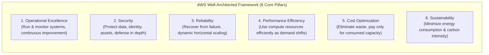
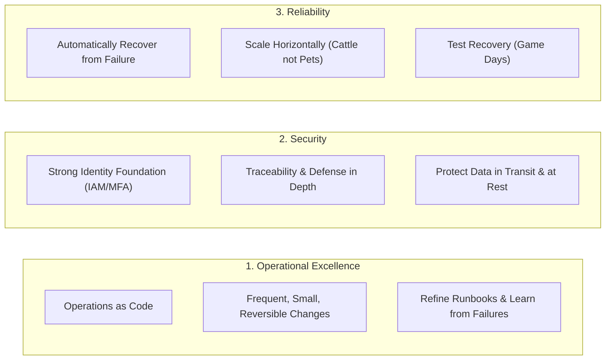
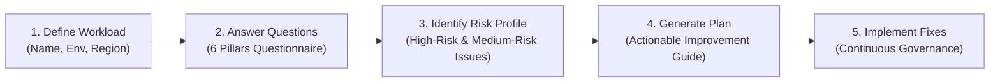
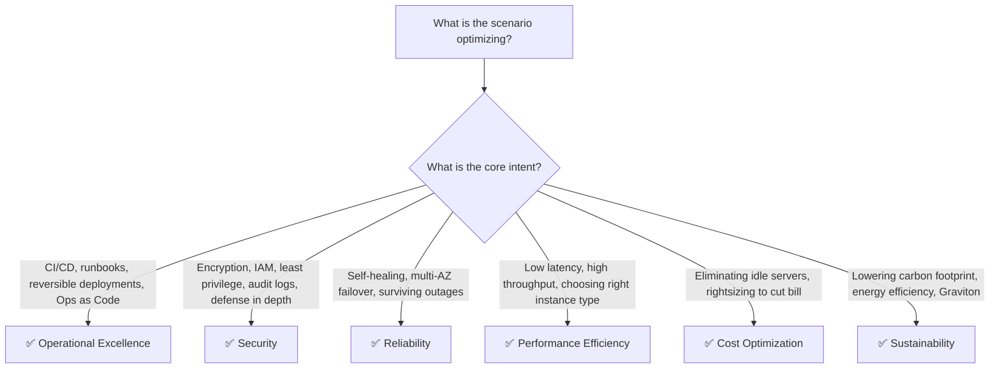

# AWS Well-Architected Framework

> **Knowledge Area:** Cloud Concepts (Domain 1.2)  
> **Relevant Certifications:** [CLF-C02](../../01_Syllabus/CLF-C02_Master_Blueprint.md), SAA-C03, SAP-C02  
> **Tags:** `#aws/concepts` `#aws/architecture` `#clf-c02`

---

## 💡 The Real-World Analogy (ELI5)

> **Designing an Earthquake-Proof, High-Tech Skyscraper:**
> - **Operational Excellence:** Having automated fire sprinkler drill simulations, digitized maintenance logs, and learning from tiny pipe leaks before a catastrophic flood occurs.
> - **Security:** Armed lobby security, encrypted smart badges for every floor, zero-trust visitor escorts, and automated lock-downs during perimeter breaches.
> - **Reliability:** Dual backup generators in the basement, redundant water supply tanks on the roof, and flexible structural steel beams that absorb earthquake tremors without buckling.
> - **Performance Efficiency:** Installing high-speed magnetic-levitation elevators that dynamically adjust dispatch algorithms based on morning rush-hour pedestrian traffic.
> - **Cost Optimization:** Motion-sensor LED lighting that automatically powers down unoccupied conference rooms, eliminating wasted electricity bills.
> - **Sustainability:** Rooftop solar panels, rainwater harvesting tanks, and low-carbon cement to dramatically reduce the building’s total environmental footprint.

---

## 1. First-Principles Computer Science & Systems Architecture

System design in computer science is governed by unavoidable engineering constraints and mathematical trade-offs:

### 1.1 The Mathematics of Reliability: MTBF vs. MTTR
In traditional engineering, availability was pursued by maximizing **Mean Time Between Failures (MTBF)**—buying increasingly expensive, military-grade hardware so components would never fail:
$$\text{Availability} = \frac{\text{MTBF}}{\text{MTBF} + \text{MTTR}}$$
* **The Cloud Architectural Shift:** Hardware *will* eventually fail (disks crash, fiber lines get cut, memory develops bit errors). The Well-Architected Framework shifts focus from preventing failure to **minimizing Mean Time to Recovery (MTTR)** through automated health checks, dynamic self-healing, and stateless horizontal scaling. If an instance can be replaced in 30 seconds by Auto Scaling, system availability approaches $99.999\%$ regardless of hardware flakiness.

### 1.2 Blast Radius Containment and Loose Coupling
* **Monolithic Systems (Tight Coupling):** If a payment processing module encounters an unhandled exception or memory leak, the entire application server crashes, taking down the catalog, user login, and cart.
* **Microservices & Queuing (Loose Coupling):** Decoupling components using message queues (Amazon SQS) and event buses (Amazon EventBridge) isolates failure domains. If downstream worker nodes fail, messages buffer safely in the queue without customer transactions being dropped.

---

## 2. Historical IT Pain Points: The Legacy Enterprise Reality

Before the Well-Architected Framework provided codified cloud blueprints, enterprise architectures suffered from systemic vulnerabilities:

| Architectural Challenge | Traditional On-Premises Architecture | AWS Well-Architected Paradigm |
|---|---|---|
| **Capacity Guessing Games** | Engineers had to estimate server capacity 3 to 5 years in advance. Over-provisioning wasted millions; under-provisioning caused site crashes on Black Friday. | **Stop guessing capacity**. Resources scale out and in elastically using Amazon EC2 Auto Scaling and serverless compute. |
| **Untested Recovery Procedures** | Disaster recovery plans lived in printed binder manuals on a shelf. Backup tapes were rarely tested; restore failures were discovered *during* real disasters. | **Test recovery procedures**. Simulate outages and test failovers using automated chaos engineering and simulated "Game Days". |
| **Monolithic "Pet" Infrastructure** | Servers were treated like "pets"—individually named, lovingly configured by hand, and irreplaceable when an OS kernel corrupted. | **Infrastructure as Code (IaC)**. Servers are "cattle"—ephemeral, disposable, and launched automatically via AWS CloudFormation templates. |
| **Undifferentiated Heavy Lifting** | Teams spent 70% of their engineering cycles racking servers, cabling patch panels, and applying firmware patches rather than writing business logic. | **Democratize advanced technologies**. Leverage managed services (RDS, DynamoDB, Bedrock) to focus entirely on customer value. |

---

## 3. General Design Principles (Across All Pillars)

The AWS Well-Architected Framework defines 6 foundational design principles that govern all cloud systems:

1. **Stop guessing your capacity needs:** Eliminate capacity guesswork. Scale compute dynamically based on real-time metrics and alerts.
2. **Test systems at production scale:** In the cloud, you can provision a production-sized replica of your environment, execute load and security tests, and terminate the environment within two hours, paying strictly for the runtime.
3. **Automate to make architectural experimentation easier:** Define infrastructure as code (CloudFormation, CDK). Version-control architectures, replicate environments rapidly, and roll back failed experiments without manual rework.
4. **Allow for evolutionary architectures:** Avoid rigid multi-year technology decisions. Cloud architectures can continuously evolve as AWS launches higher-performance, lower-cost services.
5. **Drive architectures using data:** Collect and analyze CloudWatch metrics, VPC Flow Logs, and CloudTrail events to make data-backed architectural choices rather than relying on intuition.
6. **Improve through game days:** Regularly simulate operational crises (e.g., primary AZ outage, ransomware attack) to validate team runbooks and recovery automation under realistic conditions.

---

## 4. Deep-Dive into the 6 Pillars

### Pillar 1: Operational Excellence
* **Core Focus:** Running and monitoring systems to deliver business value and continually improving supporting processes and procedures.
* **Key Design Principles:**
  - *Perform operations as code:* Define infrastructure and operational runbooks as code using AWS CloudFormation and Systems Manager.
  - *Make frequent, small, reversible changes:* Break updates into tiny increments that can be rolled back safely if metrics degrade.
  - *Refine operations procedures frequently:* Continuously update operational runbooks as workloads evolve.
  - *Anticipate failure:* Conduct "pre-mortem" exercises to identify potential points of failure before production launch.
  - *Learn from all operational failures:* Conduct blameless root-cause analysis (RCA) and convert findings into automated guardrails.
* **Key Services:** AWS CloudFormation, AWS Systems Manager, Amazon CloudWatch, AWS Config.

---

### Pillar 2: Security
* **Core Focus:** Protecting information, systems, and assets while delivering business value through risk assessments and mitigation strategies.
* **Key Design Principles:**
  - *Implement a strong identity foundation:* Enforce least-privilege permissions, Multi-Factor Authentication (MFA), and centralized identity management via IAM Identity Center.
  - *Enable traceability:* Log, monitor, and alert on all API activities and configuration changes in real time via CloudTrail and CloudWatch.
  - *Apply security at all layers (Defense in Depth):* Deploy multiple defensive layers (CloudFront edge WAF, VPC Security Groups, OS patching, IAM policies).
  - *Automate security best practices:* Automate remediation of misconfigurations using AWS Config rules, Amazon EventBridge, and AWS Lambda.
  - *Protect data in transit and at rest:* Enforce TLS 1.3 encryption for data in transit and AWS KMS envelope encryption for data at rest.
  - *Keep people away from data:* Eliminate manual SSH or direct database access using automated processing pipelines and temporary credentials.
  - *Prepare for security events:* Build automated incident response runbooks and run security incident simulation game days.
* **Key Services:** AWS IAM, AWS KMS, AWS Secrets Manager, AWS Shield, AWS WAF, Amazon GuardDuty, AWS Security Hub, Amazon Inspector, AWS CloudTrail.

---

### Pillar 3: Reliability
* **Core Focus:** Ensuring a workload performs its intended function correctly and consistently when it is expected to, and quickly recovering from failures.
* **Key Design Principles:**
  - *Automatically recover from failure:* Monitor Key Performance Indicators (KPIs) and trigger automated self-healing (e.g., EC2 Auto Scaling spinning up replacement instances, Route 53 health-check failover).
  - *Test recovery procedures:* Use chaos engineering tools (AWS Fault Injection Service) to simulate outages and prove systems recover automatically.
  - *Scale horizontally to increase aggregate workload availability:* Replace single large servers with fleets of smaller instances to reduce the blast radius of any individual hardware crash.
  - *Stop guessing capacity:* Use Auto Scaling to handle variable traffic spikes without resource exhaustion or manual provisioning.
  - *Manage change in automation:* Deploy all infrastructure changes via automated CI/CD pipelines.
* **Key Services:** AWS Auto Scaling, Elastic Load Balancing (ELB), Amazon Route 53, AWS Backup, Amazon S3 (11 9s durability), AWS Fault Injection Service.

---

### Pillar 4: Performance Efficiency
* **Core Focus:** Using computing resources efficiently to meet system requirements and maintaining that efficiency as demand changes and technologies evolve.
* **Key Design Principles:**
  - *Democratize advanced technologies:* Use managed cloud services (e.g., Amazon SageMaker for ML, Amazon RDS for databases) instead of managing complex custom software installations.
  - *Go global in minutes:* Deploy workloads across multiple AWS Regions and 600+ Edge Locations to deliver low latency to global users.
  - *Use serverless architectures:* Eliminate server management overhead by leveraging AWS Lambda, Amazon DynamoDB, and AWS Fargate.
  - *Experiment more often:* Rapidly test different instance families, storage types, and architectures using Infrastructure as Code.
  - *Consider mechanical sympathy:* Match the workload's specific compute/storage profile to the underlying hardware (e.g., memory-optimized instances for Redis caches; NVMe storage-optimized instances for high-IOPS analytics).
* **Key Services:** AWS Lambda, AWS Fargate, Amazon CloudFront, Amazon ElastiCache, AWS Compute Optimizer.

---

### Pillar 5: Cost Optimization
* **Core Focus:** Avoiding unnecessary costs and delivering maximum business value at the lowest possible price point.
* **Key Design Principles:**
  - *Implement Cloud Financial Management (FinOps):* Establish financial accountability and cost visibility across all engineering teams.
  - *Adopt a consumption model:* Pay strictly for what you use; shut down non-production development environments outside working hours.
  - *Measure overall efficiency:* Measure business output per dollar spent to quantify return on cloud investments.
  - *Stop spending money on undifferentiated heavy lifting:* Let AWS handle the physical maintenance of data centers, cooling, and hardware replacement.
  - *Analyze and attribute expenditure:* Use cost allocation tags to accurately attribute cloud spending to specific departments, projects, or applications.
* **Key Services:** AWS Cost Explorer, AWS Budgets, AWS Compute Optimizer, Savings Plans, Amazon EC2 Spot Instances, AWS Trusted Advisor.

---

### Pillar 6: Sustainability
* **Core Focus:** Minimizing the environmental impact of running cloud workloads, with an emphasis on energy consumption and carbon efficiency.
* **Key Design Principles:**
  - *Understand your impact:* Quantify energy consumption and carbon emissions associated with cloud workloads using the AWS Customer Carbon Footprint Tool.
  - *Establish sustainability goals:* Set long-term carbon reduction targets for all cloud workloads.
  - *Maximize utilization:* Right-size compute instances and eliminate idle capacity to ensure high energy efficiency per unit of work.
  - *Adopt new, more efficient hardware and software offerings:* Migrate workloads to custom-designed AWS Graviton processors (which deliver up to 60% less energy consumption for equivalent compute performance).
  - *Use managed services:* Multi-tenant managed services (such as Amazon S3 or AWS Lambda) pool compute and storage across millions of users, maximizing physical server energy efficiency.
  - *Reduce downstream impact of cloud workloads:* Optimize application code, compress payloads, and minimize user data transfer to reduce energy consumed on end-user devices.
* **Key Services:** AWS Customer Carbon Footprint Tool, AWS Graviton processors, AWS Compute Optimizer.

---

## 5. The AWS Well-Architected Tool & Architectural Lenses

The **AWS Well-Architected Tool** is a free self-service governance service in the AWS Management Console that allows organizations to review their architectures against AWS best practices:

* **High-Risk Issues (HRIs) & Medium-Risk Issues (MRIs):** The tool automatically flags severe architectural gaps (such as storing unencrypted PII or lacking automated multi-AZ failovers).
* **Well-Architected Lenses:** Specialized question sets tailored to specific domains, including:
  - *Generative AI Lens:* Best practices for foundation model selection, prompt evaluation, and vector storage.
  - *SaaS Lens:* Multi-tenant data partitioning, tenant isolation, and noisy neighbor mitigation.
  - *Financial Services Lens:* High-frequency trading resiliency and strict regulatory auditability.

---

## 6. Multi-Dimensional Pillar Comparison Matrix

| Pillar | Primary Architectural Objective | Key Design Principle Keyword | Primary AWS Services | Example Architectural Trade-Off |
|---|---|---|---|---|
| **Operational Excellence** | Run & monitor systems; continuous improvement | *Operations as code; small reversible changes* | CloudFormation, Systems Manager, CloudWatch | Slower deployment speed to ensure automated rollback safety |
| **Security** | Protect data, identities, and systems | *Least privilege; traceability; defense in depth* | IAM, KMS, Shield, WAF, GuardDuty | Added network latency from multi-layer packet inspection |
| **Reliability** | Recover automatically from failures | *Scale horizontally; test recovery procedures* | Auto Scaling, ELB, Route 53, Multi-AZ | Increased infrastructure cost to run redundant standby capacity |
| **Performance Efficiency** | Maintain optimal resource usage as demand changes | *Democratize advanced tech; mechanical sympathy* | Lambda, Fargate, ElastiCache, Compute Optimizer | Choosing higher-performance specialized instances at higher unit cost |
| **Cost Optimization** | Eliminate financial waste; pay only for value | *Adopt consumption model; measure efficiency* | Cost Explorer, Budgets, Spot Instances, Savings Plans | Running Spot Instances with risk of 2-minute interruption notice |
| **Sustainability** | Minimize environmental and carbon impact | *Maximize utilization; adopt Graviton* | Carbon Footprint Tool, Graviton3, Compute Optimizer | Restricting batch processing times to off-peak green energy windows |

### 6.2 Resolving Confusing Pillar Overlaps ("Which Pillar Is This?")
Many `CLF-C02` questions test design principles that sound similar across two pillars. Use this exact disambiguation key:

| Confusing Concept | If the Question Emphasizes... | Choose This Pillar |
| :--- | :--- | :--- |
| **Automation** | *Defining runbooks & infrastructure as code, small reversible updates* | **Operational Excellence** |
| **Automation** | *Automated self-healing, auto-failover, managing change via CI/CD to prevent outages* | **Reliability** |
| **Automation** | *Auto-remediating misconfigured S3 buckets or security groups* | **Security** |
| **Capacity / Scaling** | *Scaling horizontally to survive outages & never running out of capacity* | **Reliability** |
| **Capacity / Scaling** | *Paying only for what you consume, rightsizing to cut the monthly bill* | **Cost Optimization** |
| **Capacity / Scaling** | *Maximizing hardware utilization & eliminating idle servers to cut energy/carbon* | **Sustainability** |
| **Managed / Serverless** | *Offloading heavy tech (ML, DBs) & experimenting faster without managing servers* | **Performance Efficiency** |
| **Managed / Serverless** | *Reducing physical server energy waste via multi-tenant pooling* | **Sustainability** |
| **Failure / Game Days** | *Pre-mortems, refining human procedures, learning from operational failures* | **Operational Excellence** |
| **Failure / Game Days** | *Automatically recovering from failure & testing backup/restore procedures* | **Reliability** |

---

## 7. Exam Traps & 'Clue-to-Answer' Decryption

| Question Scenario Keyword | Target Pillar / Tool | Exam Trap & Distractor Explanation |
|---|---|---|
| *"Perform operations as code", "runbooks", "learn from failures"* | **Operational Excellence** | Trap: Do not confuse with Reliability. Operational Excellence focuses on human processes and runbooks; Reliability focuses on automated system recovery. |
| *"Traceability", "least privilege", "encrypt data at rest and in transit"* | **Security** | Trap: Do not select Operational Excellence. Security owns identity and cryptographic controls. |
| *"Automatically recover from failure", "horizontal scaling", "fault tolerance"* | **Reliability** | Trap: Do not confuse with Performance Efficiency. Reliability is about surviving component crashes; Performance is about speed and throughput. |
| *"Democratize advanced technologies", "mechanical sympathy", "go global in minutes"* | **Performance Efficiency** | Trap: Do not select Cost Optimization. Using serverless to offload management overhead is a Performance Efficiency principle. |
| *"Stop spending money on undifferentiated heavy lifting", "consumption model"* | **Cost Optimization** | Trap: Do not select Operational Excellence. Heavy lifting elimination in financial contexts refers to avoiding datacenter CapEx. |
| *"Minimize environmental impact", "reduce carbon footprint", "AWS Graviton"* | **Sustainability** | Trap: Do not confuse with Cost Optimization. Lowering carbon emissions is Sustainability; saving money is Cost Optimization. |
| *"Structured questionnaire tool in the console to evaluate workloads against best practices"* | **AWS Well-Architected Tool** | Trap: Do not choose AWS Trusted Advisor. Trusted Advisor automatically scans live API configs; Well-Architected Tool is a structured review questionnaire. |

---

## 8. Post-Topic Question Simulation & Retention Check

### Question 1
**An enterprise architecture team wants to evaluate a newly designed financial application against AWS best practices and generate actionable guidance to remediate High-Risk Issues (HRIs). Which AWS tool or service should they use?**
- A) AWS Trusted Advisor
- B) AWS Well-Architected Tool
- C) AWS Systems Manager
- D) AWS Compute Optimizer

<b>Click to View Answer & Detailed Distractor Analysis</b>

**Correct Answer:** **B) AWS Well-Architected Tool**

* **Why it's correct:** The AWS Well-Architected Tool is a free self-service assessment tool in the AWS Management Console that guides architecture teams through structured questionnaires based on the 6 Pillars, identifying High-Risk Issues (HRIs) and generating customized improvement plans.
* **Distractor Analysis:**
  - *A is incorrect:* AWS Trusted Advisor inspects active infrastructure against standard AWS recommendations (cost, performance, security, fault tolerance, quotas) automatically, but does not conduct structured questionnaire-based architectural reviews.
  - *C is incorrect:* AWS Systems Manager is an operational management hub for managing EC2 instance configurations, patch baselines, and running remote shell scripts.
  - *D is incorrect:* AWS Compute Optimizer uses machine learning to analyze CloudWatch metrics and recommend rightsizing compute, EBS volumes, and Lambda memory configurations.

---

### Question 2
**Which pillar of the AWS Well-Architected Framework focuses on minimizing the environmental and carbon impacts of running cloud workloads through rightsizing and adopting energy-efficient silicon?**
- A) Operational Excellence
- B) Sustainability
- C) Performance Efficiency
- D) Reliability

<b>Click to View Answer & Detailed Distractor Analysis</b>

**Correct Answer:** **B) Sustainability**

* **Why it's correct:** The Sustainability Pillar (the 6th pillar added to the framework) focuses on understanding environmental impacts, maximizing resource utilization, eliminating idle compute capacity, and adopting energy-efficient hardware offerings such as AWS Graviton processors.
* **Distractor Analysis:**
  - *A is incorrect:* Operational Excellence focuses on running and monitoring systems to deliver business value and continually improving operational processes.
  - *C is incorrect:* Performance Efficiency focuses on using computing resources efficiently to meet technical workload demands and system throughput.
  - *D is incorrect:* Reliability focuses on ensuring a workload performs correctly and recovers automatically from infrastructure disruptions.

---

### Question 3
**A development team uses AWS CloudFormation to define their cloud infrastructure and establishes CI/CD deployment pipelines that release small, frequent, and reversible updates to production. Which Well-Architected Pillar does this pattern directly embody?**
- A) Security Pillar
- B) Operational Excellence Pillar
- C) Cost Optimization Pillar
- D) Sustainability Pillar

<b>Click to View Answer & Detailed Distractor Analysis</b>

**Correct Answer:** **B) Operational Excellence Pillar**

* **Why it's correct:** Two foundational design principles of the Operational Excellence Pillar are *"Perform operations as code"* (using templates like CloudFormation) and *"Make frequent, small, reversible changes"* so that operational updates carry low risk and can be rolled back rapidly if defects occur.
* **Distractor Analysis:**
  - *A is incorrect:* The Security Pillar emphasizes least-privilege identity access, data encryption, and traceability.
  - *C is incorrect:* The Cost Optimization Pillar emphasizes adopting consumption models, rightsizing resources, and tagging expenditures.
  - *D is incorrect:* The Sustainability Pillar emphasizes reducing greenhouse gas emissions and maximizing energy efficiency.

---

### Question 4
**Which design principle is a core tenet of the Reliability Pillar of the AWS Well-Architected Framework?**
- A) Stop spending money on undifferentiated heavy lifting
- B) Automatically recover from failure
- C) Enable traceability across all API actions
- D) Democratize advanced technologies

<b>Click to View Answer & Detailed Distractor Analysis</b>

**Correct Answer:** **B) Automatically recover from failure**

* **Why it's correct:** The Reliability Pillar explicitly dictates that architectures must *"Automatically recover from failure"* by monitoring Key Performance Indicators (KPIs) and triggering automated self-healing mechanisms (such as EC2 Auto Scaling, Route 53 health check failovers, and multi-AZ database switches).
* **Distractor Analysis:**
  - *A is incorrect:* *"Stop spending money on undifferentiated heavy lifting"* is a core design principle of the Cost Optimization Pillar.
  - *C is incorrect:* *"Enable traceability"* is a core design principle of the Security Pillar.
  - *D is incorrect:* *"Democratize advanced technologies"* is a core design principle of the Performance Efficiency Pillar.

---

### Question 5
**An architectural team chooses an Amazon S3 Intelligent-Tiering storage class and configures Amazon EC2 Auto Scaling to terminate idle development servers outside business hours. Which Well-Architected Pillar are they directly optimizing?**
- A) Security Pillar
- B) Cost Optimization Pillar
- C) Operational Excellence Pillar
- D) Reliability Pillar

<b>Click to View Answer & Detailed Distractor Analysis</b>

**Correct Answer:** **B) Cost Optimization Pillar**

* **Why it's correct:** The Cost Optimization Pillar centers on avoiding unnecessary spending by adopting a consumption model, eliminating waste from idle capacity, and leveraging automated tiered storage (S3 Intelligent-Tiering) to move inactive data to cheaper tiers automatically.
* **Distractor Analysis:**
  - *A is incorrect:* The Security Pillar focuses on confidentiality, integrity, authentication, and compliance.
  - *C is incorrect:* The Operational Excellence Pillar focuses on runbooks, operational monitoring, and continuous procedural refinement.
  - *D is incorrect:* The Reliability Pillar focuses on system uptime, disaster recovery, and fault tolerance.

---

## 🧠 Master MCQ Solving Blueprint: Pattern Decryption & Elimination Tricks

> *This blueprint distills recurring patterns, keyword triggers, and trap options extracted from over 300 questions on the Well-Architected Framework across the official CLF-C02 question bank.*

### 1. The "Clue-to-Service" Linguistic Decryption Matrix
When reading a question scenario, search for these exact phrasing triggers:

| If You See This Trigger Phrase in the Question Stem... | The Correct Pillar / Service Is Almost Always... | Trap Distractor to Immediately Discard |
|---|---|---|
| *"Frequent, small, reversible changes"* or *"Operations as code"* or *"Anticipate failure"* | **Operational Excellence Pillar** | *Reliability* (Reversible deployments belong to Ops Excellence!) |
| *"Enable traceability"* or *"Apply security at all layers"* or *"Protect data in transit & at rest"* | **Security Pillar** | *Operational Excellence* |
| *"Automatically recover from failure"* or *"Scale horizontally (cattle not pets)"* or *"Test recovery procedures"* | **Reliability Pillar** | *Performance Efficiency* |
| *"Democratize advanced technologies"* or *"Go global in minutes"* or *"Use serverless architectures"* | **Performance Efficiency Pillar** | *Operational Excellence* |
| *"Adopt a consumption model"* or *"Stop spending money on undifferentiated heavy lifting"* | **Cost Optimization Pillar** | *Sustainability* |
| *"Understand your impact"* or *"Maximize utilization"* or *"Adopt energy-efficient chips (AWS Graviton)"* | **Sustainability Pillar** | *Cost Optimization* (Environmental impact = Sustainability!) |
| *"Review workloads against 6 pillars, identify High Risk Issues (HRIs), and get improvement plans"* | **AWS Well-Architected Tool** | *AWS Trusted Advisor* (Trusted Advisor checks live account resources; WAF Tool is a guided architectural review) |
| *"Online tool that provides real-time checks across Cost, Performance, Security, Fault Tolerance, Quotas"* | **AWS Trusted Advisor** | *AWS Well-Architected Tool* |

### 2. The 3-Step Rapid Elimination Heuristic
When evaluating a Well-Architected Framework question:
1. **Step 1: Identify the Primary Goal in the Question Stem:**
   - Is it about **deploying code, runbooks, or CI/CD rollbacks**? $\to$ **Operational Excellence**.
   - Is it about **encryption, least privilege, or audit logging**? $\to$ **Security**.
   - Is it about **recovering from outages, surviving hardware crashes, or multi-AZ**? $\to$ **Reliability**.
   - Is it about **speed, latency, IOPS, or cutting-edge tech adoption**? $\to$ **Performance Efficiency**.
   - Is it about **reducing the monthly bill, right-sizing, or stopping unused instances**? $\to$ **Cost Optimization**.
   - Is it about **carbon emissions, power consumption, or eco-friendly hardware**? $\to$ **Sustainability**.
2. **Step 2: Watch for "Dual-Benefit" Traps:**
   - Many actions save money AND energy (e.g., turning off idle servers or migrating to Graviton). 
   - Look at the *stated motive* in the question stem:
     - If the prompt says "reduce monthly expenditure" $\to$ **Cost Optimization**.
     - If the prompt says "minimize environmental footprint / carbon intensity" $\to$ **Sustainability**.
3. **Step 3: Differentiate Tooling (Well-Architected Tool vs. Trusted Advisor):**
   - Did the question ask about an **architectural review against official AWS best practice questionnaires**? $\to$ **AWS Well-Architected Tool**.
   - Did it ask for an **automated dashboard scanning your live resources** for open security ports or unattached EBS volumes? $\to$ **AWS Trusted Advisor**.

### 3. High-Frequency Decoy Autopsy: Why AWS Tries to Trick You
* **Decoy #1: "Operational Excellence" vs. "Reliability"**
  - *The Trap:* AWS frequently uses "Automate infrastructure changes" and asks which pillar applies.
  - *The Autopsy:* If the automation is for **deploying, monitoring, and rolling back software or infrastructure as code**, it is **Operational Excellence**. If the automation is for **recovering from a crash, replacing a dead server, or failing over to another AZ**, it is **Reliability**.
* **Decoy #2: "Reliability" vs. "Performance Efficiency" (Horizontal Scaling)**
  - *The Trap:* A company adds more EC2 instances behind an Application Load Balancer as traffic grows.
  - *The Autopsy:* If the goal is **fault tolerance so the loss of one server doesn't take down the application**, it is **Reliability** (*Scale horizontally to increase aggregate workload availability*). If the goal is **maintaining low response times under increasing load**, it is **Performance Efficiency**.
* **Decoy #3: "Cost Optimization" vs. "Sustainability"**
  - *The Trap:* Migrating from x86 Intel processors to AWS Graviton (ARM-based) processors.
  - *The Autopsy:* AWS questions will explicitly test the 6th pillar (Sustainability). Graviton uses up to 60% less energy for the same performance. When the stem mentions "reducing carbon footprint", do not pick Cost Optimization—pick **Sustainability**.

### 4. 10-Second Visual Decision Flowchart

