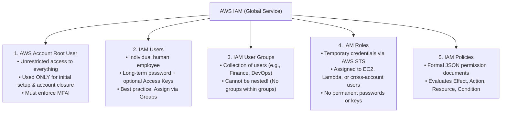
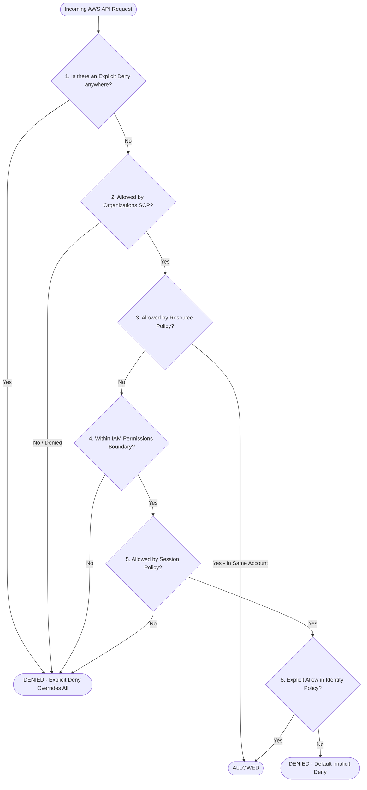

# AWS Identity & Access Management (IAM) & Directory Services

> **Service Category:** Security, Identity & Compliance (Domain 2.3)  
> **Relevant Certifications:** [CLF-C02](../../01_Syllabus/CLF-C02_Master_Blueprint.md), SAA-C03, DVA-C02, SOA-C02  
> **Tags:** `#aws/services` `#aws/security` `#aws/iam` `#clf-c02`

---

## 💡 The Real-World Analogy (ELI5)

> **Corporate Office Security System:**
> - **IAM User:** A permanent employee with a personalized employee ID badge, username, and password. Used by a real human for interactive daily work.
> - **IAM Group:** A department roster (e.g., Marketing, Accounting, DevOps). Adding an employee to the Accounting group automatically gives them physical keycard access to the accounting ledger room.
> - **IAM Role:** A temporary visitor pass or contractor keycard. It has no permanent password; anyone authorized can clip it on temporarily to perform a specific job (e.g., an electrician fixing wiring in the server room), and hand it back when finished. Used by EC2 instances, Lambda functions, or external federated users.
> - **IAM Policy:** The official written building regulation hanging on the wall. Written in standardized JSON syntax, it explicitly states: *"Persons holding Badge X are ALLOWED to enter Room Y between 9 AM and 5 PM, but are EXPLICITLY DENIED access to the Vault under all circumstances."*
> - **AWS Account Root User:** The building owner who holds the master deed, safe combination, and master keys. The owner locks their keys in a safe, enables a retina scanner (MFA), and only unlocks the safe during major financial reorganizations or legal emergencies.

---

## 1. First-Principles Computer Science & Identity Mechanics

Access management in distributed computing is governed by two distinct cryptographic concepts: **Authentication** and **Authorization**:

```mermaid
flowchart LR
    Principal["Principal (User / Service)"] -->|1. Authentication (AuthN)| Authn["Who are you?<br/>(Username/Password, Access Key, MFA Token)"]
    Authn -->|Identity Confirmed| Authz["2. Authorization (AuthZ)<br/>What are you allowed to do?<br/>(IAM Policy Evaluation Engine)"]
    Authz -->|Explicit Allow & No Explicit Deny| Resource["AWS Target Resource (e.g., S3 Bucket, EC2 Instance)"]
    Authz -->|Implicit or Explicit Deny| Denied["HTTP 403 Access Denied"]
```

### 1.1 Authentication (AuthN) vs. Authorization (AuthZ)
* **Authentication ($AuthN$):** Verifying the identity of the principal (human or machine). In AWS, this is verified using:
  - Console Password + Multi-Factor Authentication (MFA) virtual or hardware token.
  - Long-term API Access Keys (`aws_access_key_id` + `aws_secret_access_key`) for CLI/SDK.
  - Temporary session tokens issued by the **AWS Security Token Service (STS)**.
* **Authorization ($AuthZ$):** Determining the permissions granted to an authenticated identity. In AWS, authorization is computed dynamically at the exact millisecond an API request arrives, using mathematical Boolean evaluation of JSON policy documents.

### 1.2 Access Control Paradigms: RBAC vs. ABAC
* **Role-Based Access Control (RBAC):** Permissions are attached to static identities or roles (e.g., "Developers get S3 Read-Only"). As organizations scale to thousands of users, managing hundreds of static roles leads to "role explosion."
* **Attribute-Based Access Control (ABAC):** Permissions are granted dynamically based on metadata tags attached to users and resources (e.g., *"Allow access if `PrincipalTag:Department` == `ResourceTag:Department`"*). ABAC enables granular, scalable security guardrails with far fewer policies.

---

## 2. Historical IT Pain Points: The Enterprise Credential Crisis

Before modern centralized cloud identity platforms, identity and access management was notoriously insecure:

| Enterprise Identity Challenge | Traditional On-Premises Reality | AWS IAM Cloud Identity Paradigm |
|---|---|---|
| **Shared "Root / Admin" Credentials** | Multiple system administrators shared the single root password written on sticky notes or saved in shared text files. An administrator leaving the company required changing passwords everywhere. | **Individual IAM Users & Federation**. Every human has a unique identity. Root account access is permanently locked behind hardware MFA and never used for daily work. |
| **Hardcoded API Keys in Source Code** | Developers embedded plaintext database passwords and access tokens directly into application source code, resulting in catastrophic credential leaks on public GitHub repositories. | **IAM Roles for Workloads**. Applications running on Amazon EC2 or AWS Lambda automatically retrieve temporary, self-rotating credentials via AWS STS. |
| **Orphaned User Accounts & Privilege Creep** | When employees changed roles or left the company, their individual server SSH keys and database logins lingered for months, leaving backdoor attack vectors. | **Centralized Single Sign-On (IAM Identity Center)**. Deactivating a user in corporate Active Directory/Okta instantly terminates access across all 100+ AWS accounts. |
| **Permission Bloat & Audit Guesswork** | Security teams had no visibility into whether a granted database privilege had actually been exercised in the past two years, making it impossible to enforce least privilege. | **IAM Access Advisor & Access Analyzer**. Automatically analyzes CloudTrail telemetry to identify unused permissions, enabling automated rightsizing. |

---

## 3. Deep-Dive: AWS IAM Architecture & Entities

AWS IAM is a **global service** (identity configurations apply universally across all AWS Regions without regional configuration):



### 3.1 The AWS Account Root User
* **Complete Omnipotence:** The root user is the identity established when the AWS account is first created (using an email address and password). It has unrestricted administrative access to all resources, billing, and services in the account.
* **Mandatory Best Practice:** 
  1. Lock away the root user credentials immediately after account creation.
  2. Enable Multi-Factor Authentication (MFA) using a virtual authenticator app or physical FIPS-validated hardware security key (YubiKey).
  3. Never use the root user for daily operational or administrative tasks.
  4. Create dedicated administrative IAM users or IAM Identity Center roles for daily operations.
* **Tasks Exclusively Requiring Root User Access:**
  - Closing an AWS account.
  - Modifying the AWS account name, root email, or root password.
  - Changing the AWS Support plan (e.g., upgrading from Developer to Business).
  - Registering as an AWS GovCloud seller.

### 3.2 IAM Users and User Groups
* **IAM Users:** Persistent digital identities representing a specific person or application service. An IAM user can have two credential types:
  - *Console Password:* For logging into the web-based AWS Management Console.
  - *Access Key Pair (`AccessKeyId` + `SecretAccessKey`):* For authenticating CLI, SDK, and programmatic API calls.
* **IAM User Groups:** Logical collections of IAM users. Permissions applied to a group automatically apply to all users within that group.
  - *Important Limitation:* **Groups cannot be nested** (a group cannot contain another group).

### 3.3 IAM Roles and Temporary Credentials (AWS STS)
* **What is an IAM Role?** An identity with specific permissions, but **no permanent credentials (no password, no long-term access keys)**.
* **AWS Security Token Service (STS):** When a principal assumes a role, AWS STS issues temporary security credentials (access key, secret key, and session token) valid from 15 minutes to 12 hours.
* **Primary Use Cases for IAM Roles:**
  1. *AWS Services (EC2 / Lambda):* An EC2 instance retrieves temporary credentials from the Instance Metadata Service (IMDSv2) via its attached IAM Role profile to read from Amazon S3 without hardcoding keys.
  2. *Cross-Account Access:* Granting developers in Account A temporary administrative access to resources in Account B without creating duplicate user accounts.
  3. *Federated Identity:* Enabling corporate employees to log into AWS using their enterprise Active Directory or Google Workspace accounts.

---

## 4. Deep-Dive: IAM Policy Evaluation Logic & JSON Syntax

An IAM policy is a formal JSON document that defines authorization permissions:

```json
{
  "Version": "2012-10-17",
  "Statement": [
    {
      "Sid": "AllowS3ReadOnlyForFinance",
      "Effect": "Allow",
      "Principal": "*",
      "Action": [
        "s3:GetObject",
        "s3:ListBucket"
      ],
      "Resource": [
        "arn:aws:s3:::finance-reports-2026",
        "arn:aws:s3:::finance-reports-2026/*"
      ],
      "Condition": {
        "Bool": {
          "aws:MultiFactorAuthPresent": "true"
        }
      }
    }
  ]
}
```

### 4.1 The 6 Critical Policy Evaluation Steps:



1. **Default Deny:** Every request starts with an **implicit deny** (zero access).
2. **Explicit Deny Trumps Everything:** If an explicit `Deny` exists in *any* policy (SCP, Identity Policy, Resource Policy, or Boundary), the request is immediately rejected.
3. **Explicit Allow Required:** Access is granted only if an explicit `Allow` statement matches the request and no explicit `Deny` is present.

---

## 5. Multi-Dimensional Identity Entity Comparison Matrix

| Identity Entity | Long-Lived vs. Temporary | Primary Credential Type | Best Suited For | Can Have Direct Login Password? | MFA Support |
|---|---|---|---|:---:|:---:|
| **Root User** | Long-Lived | Email + Complex Password | Initial account setup; account closure; billing changes | **YES** | **Mandatory** (Hardware/Virtual) |
| **IAM User** | Long-Lived | Password (Console) / Access Keys (CLI) | Legacy human employees; service accounts lacking role support | **YES** | **Recommended** |
| **IAM User Group** | Collection | N/A (Holds shared policies) | Grouping users by department (e.g., Marketing, Admins) | **NO** | N/A |
| **IAM Role** | **Temporary (STS)** | Ephemeral session token (15m–12h) | EC2 instances, Lambda functions, cross-account, federation | **NO** | Inherited from assuming identity |
| **IAM Identity Center** | Centralized SSO | Enterprise credentials (Okta, Azure AD, AD) | Modern multi-account enterprise single sign-on | **YES** (Via IdP portal) | **Enforced via IdP** |

---

## 6. Exam Traps & 'Clue-to-Answer' Decryption

| Question Scenario Keyword | Target Entity / Practice | Exam Trap & Distractor Explanation |
|---|---|---|
| *"Grant temporary credentials to an EC2 instance to access Amazon S3"* | **IAM Role** | Trap: Never store long-term access keys inside an EC2 instance or application code. Always use IAM Roles. |
| *"Securing AWS account root user after initial creation"* | **Enable MFA, lock away root, use IAM admin user** | Trap: The root user should NEVER be used for daily administrative work. |
| *"Granting only the permissions required to complete a specific task"* | **Principle of Least Privilege** | Trap: Avoid broad wildcard permissions (`*`). Start with implicit deny and grant minimal actions. |
| *"Audit list of all account users showing password age, MFA status, and access keys"* | **IAM Credential Report** | Trap: Do not choose IAM Access Advisor. Credential Report downloads as a CSV auditing all user account credentials. |
| *"Identify which IAM permissions have not been used in the past 90 days"* | **IAM Access Advisor** | Trap: Do not choose IAM Access Analyzer. Access Advisor analyzes "service last accessed" data to trim unused rights. |
| *"Identify S3 buckets or KMS keys accessible by external AWS accounts or public internet"* | **IAM Access Analyzer** | Trap: Access Analyzer uses automated mathematical reasoning to detect external resource sharing. |
| *"Centralized single sign-on across multiple AWS accounts in an organization"* | **IAM Identity Center (AWS SSO)** | Trap: Do not create separate IAM users in every account. Centralize access using IAM Identity Center. |

---

## 7. Post-Topic Question Simulation & Retention Check

### Question 1
**What is the AWS Well-Architected recommendation for managing the AWS account root user following initial account registration?**
- A) Generate permanent programmatic access keys and distribute them to the senior development leads
- B) Delete all root user access keys, enable Multi-Factor Authentication (MFA), and use IAM roles or administrative IAM users for daily operations
- C) Share the root user login password with trusted members of the IT management team
- D) Log in as the root user daily to inspect CloudWatch operational billing graphs

<details>
<summary><b>Click to View Answer & Detailed Distractor Analysis</b></summary>

**Correct Answer:** **B) Delete all root user access keys, enable Multi-Factor Authentication (MFA), and use IAM roles or administrative IAM users for daily operations**

* **Why it's correct:** The root user possesses unrestricted, non-revocable administrative access to all resources and financial billing across the account. AWS security best practices dictate deleting all root programmatic access keys, locking down the account with hardware or virtual MFA, and delegating daily administrative responsibilities to IAM Identity Center or dedicated administrative IAM users following least-privilege principles.
* **Distractor Analysis:**
  - *A is incorrect:* Generating permanent access keys for the root user creates an extreme security vulnerability; if leaked, an attacker gains complete control of the AWS account.
  - *C is incorrect:* Sharing root credentials violates basic corporate security compliance and destroys audit traceability (CloudTrail logs would not show which human took an action).
  - *D is incorrect:* Daily administrative tasks must never be performed using the root user; daily monitoring should be performed by IAM identities with scoped permissions.
</details>

---

### Question 2
**An application running on an Amazon EC2 instance needs to securely read objects from an Amazon S3 bucket. Which approach implements the principle of least privilege without hardcoding credentials?**
- A) Embed IAM user access keys and secret keys directly into the application's configuration file
- B) Store AWS programmatic access keys in a public GitHub code repository
- C) Attach an IAM Role with an Amazon S3 read-only policy to the EC2 instance profile
- D) Configure the Amazon S3 bucket policy to allow unrestricted public read access across the internet

<details>
<summary><b>Click to View Answer & Detailed Distractor Analysis</b></summary>

**Correct Answer:** **C) Attach an IAM Role with an Amazon S3 read-only policy to the EC2 instance profile**

* **Why it's correct:** Attaching an IAM Role to an Amazon EC2 instance profile allows the application to retrieve short-lived, automatically rotated temporary security credentials from the AWS Security Token Service (STS) via the Instance Metadata Service (IMDSv2), eliminating the need to store long-term access keys.
* **Distractor Analysis:**
  - *A is incorrect:* Hardcoding long-term access keys into application files creates severe risk of accidental disclosure and requires manual rotation if compromised.
  - *B is incorrect:* Exposing access keys in a public repository allows unauthorized malicious actors to compromise and hijack the AWS account within seconds.
  - *D is incorrect:* Making the S3 bucket publicly readable exposes confidential corporate data to the entire public internet, violating security compliance.
</details>

---

### Question 3
**Which fundamental security principle dictates that users, applications, and systems should only be granted the minimum permissions necessary to complete their specific business functions?**
- A) Separation of duties
- B) Principle of Least Privilege
- C) Defense-in-depth
- D) Zero-trust perimeter

<details>
<summary><b>Click to View Answer & Detailed Distractor Analysis</b></summary>

**Correct Answer:** **B) Principle of Least Privilege**

* **Why it's correct:** The Principle of Least Privilege is the foundational security rule of AWS IAM. It mandates starting with zero access (implicit deny) and granting only the specific API actions, resource ARNs, and conditions strictly required to perform the intended job role.
* **Distractor Analysis:**
  - *A is incorrect:* Separation of duties is an operational control ensuring that critical workflows require multiple people to complete (e.g., one person requests a database change, another approves it).
  - *C is incorrect:* Defense-in-depth is an architectural strategy that implements multiple layered defensive barriers (WAF, VPC security groups, encryption, IAM) across the entire stack.
  - *D is incorrect:* Zero-trust perimeter is a modern architectural philosophy requiring continuous verification of all identities regardless of network location.
</details>

---

### Question 4
**An enterprise operates 75 AWS accounts under AWS Organizations. Which service provides a single central portal for workforce employees to sign in with their corporate credentials and access their assigned accounts and business applications?**
- A) AWS IAM Identity Center (AWS Single Sign-On)
- B) AWS Secrets Manager
- C) Amazon GuardDuty
- D) AWS Shield Advanced

<details>
<summary><b>Click to View Answer & Detailed Distractor Analysis</b></summary>

**Correct Answer:** **A) AWS IAM Identity Center (AWS Single Sign-On)**

* **Why it's correct:** AWS IAM Identity Center (successor to AWS Single Sign-On) centralizes workforce authentication and authorization across multiple AWS accounts, integrating with corporate identity providers (such as Microsoft Entra ID, Okta, or Active Directory) and providing a unified single sign-on user portal.
* **Distractor Analysis:**
  - *B is incorrect:* AWS Secrets Manager stores, retrieves, and automatically rotates database passwords and API tokens, not workforce employee identities.
  - *C is incorrect:* Amazon GuardDuty is an intelligent threat detection service that analyzes network telemetry and API logs for malicious activity.
  - *D is incorrect:* AWS Shield Advanced is an enterprise Distributed Denial of Service (DDoS) mitigation and protection service.
</details>

---

### Question 5
**What is the evaluation outcome in AWS IAM when an attached user identity policy explicitly contains an `Allow` statement for `s3:PutObject`, but the target Amazon S3 bucket policy contains an explicit `Deny` statement for that user?**
- A) Access is Allowed, because identity-based policies always override resource-based policies
- B) Access is Denied, because an explicit Deny statement in any applicable policy always overrides an Allow
- C) The user is prompted to submit a multi-factor authentication (MFA) code before proceeding
- D) Access is Allowed with restricted read-only permissions

<details>
<summary><b>Click to View Answer & Detailed Distractor Analysis</b></summary>

**Correct Answer:** **B) Access is Denied, because an explicit Deny statement in any applicable policy always overrides an Allow**

* **Why it's correct:** In the AWS IAM policy evaluation engine, an **explicit Deny** statement in *any* applicable policy (whether a Service Control Policy, Permissions Boundary, Identity Policy, or Resource Policy) permanently overrides all Allow statements, resulting in an immediate HTTP 403 Access Denied.
* **Distractor Analysis:**
  - *A is incorrect:* Identity policies do not override resource policies; both are evaluated together, and any explicit Deny immediately blocks the request.
  - *C is incorrect:* IAM policy evaluation does not dynamically prompt for MFA at the evaluation stage unless an explicit MFA condition is configured in an Allow policy.
  - *D is incorrect:* If `s3:PutObject` is denied, the write operation completely fails; it does not partially degrade to read-only access.
</details>
