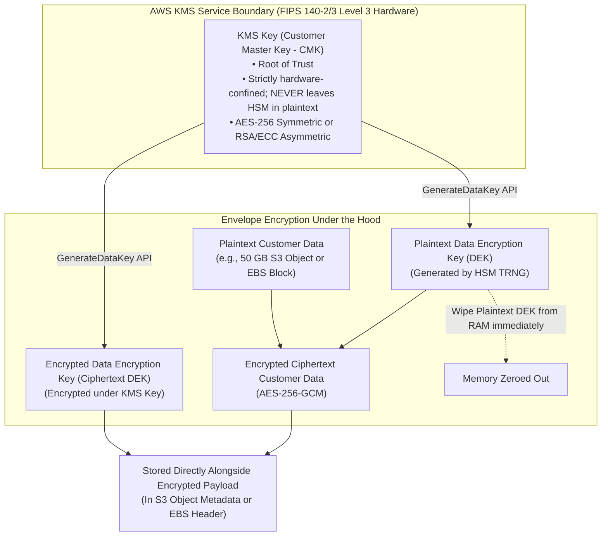
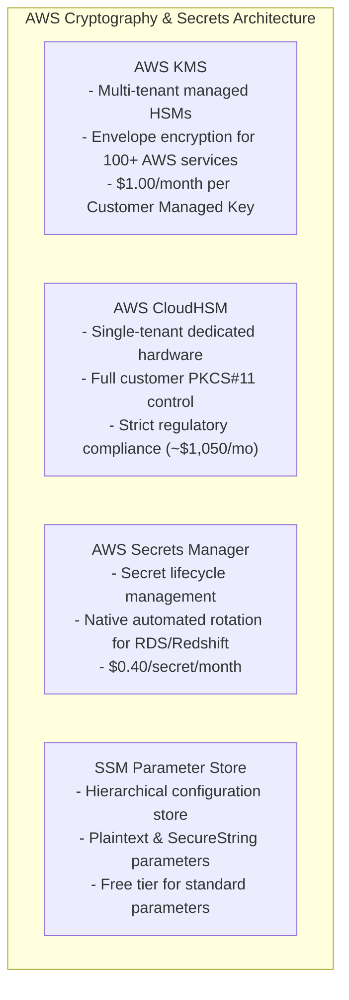
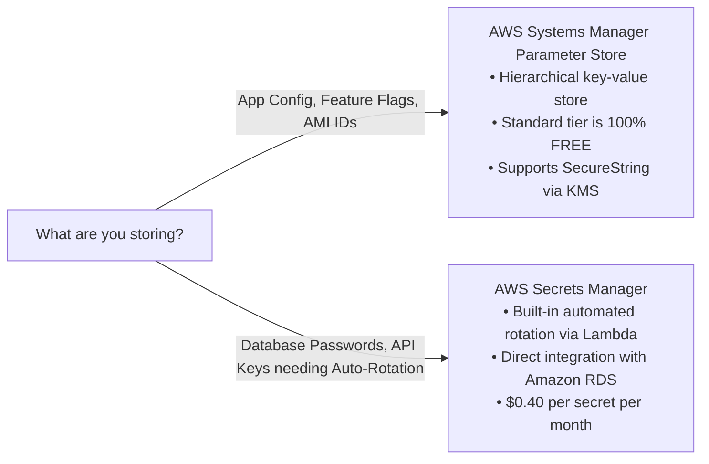
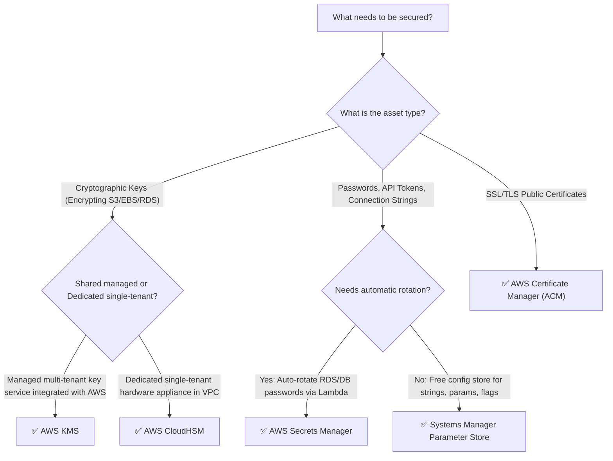

# AWS Cryptography, Key Management & Secrets Services

> **Knowledge Area:** Security and Compliance (Domain 2.1 & 2.2)  
> **Relevant Certifications:** [CLF-C02](../../01_Syllabus/CLF-C02_Master_Blueprint.md), SAA-C03, SCS-C02  
> **Tags:** `#aws/security` `#kms` `#cloudhsm` `#secrets-manager` `#parameter-store` `#clf-c02`

---

## 💡 The Real-World Analogy (ELI5)

> **Bank Vaults, Envelopes & Automated Smart Lockers:**
> - **AWS KMS (Key Management Service) & Envelope Encryption:** Imagine a bank manager who holds a heavy master golden key that *never* leaves the bank's underground vault. When you need to lock a large filing cabinet (your 50 GB database), the manager doesn't bring the golden key to your house. Instead, the manager stamps out a cheap, disposable brass key (a Data Encryption Key), hands it to you, and gives you a tamper-evident locked envelope containing a copy of that brass key locked with the golden key. You lock your cabinet with the brass key, immediately melt the brass key, and tape the locked envelope to the front of the cabinet. When you need to unlock it, you bring only the envelope back to the bank!
> - **AWS CloudHSM:** Buying and bolting your own private, bulletproof titanium safe inside a dedicated cage at the bank. It is a single-tenant physical appliance. You are the only person on Earth with the combination; even the bank president and security guards cannot open it.
> - **AWS Secrets Manager:** A high-tech digital lockbox that stores your database passwords and automatically changes the lock combination every 30 days at midnight, notifying the database server automatically while you sleep peacefully.
> - **AWS Systems Manager Parameter Store:** A free digital notebook with password-protected pages for storing configuration strings (like database host URLs or API endpoint addresses).

---

## 1. First-Principles Computer Science & Cryptographic Mechanics

Understanding cloud cryptography requires grasping the mathematical fundamentals of encryption algorithms and key hierarchies:

### 1.1 Symmetric vs. Asymmetric Cryptography
* **Symmetric Encryption (e.g., AES-256-GCM):** Uses the exact same mathematical secret key to encrypt plaintext into ciphertext and decrypt ciphertext back into plaintext.
  - *Properties:* Computationally ultra-fast; ideal for bulk data encryption (storage blocks, database files). 99% of AWS storage encryption (SSE-S3, SSE-KMS, EBS encryption) uses symmetric AES-256.
* **Asymmetric Encryption (e.g., RSA-4096, ECC P-384):** Uses a mathematically linked key pair: a **Public Key** (which anyone can use to encrypt data or verify signatures) and a **Private Key** (held secret by the owner to decrypt data or generate signatures).
  - *Properties:* Computationally heavy; ideal for identity verification, digital signatures, and TLS handshakes.

### 1.2 The Problem of Scale: Why Envelope Encryption?
If AWS had to send every 50 GB video file over the network to a central KMS server to encrypt it with a master key, two catastrophic engineering bottlenecks would occur:
1. **Network Throughput Saturation:** Terabytes of data flooding KMS network interfaces.
2. **Key Wear-out and Cryptanalytic Attacks:** Encrypting billions of blocks with a single symmetric key increases the risk of cryptographic pattern discovery.
* **The Envelope Encryption Solution:**
  - KMS generates a unique, one-time **Data Encryption Key (DEK)** for *every single file or disk block*.
  - The local application or storage node uses the plaintext DEK to encrypt the data locally in memory at wire speed (using AES-NI hardware CPU instructions).
  - The plaintext DEK is **immediately zeroed out from RAM memory**.
  - The encrypted DEK is stored directly alongside the encrypted ciphertext. To decrypt later, only the small encrypted DEK (a few bytes) is sent to KMS.

---

## 2. Historical IT Pain Points: The On-Premises Cryptography Nightmare

Before cloud key management and automated secret rotation services existed, managing enterprise secrets was notorious for human error:

| Enterprise Security Challenge | Traditional On-Premises Reality | AWS Cryptography & Secrets Paradigm |
|---|---|---|
| **Hardcoded Plaintext Secrets in Code** | Developers hardcoded database passwords and private API keys directly into application source code, leading to leaks on public GitHub repositories. | Store secrets centrally in **AWS Secrets Manager** or **SSM Parameter Store**. Applications retrieve secrets dynamically at runtime via IAM-authenticated APIs. |
| **Manual Password Rotation Disasters** | Changing a production database password required coordinating manual updates across 50 configuration files. Inevitably, one server was missed, causing production outages. | **Automated Zero-Downtime Rotation**. AWS Secrets Manager automatically executes an AWS Lambda function to rotate credentials without service interruption. |
| **Exorbitant HSM Hardware Costs** | Purchasing on-premises Hardware Security Modules (HSMs) cost **\$40,000 to \$100,000 per appliance**, requiring specialized cooling, physical racks, and complex PKCS#11 drivers. | **AWS KMS** provides high-availability, multi-tenant, FIPS 140-validated HSM encryption for **\$1.00/month per key**, with zero hardware maintenance. |
| **Audit Trails for Key Access** | Proving to auditors who accessed or decrypted sensitive encryption keys required combing through scattered, uncoordinated server syslog files. | **AWS CloudTrail Integration**. Every single call to `kms:Decrypt` or `secretsmanager:GetSecretValue` is logged immutably with timestamp, caller identity, and IP address. |

---

## 3. Deep-Dive: AWS Encryption & Key Management Services

### 3.1 AWS Key Management Service (AWS KMS)
* **What it is:** A fully managed, multi-tenant service that enables administrators to create, rotate, control, and audit cryptographic keys across AWS services and custom applications.
* **FIPS 140-2 / FIPS 140-3 Validation:** All KMS keys are generated, stored, and executed inside Hardware Security Modules (HSMs) validated under the NIST Cryptographic Module Validation Program.
* **Hardware-Bound Security:** The plaintext root KMS key **never leaves the physical boundary of the KMS HSM in unencrypted form**. Decryption requests are sent *into* KMS; plaintext keys are never exported.
* **Three Types of KMS Keys:**
  1. **AWS Owned Keys:** Created and managed by AWS internally for service operations (e.g., default DynamoDB tables). Free of charge; not visible in customer account; no custom key policies.
  2. **AWS Managed Keys:** Automatically created by AWS on your behalf when you enable encryption in a service (e.g., `aws/s3`, `aws/ebs`, `aws/rds`). Free of charge; visible in KMS console; automatic rotation every 1 year; cannot modify key policies.
  3. **Customer Managed Keys (CMKs):** Created, owned, and configured by the customer. Enables granular Key Policies, custom rotation schedules (automatic every 90 to 360 days), and cross-account access grants. Cost: **\$1.00 per key per month**.

### 3.2 AWS CloudHSM
* **What it is:** A cloud-hosted, single-tenant, dedicated Hardware Security Module appliance provisioned directly inside your private Amazon VPC subnets.
* **Single-Tenancy & Exclusive Control:** The physical cryptographic hardware is dedicated exclusively to your AWS account. AWS engineers manage hardware maintenance and power, but have **zero cryptographic administrative access** to the keys inside.
* **Standards Support:** Full native support for standard cryptographic APIs: PKCS#11, Java Cryptography Extensions (JCE), and Microsoft CryptoNG (CNG).
* **When to choose CloudHSM over KMS:** Choose CloudHSM strictly when corporate compliance, contractual agreements, or government mandates dictate dedicated single-tenant hardware where the customer has exclusive custody of the cryptographic root of trust.

---

## 4. Secrets Management: Secrets Manager vs. Parameter Store

Managing plaintext configuration data vs. sensitive database credentials requires distinct architectural patterns:

### 4.1 AWS Secrets Manager
* **Core Value Proposition:** Built specifically for storing, managing, and **automatically rotating** database credentials, OAuth tokens, and API keys without deploying custom scripts.
* **Native Lambda Rotation:** Integrates natively with Amazon RDS, Amazon Aurora, and Amazon DocumentDB to rotate credentials on a scheduled frequency (e.g., every 30, 60, or 90 days) without downtime.
* **Granular IAM Policies:** Protect secrets using resource-based policies that restrict access to specific IAM roles (e.g., allowing only the production application EC2 role to read the database secret).

### 4.2 AWS Systems Manager Parameter Store
* **Core Value Proposition:** A secure, hierarchical storage service for application configuration data, environment variables, license codes, and database connection strings.
* **Data Types:** Supports `String`, `StringList`, and `SecureString` (which encrypts parameters using an AWS KMS key).
* **Cost Efficiency:** Standard parameters are **completely free** of charge, making Parameter Store the preferred choice for general application configuration management.

---

## 5. Multi-Dimensional Cryptography Decision Matrix

| Dimension | AWS Key Management Service (KMS) | AWS CloudHSM | AWS Secrets Manager | AWS Systems Manager Parameter Store |
|---|---|---|---|---|
| **Primary Architectural Role** | Cryptographic key lifecycle & envelope encryption | Dedicated physical HSM appliance inside customer VPC | Lifecycle & automated rotation of passwords/API keys | Hierarchical key-value store for app configuration |
| **Hardware Tenancy Model** | **Multi-tenant** shared physical HSMs (FIPS 140-2 Level 2/3) | **Single-tenant** dedicated physical HSM hardware | Managed service (uses KMS for encryption) | Managed service (uses KMS for SecureString) |
| **Automated Credential Rotation** | Annual automatic key rotation (or 90–360 days custom) | Customer-managed scripts/firmware | **Built-in automated rotation** for RDS/Aurora via Lambda | No built-in automated rotation engine |
| **Compliance & Cryptographic APIs** | Integrated via AWS APIs & SDKs; AWS Key Policies | PKCS#11, Java JCE, Microsoft CNG | AWS IAM & resource policies | AWS IAM policies |
| **Pricing Model** | **\$1.00/month** per Customer Managed Key + API fees | **~\$1.45/hour** (~$1,050/month per HSM appliance) | **\$0.40/month** per secret + \$0.05 per 10k API calls | **Standard tier is FREE**; nominal fee for Advanced tier |
| **Ideal Workload Scenario** | Encrypting S3 buckets, EBS volumes, RDS storage | Strict regulatory mandates requiring dedicated hardware | Storing and auto-rotating RDS database passwords | Storing license keys, AMI IDs, environment variables |

---

## 6. Exam Traps & 'Clue-to-Answer' Decryption

| Question Scenario Keyword | Target Service | Exam Trap & Distractor Explanation |
|---|---|---|
| *"Dedicated hardware security module, single-tenant, FIPS 140-2 Level 3"* | **AWS CloudHSM** | Trap: Do not choose AWS KMS. KMS is a multi-tenant shared hardware service; CloudHSM is dedicated single-tenant. |
| *"Automatically rotate database credentials on a scheduled frequency"* | **AWS Secrets Manager** | Trap: Do not choose Systems Manager Parameter Store. Parameter Store lacks built-in automatic rotation engines. |
| *"Free hierarchical key-value store for application configuration and license keys"* | **SSM Parameter Store** | Trap: Do not choose Secrets Manager. Parameter Store standard tier is free; Secrets Manager costs \$0.40/secret/month. |
| *"Fully managed cryptographic service integrating with over 100 AWS services"* | **AWS Key Management Service (KMS)** | Trap: Do not choose CloudHSM. KMS is the default native encryption service across AWS. |
| *"Provision, manage, and renew public SSL/TLS certificates for load balancers"* | **AWS Certificate Manager (ACM)** | Trap: Do not choose KMS. KMS manages cryptographic keys; ACM provisions and auto-renews SSL/TLS web certificates. |
| *"Difference between Server-Side vs. Client-Side Encryption"* | **Server-Side: AWS encrypts on disk; Client-Side: App encrypts before upload** | Trap: Server-Side means AWS handles crypto upon disk write; Client-Side means customer encrypts data before transmission. |

---

## 7. Post-Topic Question Simulation & Retention Check

### Question 1
**An organization needs to securely store production relational database credentials and API tokens with automated, scheduled rotation every 30 days without application downtime. Which AWS service should they choose?**
- A) AWS Systems Manager Parameter Store
- B) AWS Secrets Manager
- C) AWS Key Management Service (AWS KMS)
- D) Amazon S3 Glacier Flexible Retrieval

<b>Click to View Answer & Detailed Distractor Analysis</b>

**Correct Answer:** **B) AWS Secrets Manager**

* **Why it's correct:** AWS Secrets Manager is specifically engineered for storing, managing, and automatically rotating credentials (e.g., Amazon RDS database passwords, OAuth tokens, and third-party API keys) using built-in AWS Lambda rotation functions without causing application downtime.
* **Distractor Analysis:**
  - *A is incorrect:* AWS Systems Manager Parameter Store provides secure configuration storage, but does not provide built-in automated scheduled credential rotation mechanisms.
  - *C is incorrect:* AWS KMS is used to generate, control, and manage cryptographic encryption keys; it does not store, retrieve, or rotate plaintext database passwords.
  - *D is incorrect:* Amazon S3 Glacier is an archival cold-storage service designed for long-term document backup, not a low-latency secrets vault.

---

### Question 2
**Which fully managed AWS service provides FIPS 140-validated hardware security modules to generate, rotate, and control cryptographic keys, integrating natively with over 100 AWS services to perform envelope encryption?**
- A) AWS CloudHSM
- B) AWS Key Management Service (AWS KMS)
- C) AWS Secrets Manager
- D) Amazon Macie

<b>Click to View Answer & Detailed Distractor Analysis</b>

**Correct Answer:** **B) AWS Key Management Service (AWS KMS)**

* **Why it's correct:** AWS KMS is the central, fully managed encryption engine across the AWS cloud ecosystem, providing multi-tenant FIPS 140-2/3 validated HSMs to create, manage, and audit customer master keys (KMS keys) used for envelope encryption across EBS, S3, RDS, DynamoDB, and custom applications.
* **Distractor Analysis:**
  - *A is incorrect:* AWS CloudHSM provides dedicated, single-tenant physical appliances inside a customer's VPC, requiring manual customer management rather than native turnkey multi-service integration.
  - *C is incorrect:* AWS Secrets Manager manages database credentials and API tokens, relying on KMS under the hood for encrypting secret payloads.
  - *D is incorrect:* Amazon Macie is a machine learning-powered data security service that scans Amazon S3 buckets to discover and protect sensitive personal data (PII).

---

### Question 3
**A multinational banking institution requires dedicated, single-tenant Hardware Security Module (HSM) appliances under their exclusive administrative control to meet strict regulatory compliance mandates. Which AWS service satisfies this requirement?**
- A) AWS KMS
- B) AWS CloudHSM
- C) AWS Secrets Manager
- D) AWS Shield Advanced

<b>Click to View Answer & Detailed Distractor Analysis</b>

**Correct Answer:** **B) AWS CloudHSM**

* **Why it's correct:** AWS CloudHSM provisions dedicated, single-tenant physical HSM appliances inside the customer's Amazon VPC subnets. The customer maintains exclusive administrative ownership of the cryptographic keys using industry-standard APIs (PKCS#11); AWS personnel have zero visibility into or control over keys stored inside CloudHSM.
* **Distractor Analysis:**
  - *A is incorrect:* AWS KMS is a multi-tenant shared infrastructure service where AWS manages the underlying HSM fleet.
  - *C is incorrect:* AWS Secrets Manager is a password and secret vault service, not a dedicated physical cryptographic appliance.
  - *D is incorrect:* AWS Shield Advanced is an enterprise Distributed Denial of Service (DDoS) mitigation and protection service.

---

### Question 4
**What is the core difference between Server-Side Encryption (SSE) and Client-Side Encryption when storing objects in Amazon S3?**
- A) Server-side encryption encrypts data on the client device prior to network transit
- B) Server-side encryption encrypts data after it reaches AWS storage hardware; client-side encryption encrypts data locally before transmitting it across the network to AWS
- C) Client-side encryption is automatically enabled and managed by AWS by default
- D) Server-side encryption requires customers to plug physical USB cryptographic tokens into their client devices

<b>Click to View Answer & Detailed Distractor Analysis</b>

**Correct Answer:** **B) Server-side encryption encrypts data after it reaches AWS storage hardware; client-side encryption encrypts data locally before transmitting it across the network to AWS**

* **Why it's correct:** In Server-Side Encryption (e.g., SSE-S3, SSE-KMS), plaintext data is transmitted securely over TLS to Amazon S3, and AWS storage controllers encrypt the data at the storage layer upon disk write. In Client-Side Encryption, the customer application encrypts data locally in memory using client-managed keys *before* transmitting the encrypted ciphertext over the network to S3.
* **Distractor Analysis:**
  - *A is incorrect:* Encrypting data on the client device prior to transmission describes Client-Side Encryption, not Server-Side Encryption.
  - *C is incorrect:* Client-side encryption must be explicitly engineered and executed by the customer's application code; AWS cannot manage client-side logic.
  - *D is incorrect:* Server-side encryption is completely transparent to the user and is executed by AWS storage infrastructure without physical tokens.

---

### Question 5
**A developer needs a low-cost, serverless solution to store plain-text application configuration parameters (such as database URLs, feature toggle flags, and license keys) in a hierarchical format. Which AWS service should they utilize?**
- A) AWS Systems Manager Parameter Store
- B) AWS Artifact
- C) AWS CloudTrail
- D) AWS License Manager

<b>Click to View Answer & Detailed Distractor Analysis</b>

**Correct Answer:** **A) AWS Systems Manager Parameter Store**

* **Why it's correct:** AWS Systems Manager Parameter Store provides a centralized, hierarchical key-value store for configuration variables, environment settings, and secrets. Standard parameters are available at **zero financial cost** (free tier), making it ideal for general application configuration management.
* **Distractor Analysis:**
  - *B is incorrect:* AWS Artifact is the compliance portal used to download AWS audit reports (SOC, ISO) and compliance agreements.
  - *C is incorrect:* AWS CloudTrail is an audit logging service that captures and records AWS account API activity.
  - *D is incorrect:* AWS License Manager is used by enterprises to track, manage, and enforce software licensing compliance (such as Microsoft and Oracle licenses).

---

## 🧠 Master MCQ Solving Blueprint: Pattern Decryption & Elimination Tricks

> *This blueprint distills recurring patterns, keyword triggers, and trap options extracted from over 350 questions on Encryption, KMS, CloudHSM, Secrets Manager, and Parameter Store across the official CLF-C02 question bank.*

### 1. The "Clue-to-Service" Linguistic Decryption Matrix
When reading a question scenario, search for these exact phrasing triggers:

| If You See This Trigger Phrase in the Question Stem... | The Correct Security Service Is Almost Always... | Trap Distractor to Immediately Discard |
|---|---|---|
| *"Centrally manage encryption keys across AWS services; multi-tenant HSMs"* | **AWS KMS (Key Management Service)** | *AWS CloudHSM* (CloudHSM is dedicated single-tenant) |
| *"Dedicated, single-tenant physical Hardware Security Module under exclusive customer control"* | **AWS CloudHSM** | *AWS KMS* (KMS is multi-tenant managed) |
| *"Securely store database passwords with AUTOMATIC credential rotation on a schedule"* | **AWS Secrets Manager** | *AWS Systems Manager Parameter Store* (Parameter Store does not natively auto-rotate DBs) |
| *"Low-cost / free hierarchical configuration store for application settings, parameters, and license keys"* | **AWS Systems Manager Parameter Store** | *AWS Secrets Manager* (Secrets Manager incurs monthly secret costs) |
| *"Encrypt data locally on the client device BEFORE transmitting it to AWS"* | **Client-Side Encryption** | *Server-Side Encryption* |
| *"AWS automatically encrypts data when written to disk and decrypts when accessed"* | **Server-Side Encryption (SSE)** | *Client-Side Encryption* |
| *"Cryptographic pattern where a master key encrypts a data key, and the data key encrypts the data"* | **Envelope Encryption** | *Asymmetric Hashing* |
| *"SSL/TLS certificate provisioning and automated renewal for CloudFront and ALBs at zero cost"* | **AWS Certificate Manager (ACM)** | *AWS KMS* or *AWS Secrets Manager* |

### 2. The 3-Step Rapid Elimination Heuristic
When evaluating an Encryption or Secrets question:
1. **Step 1: Identify What is Being Protected (Data Keys vs. Passwords/Tokens):**
   - Are you encrypting **S3 objects, EBS volumes, or RDS databases**? $\to$ **KMS** or **CloudHSM**.
   - Are you storing **database passwords, API keys, or OAuth credentials**? $\to$ **Secrets Manager** or **Parameter Store**.
2. **Step 2: Check Multi-Tenant vs. Dedicated Single-Tenant:**
   - Multi-tenant, integrated with 100+ AWS services, FIPS 140-2 Level 3 validated $\to$ **AWS KMS**.
   - Dedicated single-tenant appliance in your VPC, regulatory mandate for direct hardware access $\to$ **AWS CloudHSM**.
3. **Step 3: Check Rotation vs. Cost for Secrets:**
   - Does the prompt require **automatic rotation of database passwords (e.g. for RDS)**? $\to$ **AWS Secrets Manager** (has built-in Lambda integration).
   - Does the prompt require a **simple, free store for configuration strings and license keys**? $\to$ **AWS Systems Manager Parameter Store**.

### 3. High-Frequency Decoy Autopsy: Why AWS Tries to Trick You
* **Decoy #1: "AWS KMS" vs. "AWS CloudHSM"**
  - *The Trap:* Questions asking for encryption compliance with FIPS 140-2 standards.
  - *The Autopsy:* Both use FIPS 140-2 validated HSMs! The critical discriminator is **tenancy and control**. If the scenario says **"dedicated single-tenant hardware under exclusive customer control"**, select **CloudHSM**. If it says **"managed service that integrates seamlessly with S3/EBS"**, select **KMS**.
* **Decoy #2: "AWS Secrets Manager" vs. "AWS Systems Manager Parameter Store"**
  - *The Trap:* A developer needs to store a database connection string or API token.
  - *The Autopsy:* If the question mentions **automated credential rotation**, pick **Secrets Manager**. If the question emphasizes **free tier / zero cost configuration management** or simple key-value parameters, pick **Parameter Store**.
* **Decoy #3: "Client-Side" vs. "Server-Side" Encryption**
  - *The Trap:* Asking which encryption model protects data before it travels across the internet to S3.
  - *The Autopsy:* **Server-side encryption** occurs *after* data reaches AWS storage disks. To protect data *in transit and before transit*, the customer must execute **client-side encryption** in their local code before upload.

### 4. 10-Second Visual Decision Flowchart

