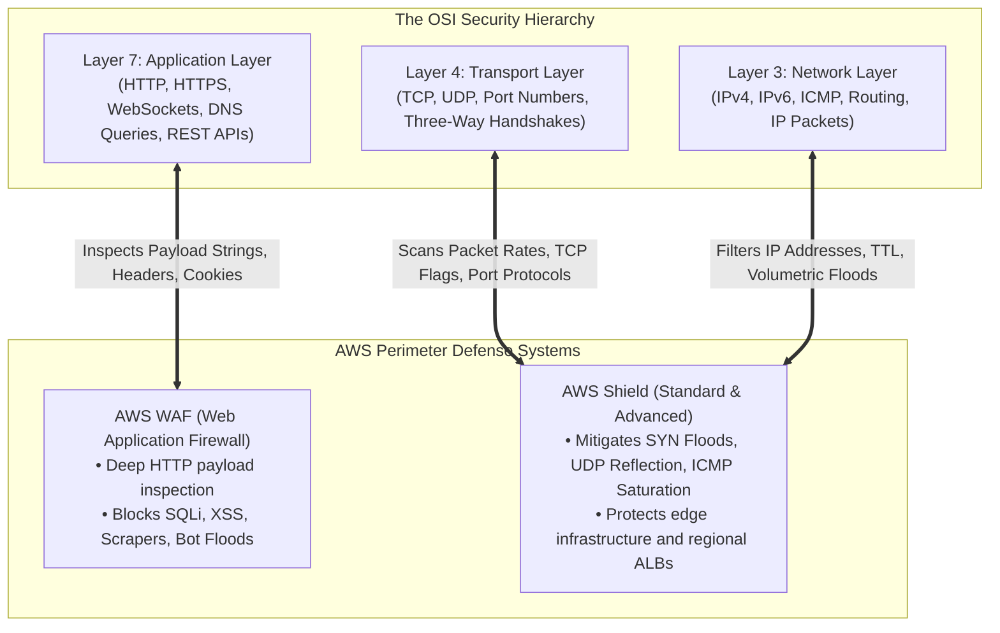
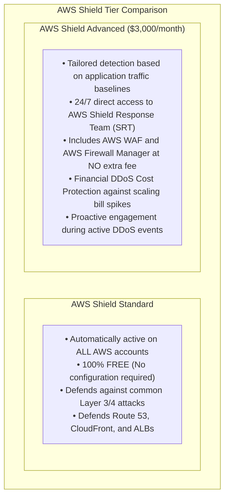
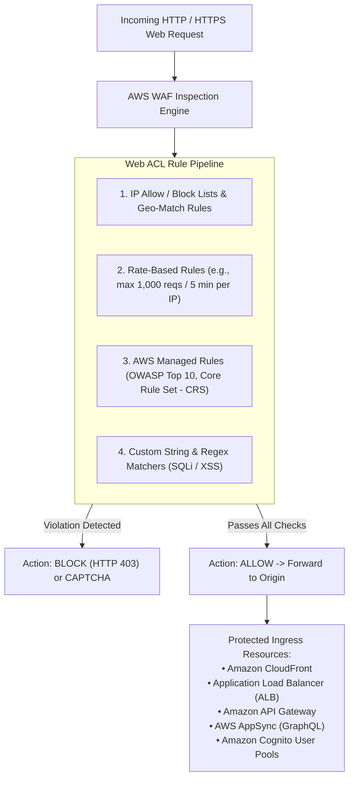
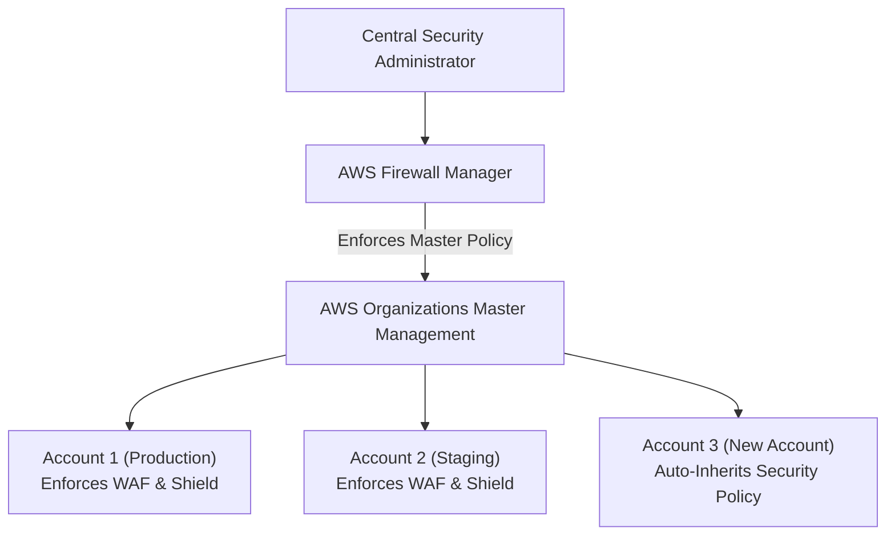
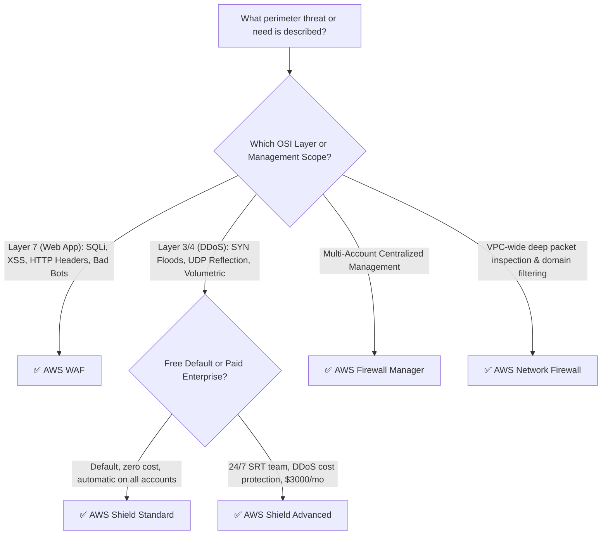

# AWS Perimeter Security: AWS Shield, AWS WAF & AWS Firewall Manager

> **Knowledge Area:** Security and Compliance (Domain 2.1 & 2.2)  
> **Relevant Certifications:** [CLF-C02](../../01_Syllabus/CLF-C02_Master_Blueprint.md), SAA-C03, SCS-C02  
> **Tags:** `#aws/security` `#waf` `#shield` `#ddos` `#firewall` `#clf-c02`

---

## 💡 The Real-World Analogy (ELI5)

> **Nightclub Perimeter Security: Highway Patrol vs. Front-Door Bouncers:**
> - **[AWS Shield](../../AWS_SERVICES_GLOSSARY.md#aws-shield) (Layers 3 & 4 Volumetric Protection):** The highway patrol and armored road barricades deployed three miles outside the nightclub. Shield prevents angry, chaotic flash mobs from driving bulldozers down the highway or jamming the street so tightly that legitimate customers cannot reach the venue (SYN floods, UDP reflection, and packet saturation attacks). **Shield Standard** is automatically active 24/7 for every building on the avenue for free; **Shield Advanced** hires a dedicated SWAT unit on speed-dial with full insurance reimbursement for broken barricades.
> - **[AWS WAF](../../AWS_SERVICES_GLOSSARY.md#aws-waf) (Layer 7 Application Protection):** The sharp-eyed, tuxedo-clad security bouncer stationed directly at the front door. WAF inspects each individual guest's ticket, identification card, and purse contents. Even if a guest walked peacefully down the highway, if their purse contains a concealed weapon or counterfeit ticket (SQL Injection `' OR '1'='1` or Cross-Site Scripting scripts), WAF denies entry immediately with an HTTP 403 Forbidden.
> - **[AWS Firewall Manager](../../AWS_SERVICES_GLOSSARY.md#aws-firewall-manager):** The regional director of security operations who writes a single master rulebook and pushes it to 50 nightclub franchises nationwide with a single click.

---

## 1. First-Principles Computer Science & OSI Layer Mechanics

Perimeter defense in computer networking is structured around the **OSI (Open Systems Interconnection) 7-Layer Reference Model**:

### 1.1 Layer 3 and Layer 4 Network & Transport Attacks
* **Volumetric Network Floods (Layer 3):** Attackers saturate incoming network bandwidth using raw data volume (e.g., ICMP Echo floods or fragmented IP packets) until the target router or link collapses.
* **State-Exhaustion Attacks (Layer 4):**
  - **TCP SYN Floods:** Exploits the standard TCP three-way handshake (SYN → SYN-ACK → ACK). The attacker transmits millions of $SYN$ packets from spoofed IP addresses but never replies with $ACK$. The server allocates memory for half-open connection tables until RAM is exhausted and new legitimate connections are rejected.
  - **UDP Reflection & Amplification:** Attackers send tiny requests with spoofed victim IP addresses to publicly exposed DNS or NTP servers, causing the external servers to reply with massive response payloads (50× to 100× larger) directed at the victim.
* **AWS Defense:** **[AWS Shield](../../AWS_SERVICES_GLOSSARY.md#aws-shield)** mitigates these attacks at the global edge using Anycast network routing and automated packet scrubbing centers without degrading customer server performance.

### 1.2 Layer 7 Application Exploits
* **Layer 7 attacks mimic legitimate human traffic:** Attackers send valid TCP handshakes and valid HTTP requests, making them completely invisible to standard Layer 4 network firewalls and Network ACLs.
* **SQL Injection (SQLi):** An attacker inputs malicious database syntax (e.g., `' OR '1'='1'; DROP TABLE users;--`) into a login form or URL query parameter to bypass authentication or extract sensitive tables.
* **Cross-Site Scripting (XSS):** Injecting malicious JavaScript payloads (e.g., ``) into web forums or comment sections to hijack user sessions.
* **HTTP GET/POST Floods:** Generating thousands of complex database search requests per second to pin server CPU at 100%.
* **AWS Defense:** **[AWS WAF](../../AWS_SERVICES_GLOSSARY.md#aws-waf)** inspects the full HTTP request body, query parameters, URI strings, and cookies, matching patterns against known threat signatures and rate-limiting abusive IP addresses.

---

## 2. Historical IT Pain Points: The On-Premises DDoS Crisis

Before cloud-scale edge scrubbing networks were accessible via on-demand configuration, mitigating Distributed Denial of Service attacks was a catastrophic operational nightmare:

| Security Challenge | Traditional On-Premises Data Center | AWS Perimeter Defense Solution |
|---|---|---|
| **Bandwidth Saturation (Pipe Choke)** | An on-premises enterprise datacenter with a 10 Gbps internet uplink was helpless against a 100 Gbps volumetric DDoS attack; the ISP pipe clogged miles before traffic hit local firewalls. | **Massive Global Edge Capacity**. [AWS Shield](../../AWS_SERVICES_GLOSSARY.md#aws-shield) absorbs and scrubs multi-terabit volumetric attacks globally across 600+ Edge Locations before traffic enters customer VPCs. |
| **Expensive Physical WAF Appliances** | Enterprises purchased dedicated hardware WAF rack appliances costing **\$50,000 to \$150,000**, which became severe network bottlenecks during peak holiday traffic. | **[AWS WAF](../../AWS_SERVICES_GLOSSARY.md#aws-waf) is 100% Serverless**. Scales elastically to handle millions of requests per second with zero hardware management. |
| **Out-of-Pocket Auto Scaling Spike Costs** | During a DDoS attack, cloud auto-scaling could spin up hundreds of EC2 instances to absorb malicious traffic, sticking the customer with a **massive surprise cloud bill**. | **[AWS Shield](../../AWS_SERVICES_GLOSSARY.md#aws-shield) Advanced DDoS Cost Protection**. AWS reimburses customers for auto-scaling spike charges incurred on EC2, ALB, CloudFront, and Route 53 during verified attacks. |
| **Manual Rule Deployment Delays** | Security engineers had to write and deploy custom firewall rules server by server during an active cyber attack. | **[AWS Firewall Manager](../../AWS_SERVICES_GLOSSARY.md#aws-firewall-manager) & Managed Rule Sets**. Automatically deploy updated rule sets across hundreds of AWS accounts in minutes. |

---

## 3. Deep-Dive: AWS Shield (Standard vs. Advanced)

### 3.1 AWS Shield Standard
* **Automatic Activation:** Transparently enabled for all AWS customers globally at **zero additional charge**.
* **Coverage:** Automatically defends against common Layer 3 and Layer 4 infrastructure attacks, including TCP SYN floods, UDP reflection/amplification, and HTTP slowloris attacks.
* **Global Anycast Integration:** When combined with [Amazon CloudFront](../../AWS_SERVICES_GLOSSARY.md#amazon-cloudfront) and [Amazon Route 53](../../AWS_SERVICES_GLOSSARY.md#amazon-route-53), Shield Standard leverages AWS's global edge network to distribute and absorb volumetric attacks before they reach internal application origins.

### 3.2 AWS Shield Advanced
* **Enterprise Subscription:** Paid monthly enterprise subscription (**\$3,000/month** base fee with a 1-year commitment, plus data transfer fees).
* **Core Value-Add Capabilities:**
  1. **24/7 [AWS Shield](../../AWS_SERVICES_GLOSSARY.md#aws-shield) Response Team (SRT):** Direct, immediate access to specialized AWS security engineers who will analyze complex attacks, triage live traffic, and author custom WAF rules on your behalf during active emergencies.
  2. **DDoS Financial Cost Protection:** If an attack triggers an EC2 Auto Scaling group or Application Load Balancer to scale out rapidly to absorb traffic, AWS credits your bill for the spike charges incurred during the incident.
  3. **Bundled [AWS WAF](../../AWS_SERVICES_GLOSSARY.md#aws-waf) & Firewall Manager:** The cost of [AWS WAF](../../AWS_SERVICES_GLOSSARY.md#aws-waf) Web ACLs, rules, and [AWS Firewall Manager](../../AWS_SERVICES_GLOSSARY.md#aws-firewall-manager) policies is bundled into the Shield Advanced subscription at no extra fee.
  4. **Proactive Engagement:** If configured with Route 53 health checks, the SRT will proactively reach out to you if application health degrades during a detected attack.

---

## 4. Deep-Dive: AWS WAF (Web Application Firewall)

### 4.1 Deployment Targets
[AWS WAF](../../AWS_SERVICES_GLOSSARY.md#aws-waf) attaches directly to Layer 7 web ingress points:
* **[Amazon CloudFront](../../AWS_SERVICES_GLOSSARY.md#amazon-cloudfront)** (Global deployment; filters attacks at edge PoPs before entering AWS Regions).
* **Application Load Balancer (ALB)** (Regional deployment; protects internal or public VPC architectures).
* **[Amazon API Gateway](../../AWS_SERVICES_GLOSSARY.md#amazon-api-gateway)** (Protects REST APIs from abusive callers).
* **[AWS AppSync](../../AWS_SERVICES_GLOSSARY.md#aws-appsync)** (Protects GraphQL APIs).
* **[Amazon Cognito](../../AWS_SERVICES_GLOSSARY.md#amazon-cognito) User Pools** (Prevents credential-stuffing attacks on login screens).

### 4.2 Web ACL Rule Capabilities
1. **AWS Managed Rules (AMR):** Turnkey rule sets maintained and updated by AWS Threat Intelligence (e.g., Core Rule Set - CRS, Known Bad Inputs, SQL Database, Linux Exploits, Bot Control).
2. **Rate-Based Rules:** Tracks request frequency from individual IP addresses. Automatically blocks or presents a CAPTCHA to any IP that exceeds a configurable threshold (e.g., >2,000 requests per 5 minutes), neutralising web scrapers and brute-force password guessers.
3. **Geo-Match Conditions (Geo-Blocking):** Restricts or allows web access based on the originating country derived from the client's public IP address.
4. **Custom Regex & Header Matchers:** Custom rules inspecting HTTP methods (GET, POST), specific header tokens, query strings, or body payloads.

---

## 5. AWS Firewall Manager: Centralized Multi-Account Governance

**[AWS Firewall Manager](../../AWS_SERVICES_GLOSSARY.md#aws-firewall-manager)** is a centralized security management service that simplifies administration of firewall rules across multiple AWS accounts within an **AWS Organization**:

* **Automated Compliance:** Automatically applies a standard set of [AWS WAF](../../AWS_SERVICES_GLOSSARY.md#aws-waf) rules, [AWS Shield](../../AWS_SERVICES_GLOSSARY.md#aws-shield) Advanced protections, and VPC Security Group policies to newly created accounts as soon as they join the organization.
* **Audit & Remediation:** Detects non-compliant resources (e.g., an ALB launched without a WAF Web ACL) and automatically attaches the required security policy.

---

## 6. Multi-Dimensional Security Comparison Matrix

| Dimension | [AWS Shield](../../AWS_SERVICES_GLOSSARY.md#aws-shield) Standard | [AWS Shield](../../AWS_SERVICES_GLOSSARY.md#aws-shield) Advanced | [AWS WAF](../../AWS_SERVICES_GLOSSARY.md#aws-waf) | [AWS Network Firewall](../../AWS_SERVICES_GLOSSARY.md#aws-network-firewall) |
|---|---|---|---|---|
| **OSI Inspection Layer** | **Layer 3 & 4** (Network/Transport) | **Layer 3 & 4** (Network/Transport) | **Layer 7** (Application) | **Layer 3 to 7** (Stateful VPC Network) |
| **Inspection Scope** | SYN floods, UDP reflection, ICMP | Complex volumetric & state exhaustion | Full HTTP/S headers, body, SQL, XSS | Deep Packet Inspection (DPI) for VPC traffic |
| **Deployment Location** | Edge PoPs, CloudFront, Route 53, ALB | CloudFront, Route 53, ALB, Global Accelerator | CloudFront, ALB, API Gateway, AppSync | Dedicated VPC Subnet Endpoint |
| **Primary Protection** | Automatic baseline DDoS defense | Tailored DDoS defense & financial protection | OWASP Top 10 exploits, SQLi, XSS, bots | Granular outbound egress filtering & IDS/IPS |
| **Financial Cost** | **100% FREE** (Always active) | **\$3,000/month** + data transfer fees | Pay per Web ACL, rule, & request count | Hourly endpoint fee + GB processing fee |
| **Response Team Access** | None | **24/7 direct access to SRT** | None (Self-service) | None (Self-service) |

---

## 7. Exam Traps & 'Clue-to-Answer' Decryption

| Question Scenario Keyword | Target Service | Exam Trap & Distractor Explanation |
|---|---|---|
| *"Protect web application against SQL injection (SQLi) and Cross-Site Scripting (XSS)"* | **[AWS WAF](../../AWS_SERVICES_GLOSSARY.md#aws-waf)** | Trap: Do not choose [AWS Shield](../../AWS_SERVICES_GLOSSARY.md#aws-shield) or Security Groups. Shield protects Layer 3/4; only WAF inspects Layer 7 HTTP payloads for SQLi and XSS. |
| *"Free, automatic DDoS protection against SYN floods and UDP reflection"* | **[AWS Shield](../../AWS_SERVICES_GLOSSARY.md#aws-shield) Standard** | Trap: Shield Standard is automatically active on every AWS account globally at zero cost. |
| *"24/7 direct access to AWS DDoS Response Team (SRT) and financial spike cost protection"* | **[AWS Shield](../../AWS_SERVICES_GLOSSARY.md#aws-shield) Advanced** | Trap: Do not choose Shield Standard. SRT access and cost reimbursement are exclusive to Shield Advanced. |
| *"Centrally enforce WAF and security group rules across all accounts in an AWS Organization"* | **[AWS Firewall Manager](../../AWS_SERVICES_GLOSSARY.md#aws-firewall-manager)** | Trap: Do not choose [AWS Config](../../AWS_SERVICES_GLOSSARY.md#aws-config) or Systems Manager. Centralized cross-account firewall orchestration is Firewall Manager. |
| *"Rate-limit or block an abusive IP sending >1,000 HTTP requests per minute"* | **[AWS WAF](../../AWS_SERVICES_GLOSSARY.md#aws-waf) Rate-Based Rule** | Trap: Do not choose Network ACLs. While NACLs block IPs, they cannot measure or enforce dynamic request rate limits. |
| *"Block web traffic from specific geographic countries (Geo-blocking)"* | **[AWS WAF](../../AWS_SERVICES_GLOSSARY.md#aws-waf) Geo-Match Rule** | Trap: Do not choose Route 53 Geolocation Routing (which routes to the nearest region, but doesn't act as a security firewall). |

---

## 8. Post-Topic Question Simulation & Retention Check

### Question 1
**Which AWS service operates at Layer 7 (Application Layer) of the OSI model to protect web applications and APIs against common web exploits such as SQL injection (SQLi) and Cross-Site Scripting (XSS)?**
- A) [AWS Shield](../../AWS_SERVICES_GLOSSARY.md#aws-shield) Standard
- B) [AWS WAF](../../AWS_SERVICES_GLOSSARY.md#aws-waf) (Web Application Firewall)
- C) Network Access Control Lists (NACLs)
- D) [Amazon GuardDuty](../../AWS_SERVICES_GLOSSARY.md#amazon-guardduty)

<b>Click to View Answer & Detailed Distractor Analysis</b>

**Correct Answer:** **B) [AWS WAF](../../AWS_SERVICES_GLOSSARY.md#aws-waf) (Web Application Firewall)**

* **Why it's correct:** [AWS WAF](../../AWS_SERVICES_GLOSSARY.md#aws-waf) operates directly at Layer 7 (Application Layer) of the OSI model, inspecting HTTP and HTTPS request bodies, query parameters, and headers to detect and block malicious web patterns, including SQL injection (SQLi), Cross-Site Scripting (XSS), and automated scraper bots.
* **Distractor Analysis:**
  - *A is incorrect:* [AWS Shield](../../AWS_SERVICES_GLOSSARY.md#aws-shield) Standard operates at Layer 3 (Network) and Layer 4 (Transport) to mitigate volumetric DDoS attacks (e.g., SYN floods and UDP reflection); it does not inspect Layer 7 HTTP payloads.
  - *C is incorrect:* Network Access Control Lists (NACLs) operate at Layer 4 at the VPC subnet boundary, filtering packets based solely on source/destination IP address, port numbers, and protocol.
  - *D is incorrect:* [Amazon GuardDuty](../../AWS_SERVICES_GLOSSARY.md#amazon-guardduty) is an intelligent threat detection service that continuously monitors CloudTrail logs, VPC Flow Logs, and DNS queries using machine learning; it is not an inline web application firewall.

---

### Question 2
**What tier of [AWS Shield](../../AWS_SERVICES_GLOSSARY.md#aws-shield) is automatically enabled across all AWS customer accounts globally at zero additional financial charge?**
- A) [AWS Shield](../../AWS_SERVICES_GLOSSARY.md#aws-shield) Enterprise
- B) [AWS Shield](../../AWS_SERVICES_GLOSSARY.md#aws-shield) Standard
- C) [AWS Shield](../../AWS_SERVICES_GLOSSARY.md#aws-shield) Advanced
- D) [AWS Shield](../../AWS_SERVICES_GLOSSARY.md#aws-shield) Pro

<b>Click to View Answer & Detailed Distractor Analysis</b>

**Correct Answer:** **B) [AWS Shield](../../AWS_SERVICES_GLOSSARY.md#aws-shield) Standard**

* **Why it's correct:** [AWS Shield](../../AWS_SERVICES_GLOSSARY.md#aws-shield) Standard is automatically active and fully transparent for all AWS customers globally at no additional charge, continuously defending all AWS edge and regional services against standard network and transport layer (Layer 3 and Layer 4) DDoS attacks.
* **Distractor Analysis:**
  - *A & D are incorrect:* "[AWS Shield](../../AWS_SERVICES_GLOSSARY.md#aws-shield) Enterprise" and "[AWS Shield](../../AWS_SERVICES_GLOSSARY.md#aws-shield) Pro" are fictitious, non-existent service tier names.
  - *C is incorrect:* [AWS Shield](../../AWS_SERVICES_GLOSSARY.md#aws-shield) Advanced is an optional paid enterprise subscription service costing $3,000 per month.

---

### Question 3
**An e-commerce retailer is preparing for a high-profile holiday flash sale and requires 24/7 dedicated access to the [AWS Shield](../../AWS_SERVICES_GLOSSARY.md#aws-shield) Response Team (SRT), along with financial cost protection to reimburse auto-scaling bill spikes if a massive DDoS attack occurs. Which AWS service should they subscribe to?**
- A) [AWS WAF](../../AWS_SERVICES_GLOSSARY.md#aws-waf) Core Rule Set
- B) [AWS Shield](../../AWS_SERVICES_GLOSSARY.md#aws-shield) Advanced
- C) [AWS Network Firewall](../../AWS_SERVICES_GLOSSARY.md#aws-network-firewall)
- D) [Amazon Inspector](../../AWS_SERVICES_GLOSSARY.md#amazon-inspector)

<b>Click to View Answer & Detailed Distractor Analysis</b>

**Correct Answer:** **B) [AWS Shield](../../AWS_SERVICES_GLOSSARY.md#aws-shield) Advanced**

* **Why it's correct:** [AWS Shield](../../AWS_SERVICES_GLOSSARY.md#aws-shield) Advanced includes 24/7 direct engagement with the specialized [AWS Shield](../../AWS_SERVICES_GLOSSARY.md#aws-shield) Response Team (SRT), specialized application-layer DDoS mitigation, bundled [AWS WAF](../../AWS_SERVICES_GLOSSARY.md#aws-waf) licenses, and formal DDoS Cost Protection, which refunds spike charges on EC2, ALB, CloudFront, and Route 53 resulting from malicious scaling events.
* **Distractor Analysis:**
  - *A is incorrect:* [AWS WAF](../../AWS_SERVICES_GLOSSARY.md#aws-waf) Managed Rules protect against specific Layer 7 vulnerabilities, but do not provide dedicated human SRT access or financial bill spike reimbursement.
  - *C is incorrect:* [AWS Network Firewall](../../AWS_SERVICES_GLOSSARY.md#aws-network-firewall) is a stateful network inspection engine deployed inside a VPC, not an enterprise DDoS mitigation service with financial protection.
  - *D is incorrect:* [Amazon Inspector](../../AWS_SERVICES_GLOSSARY.md#amazon-inspector) is an automated vulnerability management scanner that evaluates EC2 instances and ECR container images for known software vulnerabilities (CVEs).

---

### Question 4
**To which of the following AWS resources can an [AWS WAF](../../AWS_SERVICES_GLOSSARY.md#aws-waf) Web Access Control List (Web ACL) be directly attached?**
- A) [Amazon S3](../../AWS_SERVICES_GLOSSARY.md#amazon-s3) Buckets and [AWS Lambda](../../AWS_SERVICES_GLOSSARY.md#aws-lambda) function URLs directly
- B) Application Load Balancer (ALB), [Amazon CloudFront](../../AWS_SERVICES_GLOSSARY.md#amazon-cloudfront) distributions, and [Amazon API Gateway](../../AWS_SERVICES_GLOSSARY.md#amazon-api-gateway)
- C) [Amazon EC2](../../AWS_SERVICES_GLOSSARY.md#amazon-ec2) instances and [Amazon EBS](../../AWS_SERVICES_GLOSSARY.md#amazon-ebs) storage volumes
- D) [AWS Storage Gateway](../../AWS_SERVICES_GLOSSARY.md#aws-storage-gateway) and [AWS Direct Connect](../../AWS_SERVICES_GLOSSARY.md#aws-direct-connect) virtual interfaces

<b>Click to View Answer & Detailed Distractor Analysis</b>

**Correct Answer:** **B) Application Load Balancer (ALB), [Amazon CloudFront](../../AWS_SERVICES_GLOSSARY.md#amazon-cloudfront) distributions, and [Amazon API Gateway](../../AWS_SERVICES_GLOSSARY.md#amazon-api-gateway)**

* **Why it's correct:** [AWS WAF](../../AWS_SERVICES_GLOSSARY.md#aws-waf) is engineered specifically to protect HTTP/HTTPS application entry points, integrating directly with [Amazon CloudFront](../../AWS_SERVICES_GLOSSARY.md#amazon-cloudfront) distributions (global edge), Application Load Balancers (regional VPC), [Amazon API Gateway](../../AWS_SERVICES_GLOSSARY.md#amazon-api-gateway) REST APIs, [AWS AppSync](../../AWS_SERVICES_GLOSSARY.md#aws-appsync) GraphQL APIs, and [Amazon Cognito](../../AWS_SERVICES_GLOSSARY.md#amazon-cognito) User Pools.
* **Distractor Analysis:**
  - *A is incorrect:* Web ACLs cannot be attached directly to [Amazon S3](../../AWS_SERVICES_GLOSSARY.md#amazon-s3) buckets or bare Lambda functions (S3 relies on Bucket Policies; Lambda function URLs do not support direct WAF attachment without CloudFront or ALB in front).
  - *C is incorrect:* [AWS WAF](../../AWS_SERVICES_GLOSSARY.md#aws-waf) operates at Layer 7 and cannot attach directly to raw EC2 virtual machines (which use Security Groups) or EBS block storage volumes.
  - *D is incorrect:* [AWS Storage Gateway](../../AWS_SERVICES_GLOSSARY.md#aws-storage-gateway) and Direct Connect are hybrid storage and physical networking infrastructure services that do not terminate Layer 7 HTTP web traffic.

---

### Question 5
**A security team wants to automatically enforce a standardized baseline of [AWS WAF](../../AWS_SERVICES_GLOSSARY.md#aws-waf) rules, [AWS Shield](../../AWS_SERVICES_GLOSSARY.md#aws-shield) Advanced configurations, and VPC Security Group policies across all newly provisioned member accounts in an AWS Organization. Which service coordinates this capability?**
- A) [AWS Firewall Manager](../../AWS_SERVICES_GLOSSARY.md#aws-firewall-manager)
- B) [AWS Systems Manager](../../AWS_SERVICES_GLOSSARY.md#aws-systems-manager)
- C) [AWS Config](../../AWS_SERVICES_GLOSSARY.md#aws-config)
- D) [AWS Trusted Advisor](../../AWS_SERVICES_GLOSSARY.md#aws-trusted-advisor)

<b>Click to View Answer & Detailed Distractor Analysis</b>

**Correct Answer:** **A) [AWS Firewall Manager](../../AWS_SERVICES_GLOSSARY.md#aws-firewall-manager)**

* **Why it's correct:** [AWS Firewall Manager](../../AWS_SERVICES_GLOSSARY.md#aws-firewall-manager) integrates natively with [AWS Organizations](../../AWS_SERVICES_GLOSSARY.md#aws-organizations) to allow security administrators to centrally configure, author, and automatically enforce security rules—including [AWS WAF](../../AWS_SERVICES_GLOSSARY.md#aws-waf) Web ACLs, [AWS Shield](../../AWS_SERVICES_GLOSSARY.md#aws-shield) Advanced, and VPC Security Groups—across all current and future accounts in the enterprise.
* **Distractor Analysis:**
  - *B is incorrect:* [AWS Systems Manager](../../AWS_SERVICES_GLOSSARY.md#aws-systems-manager) manages server operational configurations, runbooks, and software patching, not centralized multi-account perimeter firewall orchestration.
  - *C is incorrect:* [AWS Config](../../AWS_SERVICES_GLOSSARY.md#aws-config) continuously tracks resource configuration history and evaluates compliance against rules, but does not serve as the central multi-account firewall orchestration engine.
  - *D is incorrect:* [AWS Trusted Advisor](../../AWS_SERVICES_GLOSSARY.md#aws-trusted-advisor) inspects active infrastructure against AWS best-practice checks, but cannot enforce or deploy firewall policies.

---

## 🧠 Master MCQ Solving Blueprint: Pattern Decryption & Elimination Tricks

> *This blueprint distills recurring patterns, keyword triggers, and trap options extracted from over 350 questions on [AWS WAF](../../AWS_SERVICES_GLOSSARY.md#aws-waf), Shield, DDoS mitigation, and Perimeter Security across the official CLF-C02 question bank.*

### 1. The "Clue-to-Service" Linguistic Decryption Matrix
When reading a question scenario, search for these exact phrasing triggers:

| If You See This Trigger Phrase in the Question Stem... | The Correct Perimeter Service Is... | Trap Distractor to Immediately Discard |
|---|---|---|
| *"Protect web applications against SQL injection (SQLi) and Cross-Site Scripting (XSS)"* | **[AWS WAF](../../AWS_SERVICES_GLOSSARY.md#aws-waf) (Layer 7)** | *[AWS Shield](../../AWS_SERVICES_GLOSSARY.md#aws-shield)* (Shield does not inspect SQL/XSS strings!) |
| *"Mitigate Layer 3 and Layer 4 volumetric DDoS attacks (SYN floods, UDP reflection) at no extra cost"* | **[AWS Shield](../../AWS_SERVICES_GLOSSARY.md#aws-shield) Standard** | *[AWS WAF](../../AWS_SERVICES_GLOSSARY.md#aws-waf)* or *[AWS Shield](../../AWS_SERVICES_GLOSSARY.md#aws-shield) Advanced* |
| *"Access to 24/7 Shield Response Team (SRT) and financial DDoS cost protection against bill spikes"* | **[AWS Shield](../../AWS_SERVICES_GLOSSARY.md#aws-shield) Advanced** | *[AWS Shield](../../AWS_SERVICES_GLOSSARY.md#aws-shield) Standard* or *AWS Support Enterprise* |
| *"Centrally manage and enforce WAF, Shield, and Security Group rules across ALL accounts in [AWS Organizations](../../AWS_SERVICES_GLOSSARY.md#aws-organizations)"* | **[AWS Firewall Manager](../../AWS_SERVICES_GLOSSARY.md#aws-firewall-manager)** | *[AWS Systems Manager](../../AWS_SERVICES_GLOSSARY.md#aws-systems-manager)* or *[AWS Config](../../AWS_SERVICES_GLOSSARY.md#aws-config)* |
| *"Where can [AWS WAF](../../AWS_SERVICES_GLOSSARY.md#aws-waf) Web ACLs be directly attached?"* | **CloudFront, Application Load Balancer (ALB), API Gateway, AppSync** | *[Amazon EC2](../../AWS_SERVICES_GLOSSARY.md#amazon-ec2)* or *[Amazon S3](../../AWS_SERVICES_GLOSSARY.md#amazon-s3)* (Cannot attach WAF directly to EC2 or S3!) |
| *"Stateful, managed network firewall inspecting VPC traffic at scale across protocols and domains"* | **[AWS Network Firewall](../../AWS_SERVICES_GLOSSARY.md#aws-network-firewall)** | *[AWS WAF](../../AWS_SERVICES_GLOSSARY.md#aws-waf)* (WAF is for web Layer 7, not general VPC routing!) |

### 2. The 3-Step Rapid Elimination Heuristic
When evaluating a Perimeter Security or DDoS question:
1. **Step 1: Check the OSI Attack Layer:**
   - Mentions **SQL injection, cross-site scripting, HTTP header inspection, rate limiting web requests, bots** → **[AWS WAF](../../AWS_SERVICES_GLOSSARY.md#aws-waf)** (Layer 7).
   - Mentions **SYN floods, UDP reflection, ICMP packets, bandwidth saturation, DDoS** → **[AWS Shield](../../AWS_SERVICES_GLOSSARY.md#aws-shield)** (Layers 3 & 4).
2. **Step 2: Check Free vs. Enterprise DDoS Tier:**
   - Is it the **default protection active for all AWS customers at \$0 cost**? → **[AWS Shield](../../AWS_SERVICES_GLOSSARY.md#aws-shield) Standard**.
   - Does it mention **$3,000/month, 24/7 human response team (SRT), or DDoS billing spike reimbursement**? $\to$ **[AWS Shield](../../AWS_SERVICES_GLOSSARY.md#aws-shield) Advanced**.
3. **Step 3: Multi-Account Management Check:**
   - If the goal is **orchestrating rules across multiple accounts in [AWS Organizations](../../AWS_SERVICES_GLOSSARY.md#aws-organizations)** → **[AWS Firewall Manager](../../AWS_SERVICES_GLOSSARY.md#aws-firewall-manager)**.
   - Note: [AWS Firewall Manager](../../AWS_SERVICES_GLOSSARY.md#aws-firewall-manager) **requires** [AWS Organizations](../../AWS_SERVICES_GLOSSARY.md#aws-organizations) and [AWS Config](../../AWS_SERVICES_GLOSSARY.md#aws-config) to be enabled!

### 3. High-Frequency Decoy Autopsy: Why AWS Tries to Trick You
* **Decoy #1: "[AWS WAF](../../AWS_SERVICES_GLOSSARY.md#aws-waf)" vs. "[AWS Shield](../../AWS_SERVICES_GLOSSARY.md#aws-shield)"**
  - *The Trap:* A question says: "A company wants to protect their application from being taken down by a denial of service attack."
  - *The Autopsy:* Check the attack vector! If it's a **network flood / volumetric DDoS**, it's **Shield**. If it's an **HTTP flood or malicious exploit targeting web code (SQLi/XSS)**, it's **WAF**.
* **Decoy #2: Can [AWS WAF](../../AWS_SERVICES_GLOSSARY.md#aws-waf) protect an EC2 instance directly?**
  - *The Trap:* Asking which service provides direct web application firewall filtering for an [Amazon EC2](../../AWS_SERVICES_GLOSSARY.md#amazon-ec2) instance.
  - *The Autopsy:* You **cannot** attach [AWS WAF](../../AWS_SERVICES_GLOSSARY.md#aws-waf) directly to an EC2 instance! You must place an **Application Load Balancer (ALB)** or **[Amazon CloudFront](../../AWS_SERVICES_GLOSSARY.md#amazon-cloudfront)** in front of the EC2 instance, and attach [AWS WAF](../../AWS_SERVICES_GLOSSARY.md#aws-waf) to that load balancer or CDN distribution.
* **Decoy #3: "[AWS Firewall Manager](../../AWS_SERVICES_GLOSSARY.md#aws-firewall-manager)" vs. "[AWS Network Firewall](../../AWS_SERVICES_GLOSSARY.md#aws-network-firewall)"**
  - *The Trap:* Confusing the two services due to similar names.
  - *The Autopsy:* **[AWS Network Firewall](../../AWS_SERVICES_GLOSSARY.md#aws-network-firewall)** is a physical-like network appliance that sits in your VPC to filter IP traffic. **[AWS Firewall Manager](../../AWS_SERVICES_GLOSSARY.md#aws-firewall-manager)** is a management tool that pushes WAF and Security Group rules across hundreds of accounts in [AWS Organizations](../../AWS_SERVICES_GLOSSARY.md#aws-organizations).

### 4. 10-Second Visual Decision Flowchart

