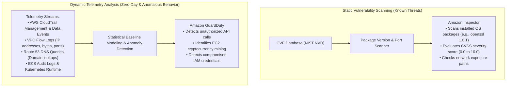
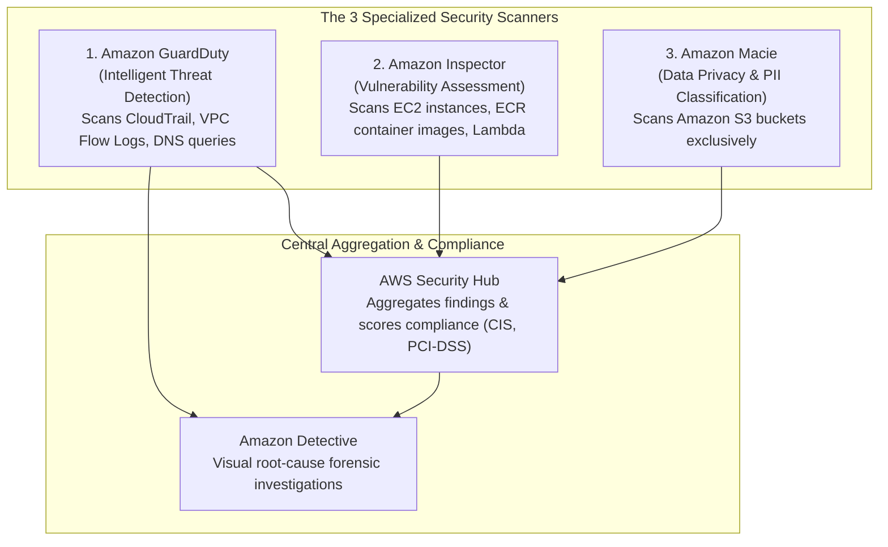
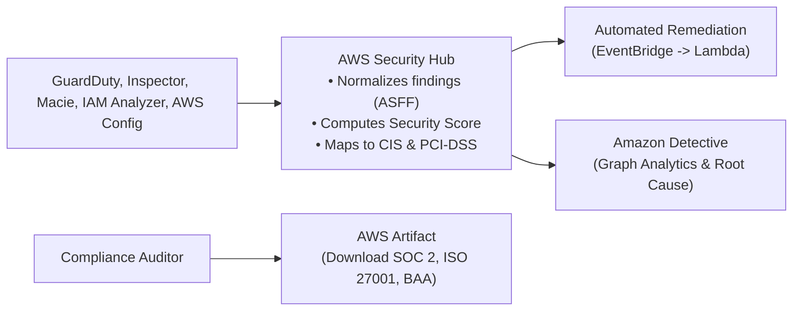
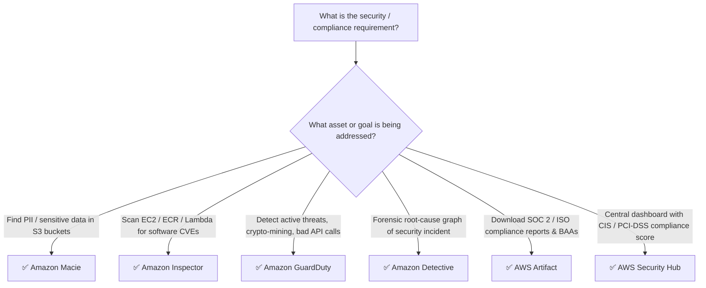

# AWS Threat Detection, Vulnerability Scanning & Compliance Services

> **Knowledge Area:** Security and Compliance (Domain 2.2 & 2.4)  
> **Relevant Certifications:** [CLF-C02](../../01_Syllabus/CLF-C02_Master_Blueprint.md), SAA-C03, SCS-C02, SOA-C02  
> **Tags:** `#aws/services` `#aws/security` `#guardduty` `#inspector` `#macie` `#securityhub` `#artifact` `#clf-c02`

---

## 💡 The Real-World Analogy (ELI5)

> **The Enterprise Cyber Defense & Audit Task Force:**
> - **[Amazon GuardDuty](../../AWS_SERVICES_GLOSSARY.md#amazon-guardduty) (The AI Security Guard):** An intelligent, eagle-eyed security officer walking the corridors 24/7/365. It doesn't inspect every file; instead, it watches hallway cameras, badge-swipe logs, and phone calls (CloudTrail logs, VPC Flow Logs, and DNS queries). If it notices an employee's badge being swiped in Tokyo and New York at the exact same minute, or sees an office computer sending secret encrypted packets to a known criminal syndicate in the middle of the night (cryptocurrency mining), GuardDuty sounds the alarm immediately.
> - **[Amazon Inspector](../../AWS_SERVICES_GLOSSARY.md#amazon-inspector) (The Building Fire Marshal):** A certified structural inspector who periodically checks every door hinge, fire extinguisher, and electrical breaker box across your building (EC2 virtual machines, ECR container images, and Lambda functions) against an official international catalog of known construction flaws (Common Vulnerabilities and Exposures - CVEs).
> - **[Amazon Macie](../../AWS_SERVICES_GLOSSARY.md#amazon-macie) (The Forensic Privacy Auditor):** A specialized data privacy inspector who opens every cardboard file box stored in your warehouse ([Amazon S3](../../AWS_SERVICES_GLOSSARY.md#amazon-s3) buckets), reads through documents, identifies sensitive Personally Identifiable Information (PII) like Social Security numbers, passport photos, and credit card numbers, and warns you if boxes containing confidential data are sitting unlocked near public doors.
> - **[Amazon Detective](../../AWS_SERVICES_GLOSSARY.md#amazon-detective) (The Forensic Detective):** The forensic crime-scene investigator who arrives after an alarm rings, gathers all evidence from the past two weeks, correlates timestamps across multiple security cameras, and builds an interactive visual timeline showing exactly how the intruder entered.
> - **[AWS Security Hub](../../AWS_SERVICES_GLOSSARY.md#aws-security-hub) (The Chief Security Officer's Master Dashboard):** The executive command room that gathers all alerts from GuardDuty, Inspector, Macie, and IAM, synthesizes them into an overall security posture score (e.g., "84% compliant"), and maps them against global industry standards like CIS and PCI-DSS.
> - **[AWS Artifact](../../AWS_SERVICES_GLOSSARY.md#aws-artifact) (The Compliance Document Vault):** A secure digital library where you can instantly download official, third-party auditor-certified reports (SOC 2, ISO 27001, FedRAMP) and sign legally binding agreements (HIPAA Business Associate Addendums - BAAs).

---

## 1. First-Principles Computer Science & Security Analytics Mechanics

Modern cloud threat detection and vulnerability management rely on two distinct analytical paradigms:

### 1.1 Signature-Based Scanning vs. Behavioral Machine Learning
* **Signature-Based Vulnerability Management ([Amazon Inspector](../../AWS_SERVICES_GLOSSARY.md#amazon-inspector)):**
  - Analyzes static system state: operating system package versions, installed software libraries, and network port bindings.
  - Matches installed packages against the **Common Vulnerabilities and Exposures (CVE)** dictionary maintained by MITRE and the National Vulnerability Database (NVD).
  - Assigns standardized **Common Vulnerability Scoring System (CVSS)** scores ranging from 0.0 (Informational) to 10.0 (Critical).
* **Behavioral Anomaly Detection ([Amazon GuardDuty](../../AWS_SERVICES_GLOSSARY.md#amazon-guardduty)):**
  - Analyzes high-velocity streaming network and management telemetry in real time.
  - Constructs mathematical baselines of normal user and workload behavior (e.g., *"This IAM user normally calls EC2 APIs from US-East during business hours"*).
  - Detects anomalies without software agents: unexpected Tor network egress, DNS data exfiltration, unusual API calls originating from an unfamiliar foreign IP address, or EC2 CPU spikes caused by cryptocurrency mining malware.

---

## 2. Historical IT Pain Points: The Enterprise Security Operation Center (SOC) Crisis

Before cloud-native intelligent threat detection and unified compliance auditing, security operations were plagued by operational failure:

| Traditional SOC Pain Point | Traditional On-Premises Reality | AWS Threat Detection & Compliance Solution |
|---|---|---|
| **SIEM Alert Fatigue & False Positives** | On-premise SIEM systems generated 50,000 unprioritized alert logs daily. Security analysts suffered burnout and missed real ransomware attacks buried in the noise. | **[Amazon GuardDuty](../../AWS_SERVICES_GLOSSARY.md#amazon-guardduty) ML Filtering**. Uses threat intelligence (AWS, CrowdStrike, Proofpoint) and ML to suppress noise and surface only actionable, high-fidelity security findings. |
| **Complex Agent Deployments & Performance Drag** | Traditional antivirus and security scanners required installing heavy third-party software agents that consumed 30% of server CPU and crashed operating systems. | **Agentless Telemetry Ingestion**. GuardDuty analyzes independent AWS network and CloudTrail telemetry streams with **zero host CPU overhead** and zero agent installation. |
| **Manual PII Discovery Audits** | Identifying sensitive credit card numbers or HIPAA patient data in petabytes of unstructured file shares required slow, error-prone manual searches. | **[Amazon Macie](../../AWS_SERVICES_GLOSSARY.md#amazon-macie) Automated Discovery**. Leverages machine learning and natural language processing to automatically evaluate and classify sensitive data in S3. |
| **Painful Multi-Month Compliance Audits** | Gathering evidence for SOC 2 or PCI-DSS audits required hundreds of hours spent taking screenshots of server configurations and physical door locks. | **[AWS Artifact](../../AWS_SERVICES_GLOSSARY.md#aws-artifact) & [AWS Security Hub](../../AWS_SERVICES_GLOSSARY.md#aws-security-hub)**. Instant download of signed third-party audit attestations and continuous real-time compliance benchmarking against CIS standards. |

---

## 3. Deep-Dive: The AWS Security Scanning Trio

### 3.1 Amazon GuardDuty: Intelligent Threat Detection
* **What it is:** A continuous, intelligent threat detection service that monitors your AWS accounts and workloads for malicious activity and unauthorized behavior.
* **Turnkey Activation:** Enabled with a single click in the AWS Management Console; requires **zero software agents** and zero network configuration.
* **Telemetry Data Sources Analyzed:**
  1. **[AWS CloudTrail](../../AWS_SERVICES_GLOSSARY.md#aws-cloudtrail) Management Events:** API calls, IAM policy modifications, unauthorized login attempts.
  2. **[AWS CloudTrail](../../AWS_SERVICES_GLOSSARY.md#aws-cloudtrail) S3 Data Events:** Suspicious bulk object downloads or public bucket permission modifications.
  3. **VPC Flow Logs:** Inbound and outbound IP network traffic telemetry.
  4. **DNS Query Logs:** Domain lookups from EC2 instances (identifying communication with command-and-control servers).
  5. **[Amazon EKS](../../AWS_SERVICES_GLOSSARY.md#amazon-eks) Audit Logs & Runtime Monitoring:** Kubernetes control plane and container process activity.
* **Common Attack Patterns Detected:**
  - *Cryptocurrency Mining:* EC2 instances communicating with known Bitcoin/Monero mining pools.
  - *Compromised IAM Credentials:* Unusually rapid API calls originating from unusual geographic locations or Tor exit nodes.
  - *Reconnaissance & Backdoors:* Port scanning or unexpected external SSH/RDP connections.

### 3.2 Amazon Inspector: Automated Vulnerability Management
* **What it is:** An automated vulnerability management service that continually scans workloads for software vulnerabilities (CVEs) and unintended network exposure.
* **Resources Scanned:**
  1. **[Amazon EC2](../../AWS_SERVICES_GLOSSARY.md#amazon-ec2) Instances:** Scans installed operating system packages and third-party software for unpatched CVEs.
  2. **[Amazon ECR](../../AWS_SERVICES_GLOSSARY.md#amazon-ecr) Container Images:** Automatically scans container base images on upload and continuously monitors repositories as new CVEs are published.
  3. **[AWS Lambda](../../AWS_SERVICES_GLOSSARY.md#aws-lambda) Functions:** Scans application code dependencies and package libraries.
* **Key Differentiator:** Inspector evaluates **vulnerabilities in software code and packages**, whereas GuardDuty detects **active runtime behavioral threats**.

### 3.3 Amazon Macie: Sensitive Data Discovery & Data Privacy
* **What it is:** A fully managed data security and privacy service that uses machine learning and pattern matching to discover, classify, and protect sensitive data stored in **[Amazon S3](../../AWS_SERVICES_GLOSSARY.md#amazon-s3)**.
* **Scope:** Scans **[Amazon S3](../../AWS_SERVICES_GLOSSARY.md#amazon-s3) buckets exclusively**.
* **Data Types Discovered:**
  - *Personally Identifiable Information (PII):* Names, residential addresses, Social Security Numbers (SSNs), driver's license IDs, passport numbers.
  - *Financial Information:* Credit card numbers, bank account numbers, SWIFT codes.
  - *Credentials & Secrets:* Unencrypted AWS secret keys, private SSH keys, and database passwords accidentally uploaded to S3.
* **Security Posture Insights:** Alerts administrators if S3 buckets containing sensitive data are unencrypted, publicly accessible, or shared with external AWS accounts.

---

## 4. Centralized Security Governance & Compliance: Security Hub, Detective & Artifact

### 4.1 AWS Security Hub
* **Unified Dashboard:** A single-pane-of-glass security posture management service that aggregates, organizes, and prioritizes security findings from [Amazon GuardDuty](../../AWS_SERVICES_GLOSSARY.md#amazon-guardduty), [Amazon Inspector](../../AWS_SERVICES_GLOSSARY.md#amazon-inspector), [Amazon Macie](../../AWS_SERVICES_GLOSSARY.md#amazon-macie), [AWS IAM Access Analyzer](../../AWS_SERVICES_GLOSSARY.md#aws-iam-access-analyzer), [AWS Firewall Manager](../../AWS_SERVICES_GLOSSARY.md#aws-firewall-manager), and AWS partner products.
* **Standardized Format:** Converts disparate alerts into the **AWS Security Finding Format (ASFF)**.
* **Continuous Compliance Auditing:** Automatically evaluates configurations against industry security benchmarks, such as:
  - Center for Internet Security (CIS) AWS Foundations Benchmark.
  - Payment Card Industry Data Security Standard (PCI-DSS).
  - AWS Foundational Security Best Practices.

### 4.2 Amazon Detective
* **Root-Cause Investigation:** Simplifies the investigation process after a security incident is identified by GuardDuty or Security Hub.
* **Interactive Graph Visualization:** Uses graph models to visualize relationships between IP addresses, user accounts, EC2 instances, and VPC traffic over time, allowing analysts to trace the root cause and full blast radius of a security breach in minutes.

### 4.3 AWS Artifact
* **The Central Compliance Document Portal:** A self-service portal in the AWS Management Console providing on-demand access to AWS security and compliance documentation.
* **Two Core Functional Areas:**
  1. **[AWS Artifact](../../AWS_SERVICES_GLOSSARY.md#aws-artifact) Reports:** Download official independent third-party audit reports demonstrating AWS infrastructure compliance, including **SOC 1, SOC 2, SOC 3, ISO 27001, FedRAMP, and PCI-DSS** attestations.
  2. **[AWS Artifact](../../AWS_SERVICES_GLOSSARY.md#aws-artifact) Agreements:** Review, accept, and manage legal agreements between your company and AWS, most notably the **Business Associate Addendum (BAA)** required for **HIPAA** regulatory compliance in healthcare.

---

## 5. Multi-Dimensional Security & Compliance Decision Matrix

| Service | Primary Role | What It Analyzes / Scans | Detection / Operation Methodology | Key Exam Scenario Keywords |
|---|---|---|---|---|
| **[Amazon GuardDuty](../../AWS_SERVICES_GLOSSARY.md#amazon-guardduty)** | Intelligent runtime threat detection | CloudTrail logs, VPC Flow Logs, DNS query logs, EKS audit logs | Machine learning behavioral anomaly detection & threat intelligence | *"Detect unauthorized behavior"*, *"Cryptocurrency mining"*, *"Compromised account"*, *"Tor exit nodes"* |
| **[Amazon Inspector](../../AWS_SERVICES_GLOSSARY.md#amazon-inspector)** | Automated vulnerability management | [Amazon EC2](../../AWS_SERVICES_GLOSSARY.md#amazon-ec2) instances, [Amazon ECR](../../AWS_SERVICES_GLOSSARY.md#amazon-ecr) container images, [AWS Lambda](../../AWS_SERVICES_GLOSSARY.md#aws-lambda) | CVE package version matching and network reachability analysis | *"Scan for software vulnerabilities"*, *"Common Vulnerabilities and Exposures (CVE)"*, *"Assess EC2 packages"* |
| **[Amazon Macie](../../AWS_SERVICES_GLOSSARY.md#amazon-macie)** | Data privacy and PII protection | **[Amazon S3](../../AWS_SERVICES_GLOSSARY.md#amazon-s3) buckets exclusively** | Machine learning and regex pattern matching for sensitive data | *"Discover PII in [Amazon S3](../../AWS_SERVICES_GLOSSARY.md#amazon-s3)"*, *"Credit card numbers"*, *"Unencrypted sensitive documents"* |
| **[Amazon Detective](../../AWS_SERVICES_GLOSSARY.md#amazon-detective)** | Security incident root-cause investigation | Telemetry data from GuardDuty, VPC Flow Logs, and CloudTrail | Graph analytics and interactive visual timeline reconstruction | *"Investigate root cause of security finding"*, *"Visual timeline of attacker activity"* |
| **[AWS Security Hub](../../AWS_SERVICES_GLOSSARY.md#aws-security-hub)** | Posture management & compliance scoring | Security findings from GuardDuty, Inspector, Macie, IAM Analyzer | Aggregates findings (ASFF); evaluates against CIS & PCI-DSS | *"Centralized single pane of glass"*, *"Security score"*, *"CIS compliance benchmark"* |
| **[AWS Artifact](../../AWS_SERVICES_GLOSSARY.md#aws-artifact)** | Compliance documentation portal | AWS compliance audit certifications and legal agreements | Self-service download of third-party audit attestations | *"Download SOC 2 or ISO 27001 reports"*, *"Sign HIPAA Business Associate Addendum (BAA)"* |

---

## 6. Exam Traps & 'Clue-to-Answer' Decryption

| Question Scenario Keyword | Target Service | Exam Trap & Distractor Explanation |
|---|---|---|
| *"Intelligent threat detection using ML across CloudTrail, VPC Flow Logs, DNS"* | **[Amazon GuardDuty](../../AWS_SERVICES_GLOSSARY.md#amazon-guardduty)** | Trap: Do not choose [Amazon Inspector](../../AWS_SERVICES_GLOSSARY.md#amazon-inspector) or CloudWatch. Inspector scans packages; GuardDuty analyzes streaming telemetry. |
| *"Scan EC2 instances and ECR container images for software vulnerabilities (CVEs)"* | **[Amazon Inspector](../../AWS_SERVICES_GLOSSARY.md#amazon-inspector)** | Trap: Do not choose [Amazon GuardDuty](../../AWS_SERVICES_GLOSSARY.md#amazon-guardduty). GuardDuty detects runtime threats; Inspector scans static software packages. |
| *"Discover and protect Personally Identifiable Information (PII) in [Amazon S3](../../AWS_SERVICES_GLOSSARY.md#amazon-s3)"* | **[Amazon Macie](../../AWS_SERVICES_GLOSSARY.md#amazon-macie)** | Trap: Do not choose GuardDuty or Inspector. Macie is specifically and exclusively designed for S3 sensitive data discovery. |
| *"Centralized security dashboard aggregating findings across multiple AWS security services"* | **[AWS Security Hub](../../AWS_SERVICES_GLOSSARY.md#aws-security-hub)** | Trap: Do not choose AWS CloudWatch or Trusted Advisor. Security Hub is the dedicated security dashboard. |
| *"Download official third-party audit reports (SOC 2, ISO 27001, PCI-DSS)"* | **[AWS Artifact](../../AWS_SERVICES_GLOSSARY.md#aws-artifact)** | Trap: Do not choose [AWS Trusted Advisor](../../AWS_SERVICES_GLOSSARY.md#aws-trusted-advisor) or Security Hub. Official audit certificates are exclusively downloaded from [AWS Artifact](../../AWS_SERVICES_GLOSSARY.md#aws-artifact). |
| *"Sign a Business Associate Addendum (BAA) for HIPAA compliance"* | **[AWS Artifact](../../AWS_SERVICES_GLOSSARY.md#aws-artifact)** | Trap: Do not choose [AWS Certificate Manager](../../AWS_SERVICES_GLOSSARY.md#aws-certificate-manager) or IAM. Legal compliance agreements are executed in [AWS Artifact](../../AWS_SERVICES_GLOSSARY.md#aws-artifact) Agreements. |
| *"Investigate the root cause and visual timeline of a security breach"* | **[Amazon Detective](../../AWS_SERVICES_GLOSSARY.md#amazon-detective)** | Trap: Do not choose CloudTrail. While CloudTrail records logs, Detective builds the interactive visual relationship graph. |

---

## 7. Post-Topic Question Simulation & Retention Check

### Question 1
**Which AWS service provides intelligent, continuous threat detection by utilizing machine learning and threat intelligence feeds to analyze VPC Flow Logs, DNS query logs, and [AWS CloudTrail](../../AWS_SERVICES_GLOSSARY.md#aws-cloudtrail) management events?**
- A) [Amazon Inspector](../../AWS_SERVICES_GLOSSARY.md#amazon-inspector)
- B) [Amazon GuardDuty](../../AWS_SERVICES_GLOSSARY.md#amazon-guardduty)
- C) [Amazon Macie](../../AWS_SERVICES_GLOSSARY.md#amazon-macie)
- D) [AWS Artifact](../../AWS_SERVICES_GLOSSARY.md#aws-artifact)

<b>Click to View Answer & Detailed Distractor Analysis</b>

**Correct Answer:** **B) [Amazon GuardDuty](../../AWS_SERVICES_GLOSSARY.md#amazon-guardduty)**

* **Why it's correct:** [Amazon GuardDuty](../../AWS_SERVICES_GLOSSARY.md#amazon-guardduty) is a fully managed, agentless intelligent threat detection service that continuously monitors telemetry sources ([AWS CloudTrail](../../AWS_SERVICES_GLOSSARY.md#aws-cloudtrail), VPC Flow Logs, DNS query logs, and EKS audit logs) using machine learning algorithms and threat intelligence feeds to identify unauthorized activity, compromised credentials, and cryptocurrency mining.
* **Distractor Analysis:**
  - *A is incorrect:* [Amazon Inspector](../../AWS_SERVICES_GLOSSARY.md#amazon-inspector) is an automated vulnerability management scanner that evaluates EC2 instances, ECR container images, and Lambda functions for known software CVEs; it does not analyze streaming network logs for anomalous behavior.
  - *C is incorrect:* [Amazon Macie](../../AWS_SERVICES_GLOSSARY.md#amazon-macie) is a data privacy service specifically engineered to discover and protect sensitive data (PII) stored inside [Amazon S3](../../AWS_SERVICES_GLOSSARY.md#amazon-s3) buckets.
  - *D is incorrect:* [AWS Artifact](../../AWS_SERVICES_GLOSSARY.md#aws-artifact) is a document repository used to download AWS compliance certifications (SOC, ISO) and execute legal agreements (BAAs).

---

### Question 2
**A healthcare provider wants to scan its [Amazon S3](../../AWS_SERVICES_GLOSSARY.md#amazon-s3) buckets to discover and catalog unencrypted Personally Identifiable Information (PII) such as Social Security Numbers, patient health records, and credit card numbers. Which AWS service should they utilize?**
- A) [Amazon GuardDuty](../../AWS_SERVICES_GLOSSARY.md#amazon-guardduty)
- B) [Amazon Macie](../../AWS_SERVICES_GLOSSARY.md#amazon-macie)
- C) [Amazon Inspector](../../AWS_SERVICES_GLOSSARY.md#amazon-inspector)
- D) [AWS Shield](../../AWS_SERVICES_GLOSSARY.md#aws-shield) Standard

<b>Click to View Answer & Detailed Distractor Analysis</b>

**Correct Answer:** **B) [Amazon Macie](../../AWS_SERVICES_GLOSSARY.md#amazon-macie)**

* **Why it's correct:** [Amazon Macie](../../AWS_SERVICES_GLOSSARY.md#amazon-macie) is a fully managed data security and data privacy service that uses machine learning and natural language pattern matching to automatically discover, classify, and protect sensitive data (such as PII, financial details, and credentials) stored exclusively in [Amazon S3](../../AWS_SERVICES_GLOSSARY.md#amazon-s3).
* **Distractor Analysis:**
  - *A is incorrect:* [Amazon GuardDuty](../../AWS_SERVICES_GLOSSARY.md#amazon-guardduty) monitors account security by analyzing log streams for active cyber threats, but does not inspect or classify sensitive text inside S3 objects.
  - *C is incorrect:* [Amazon Inspector](../../AWS_SERVICES_GLOSSARY.md#amazon-inspector) assesses operating systems, container images, and Lambda code for software package vulnerabilities, not S3 data privacy.
  - *D is incorrect:* [AWS Shield](../../AWS_SERVICES_GLOSSARY.md#aws-shield) Standard provides baseline Distributed Denial of Service (DDoS) mitigation at Layers 3 and 4.

---

### Question 3
**Which AWS service conducts automated vulnerability assessments against [Amazon EC2](../../AWS_SERVICES_GLOSSARY.md#amazon-ec2) instances, container images in Amazon Elastic Container Registry ([Amazon ECR](../../AWS_SERVICES_GLOSSARY.md#amazon-ecr)), and [AWS Lambda](../../AWS_SERVICES_GLOSSARY.md#aws-lambda) functions to discover known Common Vulnerabilities and Exposures (CVEs)?**
- A) [Amazon Inspector](../../AWS_SERVICES_GLOSSARY.md#amazon-inspector)
- B) [Amazon GuardDuty](../../AWS_SERVICES_GLOSSARY.md#amazon-guardduty)
- C) [AWS Artifact](../../AWS_SERVICES_GLOSSARY.md#aws-artifact)
- D) [AWS WAF](../../AWS_SERVICES_GLOSSARY.md#aws-waf)

<b>Click to View Answer & Detailed Distractor Analysis</b>

**Correct Answer:** **A) [Amazon Inspector](../../AWS_SERVICES_GLOSSARY.md#amazon-inspector)**

* **Why it's correct:** [Amazon Inspector](../../AWS_SERVICES_GLOSSARY.md#amazon-inspector) is an automated vulnerability management service that continually evaluates compute workloads (EC2 instances, ECR container repositories, and Lambda functions) against the National Vulnerability Database to identify software package CVEs and unintended network exposure.
* **Distractor Analysis:**
  - *B is incorrect:* [Amazon GuardDuty](../../AWS_SERVICES_GLOSSARY.md#amazon-guardduty) analyzes network and API telemetry to detect active malicious behavior (e.g., malware or crypto-mining), not static software library vulnerabilities.
  - *C is incorrect:* [AWS Artifact](../../AWS_SERVICES_GLOSSARY.md#aws-artifact) is a self-service compliance portal for downloading third-party audit reports.
  - *D is incorrect:* [AWS WAF](../../AWS_SERVICES_GLOSSARY.md#aws-waf) is an inline web application firewall that inspects Layer 7 HTTP/HTTPS traffic to block web exploits like SQL injection.

---

### Question 4
**An external financial auditor requests official proof that AWS data center physical facilities comply with Payment Card Industry Data Security Standard (PCI-DSS) Level 1 and ISO 27001 requirements. Where can the customer obtain this documentation on-demand?**
- A) [AWS Trusted Advisor](../../AWS_SERVICES_GLOSSARY.md#aws-trusted-advisor)
- B) [AWS Artifact](../../AWS_SERVICES_GLOSSARY.md#aws-artifact)
- C) [Amazon CloudWatch](../../AWS_SERVICES_GLOSSARY.md#amazon-cloudwatch)
- D) AWS Service Health Dashboard

<b>Click to View Answer & Detailed Distractor Analysis</b>

**Correct Answer:** **B) [AWS Artifact](../../AWS_SERVICES_GLOSSARY.md#aws-artifact)**

* **Why it's correct:** [AWS Artifact](../../AWS_SERVICES_GLOSSARY.md#aws-artifact) is the official, self-service compliance documentation portal in the AWS Management Console, providing complimentary, on-demand downloads of AWS ISO certifications, Service Organization Control (SOC 1/2/3) reports, and PCI-DSS compliance attestations.
* **Distractor Analysis:**
  - *A is incorrect:* [AWS Trusted Advisor](../../AWS_SERVICES_GLOSSARY.md#aws-trusted-advisor) provides automated real-time best practice recommendations across cost, performance, and security, but does not host formal third-party audit reports.
  - *C is incorrect:* [Amazon CloudWatch](../../AWS_SERVICES_GLOSSARY.md#amazon-cloudwatch) is an observability and monitoring service that collects operational metrics and logs.
  - *D is incorrect:* AWS Service Health Dashboard provides real-time status and operational availability updates for AWS services across global regions.

---

### Question 5
**Which service acts as a centralized dashboard, aggregating, normalizing, and prioritizing security findings and compliance scores across [Amazon GuardDuty](../../AWS_SERVICES_GLOSSARY.md#amazon-guardduty), [Amazon Inspector](../../AWS_SERVICES_GLOSSARY.md#amazon-inspector), [Amazon Macie](../../AWS_SERVICES_GLOSSARY.md#amazon-macie), and [AWS IAM Access Analyzer](../../AWS_SERVICES_GLOSSARY.md#aws-iam-access-analyzer)?**
- A) [AWS Security Hub](../../AWS_SERVICES_GLOSSARY.md#aws-security-hub)
- B) [Amazon Detective](../../AWS_SERVICES_GLOSSARY.md#amazon-detective)
- C) [AWS Systems Manager](../../AWS_SERVICES_GLOSSARY.md#aws-systems-manager)
- D) [AWS CloudTrail](../../AWS_SERVICES_GLOSSARY.md#aws-cloudtrail)

<b>Click to View Answer & Detailed Distractor Analysis</b>

**Correct Answer:** **A) [AWS Security Hub](../../AWS_SERVICES_GLOSSARY.md#aws-security-hub)**

* **Why it's correct:** [AWS Security Hub](../../AWS_SERVICES_GLOSSARY.md#aws-security-hub) serves as the central security posture management hub in AWS. It collects and normalizes findings from multiple AWS security services into the AWS Security Finding Format (ASFF) and automatically scores the account's compliance posture against benchmarks such as CIS AWS Foundations and PCI-DSS.
* **Distractor Analysis:**
  - *B is incorrect:* [Amazon Detective](../../AWS_SERVICES_GLOSSARY.md#amazon-detective) conducts in-depth forensic investigations and visualizes root-cause attack graphs, but is not the primary dashboard for broad cross-service compliance scoring.
  - *C is incorrect:* [AWS Systems Manager](../../AWS_SERVICES_GLOSSARY.md#aws-systems-manager) manages server operational configurations, runbooks, and software updates.
  - *D is incorrect:* [AWS CloudTrail](../../AWS_SERVICES_GLOSSARY.md#aws-cloudtrail) records raw API activity and management events across the account, but does not aggregate or prioritize security findings.

---

## 🧠 Master MCQ Solving Blueprint: Pattern Decryption & Elimination Tricks

> *This blueprint distills recurring patterns, keyword triggers, and trap options extracted from over 400 questions on Threat Detection, Vulnerability Scanning, Security Hub, Macie, Inspector, and Artifact across the official CLF-C02 question bank.*

### 1. The "Clue-to-Service" Linguistic Decryption Matrix
When reading a question scenario, search for these exact phrasing triggers:

| If You See This Trigger Phrase in the Question Stem... | The Correct Security Service Is Almost Always... | Trap Distractor to Immediately Discard |
|---|---|---|
| *"Intelligent threat detection using ML; analyzes CloudTrail, VPC Flow Logs, DNS; detects cryptocurrency mining"* | **[Amazon GuardDuty](../../AWS_SERVICES_GLOSSARY.md#amazon-guardduty)** | *[Amazon Inspector](../../AWS_SERVICES_GLOSSARY.md#amazon-inspector)* (Inspector does not analyze network flow telemetry!) |
| *"Scan EC2 instances, ECR container images, and Lambda for software vulnerabilities (CVEs)"* | **[Amazon Inspector](../../AWS_SERVICES_GLOSSARY.md#amazon-inspector)** | *[Amazon GuardDuty](../../AWS_SERVICES_GLOSSARY.md#amazon-guardduty)* (GuardDuty does not scan software package versions!) |
| *"Discover and protect Personally Identifiable Information (PII) like credit cards/SSNs stored in [Amazon S3](../../AWS_SERVICES_GLOSSARY.md#amazon-s3)"* | **[Amazon Macie](../../AWS_SERVICES_GLOSSARY.md#amazon-macie)** | *[Amazon Inspector](../../AWS_SERVICES_GLOSSARY.md#amazon-inspector)* (Inspector scans compute; Macie scans S3 data!) |
| *"Centralized security dashboard that aggregates findings and calculates compliance scores (CIS, PCI-DSS)"* | **[AWS Security Hub](../../AWS_SERVICES_GLOSSARY.md#aws-security-hub)** | *[Amazon Detective](../../AWS_SERVICES_GLOSSARY.md#amazon-detective)* or *[AWS Trusted Advisor](../../AWS_SERVICES_GLOSSARY.md#aws-trusted-advisor)* |
| *"Download third-party audit reports (SOC 1/2, ISO 27001, FedRAMP) and sign HIPAA BAA agreements"* | **[AWS Artifact](../../AWS_SERVICES_GLOSSARY.md#aws-artifact)** | *[AWS Trusted Advisor](../../AWS_SERVICES_GLOSSARY.md#aws-trusted-advisor)* (Trusted Advisor checks live account resources!) |
| *"Conduct deep forensic root-cause analysis with interactive graphs and timelines after a security incident"* | **[Amazon Detective](../../AWS_SERVICES_GLOSSARY.md#amazon-detective)** | *[AWS CloudTrail](../../AWS_SERVICES_GLOSSARY.md#aws-cloudtrail)* (CloudTrail logs raw JSON; Detective builds graph models) |

### 2. The 3-Step Rapid Elimination Heuristic
When evaluating a Threat Detection or Compliance question:
1. **Step 1: Identify What is Being Examined:**
   - **Data content inside [Amazon S3](../../AWS_SERVICES_GLOSSARY.md#amazon-s3):** SSNs, passport numbers, medical records → **[Amazon Macie](../../AWS_SERVICES_GLOSSARY.md#amazon-macie)**.
   - **Software code/OS packages:** Unpatched Apache, OpenSSL buffer overflow, CVE database → **[Amazon Inspector](../../AWS_SERVICES_GLOSSARY.md#amazon-inspector)**.
   - **Streaming logs & API behavior:** An instance calling Bitcoin mining pools, API calls from suspicious Tor nodes → **[Amazon GuardDuty](../../AWS_SERVICES_GLOSSARY.md#amazon-guardduty)**.
   - **Compliance paperwork / certificates:** SOC 2 report, ISO certification, legal BAA → **[AWS Artifact](../../AWS_SERVICES_GLOSSARY.md#aws-artifact)**.
   - **Incident forensics & root-cause graph:** Visualizing how an attacker traversed the environment → **[Amazon Detective](../../AWS_SERVICES_GLOSSARY.md#amazon-detective)**.
   - **Single pane of glass dashboard:** Aggregated compliance scores across the enterprise → **[AWS Security Hub](../../AWS_SERVICES_GLOSSARY.md#aws-security-hub)**.
2. **Step 2: Check Agent vs. Agentless:**
   - [Amazon GuardDuty](../../AWS_SERVICES_GLOSSARY.md#amazon-guardduty) is **100% agentless** (it reads AWS telemetry pipelines directly; zero performance impact).
   - [Amazon Inspector](../../AWS_SERVICES_GLOSSARY.md#amazon-inspector) scans software packages automatically using SSM agents or agentless snapshots.
3. **Step 3: Discard Look-Alike Traps:**
   - Did the question ask for a **compliance document to show an auditor**? Discard Security Hub, GuardDuty, and Inspector immediately. Select **[AWS Artifact](../../AWS_SERVICES_GLOSSARY.md#aws-artifact)**.

### 3. High-Frequency Decoy Autopsy: Why AWS Tries to Trick You
* **Decoy #1: "[Amazon GuardDuty](../../AWS_SERVICES_GLOSSARY.md#amazon-guardduty)" vs. "[Amazon Inspector](../../AWS_SERVICES_GLOSSARY.md#amazon-inspector)"**
  - *The Trap:* Questions about detecting "vulnerabilities" vs "threats".
  - *The Autopsy:* Memorize this distinct separation:
    - **Inspector = Vulnerability Scanner** (Looks for *known flaws* in installed code/packages, like a building safety inspector).
    - **GuardDuty = Active Threat Detector** (Looks for *active malicious actions* like malware, unauthorized logins, and crypto-mining, like a security guard).
* **Decoy #2: "[Amazon Macie](../../AWS_SERVICES_GLOSSARY.md#amazon-macie)" vs. "[Amazon Inspector](../../AWS_SERVICES_GLOSSARY.md#amazon-inspector)"**
  - *The Trap:* The prompt mentions "scanning resources for sensitive data or vulnerabilities".
  - *The Autopsy:* If the keyword is **S3 buckets** or **PII (Personally Identifiable Information)**, it is **ALWAYS [Amazon Macie](../../AWS_SERVICES_GLOSSARY.md#amazon-macie)**. Inspector cannot read documents inside S3!
* **Decoy #3: "[AWS Artifact](../../AWS_SERVICES_GLOSSARY.md#aws-artifact)" vs. "[AWS Trusted Advisor](../../AWS_SERVICES_GLOSSARY.md#aws-trusted-advisor)"**
  - *The Trap:* A bank needs an ISO 27001 certificate to satisfy a regulatory audit.
  - *The Autopsy:* Candidates choose Trusted Advisor because it checks security. But **Trusted Advisor does NOT provide compliance certificates or audit reports**. The official repository for downloading third-party audit reports is **[AWS Artifact](../../AWS_SERVICES_GLOSSARY.md#aws-artifact)**.

### 4. 10-Second Visual Decision Flowchart

