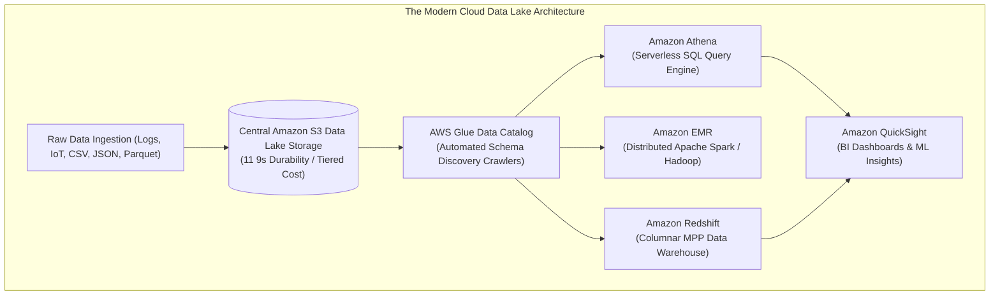
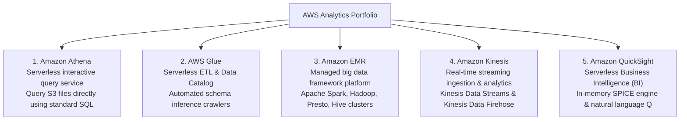
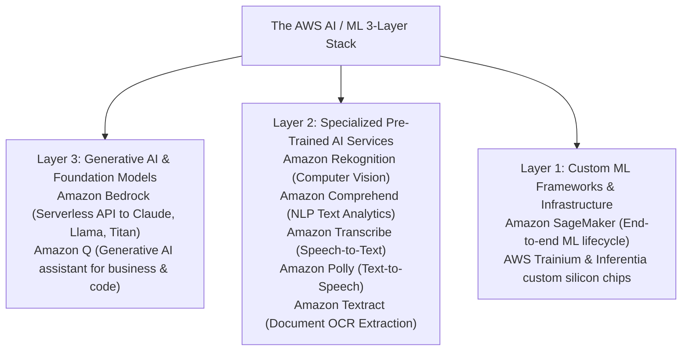
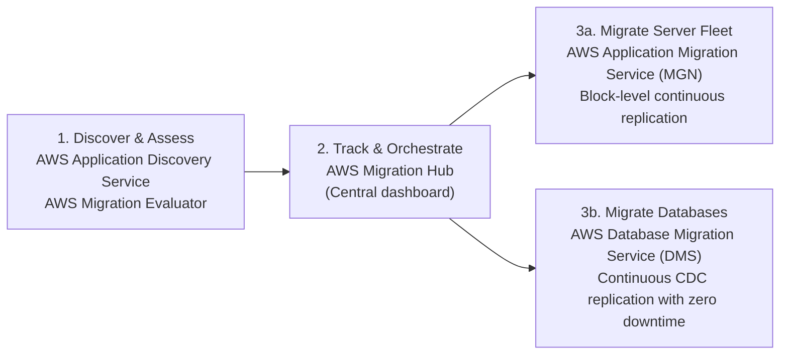
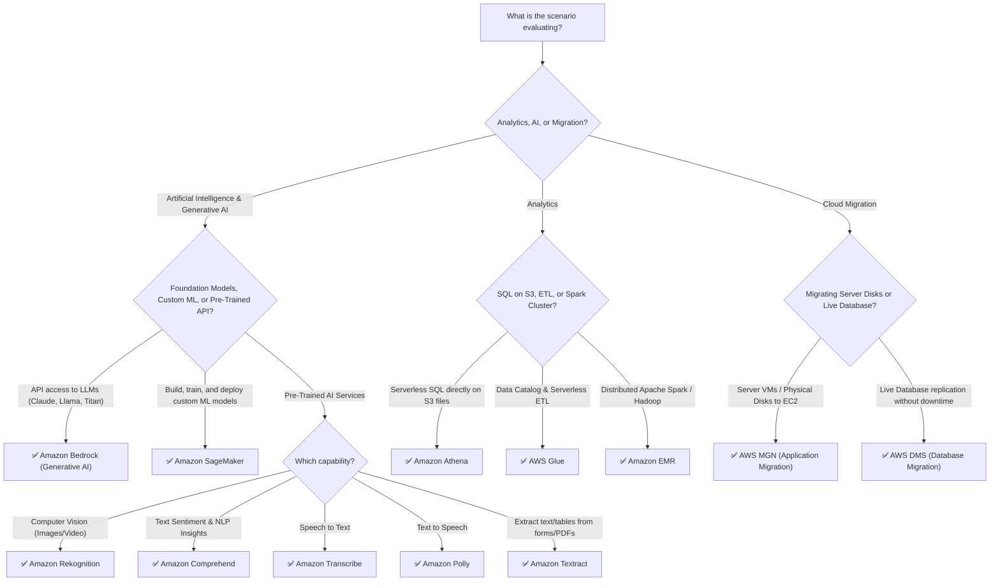

# AWS Analytics, Artificial Intelligence (AI/ML) & Cloud Migration

> **Knowledge Area:** Cloud Technology and Services (Domain 3.3, 3.8 & Generative AI)  
> **Relevant Certifications:** [CLF-C02](../../01_Syllabus/CLF-C02_Master_Blueprint.md), AIF-C01, SAA-C03  
> **Tags:** `#aws/services` `#analytics` `#athena` `#bedrock` `#sagemaker` `#migration` `#clf-c02`

---

## 💡 The Real-World Analogy (ELI5)

> **The Industrial Data Intelligence Factory & Moving Fleet:**
> - **Amazon Athena (The High-Powered Searchlight):** Instead of spending weeks unboxing and loading millions of paper spreadsheets into a rigid filing cabinet, you shine a high-powered searchlight directly at raw files sitting in the Amazon S3 warehouse and read the answers using standard SQL queries on the fly.
> - **AWS Glue (The Automated Sorting & Cleaning Conveyor):** The automated assembly line that inspects messy, dirty incoming data, catalogs its shape (Data Catalog), scrubs out defects, and formats it neatly (ETL — Extract, Transform, Load) for analysis.
> - **Amazon EMR (The Fleet of Heavy Industrial Dump Trucks):** A massive fleet of heavy Caterpillar dump trucks running Apache Spark and Hadoop, crunching petabytes of big data distributed across hundreds of cooperating engines.
> - **Amazon Bedrock (The Generative AI Vending Machine):** An automated vending machine serving leading frontier Artificial Intelligence models (Anthropic Claude, Meta Llama, Amazon Titan). You don't build a multi-billion-dollar supercomputer or train neural networks from scratch; you insert an API token and receive state-of-the-art generative responses instantly.
> - **Amazon SageMaker (The Master Formula 1 R&D Machine Shop):** The complete professional engineering workshop for professional data scientists to build, train, fine-tune, tune hyperparameters, and deploy custom machine learning algorithms on dedicated GPU clusters.
> - **AWS Application Migration Service - MGN (The Active House Mover):** A specialized team that moves your entire operating living room into a new house while you are still sitting on the couch watching television (continuous block-level server replication with near-zero cutover downtime).

---

## 1. First-Principles Computer Science & Data Systems Mechanics

Modern data intelligence operates across three distinct computational architectures: **Schema-on-Read**, **Distributed Streaming**, and **Deep Learning Transformation**:

### 1.1 Schema-on-Write vs. Schema-on-Read
* **Schema-on-Write (Traditional Relational):** Data must be rigorously parsed, validated, and transformed into strict tabular schemas *before* it can be written to disk. If a record contains an unexpected column, the write transaction fails.
* **Schema-on-Read (Amazon Athena & AWS Glue):** Raw, unstructured, or semi-structured data (JSON, CSV, Parquet) is written directly into Amazon S3 in its native raw state. The schema is applied mathematically only when an analyst executes a query. This eliminates months of upfront database design.

### 1.2 Columnar Storage Compression Mechanics (Apache Parquet / ORC)
When querying a 1 Terabyte dataset of user transactions in Amazon Athena:
* If the data is stored as uncompressed CSV, Athena must physically scan all **1,000 GB**, costing $\$5.00$ ($1\text{ TB} \times \$5/\text{TB}$).
* If converted by **AWS Glue** into columnar **Apache Parquet**, queries requesting only `TotalAmount` scan **less than 20 GB** (a $98\%$ reduction in disk I/O and query cost).

---

## 2. Historical IT Pain Points: The Big Data & AI Bottleneck

Before serverless cloud analytics and managed generative AI, extracting business intelligence from enterprise data was notoriously painful:

| Enterprise Data Challenge | Traditional On-Premises Reality | AWS Cloud Analytics & AI Paradigm |
|---|---|---|
| **Hadoop/Spark Cluster Maintenance** | Sysadmins spent weeks configuring ZooKeeper, Ambari, and failed physical disk spindles in noisy server rooms just to keep a 50-node Hadoop cluster running. | **Amazon EMR & AWS Glue**. Deploy auto-scaling Apache Spark clusters in minutes, or run fully serverless ETL jobs without managing a single server. |
| **Expensive BI Licensing & Slow Queries** | Legacy business intelligence tools charged \$10,000+ per user license and took 4 hours to run end-of-month reporting queries. | **Amazon QuickSight & Redshift**. Serverless pay-per-session BI dashboards powered by the in-memory SPICE calculation engine. |
| **Exorbitant Generative AI Training Costs** | Building generative AI capabilities required acquiring rare \$40,000 GPUs, writing CUDA code, and spending millions of dollars on base model training. | **Amazon Bedrock**. Access pre-trained frontier foundation models (Claude 3.5, Llama 3) via a single standardized serverless API. |
| **High-Risk Cutover Downtime Migrations** | Migrating an on-premises physical server required a 48-hour scheduled maintenance window, leaving customer applications completely offline. | **AWS Application Migration Service (MGN)**. Replicates server disks continuously in the background at the block level; cutover takes **minutes**. |

---

## 3. Deep-Dive: AWS Analytics & Big Data Services

### 3.1 Amazon Athena: Serverless Interactive SQL
* **What it is:** An interactive, serverless query service that makes it easy to analyze data directly in **Amazon S3** using standard ANSI SQL.
* **Core Characteristics:**
  - *Completely Serverless:* Zero infrastructure to set up, manage, or scale.
  - *Pricing Model:* Pay strictly for the volume of data scanned by your queries (standard: **\$5.00 per Terabyte scanned**).
  - *Data Formats:* Natively queries CSV, JSON, Apache Parquet, Apache ORC, and Avro files.

### 3.2 AWS Glue: Serverless ETL & Central Data Catalog
* **What it is:** A serverless data integration service that makes it easy to discover, prepare, and combine data for analytics, machine learning, and application development.
* **Core Components:**
  - **AWS Glue Data Catalog:** A centralized, unified persistent metadata store that stores table definitions, schemas, and partition metrics across all your cloud data.
  - **Glue Crawlers:** Automated crawlers that scan S3 storage buckets, automatically infer data formats and schemas, and write table definitions into the Data Catalog.
  - **Glue ETL:** Serverless Apache Spark execution engine that extracts data from source repositories, cleans and transforms it, and loads it into target data warehouses.

### 3.3 Amazon EMR (Elastic MapReduce)
* **What it is:** A cloud big data platform for processing vast amounts of data using open-source distributed frameworks such as **Apache Spark, Apache Hadoop, Apache Hive, and Presto**.
* **Key Use Cases:** Running petabyte-scale data transformations, distributed machine learning pipelines, and financial risk modeling across clusters of Amazon EC2 instances (leveraging EC2 Spot Instances for up to 90% cost savings).

### 3.4 Amazon Kinesis: Real-Time Data Streaming
* **Amazon Kinesis Data Streams:** Ingests and stores high-volume streaming data (clickstreams, financial transactions, IoT telemetry) at sub-second latency for custom real-time processing applications.
* **Amazon Kinesis Data Firehose:** A fully managed, serverless delivery stream that loads streaming data automatically into **Amazon S3, Amazon Redshift, Amazon OpenSearch Service, or Splunk** without writing custom ingestion code.

---

## 4. Deep-Dive: Artificial Intelligence & Machine Learning (AI/ML)

AWS structures its AI/ML portfolio into three distinct operational layers:

### 4.1 Generative AI: Amazon Bedrock
* **What it is:** The easiest way to build and scale generative AI applications using leading **Foundation Models (FMs)** through a single, unified serverless API.
* **Model Choice:** Direct API access to leading models from AI21 Labs, Anthropic (Claude), Cohere, Meta (Llama), Mistral AI, and Amazon (Titan).
* **Enterprise Security & Privacy:** Customer data is encrypted in transit and at rest and **is never used to train the base models**, ensuring absolute corporate intellectual property protection.
* **Knowledge Bases for Bedrock (RAG):** Connects foundation models securely to internal company data sources (in Amazon S3 or vector stores) to provide context-aware, hallucination-free generative answers without manual model retraining.

### 4.2 Custom Machine Learning: Amazon SageMaker
* **What it is:** A fully managed platform that provides every developer and data scientist with the tools to **build, train, evaluate, tune, and deploy** custom machine learning models at scale.
* **Components:** SageMaker Studio (unified IDE), SageMaker Autopilot (automated machine learning - AutoML), SageMaker JumpStart (pre-trained model hub), and managed distributed GPU training clusters.

### 4.3 Turnkey Pre-Trained AI Services (No ML Expertise Required!)
1. **Amazon Rekognition:** Computer vision service that automatically analyzes images and videos to identify objects, people, faces, text, and inappropriate content.
2. **Amazon Comprehend:** Natural Language Processing (NLP) service that extracts key phrases, entities, sentiments, and topics from unstructured text (emails, customer reviews).
3. **Amazon Transcribe:** Automatic Speech Recognition (ASR) service that converts spoken audio into accurate text transcripts.
4. **Amazon Polly:** Text-to-Speech (TTS) service that turns written text into lifelike synthetic speech in dozens of languages and voices.
5. **Amazon Textract:** Intelligent document analysis service that automatically extracts typed and handwritten text, form key-value pairs, and tabular data from scanned documents and PDFs (far beyond basic optical character recognition - OCR).

---

## 5. Cloud Migration: Assessment, Server & Database Migration

### 5.1 AWS Application Migration Service (AWS MGN)
* **What it is:** The primary, recommended migration service for lifting and shifting physical, virtual, or cloud-based servers to AWS with minimal downtime.
* **Mechanism:** Installs a lightweight replication agent on source servers that performs non-disruptive, continuous, block-level storage replication directly to an Amazon EC2 staging environment. Cutover takes mere minutes.

### 5.2 AWS Database Migration Service (AWS DMS)
* **What it is:** A managed migration engine that helps migrate relational databases, data warehouses, and NoSQL databases to AWS quickly and securely.
* **Zero Downtime (CDC):** The source database **remains fully operational** during the migration. AWS DMS continuously captures and replicates ongoing changes (Change Data Capture - CDC) until final cutover.
* **Homogeneous & Heterogeneous Migrations:** Supports migrating between identical engines (e.g., Oracle to Oracle on RDS) or between disparate engines (e.g., Oracle to Amazon Aurora PostgreSQL) when paired with the **AWS Schema Conversion Tool (SCT)**.

---

## 6. Multi-Dimensional Analytics & AI Decision Matrix

| Service | Primary Category | What It Does / Analyzes | Operating Model | Primary Exam Clue Keyword |
|---|---|---|---|---|
| **Amazon Athena** | Analytics / Query | Queries S3 files directly using standard ANSI SQL | Serverless (Pay per TB scanned) | *"Query S3 files directly using standard SQL without servers"* |
| **AWS Glue** | Analytics / ETL | Automated schema discovery & data transformation | Serverless (Managed Spark) | *"Automated ETL, schema crawlers, central Data Catalog"* |
| **Amazon EMR** | Analytics / Big Data | Runs Apache Spark, Hadoop, Hive, Presto clusters | Managed EC2 Cluster | *"Big data framework, Hadoop, Spark, petabyte processing"* |
| **Amazon Bedrock** | Generative AI | Access foundation models (Claude, Titan) via API | Fully Serverless API | *"Leading foundation models via API without managing infrastructure"* |
| **Amazon SageMaker** | Machine Learning | Build, train, evaluate, and deploy custom ML models | Managed ML Platform | *"Complete machine learning lifecycle for data scientists"* |
| **Amazon Textract** | Specialized AI | Extracts text, forms, and tables from scanned documents | Managed Pre-trained API | *"Extract text, tables, and form fields from PDF documents"* |
| **AWS Application Migration Service (MGN)** | Cloud Migration | Replicates physical/virtual servers to Amazon EC2 | Block-level replication | *"Lift-and-shift server migration with minimal downtime"* |
| **AWS Database Migration Service (DMS)** | Cloud Migration | Replicates databases to AWS with source running | Continuous CDC replication | *"Migrate database with zero downtime while source remains active"* |

---

## 7. Exam Traps & 'Clue-to-Answer' Decryption

| Question Scenario Keyword | Target Service | Exam Trap & Distractor Explanation |
|---|---|---|
| *"Serverless interactive query service analyzing data directly in S3 with standard SQL"* | **Amazon Athena** | Trap: Do not choose Amazon Redshift. Redshift requires provisioning a data warehouse cluster; Athena is serverless SQL directly on S3. |
| *"Central metadata store and automated serverless ETL crawlers"* | **AWS Glue** | Trap: Do not choose Amazon EMR. Glue is serverless ETL and cataloging; EMR runs distributed clusters. |
| *"Access leading foundation models via an API without managing GPU infrastructure"* | **Amazon Bedrock** | Trap: Do not choose Amazon SageMaker. SageMaker requires managing training and hosting endpoints; Bedrock is a serverless foundation model API. |
| *"Analyze text to extract sentiment, key phrases, and entities without ML expertise"* | **Amazon Comprehend** | Trap: Do not choose Amazon Rekognition or SageMaker. Comprehend is pre-trained NLP text analysis. |
| *"Convert audio speech recordings into written text transcripts"* | **Amazon Transcribe** | Trap: Do not confuse with Amazon Polly. Transcribe converts Speech-to-Text; Polly converts Text-to-Speech. |
| *"Migrate on-premises physical or virtual servers to Amazon EC2 with minimal downtime"* | **AWS Application Migration Service (MGN)** | Trap: Do not choose AWS Database Migration Service (DMS). MGN is for servers; DMS is for databases. |
| *"Migrate relational databases to AWS while keeping the source database operational"* | **AWS Database Migration Service (DMS)** | Trap: Do not choose AWS DataSync. DataSync moves files/storage; DMS migrates transactional database records. |

---

## 8. Post-Topic Question Simulation & Retention Check

### Question 1
**Which serverless interactive query service enables business intelligence analysts to query unstructured and semi-structured files stored directly in Amazon S3 using standard ANSI SQL without managing or provisioning database infrastructure?**
- A) Amazon Redshift
- B) Amazon Athena
- C) Amazon EMR
- D) AWS Glue

<b>Click to View Answer & Detailed Distractor Analysis</b>

**Correct Answer:** **B) Amazon Athena**

* **Why it's correct:** Amazon Athena is an interactive, serverless SQL query engine that allows users to analyze data directly inside Amazon S3 buckets using standard ANSI SQL queries, charging strictly per Terabyte of data scanned with zero server infrastructure to provision or manage.
* **Distractor Analysis:**
  - *A is incorrect:* Amazon Redshift is a managed columnar data warehouse that requires provisioning a cluster of compute nodes and loading data into relational tables.
  - *C is incorrect:* Amazon EMR is a managed cluster framework for running distributed big data engines (such as Apache Spark and Hadoop), requiring cluster node management.
  - *D is incorrect:* AWS Glue is a serverless data integration and ETL service that catalogs and transforms data, but does not provide an interactive ad-hoc SQL query interface.

---

### Question 2
**Which AWS service provides serverless API access to a broad selection of industry-leading foundation models (such as Anthropic Claude, Meta Llama, and Amazon Titan) to build generative AI applications without managing GPU servers?**
- A) Amazon SageMaker Studio
- B) Amazon Bedrock
- C) Amazon Comprehend
- D) AWS Deep Learning AMIs

<b>Click to View Answer & Detailed Distractor Analysis</b>

**Correct Answer:** **B) Amazon Bedrock**

* **Why it's correct:** Amazon Bedrock is a fully managed serverless service that provides choice of high-performing foundation models (FMs) from leading AI companies through a single API, along with a broad set of capabilities to build generative AI applications with security, privacy, and responsible AI guardrails.
* **Distractor Analysis:**
  - *A is incorrect:* Amazon SageMaker Studio is a fully featured machine learning IDE for building, training, and deploying custom models, which requires configuring compute instances and hosting endpoints.
  - *C is incorrect:* Amazon Comprehend is a specialized pre-trained natural language processing (NLP) service for sentiment analysis and entity extraction, not a general foundation model platform.
  - *D is incorrect:* AWS Deep Learning AMIs provide customized virtual machine images pre-installed with deep learning frameworks (PyTorch, TensorFlow) for manual server configuration on EC2.

---

### Question 3
**A customer service application needs to automatically analyze inbound customer feedback emails to detect sentiment (Positive, Negative, Neutral) and extract key language entities without requiring the engineering team to build custom machine learning models. Which AWS service should be used?**
- A) Amazon Rekognition
- B) Amazon Comprehend
- C) Amazon Transcribe
- D) Amazon Polly

<b>Click to View Answer & Detailed Distractor Analysis</b>

**Correct Answer:** **B) Amazon Comprehend**

* **Why it's correct:** Amazon Comprehend is a pre-trained Natural Language Processing (NLP) service that uses machine learning to uncover valuable insights, sentiment, key phrases, and entity relationships in unstructured text documents without requiring machine learning expertise.
* **Distractor Analysis:**
  - *A is incorrect:* Amazon Rekognition is a computer vision service that analyzes images and video files.
  - *C is incorrect:* Amazon Transcribe is a speech-to-text service that converts spoken audio into written text.
  - *D is incorrect:* Amazon Polly is a text-to-speech service that converts written text into lifelike synthetic voice audio.

---

### Question 4
**An enterprise is migrating 300 on-premises virtual machines to Amazon EC2. The company wants to minimize cutover downtime and perform non-disruptive, continuous block-level replication of server disks while applications remain online. Which AWS service should they utilize?**
- A) AWS Database Migration Service (DMS)
- B) AWS Application Migration Service (MGN)
- C) AWS DataSync
- D) AWS Storage Gateway

<b>Click to View Answer & Detailed Distractor Analysis</b>

**Correct Answer:** **B) AWS Application Migration Service (MGN)**

* **Why it's correct:** AWS Application Migration Service (AWS MGN) is the primary AWS tool for migrating physical, virtual, or cloud-based servers to AWS. It utilizes non-disruptive, continuous block-level data replication into an AWS staging area, enabling quick cutovers with near-zero application downtime.
* **Distractor Analysis:**
  - *A is incorrect:* AWS Database Migration Service (DMS) is designed specifically for migrating database engines and transactional data, not complete operating system server disks.
  - *C is incorrect:* AWS DataSync is an online automated file and object transfer service, not a block-level server OS migration tool.
  - *D is incorrect:* AWS Storage Gateway is a hybrid storage bridge providing on-premises servers with access to cloud storage, not a server migration tool.

---

### Question 5
**An organization needs to migrate a production on-premises Oracle database to Amazon Aurora PostgreSQL. The primary requirement is that the source database must remain fully operational and continue processing transactions throughout the migration process. Which AWS service should be used?**
- A) AWS Database Migration Service (AWS DMS)
- B) AWS Snowball Edge
- C) AWS Application Migration Service (AWS MGN)
- D) AWS DataSync

<b>Click to View Answer & Detailed Distractor Analysis</b>

**Correct Answer:** **A) AWS Database Migration Service (AWS DMS)**

* **Why it's correct:** AWS Database Migration Service (AWS DMS) enables seamless database migrations to AWS while the source database remains completely operational and online. Using Change Data Capture (CDC), DMS continuously replicates ongoing changes until the final production cutover.
* **Distractor Analysis:**
  - *B is incorrect:* AWS Snowball Edge is a physical data transport appliance used for offline bulk file transfer, which cannot replicate real-time transactional database changes.
  - *C is incorrect:* AWS Application Migration Service (MGN) is designed to lift and shift complete server virtual machines, not perform transactional database engine translations.
  - *D is incorrect:* AWS DataSync is an automated file and object transfer service for filesystems and S3, not a database replication engine.

---

## 🧠 Master MCQ Solving Blueprint: Pattern Decryption & Elimination Tricks

> *This blueprint distills recurring patterns, keyword triggers, and trap options extracted from over 500 questions on Analytics (Athena, Glue, EMR), AI/ML & Generative AI (Bedrock, SageMaker, Comprehend, Rekognition, Polly, Transcribe, Textract), and Migration (MGN, DMS) across the official CLF-C02 question bank.*

### 1. The "Clue-to-Service" Linguistic Decryption Matrix
When reading a question scenario, search for these exact phrasing triggers:

| If You See This Trigger Phrase in the Question Stem... | The Correct Analytics / AI / Migration Service Is... | Trap Distractor to Immediately Discard |
|---|---|---|
| *"Serverless interactive ad-hoc SQL queries directly on files in Amazon S3; pay per query"* | **Amazon Athena** | *Amazon Redshift* (Redshift requires provisioning clusters) |
| *"Automated ETL (Extract, Transform, Load) service; crawls data and creates a central Data Catalog"* | **AWS Glue** | *Amazon Athena* (Athena queries data, it does not clean/catalog it) |
| *"Distributed big data frameworks (Apache Spark, Hadoop, Presto) on managed clusters"* | **Amazon EMR** | *Amazon Athena* or *AWS Glue* |
| *"Cloud-native Business Intelligence (BI) service; builds visual dashboards with ML insights"* | **Amazon QuickSight** | *Amazon CloudWatch* (CloudWatch is for operational metrics, not business BI) |
| *"Access leading Foundation Models (Anthropic Claude, Meta Llama, Titan) via a single API (Generative AI)"* | **Amazon Bedrock** | *Amazon SageMaker* (SageMaker is for training custom models from scratch) |
| *"Complete end-to-end platform for data scientists to build, train, tune, and deploy custom ML models"* | **Amazon SageMaker** | *Amazon Bedrock* (Bedrock uses pre-trained serverless models) |
| *"Computer vision; identify objects, people, text, and scenes in images and video"* | **Amazon Rekognition** | *Amazon Textract* (Textract is specifically for documents/forms) |
| *"Natural Language Processing (NLP); analyze text documents for customer sentiment and entities"* | **Amazon Comprehend** | *Amazon Transcribe* (Transcribe converts spoken voice, not text sentiment) |
| *"Convert spoken speech audio files into written text (Speech-to-Text)"* | **Amazon Transcribe** | *Amazon Polly* (Polly is text-to-speech) |
| *"Convert written text into lifelike synthetic speech audio (Text-to-Speech)"* | **Amazon Polly** | *Amazon Transcribe* |
| *"Extract printed text, handwriting, and structured table fields from scanned PDFs and forms"* | **Amazon Textract** | *Amazon Rekognition* |
| *"Build conversational voice and text AI chatbots (powers Amazon Alexa)"* | **Amazon Lex** | *Amazon Polly* |
| *"Lift and shift physical/virtual server OS disks to Amazon EC2 with near-zero downtime"* | **AWS Application Migration Service (MGN)** | *AWS Database Migration Service (DMS)* |
| *"Migrate live databases while source database remains online and operational"* | **AWS Database Migration Service (DMS)** | *AWS MGN* (MGN migrates entire server disks, not databases) |

### 2. The 3-Step Rapid Elimination Heuristic
When evaluating an Analytics, AI, or Migration question:
1. **Step 1: Check the AI Category (Generative AI vs. Custom ML vs. Pre-trained APIs):**
   - Access **Foundation Models (LLMs) via an API** without managing infrastructure $\to$ **Amazon Bedrock**.
   - Data scientists writing custom algorithms, training weights, GPU clusters $\to$ **Amazon SageMaker**.
   - Ready-to-use human sense APIs:
     - Eyes / Vision $\to$ **Rekognition**.
     - Ears / Hearing (Speech $\to$ Text) $\to$ **Transcribe**.
     - Mouth / Voice (Text $\to$ Speech) $\to$ **Polly**.
     - Brain / Language comprehension $\to$ **Comprehend**.
     - Reading tables & forms $\to$ **Textract**.
2. **Step 2: Analytics (Query vs. ETL vs. Big Data Engine):**
   - Quick serverless SQL on raw CSV/JSON/Parquet in S3 $\to$ **Amazon Athena**.
   - Data pipeline extraction, cataloging, and transformation $\to$ **AWS Glue**.
   - Petabyte-scale Spark/Hadoop clusters $\to$ **Amazon EMR**.
3. **Step 3: Migration Target (Server OS vs. Database):**
   - Migrating **whole virtual machines or physical servers** $\to$ **AWS MGN**.
   - Migrating **relational/NoSQL databases with ongoing replication** $\to$ **AWS DMS**.

### 3. High-Frequency Decoy Autopsy: Why AWS Tries to Trick You
* **Decoy #1: "Amazon Bedrock" vs. "Amazon SageMaker"**
  - *The Trap:* A company wants to build a generative AI application that generates customer email replies.
  - *The Autopsy:* If the requirement is to **leverage foundation models via a managed API without training a model from scratch**, choose **Amazon Bedrock**. If the requirement is **building, training, and tuning proprietary deep learning algorithms**, choose **Amazon SageMaker**.
* **Decoy #2: "Amazon Polly" vs. "Amazon Transcribe"**
  - *The Trap:* The scenario describes converting audio recordings of customer calls into text transcripts, or converting text into speech.
  - *The Autopsy:* Remember the phonetic trigger: **Polly the Parrot speaks** (Text-to-Speech). **Transcribe writes a transcript** (Speech-to-Text).
* **Decoy #3: "AWS MGN" vs. "AWS DMS"**
  - *The Trap:* A question says: "A company wants to migrate an on-premises application server and database to AWS."
  - *The Autopsy:* Check what is being migrated! If it is the **application server (VM/disk)**, use **AWS Application Migration Service (MGN)**. If it is the **database engine and live SQL data**, use **AWS Database Migration Service (DMS)**.

### 4. 10-Second Visual Decision Flowchart

