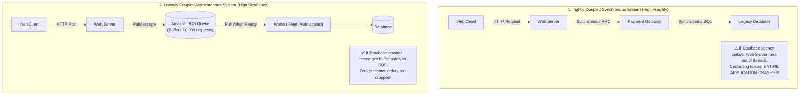
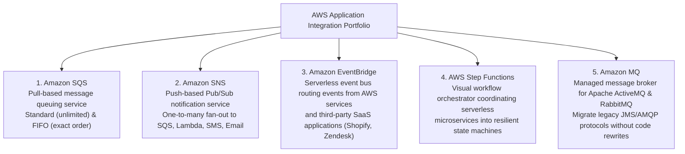
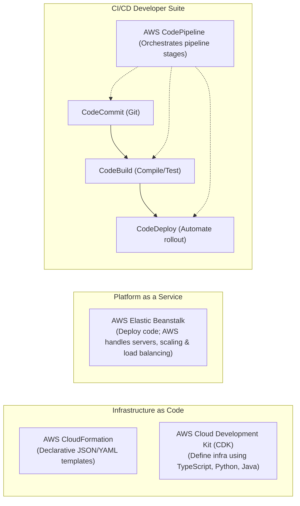

# AWS Application Integration & DevOps Services

> **Knowledge Area:** Cloud Technology and Services (Domain 3.5 & 3.6)  
> **Relevant Certifications:** [CLF-C02](../../01_Syllabus/CLF-C02_Master_Blueprint.md), SAA-C03, DVA-C02  
> **Tags:** `#aws/services` `#sqs` `#sns` `#eventbridge` `#step-functions` `#cloudformation` `#devops` `#clf-c02`

---

## 💡 The Real-World Analogy (ELI5)

> **The Modern Automated Fulfillment Center & Post Office:**
> - **Amazon SQS (Simple Queue Service):** A bank of physical PO Box mail slots. When an order arrives, the customer drops an envelope into the slot. The envelope sits safely inside the box until an available warehouse worker pulls it out. If workers are on lunch break, 5,000 envelopes safely buffer in the boxes without getting lost. Once a worker finishes an envelope, they shred it (decoupling components).
> - **Amazon SNS (Simple Notification Service):** The public emergency broadcast siren on top of the town hall. A single event occurs (e.g., flash flood warning), the mayor speaks once into the microphone, and the message immediately "fans out" simultaneously to thousands of recipients via text messages (SMS), emails, and police car radios (Pub/Sub push).
> - **Amazon EventBridge:** The central air traffic control radar and routing system. It observes planes taking off across the entire country, evaluates incoming flight telemetry against strict routing rules, and automatically routes each flight to its correct terminal gate.
> - **AWS Step Functions:** The automated robotic assembly line coordinator. It moves an automobile chassis from Station 1 (Welding) to Station 2 (Painting). If Station 2 reports a paint defect, Step Functions pauses the line, waits 3 minutes, retries, and if it fails again, routes the car to the manual inspection bay (state machine workflow).
> - **AWS CloudFormation:** The master architectural CAD blueprint for a pre-fabricated modular home. Instead of workers manually measuring wood by hand, you feed the blueprint (JSON/YAML template) into an automated 3D house printer, and AWS automatically erects identical foundations, walls, and plumbing in 15 minutes.

---

## 1. First-Principles Computer Science & Distributed Systems Mechanics

In distributed software architecture, the difference between failure and extreme resilience is **coupling**:

### 1.1 Queueing Theory and Little's Law
Under operations research and queuing theory, the average number of requests in a system ($L$) is governed by **Little's Law**:
$$L = \lambda \times W$$
where $\lambda$ is the arrival rate of incoming requests and $W$ is the average processing time per request.
* **The Reality of Traffic Spikes:** If a flash sale causes the arrival rate ($\lambda$) to multiply by $50\times$, a synchronous web server's connection pool saturates in seconds, causing catastrophic thread exhaustion and memory crashes.
* **The Queue as an Elastic Shock Absorber:** Introducing **Amazon SQS** decouples the arrival rate from the processing rate. Downstream worker nodes pull messages at their own sustainable pace, while the queue absorbs millions of messages safely.

### 1.2 Message Delivery Semantics: At-Least-Once vs. Exactly-Once
* **Standard Queues (At-Least-Once Delivery):** Messages are delivered at least once, but occasionally duplicate messages may be delivered due to distributed network retries. Messages are delivered in nearly best-effort order. Delivers **nearly unlimited throughput**.
* **FIFO Queues (First-In, First-Out & Exactly-Once):** Guarantees that the order in which messages are sent is strictly preserved, and duplicates are automatically discarded. Throughput is limited to 300 transactions/second (or 3,000/sec with batching).

---

## 2. Historical IT Pain Points: The Enterprise Monolith Nightmare

Before cloud application integration and Infrastructure as Code services were available, enterprise software operations suffered from systemic fragility:

| Enterprise Integration Challenge | Traditional On-Premises Reality | AWS Cloud Integration Paradigm |
|---|---|---|
| **Cascading Failures in Monoliths** | When a single downstream billing microservice hung, it held open TCP sockets on upstream servers, triggering a domino effect that brought down the entire corporate website. | **Decouple with Amazon SQS & SNS**. Upstream systems publish messages and immediately return HTTP 200 to users, while background workers process jobs asynchronously. |
| **Manual Point-to-Point Glue Code** | Connecting 10 microservices together required building and maintaining custom point-to-point webhook scripts and retry daemons. | **Event-Driven Architecture (Amazon EventBridge)**. Microservices publish events to a central event bus; services subscribe independently using declarative JSON rules. |
| **Complex Spaghetti State Machines** | Coordinating multi-step checkout workflows (Charge Card $\to$ Deduct Inventory $\to$ Dispatch Warehouse) required writing thousands of lines of fragile database transaction logic. | **AWS Step Functions**. Build resilient, serverless visual state machines with built-in error handling, timeouts, and automated retries. |
| **Manual Click-Ops Infrastructure Errors** | System engineers clicked through hundreds of web console screens to launch servers, load balancers, and databases, making staging environments completely inconsistent with production. | **Infrastructure as Code (AWS CloudFormation)**. Every server, database, and firewall rule is defined in version-controlled JSON/YAML templates that deploy identically every time. |

---

## 3. Deep-Dive: AWS Application Integration Services

### 3.1 Amazon SQS (Simple Queue Service)
* **What it is:** A fully managed, pull-based message queuing service that enables you to decouple and scale microservices, distributed systems, and serverless applications.
* **Core Architectural Primitives:**
  - *Visibility Timeout:* The period of time (default: 30 seconds) during which a message is hidden from other consumer instances after one consumer pulls it off the queue. If the worker crashes before deleting the message, it becomes visible again for another worker to process.
  - *Dead-Letter Queue (DLQ):* A secondary queue where messages that fail processing multiple times are isolated for engineering inspection.
  - *Short Polling vs. Long Polling:* Long polling waits up to 20 seconds for messages to arrive before returning an empty response, significantly reducing API costs and eliminating false empty responses.

### 3.2 Amazon SNS (Simple Notification Service)
* **What it is:** A fully managed, push-based publish/subscribe (Pub/Sub) messaging service that coordinates message delivery to subscribed endpoints.
* **The Fan-Out Architecture Pattern:**
  - A single message published to an SNS Topic is instantaneously cloned and pushed to **multiple Amazon SQS queues**, AWS Lambda functions, and HTTP webhooks simultaneously.
* **Subscriber Protocol Endpoints:** Amazon SQS queues, AWS Lambda functions, HTTPS endpoints, SMS text messages, Email notifications, and Mobile push notifications (APNs, FCM).

### 3.3 Amazon EventBridge
* **What it is:** A serverless event bus that ingests data from your own applications, integrated Software-as-a-Service (SaaS) applications (e.g., Salesforce, Zendesk, Datadog), and AWS services, routing events to target destinations based on declarative JSON matching rules.
* **Key Differentiator:** Direct native ingestion from third-party SaaS providers and advanced content-based JSON schema filtering without writing custom integration adapters.

### 3.4 AWS Step Functions
* **What it is:** A low-code visual workflow orchestrator that coordinates multiple AWS services and microservices into automated business processes and resilient state machines.
* **Capabilities:** Defines execution flows using JSON-based Amazon States Language (ASL) or visual drag-and-drop builders. Natively manages branching logic (`Choice` states), parallel execution (`Parallel` states), dynamic loops, automated error catching, and human-in-the-loop task approvals.

---

## 4. Deep-Dive: AWS DevOps & Infrastructure as Code (IaC)

### 4.1 AWS CloudFormation (Infrastructure as Code)
* **What it is:** A service that allows you to model, provision, and manage AWS and third-party resources by treating **infrastructure as code**.
* **Declarative Templates:** Define cloud resources (VPCs, EC2 instances, S3 buckets, RDS databases) in standardized **JSON or YAML** text templates.
* **Stacks and Change Sets:** Resources declared in a template are provisioned together as a single unit called a **Stack**. Before applying modifications to production, CloudFormation generates a **Change Set**, allowing engineers to preview exact additions, modifications, and deletions before execution.
* **Drift Detection:** Identifies when actual production resources have been manually modified outside of CloudFormation templates.

### 4.2 AWS Elastic Beanstalk (Platform as a Service - PaaS)
* **What it is:** An easy-to-use service for deploying and scaling web applications and services developed with Java, .NET, PHP, Node.js, Python, Ruby, and Docker.
* **How it Works:** You simply upload your application source code bundle, and Elastic Beanstalk automatically handles the deployment details of capacity provisioning, load balancing, auto-scaling, and application health monitoring.
* **Full Administrative Control:** Unlike closed proprietary PaaS platforms, Elastic Beanstalk gives developers full underlying administrative access to the underlying Amazon EC2 instances, OS configurations, and Security Groups at any time.

### 4.3 The AWS CI/CD Developer Tool Suite
* **AWS CodeCommit:** Fully managed, secure source-control service hosting private Git repositories.
* **AWS CodeBuild:** Fully managed, serverless continuous integration service that compiles source code, executes unit tests, and produces deployable software artifact packages (e.g., Docker images or JAR files). You pay strictly per build minute.
* **AWS CodeDeploy:** Automates software deployments to a variety of compute services, including Amazon EC2, AWS Fargate, AWS Lambda, and on-premises servers, supporting rolling, blue/green, and canary deployment strategies.
* **AWS CodePipeline:** A continuous delivery service that models, visualizes, and automates the software release phases (Source $\to$ Build $\to$ Test $\to$ Deploy).

---

## 5. Multi-Dimensional Application Integration Decision Matrix

| Dimension | Amazon SQS | Amazon SNS | Amazon EventBridge | AWS Step Functions | Amazon MQ |
|---|---|---|---|---|---|
| **Messaging Pattern** | **Point-to-Point Queue** | **Publish / Subscribe** | **Serverless Event Bus** | **State Machine Orchestrator** | **Managed Message Broker** |
| **Delivery Model** | **Pull-based** (Consumer polls) | **Push-based** (Immediate fan-out) | **Push-based** (Event router) | Visual task sequence | Push or Pull (JMS/AMQP) |
| **Message Ordering** | FIFO queues strictly guarantee order | FIFO topics support ordering | Best-effort order | Sequential state transitions | Engine-dependent |
| **Retention Window** | Up to 14 days (Default: 4 days) | No retention (Messages lost if no subscriber) | Built-in Archive & Replay | Retains execution history for 90 days | Engine storage dependent |
| **Primary Use Case** | Decoupling microservices; traffic buffering | Mobile push notifications; fan-out to queues | Ingesting third-party SaaS events (Shopify, Zendesk) | Coordinating complex multi-step serverless sagas | Migrating legacy enterprise ActiveMQ/RabbitMQ |

---

## 6. Exam Traps & 'Clue-to-Answer' Decryption

| Question Scenario Keyword | Target Service | Exam Trap & Distractor Explanation |
|---|---|---|
| *"Decouple distributed microservices using a pull-based message queue"* | **Amazon SQS** | Trap: Do not choose Amazon SNS. SQS is a pull-based queue; SNS is a push-based notification service. |
| *"Send push notifications or fan-out a single message to multiple subscribers (SMS, email, SQS)"* | **Amazon SNS** | Trap: Do not choose Amazon SQS. SQS delivers to one consumer at a time; SNS fans out to multiple subscribers. |
| *"Serverless event bus routing events from SaaS providers (Shopify, Zendesk) and AWS services"* | **Amazon EventBridge** | Trap: Do not choose CloudWatch Alarms. Native SaaS partner integration is exclusive to EventBridge. |
| *"Model, provision, and version AWS infrastructure using declarative JSON or YAML templates"* | **AWS CloudFormation** | Trap: Do not choose Elastic Beanstalk. Elastic Beanstalk deploys application code; CloudFormation defines raw infrastructure as code. |
| *"Platform as a Service (PaaS) to upload application code while AWS handles servers and scaling"* | **AWS Elastic Beanstalk** | Trap: Do not choose EC2 or CloudFormation. Uploading application code with automated deployment is Elastic Beanstalk. |
| *"Coordinate distributed microservices into visual state machine workflows with branching and retries"* | **AWS Step Functions** | Trap: Do not choose SQS or EventBridge. Visual workflow orchestration and state management is Step Functions. |
| *"Migrate legacy enterprise messaging using JMS, AMQP, or MQTT without rewriting code"* | **Amazon MQ** | Trap: Do not choose SQS. SQS uses proprietary AWS APIs; Amazon MQ provides standard JMS and AMQP protocols. |

---

## 7. Post-Topic Question Simulation & Retention Check

### Question 1
**Which AWS messaging service provides a fully managed, scalable message queuing service that enables asynchronous decoupling of distributed microservices by allowing consumers to pull messages from a buffer?**
- A) Amazon SNS
- B) Amazon SQS
- C) Amazon EventBridge
- D) AWS Step Functions

<b>Click to View Answer & Detailed Distractor Analysis</b>

**Correct Answer:** **B) Amazon SQS**

* **Why it's correct:** Amazon Simple Queue Service (SQS) is a pull-based distributed message queuing service that decouples microservices and serverless applications, storing messages safely in a buffer until downstream worker consumers poll the queue and process the tasks.
* **Distractor Analysis:**
  - *A is incorrect:* Amazon SNS is a push-based publish/subscribe service that broadcasts notifications immediately to multiple subscribers rather than storing messages in a pull-based queue.
  - *C is incorrect:* Amazon EventBridge is a serverless event bus that routes events between applications using content-matching rules, not a worker queue buffer.
  - *D is incorrect:* AWS Step Functions is a visual workflow orchestrator used to sequence multi-step microservice tasks into state machines.

---

### Question 2
**What is the core architectural difference between Amazon SQS and Amazon SNS?**
- A) SQS uses a publish/subscribe push model; SNS uses a pull-based queue buffer model
- B) SQS is a pull-based message queue where consumers poll for messages; SNS is a push-based Pub/Sub service that broadcasts messages simultaneously to multiple subscribers
- C) SQS only supports sending SMS text messages; SNS only supports storing video streams
- D) SQS requires physical server maintenance; SNS is fully serverless

<b>Click to View Answer & Detailed Distractor Analysis</b>

**Correct Answer:** **B) SQS is a pull-based message queue where consumers poll for messages; SNS is a push-based Pub/Sub service that broadcasts messages simultaneously to multiple subscribers**

* **Why it's correct:** Amazon SQS operates on a point-to-point queue model where consumers explicitly poll (pull) messages from a buffer. Amazon SNS operates on a publisher/subscriber (push) model where an event published to a topic is instantly broadcast (fanned out) to multiple subscribers simultaneously.
* **Distractor Analysis:**
  - *A is incorrect:* The definitions are inverted: SQS is pull-based queueing; SNS is push-based pub/sub.
  - *C is incorrect:* SQS carries arbitrary text payloads (up to 256 KB); SNS supports fan-out to SMS, email, SQS, Lambda, and HTTP endpoints.
  - *D is incorrect:* Both Amazon SQS and Amazon SNS are fully managed, highly available, serverless AWS services requiring zero server maintenance.

---

### Question 3
**Which service allows developers and system administrators to model, provision, version, and manage AWS infrastructure using declarative JSON or YAML templates as Infrastructure as Code (IaC)?**
- A) AWS Elastic Beanstalk
- B) AWS CloudFormation
- C) AWS CodeDeploy
- D) AWS OpsWorks

<b>Click to View Answer & Detailed Distractor Analysis</b>

**Correct Answer:** **B) AWS CloudFormation**

* **Why it's correct:** AWS CloudFormation allows organizations to treat infrastructure as code, defining collections of AWS resources (such as VPCs, EC2 instances, S3 buckets, and RDS databases) in declarative JSON or YAML templates that can be version-controlled, tested, and deployed reliably in automated stacks.
* **Distractor Analysis:**
  - *A is incorrect:* AWS Elastic Beanstalk is a Platform as a Service (PaaS) for deploying application code, not a raw declarative Infrastructure as Code template engine.
  - *C is incorrect:* AWS CodeDeploy automates software deployments to compute instances, but does not provision foundational AWS cloud infrastructure.
  - *D is incorrect:* AWS OpsWorks is a configuration management service that provides managed instances of Chef and Puppet.

---

### Question 4
**Which AWS Platform as a Service (PaaS) offering allows software developers to upload application code (e.g., in Node.js, Python, Java, or PHP) while AWS automatically handles provisioning, load balancing, auto-scaling, and operational health monitoring?**
- A) Amazon EC2
- B) AWS Elastic Beanstalk
- C) AWS CodePipeline
- D) AWS Lambda

<b>Click to View Answer & Detailed Distractor Analysis</b>

**Correct Answer:** **B) AWS Elastic Beanstalk**

* **Why it's correct:** AWS Elastic Beanstalk is an application deployment service (PaaS) where developers upload their application code bundle, and Elastic Beanstalk automatically provisions and manages the underlying Amazon EC2 virtual machines, Elastic Load Balancers, Auto Scaling groups, and databases while retaining full administrative control.
* **Distractor Analysis:**
  - *A is incorrect:* Amazon EC2 is an Infrastructure as a Service (IaaS) offering requiring manual installation and configuration of the OS, web server, and runtime environments.
  - *C is incorrect:* AWS CodePipeline is a continuous delivery orchestration service that manages CI/CD release stages, not an application runtime platform.
  - *D is incorrect:* AWS Lambda is a Function as a Service (FaaS) serverless compute engine executing individual stateless functions in response to events, rather than hosting complete web application runtime platforms.

---

### Question 5
**Which AWS service coordinates distributed microservices, serverless components, and human approvals into visual state machine workflows, natively managing branching logic, timeouts, and automated retries?**
- A) Amazon EventBridge
- B) AWS Step Functions
- C) Amazon SQS
- D) AWS CodeBuild

<b>Click to View Answer & Detailed Distractor Analysis</b>

**Correct Answer:** **B) AWS Step Functions**

* **Why it's correct:** AWS Step Functions is a serverless visual workflow orchestration service that allows developers to sequence multiple AWS services (such as AWS Lambda functions, ECS tasks, and DynamoDB operations) into resilient state machines with declarative branching logic, error handling, and automated retry mechanisms.
* **Distractor Analysis:**
  - *A is incorrect:* Amazon EventBridge is an event router that filters and delivers individual events between services, but does not manage multi-step stateful workflow execution sequences.
  - *C is incorrect:* Amazon SQS is a point-to-point message queuing service, but does not provide state machine logic, decision branching, or task orchestration.
  - *D is incorrect:* AWS CodeBuild is a serverless continuous integration build service that compiles source code and runs unit tests.

