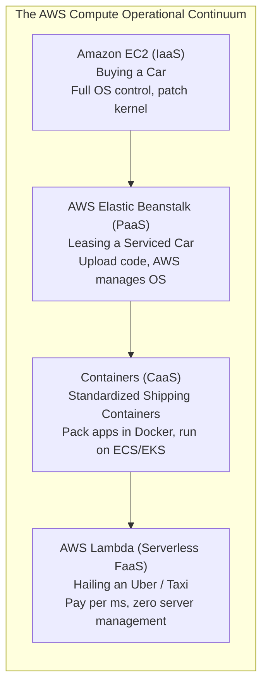
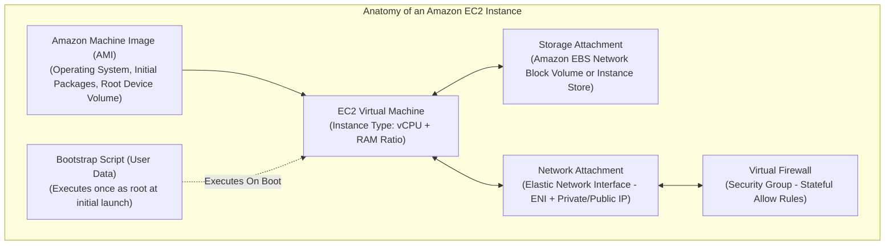
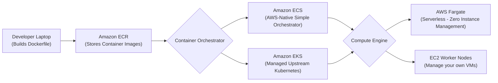
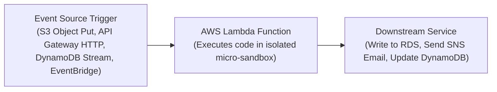
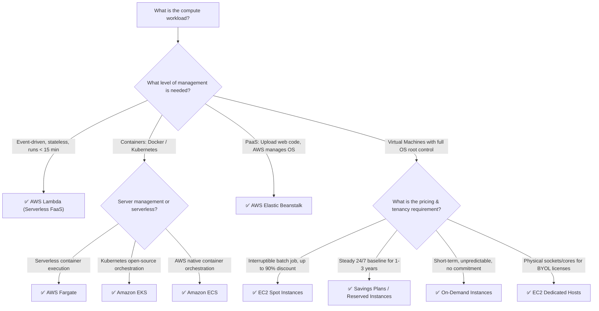

# AWS Compute Services — Architectural Deep-Dive Guide

> **Domain:** Domain 3: Cloud Technology and Services (34% of Exam Blueprint)  
> **Course Track:** AWS Certified Cloud Practitioner (`CLF-C02`)  
> **Associated Lecture:** [`03_Lectures/Lecture_02_Compute_Virtualization_and_Containers.md`](../../03_Lectures/Lecture_02_Compute_Virtualization_and_Containers.md)  
> **Hands-On Practice:** [`07_Hands_On_Labs/lab_03_ec2_compute_bootstrap.md`](../../07_Hands_On_Labs/lab_03_ec2_compute_bootstrap.md) & [`07_Hands_On_Labs/lab_05_serverless_lambda_apigateway.md`](../../07_Hands_On_Labs/lab_05_serverless_lambda_apigateway.md)

---

## 🧭 Executive Summary & Core Objective

Compute is the computational muscle of the AWS Cloud. AWS offers a spectrum of compute models ranging from raw virtual servers with full operating system access (**Amazon EC2**), to automated platform deployment (**AWS Elastic Beanstalk**), containerized microservices (**Amazon ECS / Amazon EKS / AWS Fargate**), and event-driven serverless functions (**AWS Lambda**).

This guide provides trainees with a deep architectural understanding of each compute service, instance sizing heuristics, purchasing options, and container runtimes.

---

## 🏛️ Pillar 1: The Compute Spectrum & Real-World Analogy



1. **Infrastructure as a Service (IaaS) — Amazon EC2:**
   * *Analogy:* Buying a personal sports car. You pick the engine and transmission. You are 100% responsible for oil changes, tire rotations, and engine maintenance (patching the OS, configuring firewalls, and managing software updates).
2. **Platform as a Service (PaaS) — AWS Elastic Beanstalk:**
   * *Analogy:* Leasing a car with a complete maintenance package. You bring your personal luggage (application code) and turn the key. The leasing company handles oil changes, tire rotations, and engine tuning (AWS provisions servers, configures load balancers, and automates scaling).
3. **Containers as a Service (CaaS) — Amazon ECS / EKS / Fargate:**
   * *Analogy:* Commercial shipping containers. Whether you transport furniture, electronics, or refrigerated fruit, the standardized container fits perfectly on any cargo ship, freight train, or flatbed truck. You package your code and runtime once, and it runs anywhere without environmental conflicts.
4. **Function as a Service (FaaS) — AWS Lambda:**
   * *Analogy:* Hailing an Uber or electric scooter. You do not purchase a car, pay insurance, or search for parking. The vehicle appears on-demand, drives you for 3 miles, and vanishes. You pay strictly for the exact seconds traveled. When not riding, your cost is literally **$0.00**.

---

## ⚙️ 1. Amazon Elastic Compute Cloud (Amazon EC2)

Amazon EC2 provides resizable virtual compute capacity in the cloud. An EC2 instance is a **Virtual Machine (VM)** running on a physical host server managed by the **AWS Nitro System**.



### Core EC2 Components Every Trainee Must Know:
1. **Amazon Machine Image (AMI):** The pre-configured template that provides the operating system (Amazon Linux, Ubuntu, Windows Server, Red Hat), architecture (x86_64 or ARM/Graviton), and initial software packages required to launch your instance.
2. **EC2 User Data:** A shell script or cloud-init configuration that runs **automatically with root privileges once during the initial instance boot**. Used to update packages, install web servers (Apache, Nginx), and clone code repositories without manual SSH login.
3. **Instance Metadata:** Telemetry data *about* your instance accessible from within the running instance via the non-routable link-local IP address: `http://169.254.169.254/latest/meta-data/` (instance ID, public IP, IAM role security credentials).

---

## 🏷️ 2. EC2 Instance Families & Naming Convention

AWS names EC2 instances using a standardized alphanumeric syntax (e.g., `m6g.2xlarge`):

```text
       m           6           g    .     2xlarge
   Instance     Hardware   Processor       Instance
    Family     Generation   Feature          Size
   (Memory)    (6th Gen)   (Graviton)   (8 vCPU / 32 GB)
```

### High-Yield Instance Families Summary:

| Family Letter | Classification | Optimization Focus | Common Real-World Use Cases |
|:---:|:---|:---|:---|
| **`T` / `M`** | **General Purpose** | Balanced CPU, RAM, and networking. Burstable CPU credits on `T` instances. | Web and application servers, development environments, small-to-medium databases. |
| **`C`** | **Compute Optimized** | High-performance CPUs; highest compute-to-memory ratio. | High Performance Computing (HPC), batch processing, video transcoding, dedicated gaming servers. |
| **`R` / `X`** | **Memory Optimized** | Massive RAM-to-CPU ratio; fast memory bandwidth. | In-memory databases (SAP HANA, Redis, Memcached), real-time big data processing (Apache Spark). |
| **`I` / `D`** | **Storage Optimized** | Direct-attached NVMe storage with tens of thousands of low-latency IOPS. | Data warehousing, distributed file systems, Elasticsearch / OpenSearch clusters, NoSQL databases. |
| **`P` / `G`** | **Accelerated Computing** | Hardware GPU accelerators and FPGA custom silicon. | Deep learning / AI training, machine learning inference, 3D graphics, autonomous vehicle modeling. |

---

## 💰 3. EC2 Purchasing & Tenancy Models

Choosing the right purchasing option is the primary mechanism for optimizing cloud compute costs:

```mermaid
flowchart TD
    Start{"Workload Duration & Predictability?"}
    Start -->|Short-term, irregular, dev/test| OD["On-Demand Instances\n(Highest flexibility, pay by second, zero commitment)"]
    Start -->|Steady-state predictable usage (1 or 3 Years)| Plan{"Commitment Preference?"}
    Plan -->|Flexible compute spend ($/hr) across EC2/Fargate/Lambda| SP["Compute Savings Plans\n(Up to 72% discount)"]
    Plan -->|Specific instance family in specific region| RI["Standard Reserved Instances\n(Up to 72% discount, capacity reservation)"]
    Start -->|Stateless, fault-tolerant batch jobs| Spot["Spot Instances\n(Up to 90% discount, spare capacity, 2-minute notice)"]
    Start -->|BYOL software licenses tied to physical sockets/cores| DH["Dedicated Hosts\n(Dedicated physical server, full socket/core visibility)"]
```

### Comprehensive Comparison Matrix

| Purchasing Option | Commitment Required | Discount vs. On-Demand | Interruption Risk | Best Used For |
|:---|:---:|:---:|:---:|:---|
| **On-Demand** | None (Pay per second) | Baseline (0%) | **None.** Runs until stopped. | Short-term, unpredictable workloads; dev/test; proof of concepts. |
| **Compute Savings Plans** | 1 or 3 Years ($/hr spend) | Up to **72%** | **None.** | Steady-state compute across EC2, Fargate, and Lambda. |
| **EC2 Instance Savings Plans** | 1 or 3 Years ($/hr spend) | Up to **72%** | **None.** | Steady-state compute committed to a specific instance family in a specific region. |
| **Standard Reserved Instances (RIs)** | 1 or 3 Years | Up to **72%** | **None.** (Optional capacity reservation in a specific AZ). | Steady-state production databases and applications. |
| **Spot Instances** | None (Uses spare capacity) | Up to **90%** | **High.** Reclaimed with a **2-minute notice** when AWS needs capacity. | Fault-tolerant batch jobs, image rendering, CI/CD runners, containerized web clusters. |
| **Dedicated Hosts** | On-Demand or 1–3 Years | Varies | **None.** | Regulatory compliance requiring physical isolation; BYOL software licenses bound to sockets/cores. |

---

## 🐳 4. Containers in AWS: Docker, ECR, ECS, EKS & Fargate

Containers package code and all its dependencies into an immutable image that runs identically on a laptop, on-premises, or in AWS:



1. **Amazon Elastic Container Registry (ECR):** A fully managed, highly available Docker container registry that makes it easy to store, manage, and deploy container images with integrated vulnerability scanning.
2. **Amazon Elastic Container Service (ECS):** An AWS-native, highly opinionated container orchestration service. Integrates seamlessly with AWS IAM, Application Load Balancers, and CloudWatch.
3. **Amazon Elastic Kubernetes Service (EKS):** A managed service that runs upstream open-source **Kubernetes** without needing to install or operate the Kubernetes control plane. Ideal for enterprises with existing Kubernetes YAML manifests or multi-cloud portability requirements.
4. **AWS Fargate (Serverless Container Engine):**
   * Eliminates the need to choose instance types, manage EC2 operating systems, or scale cluster worker nodes.
   * Works with both Amazon ECS and Amazon EKS. You define CPU and memory requirements, and Fargate launches the container instantly. You pay only for the exact vCPU and memory seconds consumed.

---

## ⚡ 5. Serverless Compute: AWS Lambda

**AWS Lambda** lets you run code without provisioning or managing servers. You upload your code (Node.js, Python, Java, Go, C#, Ruby, or custom container images), and Lambda handles execution, auto-scaling, high availability, and maintenance.



### Critical Lambda Rules Every Practitioner Must Know:
1. **Event-Driven Execution:** Code runs only when triggered by an event (e.g., a file uploaded to S3, an HTTP request to API Gateway, a cron schedule from EventBridge).
2. **Billing Metric:** Billed per invocation and compute duration, measured in **1-millisecond increments**. When your code is not running, **your cost is $0.00**.
3. **The 15-Minute Technical Limit:** The maximum execution duration for a single Lambda function invocation is **15 minutes (900 seconds)**. Workloads requiring continuous long-running processes must be deployed on **AWS Fargate** or **Amazon EC2**.
4. **Memory Allocation:** Scales from 128 MB up to 10,240 MB (10 GB). CPU power scales linearly with allocated memory.

---

## 🚀 6. Platform as a Service (PaaS): AWS Elastic Beanstalk

**AWS Elastic Beanstalk** is an easy-to-use service for deploying and scaling web applications and services developed with Java, .NET, PHP, Node.js, Python, Ruby, Go, and Docker on familiar servers such as Apache, Nginx, Passenger, and IIS.
- **How It Works:** You simply upload your code, and Elastic Beanstalk automatically handles the deployment—from capacity provisioning, load balancing, and auto-scaling to application health monitoring.
- **Full Underlying Control:** Unlike traditional rigid PaaS offerings, Elastic Beanstalk gives you full control over the underlying AWS resources (EC2 instances, ALBs, ASGs) at any time.

---

## 🎯 7. Exam Scenario Decryption & Practice Questions

### Key Exam Trigger Phrases

| Exam Trigger Phrase | Correct Compute Option | Distractor Trap to Avoid |
|:---|:---|:---|
| *"Run code in response to events with zero server management and per-millisecond billing"* | **AWS Lambda** | Do not pick EC2; EC2 requires managing OS patches and server sizing. |
| *"Deploy Docker containers without managing, provisioning, or patching EC2 virtual machines"* | **AWS Fargate** | Do not pick ECS with EC2 launch type; Fargate is the serverless engine. |
| *"Non-critical, fault-tolerant batch workloads with up to 90% cost savings"* | **EC2 Spot Instances** | Do not pick Reserved Instances; Spot provides deepest discounts for interruptible workloads. |
| *"Hardware visibility and physical CPU sockets to satisfy Bring Your Own License (BYOL)"* | **EC2 Dedicated Hosts** | Do not pick Dedicated Instances; Dedicated Hosts provide socket/core visibility. |
| *"Deploy a web application quickly without designing the underlying networking or scaling"* | **AWS Elastic Beanstalk** | Do not pick CloudFormation; Beanstalk is the PaaS code-deployment service. |

---

### Practice Question 1
**A company wants to run a serverless batch data transformation script that executes in response to new photos uploaded to Amazon S3. The processing takes 45 seconds per image. Which compute option is most cost-effective?**
- [A] Amazon EC2 On-Demand Instance
- [B] AWS Lambda
- [C] Amazon ECS with EC2 worker nodes
- [D] AWS Elastic Beanstalk

<details>
<summary><b>View Verified Answer & Complete Distractor Analysis</b></summary>

**Correct Answer:** `B`  
**Peer Consensus:** `100%` agreement.

**Architectural Rationale:**
- **Why [B] is Correct:** **AWS Lambda** is an event-driven serverless compute service that can be triggered directly by Amazon S3 `ObjectCreated` events. Because the script runs for only 45 seconds on-demand, Lambda bills strictly for the exact seconds of execution. When no images are being uploaded, costs are literally \$0.00, making it the most cost-effective option.

**Distractor Analysis:**
- **Why [A] is Wrong:** An EC2 instance incurs ongoing hourly costs even when sitting idle waiting for images to arrive, requiring operating system patching and management overhead.
- **Why [C] is Wrong:** Amazon ECS with EC2 worker nodes requires provisioning and maintaining virtual machine infrastructure, incurring continuous idle costs.
- **Why [D] is Wrong:** Elastic Beanstalk is a web application deployment platform that provisions long-running servers and load balancers; it is not meant for discrete 45-second event-driven image processing.

</details>

---

### Practice Question 2
**A company has an enterprise software license that is legally bound to specific physical CPU sockets and cores. Which Amazon EC2 tenancy option is required to satisfy this licensing restriction?**
- [A] Spot Instances
- [B] Dedicated Hosts
- [C] Default Multi-Tenant Instances
- [D] Dedicated Instances

<details>
<summary><b>View Verified Answer & Complete Distractor Analysis</b></summary>

**Correct Answer:** `B`  
**Peer Consensus:** `100%` agreement.

**Architectural Rationale:**
- **Why [B] is Correct:** An **EC2 Dedicated Host** is a physical server dedicated entirely to your use. Dedicated Hosts give you complete visibility into the physical hardware sockets and core counts, which is legally mandatory for **Bring Your Own License (BYOL)** compliance software agreements (e.g., Microsoft SQL Server, Oracle).

**Distractor Analysis:**
- **Why [A] is Wrong:** Spot instances run on shared multi-tenant infrastructure and can be interrupted at any time; they provide zero socket-level licensing control.
- **Why [C] is Wrong:** Default tenancy places your instances on shared hardware alongside other AWS customer accounts.
- **Why [D] is Wrong:** Dedicated Instances run on hardware dedicated to your account, but they **DO NOT** give you visibility into physical sockets and cores or control over instance placement.

</details>

---

### Practice Question 3
**What is the maximum execution time limit for a single AWS Lambda function invocation?**
- [A] 1 minute
- [B] 5 minutes
- [C] 15 minutes
- [D] Unlimited

<details>
<summary><b>View Verified Answer & Complete Distractor Analysis</b></summary>

**Correct Answer:** `C`  
**Peer Consensus:** `100%` agreement.

**Architectural Rationale:**
- **Why [C] is Correct:** AWS Lambda enforces a hard technical execution timeout of **15 minutes (900 seconds)** per function invocation. If a task exceeds 15 minutes, Lambda terminates the execution. Workloads requiring longer execution times must run on **AWS Fargate**, **Amazon EC2**, or **AWS Batch**.

**Distractor Analysis:**
- **Why [A] & [B] are Wrong:** Lambda historically had a 5-minute limit, but AWS raised this to 15 minutes in 2018. 1 minute is a common default timeout in some SDKs, but 15 minutes is the maximum allowable limit.
- **Why [D] is Wrong:** Lambda is inherently designed for short-lived, stateless functions; it does not support unlimited execution duration.

</details>

---

## 📝 Retention Self-Check Exercises
1. *What is the difference between an Amazon EC2 Dedicated Instance and an EC2 Dedicated Host?*
2. *Why would an organization choose AWS Fargate over running containers on EC2 worker nodes?*
3. *What are the three core pieces of an EC2 instance launch configuration?*
4. *If a batch processing script takes 25 minutes to execute, can it run on AWS Lambda? What service should be used instead?*

---

## 🧠 Master MCQ Solving Blueprint: Pattern Decryption & Elimination Tricks

> *This blueprint distills recurring patterns, keyword triggers, and trap options extracted from over 500 questions on AWS Compute (EC2, Lambda, ECS, EKS, Fargate, Elastic Beanstalk) across the official CLF-C02 question bank.*

### 1. The "Clue-to-Service" Linguistic Decryption Matrix
When reading a question scenario, search for these exact phrasing triggers:

| If You See This Trigger Phrase in the Question Stem... | The Correct Compute Service / Model Is... | Trap Distractor to Immediately Discard |
|---|---|---|
| *"Run code without managing servers; pay per millisecond; event-driven; short execution"* | **AWS Lambda** | *Amazon EC2* (EC2 requires OS management) |
| *"Deploy Docker containers without provisioning or managing underlying EC2 servers"* | **AWS Fargate** | *Amazon ECS with EC2 launch type* (EC2 launch type requires server management) |
| *"Orchestrate container workloads using open-source Kubernetes"* | **Amazon EKS** | *Amazon ECS* (ECS is AWS proprietary, not Kubernetes) |
| *"Quickly deploy and scale web applications by uploading code; AWS handles provisioning, load balancing, auto-scaling"* | **AWS Elastic Beanstalk** | *AWS CloudFormation* (CloudFormation is IaC; Beanstalk is PaaS) |
| *"Fault-tolerant, interruptible workloads (rendering, batch processing) seeking up to 90% discount"* | **EC2 Spot Instances** | *On-Demand Instances* or *Reserved Instances* |
| *"Steady-state, predictable compute usage for 1 or 3 years seeking maximum cost reduction"* | **Savings Plans / Reserved Instances** | *Spot Instances* (Spot is for interruptible, not steady-state) |
| *"Bring Your Own License (BYOL) requiring visibility into physical CPU sockets and cores"* | **EC2 Dedicated Hosts** | *Dedicated Instances* (Dedicated Instances do not provide socket visibility!) |
| *"Workload execution time exceeds 15 minutes"* | **AWS Fargate / Amazon EC2** | *AWS Lambda* (Lambda has a hard 15-minute maximum timeout!) |
| *"Private Docker container image registry"* | **Amazon ECR (Elastic Container Registry)** | *Amazon S3* (S3 can store files, but ECR is the container image registry) |

### 2. The 3-Step Rapid Elimination Heuristic
When evaluating a Compute question:
1. **Step 1: Check the Operational Abstraction Layer:**
   - Full OS control, root access, long-running processes $\to$ **Amazon EC2**.
   - Platform as a Service (PaaS): Upload code, let AWS handle servers $\to$ **AWS Elastic Beanstalk**.
   - Containerized workloads $\to$ **ECS / EKS** (with **Fargate** if serverless).
   - Serverless functions, event-driven, $\le 15$ minutes $\to$ **AWS Lambda**.
2. **Step 2: Check EC2 Purchasing Model:**
   - Short-term, unpredictable, development, cannot be terminated unexpectedly $\to$ **On-Demand**.
   - Fault-tolerant, stateless batch, background data jobs, can tolerate 2-minute shutdown notice $\to$ **Spot**.
   - Steady 24/7 production server running for 1 or 3 years $\to$ **Savings Plans / Reserved Instances**.
   - Strict physical hardware isolation for regulatory compliance $\to$ **Dedicated Instances**.
   - Dedicated physical server + per-core software licensing (BYOL) $\to$ **Dedicated Hosts**.
3. **Step 3: Check Duration Limits:**
   - Does the batch task take **more than 15 minutes** (e.g., 30 minutes, 2 hours)?
   - **INSTANTLY ELIMINATE AWS Lambda**. Lambda will crash at minute 15. Choose **AWS Fargate**, **EC2**, or **AWS Batch**.

### 3. High-Frequency Decoy Autopsy: Why AWS Tries to Trick You
* **Decoy #1: "Dedicated Hosts" vs. "Dedicated Instances"**
  - *The Trap:* A company has existing Windows Server licenses tied to physical CPU sockets.
  - *The Autopsy:* Both run on single-tenant hardware. But **Dedicated Instances** give you no control over which physical server is used and no visibility into physical sockets/cores. **Dedicated Hosts** give you a dedicated physical server box with socket/core mapping required for BYOL compliance.
* **Decoy #2: "AWS Lambda" vs. "AWS Fargate"**
  - *The Trap:* The scenario asks for "serverless compute" for a job that processes video files taking 45 minutes.
  - *The Autopsy:* Candidates see "serverless" and choose Lambda. But Lambda has a **15-minute execution limit**. For serverless containerized tasks that run longer than 15 minutes, the correct answer is **AWS Fargate**.
* **Decoy #3: "AWS Elastic Beanstalk" vs. "AWS CloudFormation"**
  - *The Trap:* Deploying an application environment automatically.
  - *The Autopsy:* **Elastic Beanstalk** is a Platform-as-a-Service (PaaS) for developers who just want to upload application code (`.zip`, `.war`, Dockerfile). **CloudFormation** is Infrastructure as Code (IaC) using JSON/YAML templates to provision any AWS resource across the entire cloud catalog.

### 4. 10-Second Visual Decision Flowchart


