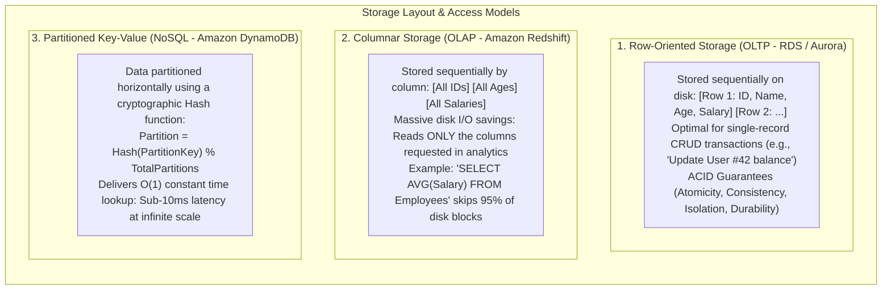
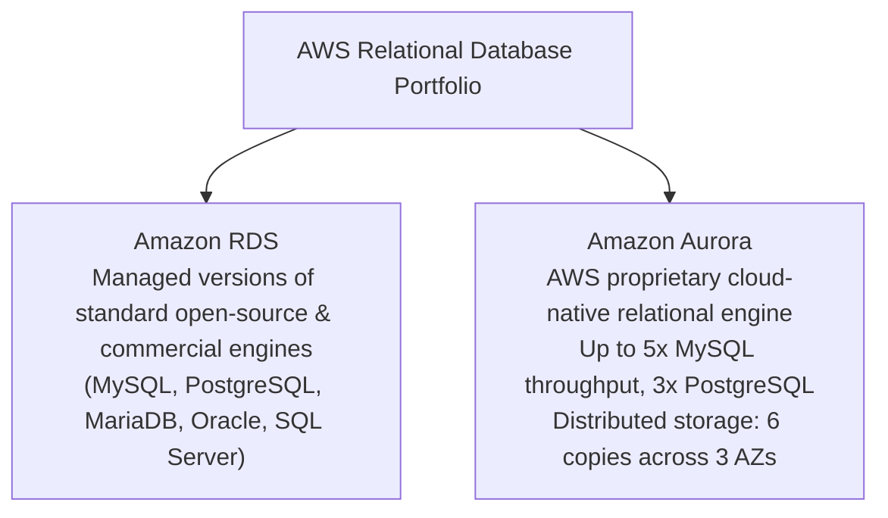
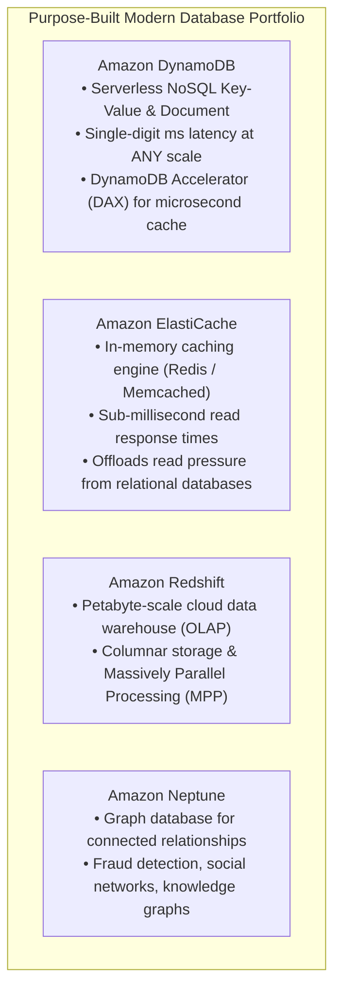

# AWS Database Services: Relational, NoSQL, In-Memory & Analytical Engines

> **Knowledge Area:** Cloud Technology and Services (Domain 3.3)  
> **Relevant Certifications:** [CLF-C02](../../01_Syllabus/CLF-C02_Master_Blueprint.md), SAA-C03, DVA-C02  
> **Tags:** `#aws/services` `#database` `#rds` `#aurora` `#dynamodb` `#elasticache` `#redshift` `#clf-c02`

---

## 💡 The Real-World Analogy (ELI5)

> **Information Management Systems in Everyday Life:**
> - **Amazon RDS / Aurora (Relational OLTP):** A meticulously organized, strict financial accounting ledger. Every row has exact columns (Invoice Number, Date, Amount), entries are mathematically linked by foreign key relationships, and transactions are strictly balanced (ACID compliance). Ideal for core banking, inventory orders, and billing.
> - **Amazon DynamoDB (NoSQL Key-Value / Document):** A vast wall of automated electronic luggage lockers at an international transit hub. You scan your barcode ticket (Partition Key), the corresponding door pops open in 2 milliseconds, and you grab your bag. Whether the station has 50 lockers or 50 million lockers, the door opens at the exact same speed.
> - **Amazon ElastiCache (In-Memory Caching):** A dry-erase whiteboard mounted next to the cashier's register. Instead of walking back to the library file cabinet every time a customer asks for the price of bread, the cashier reads it off the whiteboard in microseconds.
> - **Amazon Redshift (Columnar Data Warehouse - OLAP):** The corporate central archives room. Used by business intelligence analysts to run massive computational queries summarizing 10 years of worldwide product sales to forecast next year's corporate strategy.
> - **Amazon Neptune (Graph Database):** A social network detective's corkboard covered with photographs (nodes) connected by crisscrossing colored strings (edges) to trace complex relationships, fraud rings, and influencer networks.

---

## 1. First-Principles Computer Science & Database Systems Mechanics

Database architecture is governed by fundamental computer science trade-offs between schema rigidity, transaction guarantees, and data layout on disk:



### 1.1 OLTP vs. OLAP: The Fundamental Separation
* **Online Transaction Processing (OLTP):**
  - *Workload Nature:* High volume of fast, concurrent, atomic read/write transactions executed by end users (e-commerce checkout, updating a user profile, transferring bank funds).
  - *Data Structure:* Highly normalized relational tables with primary/foreign keys.
  - *Primary AWS Engines:* **Amazon RDS** and **Amazon Aurora**.
* **Online Analytical Processing (OLAP):**
  - *Workload Nature:* Complex, read-heavy analytical queries scanning millions or billions of historical rows to aggregate business metrics (`SUM`, `AVG`, `GROUP BY`).
  - *Data Structure:* Star or snowflake schemas with columnar storage.
  - *Primary AWS Engine:* **Amazon Redshift**.

### 1.2 ACID vs. BASE (CAP Theorem in Databases)
* **ACID (Relational):** Guarantees **Atomicity** (all-or-nothing transactions), **Consistency** (valid state constraints), **Isolation** (concurrent transactions do not interfere), and **Durability** (committed writes survive power loss). 
* **BASE (NoSQL - DynamoDB):** Trades strict multi-table locking for **Basically Available**, **Soft state**, and **Eventual consistency**. This enables DynamoDB to scale horizontally across thousands of storage nodes with zero degradation in throughput.

---

## 2. Historical IT Pain Points: The On-Premises Database Nightmare

Before fully managed cloud database services, operating relational database engines was notoriously difficult and expensive:

| Traditional Database Challenge | Traditional On-Premises Reality | AWS Managed Database Paradigm |
|---|---|---|
| **Commercial Licensing Traps** | Legacy proprietary database vendors (Oracle, Microsoft) charged tens of thousands of dollars per CPU core, with aggressive audit penalties. | **Open-Source & Cloud-Native Engines**. Run MySQL, PostgreSQL, or **Amazon Aurora** (3–5x open source performance) with zero punitive licensing lock-in. |
| **Manual Failover & Unplanned Downtime** | Setting up an active-passive database replica required custom cluster scripts. Failover took **15 to 30 minutes of downtime** while database administrators manually changed DNS records. | **Automated Multi-AZ Synchronous Failover**. Amazon RDS and Aurora automatically detect primary failure and flip DNS endpoints to healthy replicas in **60–120 seconds**. |
| **Manual Schema Sharding for Scale** | When an on-premise relational database exceeded server disk or CPU capacity, engineers spent months writing complex custom application code to "shard" data across servers. | **Serverless Horizontal Scaling**. **Amazon DynamoDB** automatically partitions and scales storage and throughput elastically with zero code rewrites. |
| **Backup Corruption & Point-in-Time Restore** | Taking full database dumps locked table locks and degraded production performance. Point-in-time recovery was notoriously unreliable. | **Automated Continuous Backups**. RDS automatically streams transaction logs to Amazon S3, allowing point-in-time recovery to any second within the retention window. |

---

## 3. Deep-Dive: AWS Managed Relational Databases (RDS & Aurora)



### 3.1 Amazon RDS (Relational Database Service)
* **What it is:** A fully managed service that simplifies the setup, operation, and scaling of relational databases in the cloud.
* **Supported Database Engines (6 Total):**
  1. MySQL
  2. PostgreSQL
  3. MariaDB
  4. Oracle (Commercial enterprise)
  5. Microsoft SQL Server (Commercial enterprise)
  6. Amazon Aurora (Cloud-native proprietary)
* **What AWS Automates for You:**
  - Operating system installation and security patching.
  - Database engine minor version updates.
  - Automated continuous backups with Point-in-Time Recovery (PITR) up to 35 days.
  - Synchronous storage replication across multiple Availability Zones (**Multi-AZ**).
* **What the Customer Remains Responsible For:**
  - Database schema design, table structures, and index optimization.
  - Database user credentials, permissions, and network access (Security Groups).
  - Query tuning and application connection pooling.

### 3.2 High Availability (Multi-AZ) vs. Read Scalability (Read Replicas)
This is one of the most frequently tested distinctions on the CLF-C02 exam:

```mermaid
flowchart TD
    subgraph MultiAZ ["Multi-AZ Deployment (High Availability / Disaster Recovery)"]
        direction LR
        PrimaryDB["Primary DB Instance<br/>(AZ-A / Read-Write)"] ==="Synchronous Block Replication < 1ms"===> StandbyDB["Standby Replica<br/>(AZ-B / Passive)"]
        ClientApp["Application"] -->|Normal Traffic| PrimaryDB
        PrimaryDB -.->|"Fails Over on Crash"| StandbyDB
    end

    subgraph ReadReplica ["Read Replicas (Scalability & Performance)"]
        direction LR
        MasterDB["Primary DB Instance<br/>(Read-Write)"] -.->"Asynchronous Log Shipping"-.-> RR1["Read Replica 1<br/>(Read-Only)"]
        MasterDB -.->"Asynchronous Log Shipping"-.-> RR2["Read Replica 2<br/>(Read-Only)"]
        WebTraffic["Read-Heavy Web Traffic"] --> RR1
        WebTraffic --> RR2
    end
```

| Dimension | Amazon RDS Multi-AZ | Amazon RDS Read Replicas |
|---|---|---|
| **Primary Purpose** | **High Availability & Disaster Recovery** | **Read Performance & Query Scalability** |
| **Replication Type** | **Synchronous** (Zero data loss; RPO = 0) | **Asynchronous** (Minor replication lag) |
| **Active Target?** | **Passive Standby** (Cannot serve queries) | **Active Read-Only** (Serves customer reads) |
| **Failover Mechanism** | **Automatic failover** in 60–120 seconds | Manual or automated promotion to standalone DB |
| **Geographic Scope** | Cross-AZ (within the same Region) | Cross-AZ or Cross-Region |

### 3.3 Amazon Aurora: The Cloud-Native Relational Engine
* **Cloud-Native Decoupled Architecture:** Unlike standard RDS where compute and storage are bundled together on a virtual machine, Aurora separates the compute processing nodes from the underlying storage layer.
* **Distributed Self-Healing Storage:** Aurora automatically partitions database volume data into 10 GB segments and replicates **6 copies across 3 Availability Zones** (2 copies per AZ).
* **Quorum Consensus Model:** Writes require a quorum of 4 out of 6 storage nodes to acknowledge; reads require a quorum of 3 out of 6 nodes, surviving the loss of an entire AZ plus an additional storage node without losing data.
* **Extreme Performance & Scalability:** Delivers up to **5x the throughput of standard MySQL** and **3x the throughput of standard PostgreSQL**. Scales storage automatically up to 128 TiB without manual disk allocation. Supports up to **15 low-latency Read Replicas** (compared to 5 in standard RDS).

---

## 4. Deep-Dive: NoSQL, In-Memory & Specialized Database Engines



### 4.1 Amazon DynamoDB (Serverless NoSQL)
* **What it is:** A fully managed, serverless, multi-region, multi-active NoSQL database delivering consistent, single-digit millisecond response times at any scale.
* **Data Model:** Stores unstructured and semi-structured data as **Items** (rows) containing **Attributes** (columns). Every item is uniquely identified by a **Partition Key** (or composite Partition Key + Sort Key).
* **Key Capabilities:**
  - *Serverless Scaling:* Choose On-Demand capacity (scales instantly to match spiky traffic) or Provisioned capacity (with Auto Scaling).
  - *DynamoDB Accelerator (DAX):* A fully managed, highly available in-memory cache that reduces read latency from single-digit milliseconds down to **microseconds**.
  - *DynamoDB Global Tables:* Fully managed, multi-region, multi-active replication delivering local sub-second read/write performance worldwide.

### 4.2 Amazon ElastiCache (In-Memory Acceleration)
* **What it is:** A fully managed in-memory data store that improves application performance by retrieving data from fast, managed in-memory caches instead of relying solely on slower disk-based databases.
* **Supported Open-Source Engines:**
  - **Redis OSS:** Advanced data structures (hashes, lists, sets, sorted sets, geospatial), pub/sub messaging, Multi-AZ replication, persistence, and automated failover.
  - **Memcached:** Pure, multi-threaded memory object caching system designed for simple key-value caching without persistence.

### 4.3 Amazon Redshift (Cloud Data Warehouse)
* **What it is:** A petabyte-scale, fully managed cloud data warehouse service optimized for complex analytical queries (OLAP) and business intelligence reporting.
* **Architectural Mechanics:**
  - *Columnar Storage:* Encodes and stores data by column rather than row, reducing disk I/O by over 90% for typical business intelligence aggregation queries.
  - *Massively Parallel Processing (MPP):* Distributes data and query execution across a cluster of compute nodes to analyze petabytes of structured and semi-structured data in seconds.

### 4.4 Specialty Purpose-Built Databases
1. **Amazon Neptune:** Graph database optimized for navigating highly connected graph relationships (social graphs, fraud detection, identity resolution). Supports Apache TinkerPop Gremlin and SPARQL.
2. **Amazon DocumentDB:** Fully managed JSON document database compatible with existing MongoDB workloads.
3. **Amazon Timestream:** Serverless time-series database optimized for storing and analyzing events that change over time (IoT device telemetry, industrial sensors, stock market ticks).
4. **Amazon QLDB (Quantum Ledger Database):** Cryptographically verifiable, immutable append-only ledger database owned by a central trusted authority.

---

## 5. Multi-Dimensional Database Selection Matrix

| Database Service | Primary Data Model | Typical Use Case | Scaling Paradigm | Latency Target | High Availability Mechanism |
|---|---|---|---|---|---|
| **Amazon RDS** | Relational (SQL) | Traditional ERP, CRM, transactional e-commerce | Vertical compute; auto-scaling storage | Single-digit ms | Multi-AZ synchronous standby |
| **Amazon Aurora** | Relational (SQL) | High-performance enterprise OLTP applications | Vertical compute; auto-scaling storage up to 128 TiB | Single-digit ms | 6-way storage replication across 3 AZs |
| **Amazon DynamoDB** | NoSQL (Key-Value/Doc) | High-scale mobile backends, gaming leaderboards, cart | **Horizontal auto-scaling** (Serverless) | **Single-digit ms (Microseconds with DAX)** | Multi-AZ automated replication; Global Tables |
| **Amazon ElastiCache** | In-Memory Key-Value | Read acceleration, user session stores | Vertical and horizontal cluster sharding | **Sub-millisecond (Microseconds)** | Redis Multi-AZ replication with auto-failover |
| **Amazon Redshift** | Columnar Relational | Business intelligence, enterprise data warehouse | Horizontal node clustering (MPP) | Seconds to minutes (Complex OLAP) | Multi-node cluster with automated S3 snapshots |
| **Amazon Neptune** | Graph (Nodes & Edges) | Fraud detection networks, social media connections | Read replicas; decoupled storage | Single-digit ms | Multi-AZ replicas |

---

## 6. Exam Traps & 'Clue-to-Answer' Decryption

| Question Scenario Keyword | Target Database Service | Exam Trap & Distractor Explanation |
|---|---|---|
| *"Relational database with automated Multi-AZ failover and read scaling"* | **Amazon RDS** | Trap: Do not choose DynamoDB. Relational data with SQL joins requires RDS or Aurora. |
| *"Cloud-native database, up to 5x throughput of MySQL, 6 copies of data across 3 AZs"* | **Amazon Aurora** | Trap: Do not choose standard RDS MySQL. The 5x throughput and 6-way storage is exclusive to Aurora. |
| *"Fully managed serverless NoSQL key-value database with single-digit millisecond latency"* | **Amazon DynamoDB** | Trap: Do not choose Amazon RDS. RDS is relational and requires instance provisioning; DynamoDB is serverless NoSQL. |
| *"In-memory cache to reduce database read latency to microseconds"* | **Amazon ElastiCache** | Trap: Do not choose Amazon RDS Read Replicas. Read replicas reduce load on the primary DB, but only in-memory ElastiCache achieves microsecond latency. |
| *"Petabyte-scale columnar data warehouse for complex analytical reporting (OLAP)"* | **Amazon Redshift** | Trap: Do not choose Amazon RDS. RDS is designed for transactional OLTP; Redshift is built for columnar OLAP. |
| *"Graph database for fraud detection rings and social network relationships"* | **Amazon Neptune** | Trap: Do not choose DynamoDB or RDS. Highly interconnected relationship networks require Neptune. |
| *"Continuous, zero-downtime database migration between on-prem and AWS"* | **AWS Database Migration Service (DMS)** | Trap: Do not choose AWS DataSync. DataSync migrates files/objects; AWS DMS migrates live relational and NoSQL databases. |

---

## 7. Post-Topic Question Simulation & Retention Check

### Question 1
**Which AWS database service provides a fully managed serverless NoSQL key-value and document database engine that delivers predictable single-digit millisecond latency at any scale with automated multi-AZ replication?**
- A) Amazon RDS for PostgreSQL
- B) Amazon DynamoDB
- C) Amazon Redshift
- D) Amazon DocumentDB

<details>
<summary><b>Click to View Answer & Detailed Distractor Analysis</b></summary>

**Correct Answer:** **B) Amazon DynamoDB**

* **Why it's correct:** Amazon DynamoDB is a fully managed, serverless NoSQL database service that provides consistent, predictable single-digit millisecond latency, automated horizontal partition scaling, built-in multi-AZ data replication, and high throughput for key-value and document data structures.
* **Distractor Analysis:**
  - *A is incorrect:* Amazon RDS for PostgreSQL is a managed relational (SQL) database service that requires provisioning underlying instance compute sizes, not a serverless NoSQL key-value engine.
  - *C is incorrect:* Amazon Redshift is a petabyte-scale columnar data warehouse optimized for complex analytical business intelligence queries (OLAP), not a low-latency NoSQL transactional database.
  - *D is incorrect:* Amazon DocumentDB is a managed document database compatible with MongoDB, but requires cluster instance provisioning and does not operate as AWS's flagship serverless key-value engine.
</details>

---

### Question 2
**An enterprise is migrating a production MySQL database to AWS. The company requires a cloud-native relational database engine that delivers up to 5 times the throughput of standard MySQL, replicates 6 copies of data across 3 Availability Zones, and supports up to 15 low-latency read replicas. Which database service should they choose?**
- A) Amazon DynamoDB
- B) Amazon Aurora
- C) Amazon Redshift
- D) Amazon Neptune

<details>
<summary><b>Click to View Answer & Detailed Distractor Analysis</b></summary>

**Correct Answer:** **B) Amazon Aurora**

* **Why it's correct:** Amazon Aurora is AWS's cloud-native, high-performance relational database engine compatible with MySQL and PostgreSQL. It delivers up to 5x the throughput of standard MySQL by decoupling compute from storage, maintaining 6 copies of data across 3 Availability Zones, and supporting up to 15 read replicas.
* **Distractor Analysis:**
  - *A is incorrect:* Amazon DynamoDB is a non-relational (NoSQL) key-value database, incompatible with traditional relational MySQL schemas.
  - *C is incorrect:* Amazon Redshift is an analytical data warehouse (OLAP), not an operational online transaction processing (OLTP) engine for relational applications.
  - *D is incorrect:* Amazon Neptune is a graph database designed for interconnected relationship mapping, not relational SQL workloads.
</details>

---

### Question 3
**An e-commerce website experiences extreme read traffic on its Amazon RDS database during flash sale events. Which architectural modification should the team implement to reduce database read latency to microseconds without re-architecting the application database schema?**
- A) Upgrade the EC2 web server instance types
- B) Implement an Amazon ElastiCache in-memory caching cluster in front of the database
- C) Migrate the database tables to Amazon Redshift
- D) Enable Object Versioning on the Amazon S3 static website bucket

<details>
<summary><b>Click to View Answer & Detailed Distractor Analysis</b></summary>

**Correct Answer:** **B) Implement an Amazon ElastiCache in-memory caching cluster in front of the database**

* **Why it's correct:** Amazon ElastiCache (running Redis or Memcached) is an in-memory caching engine that stores frequently requested database query results directly in RAM, allowing applications to retrieve hot data with microsecond latency and offloading high read traffic from the backend relational database.
* **Distractor Analysis:**
  - *A is incorrect:* Scaling the EC2 web instances does not resolve backend database bottlenecks and will increase connection contention on RDS.
  - *C is incorrect:* Amazon Redshift is a columnar data warehouse for analytical reporting, completely unsuitable for high-concurrency, low-latency e-commerce transactions.
  - *D is incorrect:* S3 Versioning protects against accidental object deletion in storage buckets, providing zero performance benefits to an Amazon RDS database.
</details>

---

### Question 4
**Which AWS database service is purpose-built for Online Analytical Processing (OLAP), utilizing columnar data storage and Massively Parallel Processing (MPP) to execute complex business intelligence queries across petabytes of historical structured data?**
- A) Amazon RDS for MySQL
- B) Amazon Redshift
- C) Amazon DynamoDB
- D) Amazon MemoryDB for Redis

<details>
<summary><b>Click to View Answer & Detailed Distractor Analysis</b></summary>

**Correct Answer:** **B) Amazon Redshift**

* **Why it's correct:** Amazon Redshift is a fully managed, petabyte-scale cloud data warehouse designed specifically for OLAP business intelligence workloads. It uses columnar storage and massively parallel processing (MPP) architectures to query massive analytical datasets at high speeds.
* **Distractor Analysis:**
  - *A is incorrect:* Amazon RDS for MySQL uses row-oriented storage optimized for transactional processing (OLTP), not petabyte-scale analytical aggregation.
  - *C is incorrect:* Amazon DynamoDB is a NoSQL key-value database optimized for fast individual item lookups, not complex multi-table analytical queries across historical archives.
  - *D is incorrect:* Amazon MemoryDB is an ultra-fast, transactional in-memory database for Redis workloads, not a petabyte-scale data warehouse.
</details>

---

### Question 5
**A security analytics team needs to construct a fraud detection platform that analyzes complex, highly interconnected relationships between bank account holders, shared phone numbers, physical addresses, and device fingerprints. Which AWS purpose-built database is ideal for this workload?**
- A) Amazon Neptune
- B) Amazon Timestream
- C) Amazon DocumentDB
- D) Amazon RDS for SQL Server

<details>
<summary><b>Click to View Answer & Detailed Distractor Analysis</b></summary>

**Correct Answer:** **A) Amazon Neptune**

* **Why it's correct:** Amazon Neptune is a purpose-built graph database engine engineered specifically to store and navigate highly interconnected relationship graphs (nodes, edges, and properties) with sub-second query speeds, making it ideal for fraud rings, social networks, and recommendation engines.
* **Distractor Analysis:**
  - *B is incorrect:* Amazon Timestream is a purpose-built time-series database designed for sequential IoT sensor metrics and server logs over time.
  - *C is incorrect:* Amazon DocumentDB is a JSON document database compatible with MongoDB, optimized for nested semi-structured documents rather than graph relationship traversals.
  - *D is incorrect:* Amazon RDS for SQL Server is a traditional relational database where traversing multi-level recursive relationships requires complex, resource-heavy SQL joins that do not scale well for deep graph queries.
</details>
