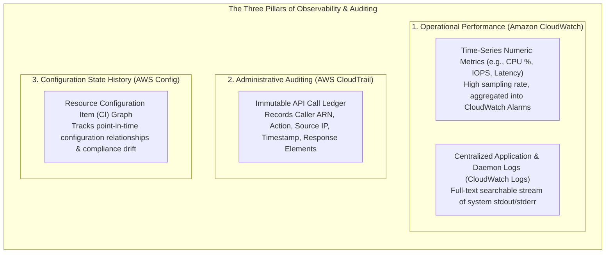
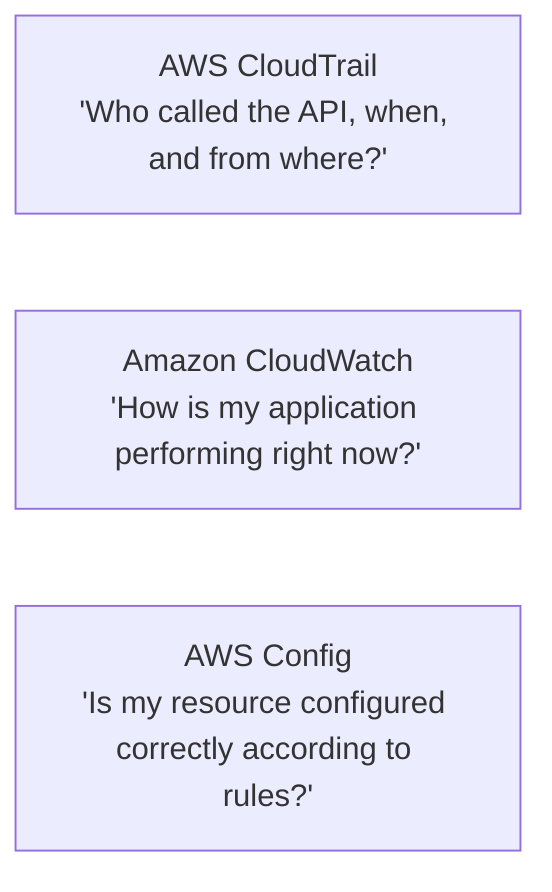
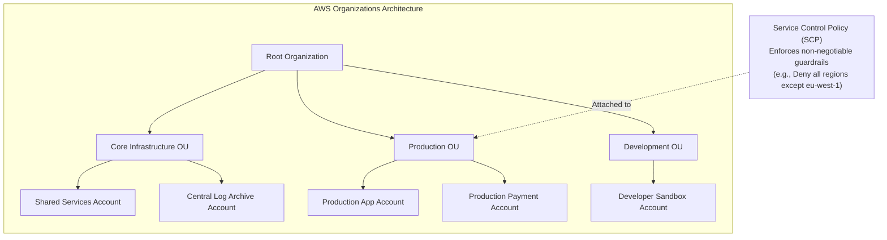

# AWS Management, Observability & Multi-Account Governance

> **Knowledge Area:** Cloud Technology and Services (Domain 3.5 & 3.7)  
> **Relevant Certifications:** [CLF-C02](../../01_Syllabus/CLF-C02_Master_Blueprint.md), SAA-C03, SOA-C02  
> **Tags:** `#aws/services` `#cloudwatch` `#cloudtrail` `#config` `#organizations` `#systems-manager` `#clf-c02`

---

## 💡 The Real-World Analogy (ELI5)

> **Commercial High-Rise Operations, Security & Governance:**
> - **Amazon CloudWatch (The Smart Building Telemetry & Smoke Detector):** Measures real-time operational physical metrics: room temperature (CPU utilization), elevator speed (network throughput), and water tank pressure (disk I/O). If smoke is detected, it sounds an automated siren (CloudWatch Alarm) that calls the fire department (Amazon SNS) and automatically triggers emergency ventilation fans (EC2 Auto Scaling).
> - **AWS CloudTrail (The 24/7 Security Entrance CCTV Camera):** The immutable forensic video camera recording the building's front revolving door. Every time someone enters or requests access, the camera permanently logs: *Who walked in (IAM Identity), What master key they presented (API Action), Which door handle they touched (AWS Resource ARN), At what exact second it occurred (Timestamp), and What vehicle license plate they arrived in (Source IP Address).*
> - **AWS Config (The Municipal Building & Code Inspector):** Constantly walks every floor with an official building safety code checklist. If an employee removes an emergency exit sign or props open a security door (disabling S3 bucket encryption or opening port 22 to the public internet), Config flags the room as non-compliant, records the exact second the violation occurred, and can automatically dispatch a repair crew to re-lock the door.
> - **AWS Systems Manager (The Building Maintenance Master iPad):** The universal digital remote control used by facility engineers to push firmware updates, run diagnostic scripts, and inspect 500 air conditioning units simultaneously without walking up physical stairs or needing individual physical brass keys (no SSH keys or open port 22 required).
> - **AWS Organizations & Service Control Policies (The Corporate Parent Conglomerate):** The corporate headquarters that owns 50 franchise buildings. The board of directors enforces non-negotiable corporate policies (SCPs) that forbid any branch manager from demolishing load-bearing walls, even if the branch manager has local executive authority.

---

## 1. First-Principles Computer Science & Observability Mechanics

In distributed systems engineering, complete operational governance requires the synthesis of **Three Pillars of Observability** alongside immutable auditing and state tracking:

### 1.1 The Crucial Distinction: Metrics vs. Audit Logs vs. Configuration State
* **Amazon CloudWatch answers:** *"How is the system performing right now, and what operational threshold was breached?"* (Telemetry data: CPU utilization hit $92\%$, database connections dropped, HTTP 500 error rate spiked).
* **AWS CloudTrail answers:** *"Who made the API call, from what IP address, at what exact millisecond, and on what resource?"* (Management and forensic data: `Alice` called `ec2:TerminateInstances` from IP `198.51.100.24` at `14:22:01 UTC`).
* **AWS Config answers:** *"What did the resource configuration look like last Tuesday at 3:00 PM compared to today, and does it comply with organizational security rules?"* (Configuration state data: Security Group `sg-01` had port 22 closed yesterday, but someone opened it to `0.0.0.0/0` today).

### 1.2 Mathematical Set Theory of Service Control Policies (SCPs)
In AWS multi-account governance, an account's effective permissions are determined by the **intersection ($\cap$)** of Service Control Policies and IAM Identity Policies:
$$\text{Effective Permissions} = \text{SCP Allowed Actions} \cap \text{IAM Allowed Actions}$$
* **The Root User Constraint (Crucial Exam Concept!):** Service Control Policies (SCPs) apply to **all identities** in a member account, **including the member account root user**. Even the root user cannot bypass an explicit `Deny` in an SCP!

---

## 2. Historical IT Pain Points: The Enterprise Management Nightmare

Before automated cloud observability and centralized multi-account governance, enterprise IT operations struggled with blind spots and audit chaos:

| Enterprise Management Challenge | Traditional On-Premises Reality | AWS Cloud Governance Paradigm |
|---|---|---|
| **Ephemeral Logs Lost on Server Crash** | System application logs were stored locally on `/var/log` on physical hard drives. When a server crashed or caught fire, the root-cause crash logs were permanently destroyed. | **Amazon CloudWatch Logs Agent**. Streams logs continuously to high-durability, centralized cloud storage in real time before instances terminate. |
| **Undetected Insider Threat & Tampering** | Rogue employees could modify administrative configurations or delete database tables, then delete local server bash history and syslogs to erase their tracks. | **AWS CloudTrail Immutable Logging**. API logs are cryptographically hashed and delivered to encrypted, tamper-evident S3 buckets with S3 Object Lock. |
| **Configuration Drift & Shadow IT** | Developers manually adjusted firewall rules or opened ports to test code, leaving permanent security vulnerabilities that remained undiscovered for years. | **AWS Config Continuous Evaluation**. Detects configuration drift within seconds and automatically triggers automated remediation via AWS Systems Manager. |
| **SSH Key Sprawl & Bastion Host Maintenance** | Managing SSH key pairs for 500 Linux servers required maintaining exposed "bastion hosts," opening port 22 to the public internet, and manually rotating keys. | **AWS Systems Manager Session Manager**. Provides browser-based one-click shell access to EC2 instances with zero open inbound ports and zero SSH keys. |

---

## 3. Deep-Dive: The Observability & Auditing Trio

### 3.1 Amazon CloudWatch
* **What it is:** A comprehensive monitoring and observability service engineered for DevOps engineers, developers, site reliability engineers (SREs), and IT managers.
* **Core Components:**
  1. **CloudWatch Metrics:** Time-series performance data collected from AWS services automatically (e.g., EC2 CPU utilization, EBS read/write IOPS, RDS database connections, S3 bucket size). Metrics are retained for **15 months**.
     - *Basic Monitoring (Free):* Metrics published at **5-minute intervals**.
     - *Detailed Monitoring (Paid):* Metrics published at **1-minute intervals**.
     - *Custom Metrics:* Applications publish custom operational metrics (e.g., page load time, active shopping carts, memory utilization) via the CloudWatch unified agent.
  2. **CloudWatch Alarms:** Watches a specific metric over a specified time window and automatically initiates actions based on threshold evaluation:
     - *EC2 Action:* Automatically stop, terminate, reboot, or recover an EC2 instance.
     - *Auto Scaling Action:* Trigger scale-out or scale-in events to handle traffic surges.
     - *Notification Action:* Publish an alert message to an **Amazon SNS** topic to send SMS or emails to on-call engineers.
  3. **CloudWatch Logs:** Centralizes, monitors, and stores operating system and application log files from EC2, Lambda, CloudTrail, Route 53, and VPC Flow Logs. Supports CloudWatch Logs Insights for real-time interactive SQL-like log querying.

### 3.2 AWS CloudTrail
* **What it is:** An operational governance service that enables auditing, security monitoring, and operational troubleshooting by recording every API call and user action across your AWS infrastructure.
* **What is Recorded in Every CloudTrail Event:**
  - *Identity of the caller:* IAM user, IAM role, or AWS service principal.
  - *Time of the event:* Timestamp in UTC.
  - *API Action:* The exact API called (e.g., `s3:CreateBucket`, `ec2:RunInstances`, `iam:DeleteUser`).
  - *Source IP address:* Public or private IP of the caller.
  - *Request and Response Elements:* Parameters passed and HTTP status response.
* **Trail Types:**
  - *Event History:* Free 90-day rolling log of management events in the console.
  - *Multi-Region Trail:* Captures all events across all AWS Regions and delivers them to an encrypted, centralized Amazon S3 bucket for permanent archival.

### 3.3 AWS Config
* **What it is:** A service that continually assesses, audits, and evaluates the configurations of your AWS resources to ensure compliance with internal security guidelines and external regulatory mandates.
* **Core Capabilities:**
  - *Configuration History:* Maintains a detailed point-in-time timeline of configuration changes made to every resource (e.g., showing every Security Group rule modification over the past year).
  - *AWS Config Rules:* Pre-built managed rules (e.g., `s3-bucket-ssl-requests-only`, `encrypted-volumes`, `root-account-mfa-enabled`) that continuously evaluate resource compliance.
  - *Automated Remediation:* Automatically executes an AWS Systems Manager Automation runbook when a resource drifts into non-compliance (e.g., automatically closing an open security group port).

---

## 4. Multi-Account Management: AWS Organizations & Control Tower

As enterprises expand, managing security, billing, and access across multiple individual AWS accounts requires centralized organizational architecture:

### 4.1 AWS Organizations
* **Consolidated Billing:** Aggregates billing and usage across all member accounts into a single master invoice paid by the management account. Combines usage across accounts to unlock tiered volume discounts (e.g., aggregated S3 storage tiers).
* **Organizational Units (OUs):** Hierarchical groupings of accounts within an organization that allow administrators to apply standardized policies across multiple accounts simultaneously.
* **Service Control Policies (SCPs):** JSON policy documents that set the **maximum allowable permissions** for member accounts or entire OUs. SCPs act as guardrails: if an action is denied by an SCP, no user or administrator in that account—**not even the root user**—can execute that action!

### 4.2 AWS Control Tower
* **Automated Enterprise Landing Zone:** A managed service that automates the setup of a secure, multi-account AWS environment based on AWS Well-Architected best practices.
* **Turnkey Setup:** Automatically configures an AWS Organization, sets up centralized logging (CloudTrail and Config log archive account), provisions cross-account security audit roles, and deploys pre-configured **Guardrails** (preventive SCPs and detective Config rules).

---

## 5. Operations Automation: Systems Manager & Trusted Advisor

### 5.1 AWS Systems Manager (SSM)
* **What it is:** The central operational hub for managing compute nodes (Amazon EC2 instances, on-premises physical servers, and virtual machines).
* **Key Capabilities:**
  - **Session Manager:** Provides fully secure, browser-based one-click terminal shell access to EC2 instances without requiring open inbound ports (port 22 closed), bastion hosts, or SSH keys.
  - **Patch Manager:** Automates the rollout of operating system and security patches across large fleets of Linux and Windows instances according to predefined maintenance windows.
  - **Run Command:** Remotely and securely executes scripts or shell commands across thousands of managed instances simultaneously without logging into each machine.

### 5.2 AWS Trusted Advisor
* **What it is:** An online automated optimization tool that continuously inspects your AWS infrastructure and compares your configurations against AWS Well-Architected best practices.
* **The 5 Recommendation Pillars:**
  1. **Cost Optimization:** Flags idle resources, unattached EBS volumes, underutilized RDS databases, and recommends Reserved Instances or Savings Plans.
  2. **Security:** Checks for public S3 buckets, unrestricted security group ports, missing root MFA, and exposed IAM access keys.
  3. **Fault Tolerance:** Checks for single-AZ RDS databases, missing S3 bucket lifecycle rules, and lack of EBS snapshots.
  4. **Performance:** Identifies compute and storage bottlenecks, high CPU utilization, and suboptimal CloudFront configurations.
  5. **Service Quotas:** Alerts when resource usage exceeds $80\%$ of account service limits (e.g., approaching VPC or Elastic IP quotas).
* **Support Plan Tiers:**
  - *Basic & Developer Support:* Provides access to **7 core security and quota checks**.
  - *Business & Enterprise Support:* Unlocks the **full library of 115+ automated checks** with programmatic AWS Support API access.

---

## 6. Multi-Dimensional Governance & Observability Decision Matrix

| Dimension | Amazon CloudWatch | AWS CloudTrail | AWS Config | AWS Systems Manager | AWS Trusted Advisor |
|---|---|---|---|---|---|
| **Primary Question Answered** | *"How is my workload performing right now?"* | *"Who made the API call, when, and from where?"* | *"Is my configuration compliant with policy?"* | *"How do I operate and patch my server fleet?"* | *"Am I following AWS architectural best practices?"* |
| **Primary Data Collected** | Numeric metrics (CPU, disk) and stdout/stderr logs | Structured JSON audit records of AWS API calls | Resource Configuration Items (CIs) and relationships | Server inventory, patch status, command executions | Account-level configuration and quota scans |
| **Target Audience** | DevOps, SREs, System Administrators | Security Officers, Compliance Auditors, SecOps | Governance Leads, Security Compliance Engineers | Cloud Operations, IT Systems Administrators | Solution Architects, IT Financial Directors |
| **Automated Actions** | Trigger Auto Scaling; send SNS alerts; reboot EC2 | Ingest into SIEM; trigger EventBridge rules | Auto-remediate non-compliant resources via SSM | Automated OS patch deployment; remote shell scripts | Manual review or automated alert exports |
| **Pricing Model** | Free basic metrics; pay per custom metric, log, & alarm | Free 90-day management events; pay for multi-region trails | Pay per configuration item recorded & rule evaluation | Session Manager is free; pay for advanced management | 7 core checks free; full checks require Business/Enterprise |

---

## 7. Exam Traps & 'Clue-to-Answer' Decryption

| Question Scenario Keyword | Target Service | Exam Trap & Distractor Explanation |
|---|---|---|
| *"Monitor CPU utilization, trigger Auto Scaling, and send email alerts on threshold breach"* | **Amazon CloudWatch** | Trap: Do not choose CloudTrail. CloudWatch monitors performance metrics; CloudTrail audits API actions. |
| *"Record an immutable audit trail of who made API calls and deleted an S3 bucket"* | **AWS CloudTrail** | Trap: Do not choose CloudWatch Logs. CloudTrail specifically tracks the *identity, time, and IP* of the person who initiated the API call. |
| *"Track resource configuration history and automatically detect when S3 encryption is turned off"* | **AWS Config** | Trap: Do not choose CloudTrail or GuardDuty. Tracking configuration compliance against rules is AWS Config. |
| *"Centrally restrict which AWS services can be accessed by member accounts in an organization"* | **Service Control Policies (SCPs)** | Trap: Do not choose IAM Identity Policies. Central multi-account guardrails are enforced via Organizations SCPs. |
| *"Provide secure terminal shell access to EC2 instances without opening port 22 or SSH keys"* | **AWS Systems Manager Session Manager** | Trap: Do not choose EC2 Instance Connect or Bastion Host. Session Manager eliminates open inbound ports and SSH keys entirely. |
| *"Automated tool providing real-time guidance across Cost, Security, Fault Tolerance, Performance, and Quotas"* | **AWS Trusted Advisor** | Trap: Do not choose AWS Well-Architected Tool. Trusted Advisor scans live API configurations automatically; Well-Architected Tool is a structured review questionnaire. |

---

## 8. Post-Topic Question Simulation & Retention Check

### Question 1
**Which AWS service records API activity, user logins, and administrative modifications across an AWS account, providing an immutable audit trail for security investigations and regulatory compliance?**
- A) Amazon CloudWatch
- B) AWS CloudTrail
- C) AWS Config
- D) AWS Trusted Advisor

<b>Click to View Answer & Detailed Distractor Analysis</b>

**Correct Answer:** **B) AWS CloudTrail**

* **Why it's correct:** AWS CloudTrail captures, logs, and stores a continuous record of all API calls, console actions, and programmatic SDK invocations across an AWS account, answering the essential forensic audit questions: *"Who made the API request, at what timestamp, from what source IP address, and on what resource?"*
* **Distractor Analysis:**
  - *A is incorrect:* Amazon CloudWatch monitors application performance metrics (e.g., CPU utilization, memory, disk I/O) and aggregates runtime logs, but does not generate identity-based AWS API audit trails.
  - *C is incorrect:* AWS Config tracks the configuration history and compliance state of AWS resources, but does not capture the real-time API request payload or user authentication identity.
  - *D is incorrect:* AWS Trusted Advisor provides automated recommendations against AWS best practices across five pillars, not immutable API call logging.

---

### Question 2
**A systems engineer needs to monitor Amazon EC2 CPU utilization, trigger automated horizontal scaling actions when average CPU exceeds 80% for 5 consecutive minutes, and dispatch email alerts to on-call engineers. Which service coordinates this?**
- A) AWS CloudTrail
- B) Amazon CloudWatch
- C) AWS Config
- D) AWS Systems Manager

<b>Click to View Answer & Detailed Distractor Analysis</b>

**Correct Answer:** **B) Amazon CloudWatch**

* **Why it's correct:** Amazon CloudWatch monitors operational telemetry metrics (e.g., CPU utilization) and allows administrators to configure CloudWatch Alarms that evaluate metric thresholds to trigger automated Amazon EC2 Auto Scaling actions and publish alert notifications to Amazon SNS topics.
* **Distractor Analysis:**
  - *A is incorrect:* AWS CloudTrail audits API activity and administrative changes, but does not evaluate numerical operational performance metrics or trigger Auto Scaling.
  - *C is incorrect:* AWS Config evaluates resource configuration compliance against predefined rules, not streaming performance metrics.
  - *D is incorrect:* AWS Systems Manager automates node configuration and software patch deployments, but does not monitor performance thresholds or trigger dynamic auto-scaling.

---

### Question 3
**Which AWS service tracks the complete configuration change history of AWS resources over time, evaluates active resource configurations against compliance rules, and supports automated remediation of non-compliant resources?**
- A) AWS CloudTrail
- B) AWS Config
- C) Amazon Inspector
- D) AWS Trusted Advisor

<b>Click to View Answer & Detailed Distractor Analysis</b>

**Correct Answer:** **B) AWS Config**

* **Why it's correct:** AWS Config continuously records configuration changes to AWS resources, provides a visual historical timeline of resource modifications, evaluates resource state against compliance rules (such as verifying EBS volume encryption), and initiates automated remediation via Systems Manager runbooks.
* **Distractor Analysis:**
  - *A is incorrect:* AWS CloudTrail records API calls (who initiated an action), but does not maintain a stateful historical model of resource configurations or evaluate compliance rules.
  - *C is incorrect:* Amazon Inspector is an automated vulnerability scanner that evaluates operating systems and container images for software package CVEs.
  - *D is incorrect:* AWS Trusted Advisor scans account resources against fixed architectural best practices, but does not provide custom configuration change tracking or automated remediation.

---

### Question 4
**An enterprise operates 150 AWS accounts under AWS Organizations. Which feature allows administrators to establish central guardrails that strictly restrict which AWS services and API actions can be executed within member accounts, applying even to the account root users?**
- A) AWS IAM Identity Center
- B) Service Control Policies (SCPs)
- C) AWS Trusted Advisor
- D) Amazon CloudWatch Synthetics

<b>Click to View Answer & Detailed Distractor Analysis</b>

**Correct Answer:** **B) Service Control Policies (SCPs)**

* **Why it's correct:** Service Control Policies (SCPs) in AWS Organizations define the maximum allowable permissions for member accounts or Organizational Units (OUs). They function as central boundaries: if an action is denied by an SCP, no identity in that account—including the member account root user—can perform that action.
* **Distractor Analysis:**
  - *A is incorrect:* AWS IAM Identity Center centralizes workforce single sign-on authentication, but does not enforce organization-wide service restriction boundaries across accounts.
  - *C is incorrect:* AWS Trusted Advisor provides optimization recommendations, not policy enforcement guardrails.
  - *D is incorrect:* Amazon CloudWatch Synthetics runs automated browser canary scripts to test customer-facing endpoints and APIs.

---

### Question 5
**Which AWS tool provides real-time automated guidance and recommendations across five pillars: Cost Optimization, Security, Fault Tolerance, Performance, and Service Quotas?**
- A) AWS Trusted Advisor
- B) AWS Health Dashboard
- C) AWS CloudTrail
- D) AWS Compute Optimizer

<b>Click to View Answer & Detailed Distractor Analysis</b>

**Correct Answer:** **A) AWS Trusted Advisor**

* **Why it's correct:** AWS Trusted Advisor is an automated online tool that inspects your AWS infrastructure and compares configurations against AWS best practices across five core categories: Cost Optimization, Security, Fault Tolerance, Performance, and Service Quotas.
* **Distractor Analysis:**
  - *B is incorrect:* The AWS Health Dashboard provides alerts and remediation guidance when AWS experiences service disruptions or scheduled maintenance impacting your specific account.
  - *C is incorrect:* AWS CloudTrail captures and records API activity, but does not generate automated architectural recommendations.
  - *D is incorrect:* AWS Compute Optimizer focuses specifically on right-sizing compute instances, EBS volumes, and Lambda memory using machine learning, but does not cover the broad 5-pillar scope of Trusted Advisor.

