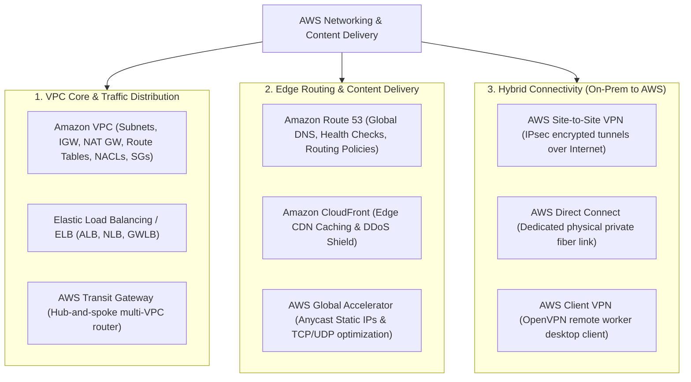
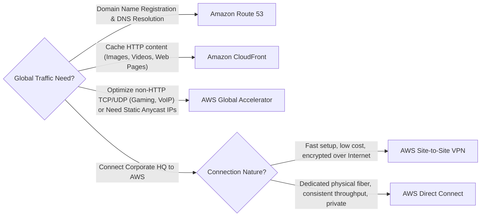

# AWS Networking & Content Delivery — Map of Content (MOC)

> **Domain:** 03_Services / Networking & Content Delivery  
> **Parent MOC:** [AWS_Brain_MOC](../../../../../README.md)  
> **Certifications:** [CLF-C02](../../01_Syllabus/CLF-C02_Master_Blueprint.md), SAA-C03, Advanced Networking

---

## 💡 The Real-World Analogy (ELI5)

> **A Secure Gated Suburb:**
> - **Amazon VPC:** A private, walled residential gated community that belongs entirely to you.
> - **Subnets:** Individual streets inside the community. *Public Subnet:* The commercial storefront street where delivery trucks can enter directly. *Private Subnet:* The secluded residential street behind a second gate.
> - **Internet Gateway (IGW):** The main freeway off-ramp connected to the public street.
> - **NAT Gateway:** A guarded one-way neighborhood delivery van. It lets private houses order pizza from the internet, but ensures the pizza delivery driver cannot discover or enter the private houses uninvited.
> - **Route 53:** The city telephone directory (DNS) that translates human company names (e.g., ) into street GPS coordinates (IP addresses).
> - **Amazon CloudFront:** Local convenience store chains in every neighborhood stocking the town's favorite snacks so nobody has to drive 50 miles to the main bakery.

---

## 1. Architectural Taxonomy of AWS Networking

AWS networking services provide the foundational connectivity, isolation, traffic routing, edge acceleration, and hybrid bridges for all cloud workloads:

---

## 2. Decision Tree: Global Edge Acceleration & Routing

---

## 3. Atomic Notes in this Domain

| Atomic Note | Description | Key Focus / Keywords |
| :--- | :--- | :--- |
| **[Amazon_VPC](../../09_Notes_and_Cheatsheets/services/Networking_ContentDelivery/Amazon_VPC_and_Networking.md)** | Virtual Private Cloud | Subnets, Internet Gateway, NAT Gateway, Security Groups vs. NACLs. |
| **[AWS_Elastic_Load_Balancing_ELB](../../09_Notes_and_Cheatsheets/services/Networking_ContentDelivery/Amazon_VPC_and_Networking.md)** | Elastic Load Balancing | ALB (Layer 7 HTTP), NLB (Layer 4 static IP/ultra-low latency), GWLB. |
| **[Amazon_Route53](../../09_Notes_and_Cheatsheets/services/Networking_ContentDelivery/Amazon_VPC_and_Networking.md)** | Highly Available DNS Service | Latency, Geolocation, Failover, Weighted, Multivalue, Alias Records. |
| **[Amazon_CloudFront](../../09_Notes_and_Cheatsheets/services/Networking_ContentDelivery/Amazon_CloudFront_and_Global_Accelerator.md)** | Content Delivery Network (CDN) | Edge Locations, Caching, Origin Access Control (OAC), DDoS protection. |
| **[AWS_Global_Accelerator](../../09_Notes_and_Cheatsheets/services/Networking_ContentDelivery/Amazon_CloudFront_and_Global_Accelerator.md)** | Global Traffic Accelerator | Anycast static IPs, AWS global fiber backbone, 60% latency reduction. |
| **[AWS_Transit_Gateway](../../09_Notes_and_Cheatsheets/distinctions/Hybrid_Networking_DirectConnect_vs_SiteToSiteVPN_vs_TransitGateway.md)** | Centralized Cloud Router | Hub-and-spoke topology, eliminates complex VPC peering meshes. |
| **[AWS_Site_to_Site_VPN](../../09_Notes_and_Cheatsheets/distinctions/Hybrid_Networking_DirectConnect_vs_SiteToSiteVPN_vs_TransitGateway.md)** | IPsec VPN Connection | Fast, secure encrypted tunnel over the public internet. |
| **[AWS_Direct_Connect](../../09_Notes_and_Cheatsheets/distinctions/Hybrid_Networking_DirectConnect_vs_SiteToSiteVPN_vs_TransitGateway.md)** | Dedicated Private Connection | Bypasses public internet entirely; consistent throughput, lower data egress costs. |
| **[AWS_Client_VPN](../../09_Notes_and_Cheatsheets/distinctions/Hybrid_Networking_DirectConnect_vs_SiteToSiteVPN_vs_TransitGateway.md)** | Managed Remote Access VPN | Secure OpenVPN client for remote employees accessing VPC resources. |
---

## 7. Post-Topic Question Simulation & Retention Check

Test your understanding of AWS Networking & Content Delivery with these 5 exam-style questions:

## 🎯 Exam Traps & 'Clue-to-Answer' Trigger Words

| Networking Component | Stateful or Stateless? | Scope & Level |
| :--- | :---: | :--- |
| **Security Group (SG)** | **Stateful** (Inbound return traffic allowed automatically) | Associated with **Network Interface (ENI) / Instance** level. |
| **Network ACL (NACL)** | **Stateless** (Must explicitly allow return traffic on ephemeral ports) | Associated with **Subnet** boundary level. |
| **VPC Peering** | Non-transitive | Direct connection between 2 VPCs; no transitive routing! |
| **Transit Gateway** | Transitive hub | Hub-and-spoke connection connecting thousands of VPCs and on-prem networks. |
| **AWS Direct Connect** | Dedicated private link | Physical dedicated fiber connection bypassing the public internet. |
| **AWS Site-to-Site VPN** | Encrypted tunnel | IPsec VPN tunnel over the public internet. |

---

### Question 1
**What is the key functional difference between a Security Group and a Network Access Control List (NACL) in Amazon VPC?**
- A) Security Groups operate at the subnet level; NACLs operate at the instance level.
- B) Security Groups are stateful and support only Allow rules; NACLs are stateless and support both Allow and Deny rules.
- C) Security Groups inspect Layer 7 HTTP requests; NACLs inspect Layer 2 MAC addresses.
- D) NACLs are attached directly to EC2 Elastic Network Interfaces (ENIs).

<b>Click to View Answer & Explanation</b>

**Correct Answer:** **B) Security Groups are stateful and support only Allow rules; NACLs are stateless and support both Allow and Deny rules.**  
- **Why it's correct:** Security Groups act as instance-level stateful firewalls (return traffic is automatically allowed). Network ACLs act as subnet-level stateless firewalls requiring explicit inbound and outbound rules, and can explicitly deny specific IP addresses.

### Question 2
**A backend database running on an Amazon EC2 instance in a private subnet needs to download security patches from the internet, but must not be publicly reachable from the outside world. Which component enables this?**
- A) Internet Gateway (IGW)
- B) NAT Gateway
- C) Virtual Private Gateway (VGW)
- D) VPC Peering connection

<b>Click to View Answer & Explanation</b>

**Correct Answer:** **B) NAT Gateway**  
- **Why it's correct:** A NAT Gateway deployed in a public subnet allows instances in private subnets to initiate outbound egress connections to the internet (e.g. for OS patches) while blocking unsolicited inbound connections from the internet.

### Question 3
**Which service provides a highly available, scalable Domain Name System (DNS) web service that translates human-friendly names (e.g., `www.example.com`) into numeric IP addresses and supports health-check routing?**
- A) Amazon Route 53
- B) Amazon CloudFront
- C) AWS Direct Connect
- D) AWS Global Accelerator

<b>Click to View Answer & Explanation</b>

**Correct Answer:** **A) Amazon Route 53**  
- **Why it's correct:** Amazon Route 53 is AWS's authoritative global DNS service, offering latency-based routing, weighted routing, geo-routing, and automated endpoint health checking.

### Question 4
**A global web application wants to reduce latency for international users accessing static images, video streams, and dynamic web content by caching assets at over 600 Edge Locations worldwide. Which service should they deploy?**
- A) Amazon Route 53
- B) Amazon CloudFront
- C) AWS Transit Gateway
- D) Amazon VPC Peering

<b>Click to View Answer & Explanation</b>

**Correct Answer:** **B) Amazon CloudFront**  
- **Why it's correct:** Amazon CloudFront is a Content Delivery Network (CDN) service that caches static and streaming media at worldwide Edge Locations (Points of Presence) to deliver low latency and high transfer speeds.

### Question 5
**An enterprise requires a dedicated, private physical network connection from its corporate data center to AWS that bypasses the public internet entirely to deliver consistent network performance and high throughput. Which service should they order?**
- A) AWS Site-to-Site VPN
- B) AWS Direct Connect
- C) Amazon VPC Peering
- D) AWS Client VPN

<b>Click to View Answer & Explanation</b>

**Correct Answer:** **B) AWS Direct Connect**  
- **Why it's correct:** AWS Direct Connect establishes a dedicated physical 1 Gbps, 10 Gbps, or 100 Gbps fiber-optic link between the customer's on-premises network and AWS, bypassing the public internet for consistent latency and reduced bandwidth costs.

