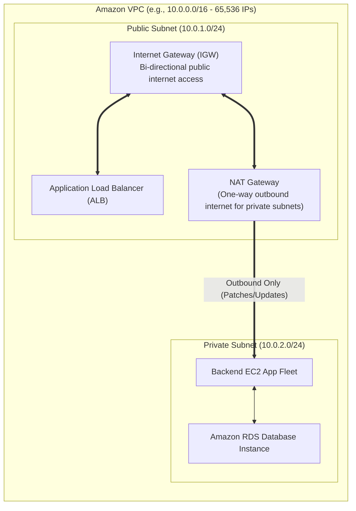
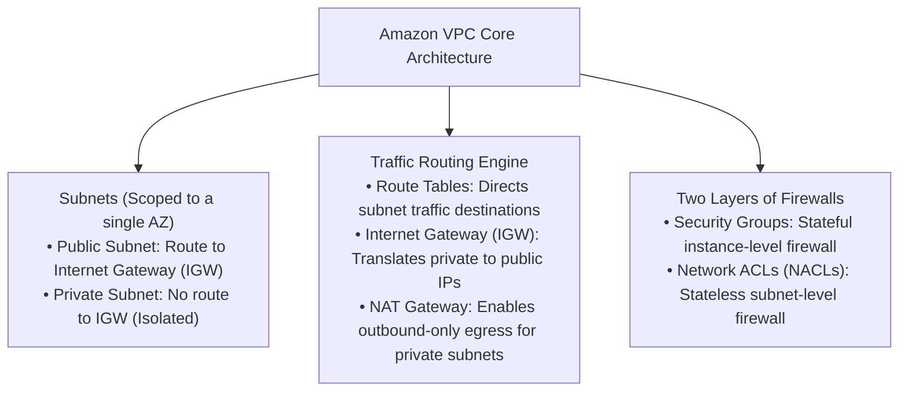
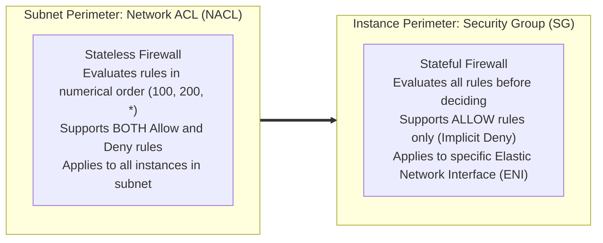
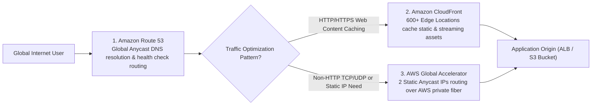
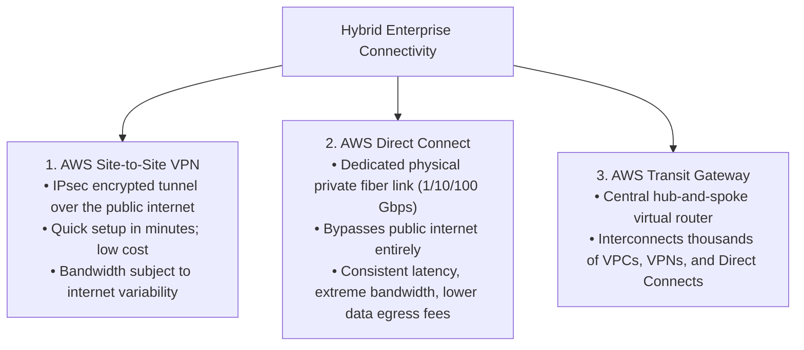
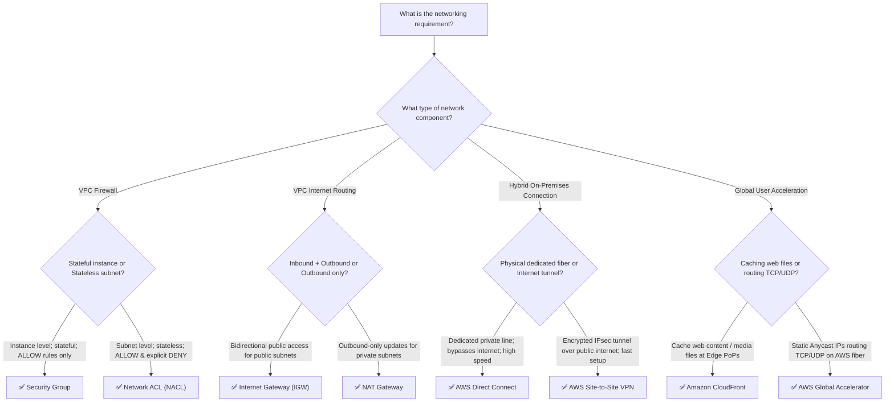

# AWS Networking, Content Delivery & Hybrid Connectivity

> **Knowledge Area:** Cloud Technology and Services (Domain 3.4)  
> **Relevant Certifications:** [CLF-C02](../../01_Syllabus/CLF-C02_Master_Blueprint.md), SAA-C03, ANS-C01  
> **Tags:** `#aws/services` `#networking` `#vpc` `#route53` `#cloudfront` `#direct-connect` `#clf-c02`

---

## 💡 The Real-World Analogy (ELI5)

> **A Secure Gated Suburb & City Infrastructure:**
> - **[Amazon VPC](../../AWS_SERVICES_GLOSSARY.md#amazon-vpc) (Virtual Private Cloud):** A private, walled, master-planned residential community that belongs entirely to your company.
> - **Subnets:** Individual streets inside the neighborhood.
>   - *Public Subnet:* The commercial storefront avenue right by the main gate where delivery vans and customers can drive up directly (web servers, load balancers).
>   - *Private Subnet:* The quiet, residential cul-de-sac tucked behind a secondary security gate where only residents can live (databases, backend application servers).
> - **Internet Gateway (IGW):** The main freeway off-ramp connected to the public street.
> - **NAT Gateway:** A guarded, one-way neighborhood delivery van. It lets residents in the private cul-de-sac order pizza or package deliveries from the internet, but ensures external pizza delivery drivers can never discover or drive into the private street uninvited.
> - **Security Group:** A personalized smart security guard standing outside each house's front door (stateful instance firewall).
> - **Network ACL (NACL):** A municipal checkpoint gate stationed at the entrance of each street (stateless subnet firewall).
> - **[Amazon Route 53](../../AWS_SERVICES_GLOSSARY.md#amazon-route-53):** The city telephone directory (DNS) that translates human-friendly business names (e.g., `amazon.com`) into physical GPS coordinates (IP addresses).
> - **[Amazon CloudFront](../../AWS_SERVICES_GLOSSARY.md#amazon-cloudfront):** Local convenience store chains placed in every neighborhood worldwide, caching favorite snacks and cold sodas so customers don't have to drive 50 miles to the central regional bakery.

---

## 1. First-Principles Computer Science & Networking Mechanics

Cloud networking is built upon the fundamental mathematics of the Internet Protocol (IPv4/IPv6), packet routing, and connection state tracking:

### 1.1 The Mathematics of CIDR Subnetting & The 5 Reserved AWS IPs
In IPv4 Classless Inter-Domain Routing (CIDR), network sizes are designated by bitmasks:
$$\text{Total IP Addresses} = 2^{32 - \text{Prefix Length}}$$
For a standard `/24` subnet: 2^(32 − 24) = 2⁸ = **256 total addresses**.
* **The 5 Reserved AWS IP Addresses (High-Yield Exam Trap!):** In *every* AWS VPC subnet, AWS reserves exactly **5 IP addresses** for internal infrastructure routing; they cannot be assigned to customer resources:
  1. `10.0.0.0`: **Network address** (first IP).
  2. `10.0.0.1`: **VPC router** (default gateway).
  3. `10.0.0.2`: **Amazon-provided DNS server** ([Amazon Route 53](../../AWS_SERVICES_GLOSSARY.md#amazon-route-53) Resolver / VPC Base + 2).
  4. `10.0.0.3`: **Reserved by AWS for future use**.
  5. `10.0.0.255`: **Network broadcast address** (AWS VPC does not support broadcast, but address is reserved).
* **Usable Host Capacity Formula:**
  $$\text{Usable Host IPs} = 2^{32 - \text{Prefix}} - 5 \implies 256 - 5 = \mathbf{251\text{ usable host IPs}}$$

### 1.2 Stateful vs. Stateless Filtering Mechanics
* **Stateful Filtering (Security Groups):** The firewall software maintains an active **connection tracking table** in kernel memory. When an incoming packet is permitted on an allowed port (e.g., inbound TCP 443), the firewall automatically creates a temporary reverse entry in the state table. Return outbound traffic is **automatically allowed** regardless of outbound rules.
* **Stateless Filtering (Network ACLs):** The firewall evaluates each packet in complete isolation with zero memory of previous packets. Outbound return packets must explicitly match an outbound rule (specifically allowing ephemeral client ports `1024–65535`), or the return response is dropped.

---

## 2. Historical IT Pain Points: The Legacy Networking Burden

Before software-defined cloud networking (SDN), establishing enterprise networks required physical cabling and hardware procurement:

| Enterprise Networking Challenge | Traditional On-Premises Reality | AWS Cloud Networking Paradigm |
|---|---|---|
| **Physical Cabling & Switch Configuration** | Network engineers ran physical copper and fiber cables between racks, configuring physical Cisco switches and VLAN tags. Adding a network took weeks. | **[Amazon VPC](../../AWS_SERVICES_GLOSSARY.md#amazon-vpc) Software-Defined Networking**. Create private isolated virtual networks, subnets, and route tables in seconds via console or API. |
| **Public IP Address Exhaustion** | Enterprises purchased expensive public IPv4 blocks from regional registries (ARIN/RIPE), managing complex public IP NAT pools. | **Elastic IPs & Managed NAT Gateways**. AWS provides on-demand public IPs and fully managed, auto-scaling NAT Gateways handling up to 100 Gbps. |
| **Point-to-Point VPN Internet Jitter** | Remote office connections traversed congested public internet hops, suffering packet loss, latency spikes, and ISP carrier cuts. | **[AWS Direct Connect](../../AWS_SERVICES_GLOSSARY.md#aws-direct-connect) & Global Accelerator**. Traffic bypasses the public internet, routing directly across AWS's private, congestion-free global fiber backbone. |
| **Full-Mesh Peering Complexity** | Interconnecting 20 corporate VPCs or datacenters required N(N-1)/2 = 190 individual point-to-point peering connections. | **[AWS Transit Gateway](../../AWS_SERVICES_GLOSSARY.md#aws-transit-gateway)**. A single central cloud hub-and-spoke router that scales to connect thousands of VPCs and on-premises offices. |

---

## 3. Deep-Dive: Amazon VPC (Virtual Private Cloud) Architecture

### 3.1 Public vs. Private Subnets
* **Public Subnet:** A subnet whose associated Route Table contains a direct route to an **Internet Gateway (IGW)** (`0.0.0.0/0 -> igw-xxxx`). Instances in public subnets can be assigned public IPv4 addresses and communicate bidirectionally with the internet (e.g., public Application Load Balancers, bastion hosts).
* **Private Subnet:** A subnet whose Route Table has **no direct route to an Internet Gateway**. Instances have strictly private IP addresses (`10.x.x.x`, `172.16.x.x`, `192.168.x.x`) and are completely shielded from unsolicited inbound internet traffic (e.g., database clusters, backend payment processing APIs).

### 3.2 The Internet Gateway (IGW) vs. NAT Gateway
* **Internet Gateway (IGW):** A horizontally scaled, highly available, redundant VPC component that enables communication between resources in your VPC and the internet. It performs automated 1:1 Network Address Translation between private and public IP addresses.
* **NAT Gateway (Network Address Translation):** A managed service deployed in a **public subnet** that allows instances in private subnets to initiate outbound connections to the internet (e.g., to download OS security patches, software updates) while preventing external internet clients from initiating inbound connections to those private servers.

### 3.3 Security Groups vs. Network ACLs (Crucial Exam Comparison!)

| Security Dimension | Security Group (SG) | Network ACL (NACL) |
|---|---|---|
| **Operates At** | **Instance / ENI Level** | **Subnet Boundary Level** |
| **State Nature** | **Stateful** (Return traffic automatically allowed) | **Stateless** (Return traffic must be explicitly allowed) |
| **Rule Types Supported** | **Allow rules ONLY** (Implicit Deny all else) | **Allow AND Deny rules** (Can block specific IP addresses) |
| **Rule Processing Order** | All rules evaluated simultaneously | Evaluated in strict **numerical order** (lowest number first) |
| **Default Configuration** | Blocks all inbound; allows all outbound | Default NACL allows all inbound & all outbound |

---

## 4. Edge Routing, DNS & Global Acceleration

### 4.1 Amazon Route 53 (Global DNS)
* **What it is:** A highly available, scalable, authoritative cloud Domain Name System (DNS) web service operating on port 53.
* **Core Capabilities:**
  - *Domain Registration:* Purchase and manage domain names (`.com`, `.net`, `.org`).
  - *DNS Health Checking & Failover:* Continuously monitors server endpoint health and automatically routes traffic away from unhealthy servers.
* **The 7 Route 53 Routing Policies:**
  1. **Simple Routing:** Standard single-record lookup (e.g., maps domain to one IP).
  2. **Weighted Routing:** Distributes traffic across resources based on assigned percentages (ideal for A/B testing).
  3. **Latency-Based Routing:** Routes user requests to the AWS Region that provides the lowest network latency.
  4. **Failover Routing:** Active-passive disaster recovery failover based on Route 53 health checks.
  5. **Geolocation Routing:** Routes traffic based on the geographic location of the user (e.g., users in France routed to French language servers).
  6. **Geoproximity Routing:** Routes traffic based on geographic location of resources, adjusted by "bias" values.
  7. **Multivalue Answer Routing:** Returns multiple healthy IP addresses in response to DNS queries, providing simple DNS-level load balancing.

### 4.2 Amazon CloudFront (Content Delivery Network - CDN)
* **What it is:** A high-speed global Content Delivery Network that securely delivers static media, dynamic web pages, streaming video, and APIs to users worldwide.
* **Mechanism:** Caches copies of data at **600+ Points of Presence (Edge Locations)** globally. If a user in London requests an image stored in an S3 bucket in Virginia, CloudFront serves the image locally from London in 5 ms after the first fetch.
* **Origin Access Control (OAC):** Secures S3 buckets so that files can *only* be accessed through CloudFront, preventing users from bypassing the CDN.

### 4.3 AWS Global Accelerator
* **What it is:** A networking service that improves the availability and performance of applications for global users by routing traffic over **AWS's congestion-free private global network**.
* **Key Differentiators from CloudFront:**
  - *Static Anycast IP Addresses:* Provides **2 fixed, static Anycast IP addresses** that never change, simplifying firewall whitelisting.
  - *Protocol Agnostic:* Optimizes both HTTP/HTTPS and **non-HTTP protocols (TCP/UDP)**, making it ideal for real-time multiplayer gaming, VoIP telephony, IoT telemetry, and video conferencing. (CloudFront specializes strictly in HTTP/HTTPS caching).

---

## 5. Hybrid Cloud Connectivity: Connecting On-Premises to AWS

When enterprise workloads require private connectivity between corporate on-premises datacenters and AWS VPCs, AWS provides three distinct hybrid solutions:

| Hybrid Solution | Connection Medium | Encryption | Provisioning Time | Bandwidth & Performance | Primary Use Case |
|---|---|---|---|---|---|
| **[AWS Site-to-Site VPN](../../AWS_SERVICES_GLOSSARY.md#aws-site-to-site-vpn)** | **Public Internet** | **IPsec Encrypted (AES-256)** | Minutes | Variable (Subject to public ISP internet congestion) | Quick setup, low-cost disaster recovery backup link |
| **[AWS Direct Connect](../../AWS_SERVICES_GLOSSARY.md#aws-direct-connect) (DX)** | **Dedicated Private Fiber** | Unencrypted natively (Can layer MACsec or VPN on top) | 1 to 3 Months (Carrier installation) | **Consistent, predictable throughput** (1, 10, or 100 Gbps) | High-throughput data replication, mission-critical latency |
| **[AWS Transit Gateway](../../AWS_SERVICES_GLOSSARY.md#aws-transit-gateway)** | Central Regional Hub | Encrypted across internal backbone | Minutes | Scalable (Up to 50 Gbps per VPC attachment) | Hub-and-spoke management of hundreds of VPCs and on-prem links |

---

## 6. Multi-Dimensional Networking Decision Matrix

| Dimension | Security Groups | Network ACLs (NACLs) | [AWS WAF](../../AWS_SERVICES_GLOSSARY.md#aws-waf) | [AWS Shield](../../AWS_SERVICES_GLOSSARY.md#aws-shield) Standard |
|---|---|---|---|---|
| **OSI Layer** | **Layer 4** (Transport) | **Layer 4** (Transport/Network) | **Layer 7** (Application) | **Layer 3 & 4** (Network/Transport) |
| **Scope** | Instance / ENI boundary | Subnet boundary | CloudFront, ALB, API Gateway | Global Edge & Regional Infrastructure |
| **Statefulness** | **Stateful** (Automatic return) | **Stateless** (Manual return) | Stateful HTTP session tracking | Stateful packet scrubbing |
| **Deny Rules?** | **NO** (Allow rules only) | **YES** (Explicit Deny IP) | **YES** (Block, CAPTCHA, Rate-limit) | Automated drop |
| **Cost** | 100% FREE | 100% FREE | Pay per Web ACL, rule, & request | 100% FREE (Always active) |
| **Primary Protection** | Unauthorized port access to server | Subnet-wide IP address blocking | SQL Injection, XSS, scrapers, bots | Volumetric SYN floods & UDP reflection |

---

## 7. Exam Traps & 'Clue-to-Answer' Decryption

| Question Scenario Keyword | Target Service / Component | Exam Trap & Distractor Explanation |
|---|---|---|
| *"Stateful instance-level firewall supporting Allow rules only"* | **Security Group (SG)** | Trap: Do not choose Network ACL. SGs are stateful and instance-level; NACLs are stateless and subnet-level. |
| *"Stateless subnet firewall supporting both Allow and Deny rules"* | **Network ACL (NACL)** | Trap: Do not choose Security Group. SGs cannot explicitly deny an IP address. |
| *"Allow private subnet EC2 instances to download OS patches outbound without allowing inbound internet"* | **NAT Gateway** | Trap: Do not choose Internet Gateway. An IGW allows bidirectional traffic; a NAT Gateway allows outbound-only from private subnets. |
| *"Dedicated physical private fiber connection bypassing the public internet"* | **[AWS Direct Connect](../../AWS_SERVICES_GLOSSARY.md#aws-direct-connect)** | Trap: Do not choose [AWS Site-to-Site VPN](../../AWS_SERVICES_GLOSSARY.md#aws-site-to-site-vpn). VPN runs over the public internet; Direct Connect is dedicated private physical fiber. |
| *"Cache static and streaming media at worldwide Edge Locations for low latency"* | **[Amazon CloudFront](../../AWS_SERVICES_GLOSSARY.md#amazon-cloudfront)** | Trap: Do not choose [Amazon Route 53](../../AWS_SERVICES_GLOSSARY.md#amazon-route-53) or Global Accelerator. Only CloudFront caches content at the edge. |
| *"Provide 2 static Anycast IP addresses and optimize non-HTTP TCP/UDP protocols over AWS backbone"* | **[AWS Global Accelerator](../../AWS_SERVICES_GLOSSARY.md#aws-global-accelerator)** | Trap: Do not choose [Amazon CloudFront](../../AWS_SERVICES_GLOSSARY.md#amazon-cloudfront). Global Accelerator provides static Anycast IPs and supports non-HTTP (UDP/TCP) traffic. |
| *"Central hub-and-spoke virtual router connecting hundreds of VPCs and on-premise networks"* | **[AWS Transit Gateway](../../AWS_SERVICES_GLOSSARY.md#aws-transit-gateway)** | Trap: Do not choose VPC Peering. VPC Peering is point-to-point and non-transitive; Transit Gateway is the central transitive hub. |

---

## 8. Post-Topic Question Simulation & Retention Check

### Question 1
**What is the foundational architectural difference between a Security Group and a Network Access Control List (NACL) in an [Amazon VPC](../../AWS_SERVICES_GLOSSARY.md#amazon-vpc)?**
- A) Security Groups operate at the VPC subnet level; NACLs operate at the EC2 instance level
- B) Security Groups are stateful firewalls supporting Allow rules only; NACLs are stateless firewalls supporting both Allow and Deny rules
- C) Security Groups inspect Layer 7 HTTP payloads; NACLs inspect Layer 2 Ethernet frames
- D) Security Groups are attached to Internet Gateways; NACLs are attached to NAT Gateways

<b>Click to View Answer & Detailed Distractor Analysis</b>

**Correct Answer:** **B) Security Groups are stateful firewalls supporting Allow rules only; NACLs are stateless firewalls supporting both Allow and Deny rules**

* **Why it's correct:** Security Groups act as instance-level stateful virtual firewalls (inbound return traffic is automatically permitted regardless of outbound rules). Network ACLs act as subnet-level stateless boundary firewalls where packets are evaluated independently in numerical order and support explicit Allow and Deny rules (allowing administrators to block specific malicious IP addresses).
* **Distractor Analysis:**
  - *A is incorrect:* The boundaries are reversed: Security Groups operate at the instance (ENI) level, whereas NACLs operate at the subnet boundary.
  - *C is incorrect:* Security Groups and NACLs both operate at Layer 4 (Transport / IP / Ports); Layer 7 inspection is performed by [AWS WAF](../../AWS_SERVICES_GLOSSARY.md#aws-waf).
  - *D is incorrect:* Security Groups attach to Elastic Network Interfaces (ENIs); NACLs attach to subnets. Neither attaches to gateways.

---

### Question 2
**A production relational database running on an [Amazon EC2](../../AWS_SERVICES_GLOSSARY.md#amazon-ec2) instance in a private subnet needs to download operating system security updates from the internet, but must strictly reject any unsolicited inbound connections from the outside world. Which component enables this architecture?**
- A) Internet Gateway (IGW)
- B) NAT Gateway
- C) Virtual Private Gateway (VGW)
- D) [Amazon VPC](../../AWS_SERVICES_GLOSSARY.md#amazon-vpc) Peering Connection

<b>Click to View Answer & Detailed Distractor Analysis</b>

**Correct Answer:** **B) NAT Gateway**

* **Why it's correct:** A NAT Gateway deployed in a public subnet enables compute resources residing inside private subnets to initiate outbound IPv4 connections to the public internet (e.g., for operating system patching or repository downloads) while completely blocking any inbound connection initiated from the internet.
* **Distractor Analysis:**
  - *A is incorrect:* An Internet Gateway provides bidirectional communication for instances with public IP addresses in public subnets, exposing private databases to inbound public internet traffic.
  - *C is incorrect:* A Virtual Private Gateway (VGW) is the VPN concentrator on the AWS side of an [AWS Site-to-Site VPN](../../AWS_SERVICES_GLOSSARY.md#aws-site-to-site-vpn) connection, connecting to on-premises networks rather than the public internet.
  - *D is incorrect:* VPC Peering connects two private VPCs together over AWS internal networking; it does not provide internet egress.

---

### Question 3
**Which AWS service provides an authoritative, highly available Domain Name System (DNS) web service that translates human-readable domain names into IP addresses and supports automated health check failover?**
- A) [Amazon Route 53](../../AWS_SERVICES_GLOSSARY.md#amazon-route-53)
- B) [Amazon CloudFront](../../AWS_SERVICES_GLOSSARY.md#amazon-cloudfront)
- C) [AWS Direct Connect](../../AWS_SERVICES_GLOSSARY.md#aws-direct-connect)
- D) [AWS Global Accelerator](../../AWS_SERVICES_GLOSSARY.md#aws-global-accelerator)

<b>Click to View Answer & Detailed Distractor Analysis</b>

**Correct Answer:** **A) [Amazon Route 53](../../AWS_SERVICES_GLOSSARY.md#amazon-route-53)**

* **Why it's correct:** [Amazon Route 53](../../AWS_SERVICES_GLOSSARY.md#amazon-route-53) is AWS's cloud Domain Name System (DNS) service operating on port 53. It handles domain registration, DNS queries, health checks, and advanced routing policies (latency-based, failover, geolocation, and weighted routing).
* **Distractor Analysis:**
  - *B is incorrect:* [Amazon CloudFront](../../AWS_SERVICES_GLOSSARY.md#amazon-cloudfront) is a Content Delivery Network (CDN) that caches web content at edge locations, relying on Route 53 for initial DNS resolution.
  - *C is incorrect:* [AWS Direct Connect](../../AWS_SERVICES_GLOSSARY.md#aws-direct-connect) is a physical dedicated fiber-optic telecommunications link between on-premises datacenters and AWS.
  - *D is incorrect:* [AWS Global Accelerator](../../AWS_SERVICES_GLOSSARY.md#aws-global-accelerator) optimizes TCP/UDP network pathways using Anycast static IPs, but is not a domain name registration or DNS server.

---

### Question 4
**A media broadcasting company wants to accelerate the delivery of static images, high-definition video files, and web assets to millions of viewers worldwide by caching content closer to end users at over 600 Edge Locations. Which service should they deploy?**
- A) [Amazon Route 53](../../AWS_SERVICES_GLOSSARY.md#amazon-route-53)
- B) [Amazon CloudFront](../../AWS_SERVICES_GLOSSARY.md#amazon-cloudfront)
- C) [AWS Transit Gateway](../../AWS_SERVICES_GLOSSARY.md#aws-transit-gateway)
- D) [Amazon VPC](../../AWS_SERVICES_GLOSSARY.md#amazon-vpc) Peering

<b>Click to View Answer & Detailed Distractor Analysis</b>

**Correct Answer:** **B) [Amazon CloudFront](../../AWS_SERVICES_GLOSSARY.md#amazon-cloudfront)**

* **Why it's correct:** [Amazon CloudFront](../../AWS_SERVICES_GLOSSARY.md#amazon-cloudfront) is a globally distributed Content Delivery Network (CDN) service that caches static web pages, media files, and live streaming video at Points of Presence (Edge Locations) worldwide, dramatically reducing delivery latency for global audiences.
* **Distractor Analysis:**
  - *A is incorrect:* [Amazon Route 53](../../AWS_SERVICES_GLOSSARY.md#amazon-route-53) resolves DNS domain names to IP addresses, but does not cache or deliver web asset files.
  - *C is incorrect:* [AWS Transit Gateway](../../AWS_SERVICES_GLOSSARY.md#aws-transit-gateway) is a centralized virtual router that connects multiple VPCs and on-premises enterprise networks in a hub-and-spoke topology.
  - *D is incorrect:* [Amazon VPC](../../AWS_SERVICES_GLOSSARY.md#amazon-vpc) Peering is a private network connection between two VPCs, providing no public edge caching capabilities.

---

### Question 5
**An enterprise requires a dedicated, private physical network connection from its corporate on-premises data center to AWS that bypasses the public internet completely to ensure consistent throughput, reduced data egress charges, and deterministic network latency. Which service should they implement?**
- A) [AWS Site-to-Site VPN](../../AWS_SERVICES_GLOSSARY.md#aws-site-to-site-vpn)
- B) [AWS Direct Connect](../../AWS_SERVICES_GLOSSARY.md#aws-direct-connect)
- C) [Amazon VPC](../../AWS_SERVICES_GLOSSARY.md#amazon-vpc) Peering
- D) AWS Client VPN

<b>Click to View Answer & Detailed Distractor Analysis</b>

**Correct Answer:** **B) [AWS Direct Connect](../../AWS_SERVICES_GLOSSARY.md#aws-direct-connect)**

* **Why it's correct:** [AWS Direct Connect](../../AWS_SERVICES_GLOSSARY.md#aws-direct-connect) establishes a dedicated physical 1 Gbps, 10 Gbps, or 100 Gbps fiber-optic connection between an enterprise's on-premises network and an [AWS Direct Connect](../../AWS_SERVICES_GLOSSARY.md#aws-direct-connect) location. By bypassing the public internet entirely, it delivers consistent, predictable network performance and significantly reduced data transfer (egress) rates.
* **Distractor Analysis:**
  - *A is incorrect:* [AWS Site-to-Site VPN](../../AWS_SERVICES_GLOSSARY.md#aws-site-to-site-vpn) creates an encrypted IPsec tunnel over the public internet, which remains vulnerable to public internet congestion and variable latency.
  - *C is incorrect:* [Amazon VPC](../../AWS_SERVICES_GLOSSARY.md#amazon-vpc) Peering connects two AWS VPCs together internally; it cannot connect physical on-premises datacenters to AWS.
  - *D is incorrect:* AWS Client VPN is a client-based OpenVPN solution for individual remote employees working from laptops, not an enterprise datacenter dedicated trunk link.

---

## 🧠 Master MCQ Solving Blueprint: Pattern Decryption & Elimination Tricks

> *This blueprint distills recurring patterns, keyword triggers, and trap options extracted from over 500 questions on VPC, Networking, Route 53, CloudFront, Direct Connect, and Hybrid Connectivity across the official CLF-C02 question bank.*

### 1. The "Clue-to-Service" Linguistic Decryption Matrix
When reading a question scenario, search for these exact phrasing triggers:

| If You See This Trigger Phrase in the Question Stem... | The Correct Network Component / Service Is... | Trap Distractor to Immediately Discard |
|---|---|---|
| *"Stateful virtual firewall operating at the instance/ENI level; supports ALLOW rules only; return traffic automatically allowed"* | **Security Group** | *Network ACL* (NACL is stateless and subnet-level) |
| *"Stateless virtual firewall operating at the subnet level; supports both ALLOW and DENY rules; evaluated numerically"* | **Network Access Control List (NACL)** | *Security Group* (Security Groups cannot have explicit Deny rules!) |
| *"Allow instances in a private subnet to download patches/updates from the internet while blocking inbound internet traffic"* | **NAT Gateway** | *Internet Gateway* (IGW allows bidirectional access, exposing private instances) |
| *"Provide bidirectional internet connectivity for public subnets via route table target 0.0.0.0/0"* | **Internet Gateway (IGW)** | *NAT Gateway* or *Virtual Private Gateway* |
| *"Authoritative global DNS service; port 53; translates domain names to IPs; health checks; routing policies"* | **[Amazon Route 53](../../AWS_SERVICES_GLOSSARY.md#amazon-route-53)** | *[Amazon CloudFront](../../AWS_SERVICES_GLOSSARY.md#amazon-cloudfront)* (CloudFront is a CDN, not an authoritative DNS server) |
| *"Global Content Delivery Network (CDN) caching static/dynamic web content at 600+ Edge Locations"* | **[Amazon CloudFront](../../AWS_SERVICES_GLOSSARY.md#amazon-cloudfront)** | *[Amazon Route 53](../../AWS_SERVICES_GLOSSARY.md#amazon-route-53)* or *[AWS Global Accelerator](../../AWS_SERVICES_GLOSSARY.md#aws-global-accelerator)* |
| *"Dedicated, private physical fiber-optic connection bypassing the public internet; predictable latency"* | **[AWS Direct Connect](../../AWS_SERVICES_GLOSSARY.md#aws-direct-connect)** | *[AWS Site-to-Site VPN](../../AWS_SERVICES_GLOSSARY.md#aws-site-to-site-vpn)* (VPN traverses the public internet!) |
| *"Encrypted IPsec tunnel connecting an on-premises router to AWS over the public internet"* | **[AWS Site-to-Site VPN](../../AWS_SERVICES_GLOSSARY.md#aws-site-to-site-vpn)** | *[AWS Direct Connect](../../AWS_SERVICES_GLOSSARY.md#aws-direct-connect)* (Direct Connect is unencrypted physical fiber by default) |
| *"Centralized hub-and-spoke router connecting hundreds of VPCs and on-premises networks together"* | **[AWS Transit Gateway](../../AWS_SERVICES_GLOSSARY.md#aws-transit-gateway)** | *VPC Peering* (VPC Peering creates a complex mesh; does not support transitive routing) |
| *"Provide two static Anycast IP addresses to route non-HTTP (TCP/UDP) traffic over the AWS global backbone"* | **[AWS Global Accelerator](../../AWS_SERVICES_GLOSSARY.md#aws-global-accelerator)** | *[Amazon CloudFront](../../AWS_SERVICES_GLOSSARY.md#amazon-cloudfront)* (CloudFront caches HTTP/HTTPS at edge; Global Accelerator routes TCP/UDP) |
| *"Privately connect a VPC to [Amazon S3](../../AWS_SERVICES_GLOSSARY.md#amazon-s3) or DynamoDB without an Internet Gateway or NAT Gateway"* | **VPC Gateway Endpoint** | *Internet Gateway* or *NAT Gateway* |

### 2. The 3-Step Rapid Elimination Heuristic
When evaluating an AWS Networking question:
1. **Step 1: Security Group vs. Network ACL (NACL):**
   - Did the question mention **"Block a single malicious IP address"**?
     - → **Network ACL (NACL)**! (Security Groups have NO Deny rules; only NACLs support explicit DENY!).
   - Did the question mention **"Return traffic is automatically allowed"**?
     - → **Security Group**! (Stateful connection tracking).
2. **Step 2: Internet Inbound vs. Outbound:**
   - Need **two-way internet traffic** for web servers? → **Internet Gateway (IGW)**.
   - Need **one-way outbound internet traffic** for private EC2 instances to download Linux security updates? → **NAT Gateway** (placed in the public subnet).
3. **Step 3: Direct Connect vs. VPN:**
   - Bypasses public internet + dedicated physical line + high consistent bandwidth + takes weeks/months → **[AWS Direct Connect](../../AWS_SERVICES_GLOSSARY.md#aws-direct-connect)**.
   - Encrypted over public internet + quick setup in hours + low cost → **[AWS Site-to-Site VPN](../../AWS_SERVICES_GLOSSARY.md#aws-site-to-site-vpn)**.

### 3. High-Frequency Decoy Autopsy: Why AWS Tries to Trick You
* **Decoy #1: "Security Group" vs. "Network ACL (NACL)"**
  - *The Trap:* A web administrator needs to explicitly block incoming traffic from a specific IP address `203.0.113.50`.
  - *The Autopsy:* Security Groups **only support ALLOW rules**. You cannot write a deny rule in a Security Group. The ONLY native VPC firewall that can explicitly **DENY an IP address** is a **Network ACL (NACL)**.
* **Decoy #2: "[Amazon CloudFront](../../AWS_SERVICES_GLOSSARY.md#amazon-cloudfront)" vs. "[AWS Global Accelerator](../../AWS_SERVICES_GLOSSARY.md#aws-global-accelerator)"**
  - *The Trap:* Improving global user performance for a gaming or VoIP application using edge networks.
  - *The Autopsy:* **CloudFront** is a CDN that **caches** HTTP/HTTPS files (HTML, images, videos) at edge locations. **Global Accelerator** does **not cache** data; it provides two static Anycast IP addresses to route non-HTTP (TCP/UDP, VoIP, gaming) traffic directly onto AWS's private high-speed global fiber backbone.
* **Decoy #3: "VPC Peering" vs. "[AWS Transit Gateway](../../AWS_SERVICES_GLOSSARY.md#aws-transit-gateway)"**
  - *The Trap:* Connecting 50 VPCs together.
  - *The Autopsy:* VPC Peering is non-transitive (VPC A → B and B → C does NOT mean A can talk to C). Connecting 50 VPCs with peering requires 50 × 49 / 2 = 1{,}225 peerings! For hub-and-spoke interconnectivity across many VPCs, the answer is **[AWS Transit Gateway](../../AWS_SERVICES_GLOSSARY.md#aws-transit-gateway)**.

### 4. 10-Second Visual Decision Flowchart

