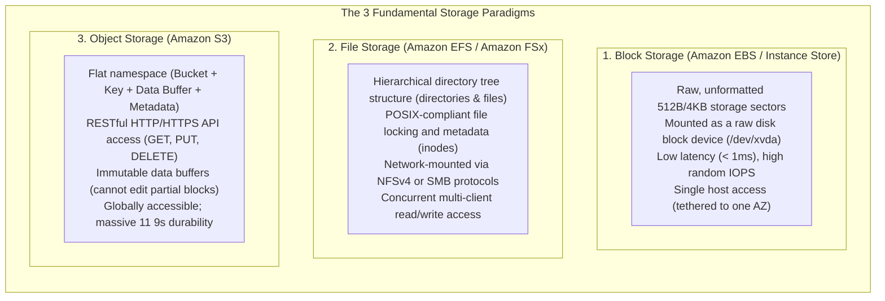
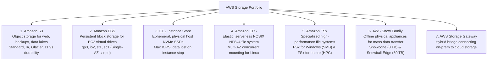
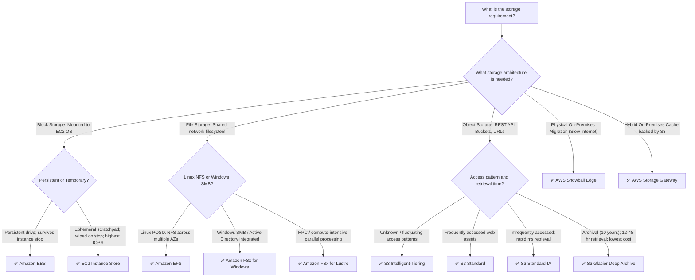

# AWS Storage Services: S3, EBS, EFS & Hybrid Data Migration

> **Knowledge Area:** Cloud Technology and Services (Domain 3.3)  
> **Relevant Certifications:** [CLF-C02](../../01_Syllabus/CLF-C02_Master_Blueprint.md), SAA-C03, SOA-C02  
> **Tags:** `#aws/services` `#storage` `#s3` `#ebs` `#efs` `#snow-family` `#clf-c02`

---

## 💡 The Real-World Analogy (ELI5)

> **Storage Paradigms in Everyday Life:**
> - **[Amazon EBS](../../AWS_SERVICES_GLOSSARY.md#amazon-ebs) (Elastic Block Store):** The internal high-speed SSD bolted directly into your laptop motherboard. It is formatted with an operating system (Windows/Linux) and delivers blazing-fast millisecond read/write speeds, but it is physically tethered to that single machine in one specific room (Availability Zone).
> - **[Amazon EC2](../../AWS_SERVICES_GLOSSARY.md#amazon-ec2) Instance Store:** The volatile temporary RAM drive or cache in your computer. It offers blindingly fast IOPS, but if you shut down or unplug the desktop, every byte is completely erased into thin air.
> - **[Amazon EFS](../../AWS_SERVICES_GLOSSARY.md#amazon-efs) (Elastic File System):** A shared office Wi-Fi network-attached storage (NAS) hard drive. Fifty different workers across different rooms and floors can simultaneously open, edit, and save collaborative documents inside a shared folder structure.
> - **[Amazon S3](../../AWS_SERVICES_GLOSSARY.md#amazon-s3) (Simple Storage Service):** An infinite digital valet parking garage in the cloud. You hand an item (a file) to the valet, receive a unique claim ticket (a URL), and you can retrieve that exact item from anywhere in the world over the internet.
> - **[Amazon S3 Glacier](../../AWS_SERVICES_GLOSSARY.md#amazon-s3-glacier) Deep Archive:** A climate-controlled underground salt mine for archival paper tax records that you must legally retain for 10 years but rarely open. It costs pennies per month, but requesting a document box takes 12 to 48 hours to retrieve.
> - **AWS Snowball Edge:** Hiring a heavily armored, tamper-proof courier truck to transport 80 Terabytes of physical hard drives across town when your office internet uplink is as slow as a garden hose.

---

## 1. First-Principles Computer Science & Storage Primitives

In systems engineering, digital storage is divided into three fundamentally incompatible architectural paradigms:



### 1.1 The Mathematics of 11 9s Durability ($99.999999999\%$)
[Amazon S3](../../AWS_SERVICES_GLOSSARY.md#amazon-s3) Standard is engineered for **$99.999999999\%$ annual durability**:
$$\text{Annual Probability of Data Loss} = 1 - 0.99999999999 = 10^{-11} = 0.000000001\%$$
* **What 11 9s means in physical reality:** If an enterprise stores $10{,}000{,}000$ (10 million) independent digital objects in [Amazon S3](../../AWS_SERVICES_GLOSSARY.md#amazon-s3), you can statistically expect to lose a single file once every **$10{,}000\text{ years}$**.
* **Erasure Coding Under the Hood:** AWS achieves this resilience not by simple 3-way mirroring, but by using advanced Reed-Solomon erasure coding. Every file is decomposed into mathematical parity chunks and striped across multiple discrete physical storage facilities in at least **3 separate Availability Zones**. An entire data center can be destroyed, and S3 will reconstruct the original file on the fly with zero data corruption.

### 1.2 The Physics of Network Data Transfer: Sneakernet vs. Bandwidth
When migrating massive data sets from on-premises datacenters to AWS, the speed of network data transfer is limited by the physical formula:
$$T = \frac{\text{Total Data Volume (Bits)}}{\text{Effective Network Throughput (Bits/Sec)}}$$
* **The Reality of Large Data Migration:** Attempting to transfer $100\text{ Terabytes}$ of video archives over a standard corporate $100\text{ Mbps}$ uplink:
  $$T = \frac{100 \times 10^{12} \times 8\text{ bits}}{100 \times 10^6\text{ bits/sec}} \approx 8{,}000{,}000\text{ seconds} \approx \mathbf{92.6\text{ days of continuous saturation}}!$$
* **The Snowball Advantage:** Shipping an **AWS Snowball Edge** (80 TB appliance) via courier takes approximately 3 business days end-to-end, proving the famous computer science adage: *"Never underestimate the bandwidth of a station wagon full of tapes hurtling down the highway."*

---

## 2. Historical IT Pain Points: The On-Premises Storage Crisis

Before cloud-scale object and elastic file systems, managing enterprise storage was one of the most capital-intensive burdens in IT:

| Enterprise Storage Challenge | Traditional On-Premises Reality | AWS Cloud Storage Paradigm |
|---|---|---|
| **SAN/NAS Capacity Guessing** | Enterprises purchased \$2M Storage Area Network (SAN) disk arrays 3 years in advance. Adding a shelf of drives required scheduled maintenance downtime. | **Infinite Elasticity**. [Amazon S3](../../AWS_SERVICES_GLOSSARY.md#amazon-s3) and [Amazon EFS](../../AWS_SERVICES_GLOSSARY.md#amazon-efs) scale dynamically from gigabytes to exabytes with zero capacity planning or downtime. |
| **Physical Hard Drive Failures** | Sysadmins spent weekends replacing clicking, failed SCSI/SAS spinning disk drives in noisy server rooms and monitoring RAID rebuilds. | **100% Abstracted Reliability**. AWS manages all physical disk replacements, media degaussing, and hardware shredding behind the scenes. |
| **Multi-Server Shared Storage Bottlenecks** | On-premises NFS servers were notorious single points of failure (SPOFs). If the NFS head controller crashed, 200 application servers hung simultaneously. | **[Amazon EFS](../../AWS_SERVICES_GLOSSARY.md#amazon-efs) Multi-AZ Architecture**. Replicates across multiple AZs automatically, providing fully redundant, elastic shared file storage. |
| **Tape Archiving & Courier Storage** | Physical backup tapes had to be manually indexed, packaged, and transported off-site to underground vaults, risking physical theft and tape degradation. | **[Amazon S3 Glacier](../../AWS_SERVICES_GLOSSARY.md#amazon-s3-glacier)**. Automated lifecycle rules move aging data to cold archival tiers costing as low as **\$0.00099/GB/month**. |

---

## 3. Deep-Dive: AWS Storage Services Portfolio



### 3.1 Amazon S3 (Simple Storage Service)
[Amazon S3](../../AWS_SERVICES_GLOSSARY.md#amazon-s3) is an object storage service offering industry-leading scalability, data availability, security, and performance:
* **Object Structure:** Files are stored as "objects" inside "buckets" (which have globally unique names across all AWS accounts worldwide). Each object contains:
  - *Key:* The unique name/path identifier (e.g., `photos/2026/beach.jpg`).
  - *Value:* The raw byte data payload (files can range from 0 bytes up to **5 Terabytes** per single object).
  - *Metadata:* Key-value pairs describing the object (content-type, creation date).
* **[Amazon S3](../../AWS_SERVICES_GLOSSARY.md#amazon-s3) Storage Classes:**
  1. **S3 Standard:** Default storage for frequently accessed data; low latency, high throughput ($> 3$ AZs).
  2. **S3 Intelligent-Tiering:** Automatically moves objects between 3 access tiers (Frequent, Infrequent, Archive Instant) based on machine-learned usage patterns with **zero operational overhead and zero retrieval fees**.
  3. **S3 Standard-Infrequent Access (Standard-IA):** For data accessed less frequently, but requiring rapid millisecond retrieval when requested. Lower storage fee; nominal per-GB retrieval fee.
  4. **S3 One Zone-Infrequent Access (One Zone-IA):** Stores data in a single AZ at 20% lower cost. Sacrifices multi-AZ resilience; data is permanently lost if that single AZ is destroyed. Ideal for reproducible secondary backups.
  5. **S3 Glacier Instant Retrieval:** Archival storage requiring rare access (once a quarter), but delivering **millisecond retrieval speeds**.
  6. **S3 Glacier Flexible Retrieval (formerly Glacier):** Low-cost archival storage for data accessed 1–2 times per year. Retrieval options: Expedited (1–5 minutes), Standard (3–5 hours), Bulk (5–12 hours, free).
  7. **S3 Glacier Deep Archive:** **Lowest cost storage in the entire cloud** (\$0.00099 per GB/month = ~$1 per Terabyte/month). Designed for 7-to-10 year compliance archives with standard 12-hour or bulk 48-hour retrieval windows.

### 3.2 Amazon Elastic Block Store (Amazon EBS)
* **What it is:** High-performance, persistent virtual block storage drives attached to an [Amazon EC2](../../AWS_SERVICES_GLOSSARY.md#amazon-ec2) instance across a dedicated internal storage network.
* **AZ-Locked Scope:** An EBS volume resides in **one specific Availability Zone** and can only be attached to an EC2 instance located in that exact same AZ.
* **Persistence:** Unlike Instance Store, an EBS volume persists independently of the instance. If the EC2 instance is stopped or rebooted, data on EBS remains completely intact.
* **EBS Snapshots:** Point-in-time incremental backups of EBS volumes, automatically compressed and stored with 11 9s durability inside **[Amazon S3](../../AWS_SERVICES_GLOSSARY.md#amazon-s3)**.
* **Volume Types:**
  - *General Purpose SSD (`gp3` / `gp2`):* Balanced baseline for boot volumes, virtual desktops, and development databases.
  - *Provisioned IOPS SSD (`io2 Block Express` / `io1`):* Sub-millisecond latency for mission-critical relational databases (Oracle, SQL Server) requiring up to 256,000 IOPS.
  - *Throughput Optimized HDD (`st1`):* Low-cost magnetic storage for big data, data warehousing, and log processing.
  - *Cold HDD (`sc1`):* Lowest-cost magnetic HDD for infrequently accessed sequential workloads.

### 3.3 Amazon EC2 Instance Store (Ephemeral Storage)
* **What it is:** Physical solid-state disk (NVMe) hardware physically attached to the motherboard of the host server blade hosting the EC2 instance.
* **Blazing Performance:** Delivers millions of IOPS and microsecond latency because data does not travel over a storage network cable.
* **Ephemeral Lifecycle:** **Data is temporary**. If the EC2 instance is stopped, terminated, or suffers underlying hardware host degradation, all data stored on the Instance Store is **permanently lost**. (Ideal strictly for temporary swap space, caches, and distributed scratch buffers).

### 3.4 Amazon Elastic File System (Amazon EFS)
* **What it is:** A serverless, fully elastic file storage system supporting the standard Network File System (NFSv4) protocol for Linux workloads.
* **Multi-Instance & Multi-AZ Access:** Can be mounted concurrently by **hundreds or thousands of [Amazon EC2](../../AWS_SERVICES_GLOSSARY.md#amazon-ec2) instances** across multiple Availability Zones simultaneously.
* **Elastic Scaling:** Automatically grows and shrinks as files are added or deleted; you never provision or allocate storage capacity in advance.

### 3.5 Specialized File Systems: Amazon FSx
* **[Amazon FSx](../../AWS_SERVICES_GLOSSARY.md#amazon-fsx) for Windows File Server:** Fully managed native Microsoft Windows file storage built on Windows Server and fully compatible with the Server Message Block (SMB) protocol and Active Directory.
* **[Amazon FSx](../../AWS_SERVICES_GLOSSARY.md#amazon-fsx) for Lustre:** High-performance parallel file system designed for compute-intensive workloads: High-Performance Computing (HPC), machine learning training, and financial modeling with sub-millisecond latencies.

---

## 4. Hybrid Storage & Large-Scale Data Migration

```mermaid
flowchart LR
    OnPrem["On-Premises Data Center"] --> MigrationDemand{"Migration Speed & Network Link?"}
    
    MigrationDemand -->|Direct Online Sync via Network| DataSync["AWS DataSync<br/>(10x faster online automated transfer agent)"]
    MigrationDemand -->|Local Caching to S3 via NFS/SMB| StorageGW["AWS Storage Gateway<br/>(S3 File Gateway, Volume Gateway, Tape Gateway)"]
    MigrationDemand -->|Petabytes with Slow Internet (< 1 Gbps)| SnowFam["AWS Snow Family (Physical Appliances)"]
    
    SnowFam --> Snowcone["AWS Snowcone (8 TB SSD)"]
    SnowFam --> Snowball["AWS Snowball Edge (80 TB)"]
    SnowFam --> Snowmobile["AWS Snowmobile (Up to 100 PB Truck)"]
```

### 4.1 The AWS Snow Family (Physical Data Transport)
When moving massive datasets over limited or saturated internet bandwidth, AWS ships physical ruggedized hardware appliances directly to the customer:
1. **AWS Snowcone:** Small, ultra-portable, ruggedized device weighing 4.5 lbs. Holds **8 Terabytes** of usable storage; can be battery-powered and deployed in drones, ships, or field hospitals.
2. **AWS Snowball Edge:** Ruggedized, secure shipping container device. Holds up to **80 Terabytes** of usable storage; includes onboard compute (EC2 instances) for edge processing.
3. **AWS Snowmobile:** A 45-foot ruggedized shipping container pulled by a semi-trailer truck. Holds up to **100 Petabytes** for colossal datacenter migrations.

### 4.2 AWS Storage Gateway: The Hybrid Bridge
Connects on-premises enterprise environments directly to AWS cloud storage:
* **[Amazon S3](../../AWS_SERVICES_GLOSSARY.md#amazon-s3) File Gateway:** Exposes a local NFS or SMB file share backed directly by [Amazon S3](../../AWS_SERVICES_GLOSSARY.md#amazon-s3) buckets, caching frequently accessed files locally on-premises.
* **Volume Gateway:** Provides cloud-backed iSCSI block storage volumes for on-premises servers (Cached Volumes store primary data in S3 with local cache; Stored Volumes store primary data locally with asynchronous S3 backup).
* **Tape Gateway:** Replaces physical magnetic tape libraries with virtual tapes backed by [Amazon S3 Glacier](../../AWS_SERVICES_GLOSSARY.md#amazon-s3-glacier) and Glacier Deep Archive.

---

## 5. Multi-Dimensional Storage Comparison Matrix

| Storage Service | Storage Type | Primary Access Protocol | Resiliency & Scope | Concurrency | Relative Cost | Best Suited Workload |
|---|---|---|---|---|---|---|
| **[Amazon S3](../../AWS_SERVICES_GLOSSARY.md#amazon-s3)** | **Object** | REST API (HTTP/HTTPS) | Multi-AZ (11 9s durability) | Unlimited concurrent global access | **$** (Very Low) | Media assets, data lakes, static website hosting, backups |
| **[Amazon EBS](../../AWS_SERVICES_GLOSSARY.md#amazon-ebs)** | **Block** | Direct OS Block Device | **Single AZ** | Single EC2 instance (Multi-Attach on io2) | **$$$** (Moderate) | EC2 boot drives, relational databases (PostgreSQL/SQL Server) |
| **Instance Store** | **Block** | Direct NVMe bus | **Single Physical Host** | Single instance only | Included in EC2 price | High-performance scratch buffers, caches, temporary swap |
| **[Amazon EFS](../../AWS_SERVICES_GLOSSARY.md#amazon-efs)** | **File** | Network File System (NFSv4) | Multi-AZ (11 9s durability) | 1,000+ Linux instances concurrently | **$$$$** (Higher) | Shared web content management (WordPress), Linux analytics |
| **[Amazon FSx](../../AWS_SERVICES_GLOSSARY.md#amazon-fsx) (Win)** | **File** | Server Message Block (SMB) | Single-AZ or Multi-AZ | Windows EC2 instances & on-prem | **$$$$** (Higher) | Microsoft Active Directory enterprise file shares, ASP.NET |
| **FSx for Lustre** | **File** | High-perf parallel POSIX | Single-AZ or Multi-AZ | Massive distributed compute nodes | **$$$$$** (High) | Machine learning training, AI vector prep, HPC modeling |

---

## 6. Exam Traps & 'Clue-to-Answer' Decryption

| Question Scenario Keyword | Target Storage Class / Service | Exam Trap & Distractor Explanation |
|---|---|---|
| *"Automatically optimize storage costs for data with unknown or changing access patterns"* | **S3 Intelligent-Tiering** | Trap: Do not choose S3 Lifecycle rules. Lifecycle rules require known time intervals (e.g., 30 days); Intelligent-Tiering handles unknown patterns automatically with zero retrieval fees. |
| *"Shared POSIX file system mounted concurrently by hundreds of Linux EC2 instances"* | **[Amazon EFS](../../AWS_SERVICES_GLOSSARY.md#amazon-efs)** | Trap: Do not choose [Amazon EBS](../../AWS_SERVICES_GLOSSARY.md#amazon-ebs). Standard EBS volumes mount to only a single instance in a single AZ. |
| *"Lowest cost storage class in AWS for long-term archival with 12-48 hour retrieval"* | **S3 Glacier Deep Archive** | Trap: Do not choose standard S3 Glacier. Glacier Deep Archive is the absolute lowest cost (\$0.00099/GB/month). |
| *"Ephemeral storage that loses all data when an EC2 instance is stopped or terminated"* | **[Amazon EC2](../../AWS_SERVICES_GLOSSARY.md#amazon-ec2) Instance Store** | Trap: Do not choose [Amazon EBS](../../AWS_SERVICES_GLOSSARY.md#amazon-ebs). EBS volumes are persistent and survive instance stopping. |
| *"Physical block storage drive for an EC2 operating system boot drive"* | **[Amazon EBS](../../AWS_SERVICES_GLOSSARY.md#amazon-ebs)** | Trap: S3 and EFS cannot be used as an EC2 operating system boot disk. Only EBS (or Instance Store) can act as a boot drive. |
| *"Migrate 100 TB of data to S3 when on-premises internet bandwidth is extremely limited"* | **AWS Snowball Edge** | Trap: Do not choose [AWS DataSync](../../AWS_SERVICES_GLOSSARY.md#aws-datasync) or Direct Connect. Saturated or slow internet links require physical Snowball appliances. |
| *"Replace on-premises physical magnetic tape backup libraries with cloud storage"* | **[AWS Storage Gateway](../../AWS_SERVICES_GLOSSARY.md#aws-storage-gateway) (Tape Gateway)** | Trap: Do not choose Snowball. Tape Gateway directly interfaces with legacy backup software as a virtual tape library (VTL). |

---

## 7. Post-Topic Question Simulation & Retention Check

### Question 1
**Which [Amazon S3](../../AWS_SERVICES_GLOSSARY.md#amazon-s3) storage class automatically optimizes customer cloud storage expenses by monitoring access patterns and moving objects between access tiers without operational overhead or retrieval fees?**
- A) S3 Standard
- B) S3 Intelligent-Tiering
- C) S3 Glacier Flexible Retrieval
- D) S3 One Zone-Infrequent Access (S3 One Zone-IA)

<details>
<summary><b>Click to View Answer & Detailed Distractor Analysis</b></summary>

**Correct Answer:** **B) S3 Intelligent-Tiering**

* **Why it's correct:** [Amazon S3](../../AWS_SERVICES_GLOSSARY.md#amazon-s3) Intelligent-Tiering is specifically designed to optimize storage costs automatically by monitoring object access frequencies and dynamically migrating objects between frequent, infrequent, and optional archive tiers with zero retrieval charges and no manual lifecycle rule configuration.
* **Distractor Analysis:**
  - *A is incorrect:* S3 Standard is designed for frequently accessed data and does not automatically move data to lower-cost tiers.
  - *C is incorrect:* S3 Glacier Flexible Retrieval is an archival storage class requiring manual lifecycle transitions and carries per-GB retrieval fees and minutes-to-hours retrieval windows.
  - *D is incorrect:* S3 One Zone-IA requires explicit lifecycle management and stores data in a single Availability Zone, carrying retrieval fees and risk of permanent data loss if that AZ fails.
</details>

---

### Question 2
**An application running on multiple [Amazon EC2](../../AWS_SERVICES_GLOSSARY.md#amazon-ec2) instances across three Availability Zones requires concurrent read and write access to a shared hierarchical file system using standard Linux POSIX NFS protocols. Which AWS storage service satisfies these requirements?**
- A) Amazon Elastic Block Store ([Amazon EBS](../../AWS_SERVICES_GLOSSARY.md#amazon-ebs))
- B) Amazon Elastic File System ([Amazon EFS](../../AWS_SERVICES_GLOSSARY.md#amazon-efs))
- C) [Amazon S3 Glacier](../../AWS_SERVICES_GLOSSARY.md#amazon-s3-glacier) Instant Retrieval
- D) [Amazon EC2](../../AWS_SERVICES_GLOSSARY.md#amazon-ec2) Instance Store

<details>
<summary><b>Click to View Answer & Detailed Distractor Analysis</b></summary>

**Correct Answer:** **B) Amazon Elastic File System ([Amazon EFS](../../AWS_SERVICES_GLOSSARY.md#amazon-efs))**

* **Why it's correct:** [Amazon EFS](../../AWS_SERVICES_GLOSSARY.md#amazon-efs) is a fully managed, serverless file system supporting the standard Network File System (NFSv4) protocol, capable of being mounted simultaneously by hundreds or thousands of Linux [Amazon EC2](../../AWS_SERVICES_GLOSSARY.md#amazon-ec2) instances distributed across multiple Availability Zones.
* **Distractor Analysis:**
  - *A is incorrect:* [Amazon EBS](../../AWS_SERVICES_GLOSSARY.md#amazon-ebs) volumes are block storage devices scoped to a single Availability Zone and typically attach to a single EC2 instance at a time (multi-attach is limited to clustered apps on io2 within the same AZ).
  - *C is incorrect:* [Amazon S3 Glacier](../../AWS_SERVICES_GLOSSARY.md#amazon-s3-glacier) Instant Retrieval is an archival object storage service accessed via REST APIs, not a network-mounted POSIX hierarchical filesystem.
  - *D is incorrect:* [Amazon EC2](../../AWS_SERVICES_GLOSSARY.md#amazon-ec2) Instance Store volumes are physical disks tethered to a single host server and cannot be shared across multiple instances or AZs.
</details>

---

### Question 3
**What is the defining architectural characteristic of [Amazon EC2](../../AWS_SERVICES_GLOSSARY.md#amazon-ec2) Instance Store storage?**
- A) It is persistent block storage that survives instance stopping, rebooting, and termination
- B) It is ephemeral temporary storage physically attached to the host server, where all data is permanently lost if the instance is stopped or terminated
- C) It is hosted in a redundant off-site Storage Area Network (SAN) with automatic multi-AZ replication
- D) It automatically replicates objects across multiple AWS Regions with 11 9s durability

<details>
<summary><b>Click to View Answer & Detailed Distractor Analysis</b></summary>

**Correct Answer:** **B) It is ephemeral temporary storage physically attached to the host server, where all data is permanently lost if the instance is stopped or terminated**

* **Why it's correct:** [Amazon EC2](../../AWS_SERVICES_GLOSSARY.md#amazon-ec2) Instance Store consists of physical NVMe disks installed directly on the physical blade hosting the virtual machine. While it provides extreme throughput and microsecond IOPS, its lifecycle is strictly tied to the instance execution; if the instance is stopped or terminated, the storage blocks are wiped permanently.
* **Distractor Analysis:**
  - *A is incorrect:* [Amazon EBS](../../AWS_SERVICES_GLOSSARY.md#amazon-ebs) provides persistent block storage that survives stopping and termination; Instance Store is strictly temporary (ephemeral).
  - *C is incorrect:* Instance Store is internal local server hardware, not an external network-attached SAN device.
  - *D is incorrect:* Replicating data across multiple AWS Regions with 11 9s durability describes [Amazon S3](../../AWS_SERVICES_GLOSSARY.md#amazon-s3) Cross-Region Replication, not local instance storage.
</details>

---

### Question 4
**A healthcare provider must archive 250 Terabytes of historical patient medical images for 10 years to satisfy national regulatory compliance. The images are accessed fewer than once per year, and the organization can tolerate a retrieval time of 12 hours. Which AWS storage option delivers the lowest financial cost?**
- A) S3 Standard-Infrequent Access (S3 Standard-IA)
- B) S3 Glacier Deep Archive
- C) [Amazon EBS](../../AWS_SERVICES_GLOSSARY.md#amazon-ebs) Cold HDD (`sc1`)
- D) [Amazon EFS](../../AWS_SERVICES_GLOSSARY.md#amazon-efs) One Zone

<details>
<summary><b>Click to View Answer & Detailed Distractor Analysis</b></summary>

**Correct Answer:** **B) S3 Glacier Deep Archive**

* **Why it's correct:** S3 Glacier Deep Archive is the lowest-cost cloud storage tier available in AWS ($0.00099 per GB/month, or ~$1 per Terabyte/month), purpose-built for multi-year regulatory retention where retrieval latency of 12 to 48 hours is fully acceptable.
* **Distractor Analysis:**
  - *A is incorrect:* S3 Standard-IA costs approximately $0.0125 per GB/month, which is over 12 times more expensive than S3 Glacier Deep Archive.
  - *C is incorrect:* [Amazon EBS](../../AWS_SERVICES_GLOSSARY.md#amazon-ebs) Cold HDD (`sc1`) is persistent block storage designed for big data sequential streams and costs significantly more (~$0.015–$0.025/GB/month) than archival object storage.
  - *D is incorrect:* [Amazon EFS](../../AWS_SERVICES_GLOSSARY.md#amazon-efs) One Zone is elastic file storage and is considerably more expensive than cold archival storage tiers.
</details>

---

### Question 5
**An enterprise needs to physically migrate 120 Terabytes of on-premises corporate backups to [Amazon S3](../../AWS_SERVICES_GLOSSARY.md#amazon-s3), but its corporate internet connection is limited to an unreliable 15 Mbps connection. Which AWS service is purpose-built for this data transfer requirement?**
- A) [AWS Storage Gateway](../../AWS_SERVICES_GLOSSARY.md#aws-storage-gateway)
- B) AWS Snowball Edge
- C) [AWS DataSync](../../AWS_SERVICES_GLOSSARY.md#aws-datasync)
- D) [AWS Direct Connect](../../AWS_SERVICES_GLOSSARY.md#aws-direct-connect)

<details>
<summary><b>Click to View Answer & Detailed Distractor Analysis</b></summary>

**Correct Answer:** **B) AWS Snowball Edge**

* **Why it's correct:** AWS Snowball Edge is a secure, ruggedized physical hardware appliance shipped to the customer's data center by AWS. Customers copy up to 80 Terabytes per device over local high-speed LAN connections and ship the appliance back to AWS, entirely bypassing slow, constrained internet bandwidth.
* **Distractor Analysis:**
  - *A is incorrect:* [AWS Storage Gateway](../../AWS_SERVICES_GLOSSARY.md#aws-storage-gateway) is a software virtual appliance that connects on-premises environments to cloud storage over active internet connections, which would take months over a 15 Mbps link.
  - *C is incorrect:* [AWS DataSync](../../AWS_SERVICES_GLOSSARY.md#aws-datasync) is an online automated data transfer agent that requires a high-speed network connection to operate efficiently.
  - *D is incorrect:* [AWS Direct Connect](../../AWS_SERVICES_GLOSSARY.md#aws-direct-connect) is a dedicated physical private telecommunications circuit requiring months of carrier provisioning and high ongoing capital expense.
</details>

---

## 🧠 Master MCQ Solving Blueprint: Pattern Decryption & Elimination Tricks

> *This blueprint distills recurring patterns, keyword triggers, and trap options extracted from over 450 questions on Storage Services (S3, EBS, EFS, Instance Store, Snow Family, Storage Gateway) across the official CLF-C02 question bank.*

### 1. The "Clue-to-Service" Linguistic Decryption Matrix
When reading a question scenario, search for these exact phrasing triggers:

| If You See This Trigger Phrase in the Question Stem... | The Correct Storage Service / Tier Is... | Trap Distractor to Immediately Discard |
|---|---|---|
| *"Unknown or shifting access patterns; automatically moves objects to save costs; zero retrieval fees"* | **S3 Intelligent-Tiering** | *S3 Standard-IA* (Standard-IA has retrieval fees and requires manual lifecycle) |
| *"Multi-instance concurrent access for Linux servers across multiple AZs via POSIX NFS"* | **[Amazon EFS](../../AWS_SERVICES_GLOSSARY.md#amazon-efs)** | *[Amazon EBS](../../AWS_SERVICES_GLOSSARY.md#amazon-ebs)* (EBS is block storage scoped to a single AZ) |
| *"Persistent, high-performance block storage volume attached to a single EC2 instance"* | **[Amazon EBS](../../AWS_SERVICES_GLOSSARY.md#amazon-ebs)** | *Instance Store* (Instance Store is ephemeral and lost on stop!) |
| *"Temporary scratchpad storage; extreme IOPS; all data is lost when instance is stopped or terminated"* | **[Amazon EC2](../../AWS_SERVICES_GLOSSARY.md#amazon-ec2) Instance Store** | *[Amazon EBS](../../AWS_SERVICES_GLOSSARY.md#amazon-ebs)* (EBS data persists through instance stop) |
| *"Multi-year archival compliance (7-10 years); accessed < once a year; 12 to 48 hours retrieval; lowest cost"* | **S3 Glacier Deep Archive** | *S3 Standard-IA* or *[Amazon EBS](../../AWS_SERVICES_GLOSSARY.md#amazon-ebs) Cold HDD* |
| *"Archive data; accessed once or twice a year; can retrieve in 3 to 5 hours"* | **S3 Glacier Flexible Retrieval** | *S3 Glacier Instant Retrieval* (Instant is for ms retrieval) |
| *"Move tens of Terabytes (or Petabytes) of data to AWS where internet connection is slow or nonexistent"* | **[AWS Snow Family](../../AWS_SERVICES_GLOSSARY.md#aws-snow-family) (Snowball Edge)** | *[AWS Storage Gateway](../../AWS_SERVICES_GLOSSARY.md#aws-storage-gateway)* or *[AWS Direct Connect](../../AWS_SERVICES_GLOSSARY.md#aws-direct-connect)* |
| *"Hybrid storage appliance deployed on-premises that provides low-latency local cache backed by [Amazon S3](../../AWS_SERVICES_GLOSSARY.md#amazon-s3)"* | **[AWS Storage Gateway](../../AWS_SERVICES_GLOSSARY.md#aws-storage-gateway)** | *AWS Snowball Edge* (Snowball is for one-time physical transfer) |
| *"Fully managed shared file storage for Windows applications using SMB protocol"* | **[Amazon FSx](../../AWS_SERVICES_GLOSSARY.md#amazon-fsx) for Windows File Server** | *[Amazon EFS](../../AWS_SERVICES_GLOSSARY.md#amazon-efs)* (EFS is for Linux POSIX NFS) |
| *"High-performance compute (HPC), machine learning, sub-millisecond file storage"* | **[Amazon FSx](../../AWS_SERVICES_GLOSSARY.md#amazon-fsx) for Lustre** | *[Amazon EFS](../../AWS_SERVICES_GLOSSARY.md#amazon-efs)* |

### 2. The 3-Step Rapid Elimination Heuristic
When evaluating a Storage question:
1. **Step 1: Identify Storage Primitive (Block vs. File vs. Object):**
   - Mounted as a virtual hard disk drive (`/dev/sda1` or `C:\`) for an OS $\to$ **Block Storage (EBS / Instance Store)**.
   - Mounted as a shared network folder with directory paths for multiple machines $\to$ **File Storage (EFS / FSx)**.
   - Accessed via HTTP/HTTPS REST API, web URLs, or SDKs (Buckets & Keys) $\to$ **Object Storage ([Amazon S3](../../AWS_SERVICES_GLOSSARY.md#amazon-s3))**.
2. **Step 2: Check Persistence & Durability:**
   - Survives instance reboots, stops, and failures $\to$ **[Amazon EBS](../../AWS_SERVICES_GLOSSARY.md#amazon-ebs)**.
   - Wiped permanently into nothingness when the instance stops $\to$ **Instance Store**.
   - 11 9s durability across $\ge 3$ AZs $\to$ **[Amazon S3](../../AWS_SERVICES_GLOSSARY.md#amazon-s3)**.
3. **Step 3: Check S3 Storage Class Economics:**
   - Pattern unknown? $\to$ **Intelligent-Tiering**.
   - Millisecond latency required? $\to$ **Standard**, **Standard-IA**, or **Glacier Instant Retrieval**.
   - Hours tolerable, lowest monthly cost? $\to$ **Glacier Deep Archive**.

### 3. High-Frequency Decoy Autopsy: Why AWS Tries to Trick You
* **Decoy #1: "[Amazon EBS](../../AWS_SERVICES_GLOSSARY.md#amazon-ebs)" vs. "[Amazon EC2](../../AWS_SERVICES_GLOSSARY.md#amazon-ec2) Instance Store"**
  - *The Trap:* "A developer needs temporary storage for caching and buffer processing where data loss upon termination is acceptable."
  - *The Autopsy:* Candidates choose EBS out of habit. But for **temporary, ephemeral, ultra-high IOPS scratchpad data**, the correct answer is **Instance Store**. If the data must **persist** after stopping the instance, the answer is **[Amazon EBS](../../AWS_SERVICES_GLOSSARY.md#amazon-ebs)**.
* **Decoy #2: "[Amazon EFS](../../AWS_SERVICES_GLOSSARY.md#amazon-efs)" vs. "[Amazon EBS](../../AWS_SERVICES_GLOSSARY.md#amazon-ebs)"**
  - *The Trap:* Multiple EC2 instances across different Availability Zones need to read and write to the same shared directory simultaneously.
  - *The Autopsy:* Standard EBS volumes attach to only **one** EC2 instance in **one** AZ. For concurrent multi-instance read/write file access across AZs, the answer is **[Amazon EFS](../../AWS_SERVICES_GLOSSARY.md#amazon-efs)**.
* **Decoy #3: "AWS Snowball Edge" vs. "[AWS Storage Gateway](../../AWS_SERVICES_GLOSSARY.md#aws-storage-gateway)"**
  - *The Trap:* An on-premises datacenter needs to integrate with AWS storage.
  - *The Autopsy:* If it is a **one-time physical data migration** of 50–500 TB over a slow internet link, select **Snowball Edge**. If it is an **ongoing hybrid cloud connection** allowing on-premises applications to continuously read/write cached data to S3, select **Storage Gateway**.

### 4. 10-Second Visual Decision Flowchart


