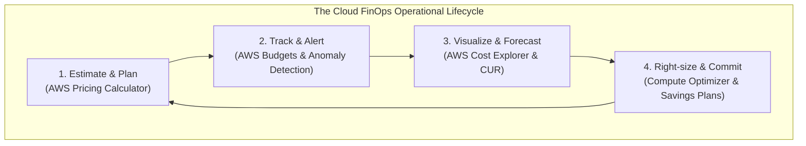
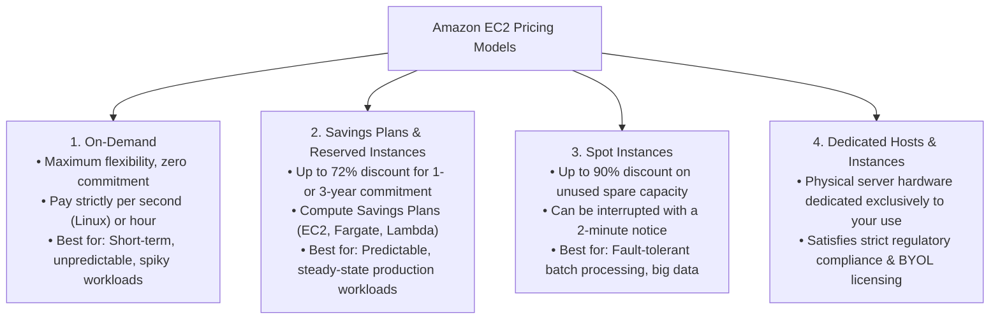
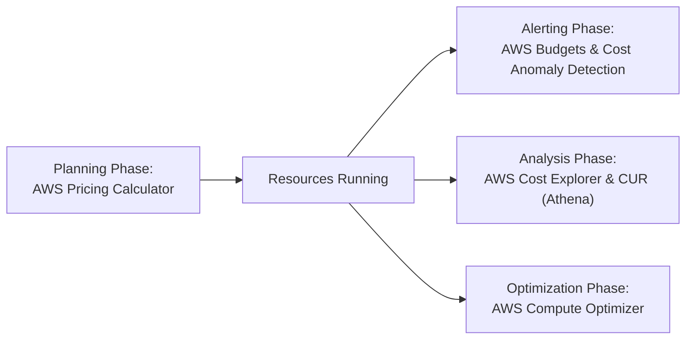

# AWS Pricing Models, FinOps & Cost Management Tools

> **Knowledge Area:** Billing and Pricing (Domain 4.1 & 4.2)  
> **Relevant Certifications:** [CLF-C02](../../01_Syllabus/CLF-C02_Master_Blueprint.md), SAA-C03, SOA-C02  
> **Tags:** `#aws/billing` `#finops` `#cost-explorer` `#budgets` `#pricing-calculator` `#clf-c02`

---

## 💡 The Real-World Analogy (ELI5)

> **Hotel Room Booking Models & Personal Expense Tracking:**
> - **On-Demand Instances:** Walking up to a luxury hotel reception desk at 11:00 PM without a reservation and booking a room for the night. You have absolute flexibility, can check out the next morning with zero commitment, but you pay the standard published retail rate.
> - **Compute Savings Plans / Reserved Instances:** Signing a corporate enterprise contract committing to book at least \$50 worth of hotel rooms every day for the next 1 or 3 years. Because the hotel guarantees revenue, they reward your commitment with up to a **72% discount**.
> - **Spot Instances:** Flying on a commercial passenger airline as a standby passenger. You buy an unsold empty seat for up to a **90% discount**, but if a full-fare passenger shows up at the departure gate, the airline gives you a 2-minute tap on the shoulder and asks you to exit the plane.
> - **Dedicated Hosts:** Booking out an entire private penthouse floor exclusively for your company board members so that no outside guests can ride your elevator or step onto your hallway (strict physical server compliance).
> - **AWS Pricing Calculator:** Reading the catering menu and estimating your total wedding banquet bill *before* booking the venue.
> - **AWS Budgets:** Setting a strict smartphone alert that beeps loudly when your monthly credit card charges cross \$800, or when your current spending pace predicts you will breach \$1,000 by month-end.
> - **AWS Cost Explorer:** Opening an interactive mobile banking app to review colorful charts of your spending over the past 12 months, categorized by restaurant, groceries, and travel, with a forecast of next month's bill.

---

## 1. First-Principles Computer Science & Financial Systems Mechanics

Cloud Financial Management (FinOps) relies on computational economics, statistical anomaly detection, and capacity commitment modeling:

### 1.1 The Mathematics of Compute Commitments (Savings Plans vs. On-Demand)
* **On-Demand Cost Formula:**
  $$\text{Total Cost} = \text{Active Instance Hours} \times \text{Hourly Retail Rate}$$
* **Savings Plans Commitment Formula:**
  An enterprise commits to an hourly spend rate ($\$X/\text{hour}$) for a 1-year or 3-year term. Every hour, usage up to $\$X$ is billed at the discounted Savings Plan rate (up to 72% off), while any surge usage above $\$X$ is billed at the standard On-Demand rate.
* **Payment Options Trade-Off:**
  1. *All Upfront (Highest Discount):* Pay the entire 1- or 3-year commitment on day one in cash.
  2. *Partial Upfront (Balanced Discount):* Pay $\ge 50\%$ upfront; remainder billed monthly.
  3. *No Upfront (Lowest Discount):* Pay zero cash upfront; commitment billed entirely on monthly invoices.

### 1.2 Spot Instance Spare Capacity & The 2-Minute Interruption Notice
AWS operates vast server farms engineered to handle global peak holiday traffic. During normal off-peak hours, millions of CPU cores sit idle.
* **Spot Pricing Mechanics:** AWS sells this spare, unallocated compute capacity at up to a **90% discount** compared to On-Demand rates.
* **The Interruption Warning:** If AWS needs the physical capacity back for full-paying On-Demand customers, AWS sends an automated **2-minute warning notice** via the EC2 Instance Metadata Service (IMDS) and Amazon EventBridge before terminating or stopping the Spot instance. Workloads must be stateless and fault-tolerant (e.g., containerized batch rendering, big data worker nodes).

---

## 2. Historical IT Pain Points: The Enterprise FinOps Crisis

Before automated cloud financial visibility and rightsizing services, managing corporate IT spending was notoriously opaque:

| Enterprise Financial Challenge | Traditional On-Premises Reality | AWS Cloud FinOps Paradigm |
|---|---|---|
| **Multi-Million Dollar Software Audits** | Enterprise software vendors performed surprise on-site audits, hitting companies with millions of dollars in unexpected licensing fines. | **AWS License Manager & Native Tracking**. Automatically tracks, enforces, and reports license compliance across all cloud resources. |
| **Zero Departmental Accountability** | IT received a single multi-million dollar annual datacenter bill; there was no mechanism to determine which department consumed the budget. | **Cost Allocation Tags**. Label resources by `Department`, `Project`, or `Environment`; slice spending accurately in Cost Explorer. |
| **Over-Provisioned "Ghost" Servers** | Sysadmins ordered 64-core servers with 256 GB RAM for small web applications "just in case," resulting in massive capital waste. | **AWS Compute Optimizer**. Uses machine learning to analyze CloudWatch metrics and recommend downsizing over-provisioned instances. |
| **Month-End "Bill Shock" Outages** | Companies only discovered that an unmonitored test script left 10 large GPU servers running when the paper invoice arrived 30 days later. | **AWS Budgets & Cost Anomaly Detection**. Alerts engineers via email/SNS within hours of an unexpected spending spike. |

---

## 3. Deep-Dive: Amazon EC2 Pricing Models

Selecting the optimal compute pricing model is the cornerstone of cloud cost optimization:

### 3.1 On-Demand Instances
* **How it works:** Pay for compute capacity by the second (minimum 60 seconds) with no long-term commitments or upfront payments.
* **Ideal Workload:** Applications with short-term, unpredictable, or highly fluctuating workloads that cannot be interrupted (e.g., first-time production launches, dynamic e-commerce seasonal spikes).

### 3.2 Savings Plans (Compute vs. EC2 Instance)
* **Compute Savings Plans (Most Flexible):** Provides discounts up to **66%**; applies automatically across Amazon EC2, AWS Fargate, and AWS Lambda regardless of instance family, operating system, size, tenancy, or AWS Region.
* **EC2 Instance Savings Plans:** Provides discounts up to **72%** in exchange for committing to a specific instance family in a specific Region (e.g., `m6g` in `us-east-1`), while allowing flexibility to change operating systems or instance sizes within that family.

### 3.3 Reserved Instances (RIs)
* **Standard RIs:** Provide up to 72% discount for committing to a specific instance configuration for 1 or 3 years. Cannot be converted to another instance family.
* **Convertible RIs:** Provide up to 54% discount with the ability to exchange for different instance families, operating systems, and tenancies over the commitment term.

### 3.4 Spot Instances
* **How it works:** Leverage spare, unused EC2 computing capacity at steep discounts of up to **90% off On-Demand rates**.
* **Interruption Handling:** AWS can reclaim capacity with a **2-minute warning**. Ideal strictly for applications that can gracefully handle abrupt node termination: stateless microservices, batch processing, image rendering, CI/CD testing agents, and Apache Spark analytics worker nodes.

### 3.5 Dedicated Hosts vs. Dedicated Instances
* **Dedicated Hosts:** A physical server with EC2 capacity fully dedicated to your exclusive use. Provides full visibility and control over core/socket socket allocations, satisfying strict regulatory mandates and enabling **Bring Your Own License (BYOL)** agreements (e.g., per-core Windows Server and SQL Server licenses).
* **Dedicated Instances:** Instances running on hardware dedicated to a single customer account at the hypervisor level, but without socket-level server mapping or BYOL licensing control.

---

## 4. Deep-Dive: AWS FinOps & Cost Management Tools

### 4.1 AWS Pricing Calculator (`calculator.aws`)
* **What it is:** A free, web-based planning tool that allows cloud architects and financial managers to estimate the cost of AWS architectures **before building or provisioning any resources**.
* **Key Features:** Requires **no AWS account**; allows modeling multi-service architectures, configuring storage tiers, licensing types, and payment options; generates shareable URL links and exportable CSV cost estimates for executive sign-off.

### 4.2 AWS Budgets
* **What it is:** A proactive cost governance tool that allows you to set custom spending and usage budgets with automated alerting.
* **Three Types of Budgets:**
  1. *Cost Budgets:* Track total financial expenditure (e.g., alert when account spend exceeds \$5,000/month).
  2. *Usage Budgets:* Track resource consumption (e.g., alert when S3 egress exceeds 500 GB).
  3. *Reservation / Savings Plans Budgets:* Track utilization and coverage percentages of your commitments.
* **Threshold Types:** Alerts can be triggered based on **Actual Spend** (e.g., when actual spend crosses 85% of budget) or **Forecasted Spend** (e.g., when AWS algorithms predict you will breach 100% of budget by month-end).
* **Automated Actions:** Can execute automated remediation via AWS IAM policies or Systems Manager (e.g., automatically stopping development EC2 instances when a budget is breached).

### 4.3 AWS Cost Explorer
* **What it is:** A graphical reporting tool in the AWS Management Console used to **visualize, understand, and analyze** historical AWS spending patterns and future projected costs.
* **Time Horizons:** Provides **12 months of historical spending data** and generates predictive forecasts for the **next 12 months** based on historical machine-learned trends.
* **Dimensional Filtering:** Slice and filter spending by AWS Service, AWS Account, Region, Usage Type, and custom **Cost Allocation Tags**.

### 4.4 AWS Cost and Usage Report (CUR)
* **What it is:** The most detailed, granular raw billing dataset available in AWS.
* **Granularity:** Delivers hourly or daily line-item records to an **Amazon S3 bucket** in CSV or Apache Parquet format.
* **Analysis:** Query billions of raw billing records using SQL in **Amazon Athena**, or visualize corporate FinOps dashboards in **Amazon QuickSight**.

### 4.5 AWS Compute Optimizer
* **What it is:** A machine learning-powered optimization service that analyzes CloudWatch utilization metrics (CPU, memory, disk I/O, network) over a 14-day window to recommend optimal AWS compute resources.
* **Recommendations Provided:** Rightsizing over-provisioned (downsizing to eliminate waste) and under-provisioned (upsizing to remove performance bottlenecks) resources across **Amazon EC2 instances, Amazon EBS volumes, AWS Lambda functions, and AWS Fargate tasks**.

---

## 5. Multi-Dimensional FinOps Tools & Pricing Models Decision Matrix

### 5.1 Compute Pricing Models Comparison:
| Pricing Model | Maximum Discount | Flexibility | Commitment Term | Interruption Risk? | Primary Use Case |
|---|---|---|---|:---:|---|
| **On-Demand** | **0%** (Baseline retail) | **Maximum** | None (Pay per second) | **NO** | Spiky, unpredictable, short-term development workloads |
| **Compute Savings Plans** | **Up to 66%** | **High** (Any region, OS, compute) | 1 or 3 Years (\$/hour) | **NO** | Core steady-state application fleets & serverless |
| **EC2 Instance Savings Plans**| **Up to 72%** | Moderate (Specific family & region) | 1 or 3 Years (\$/hour) | **NO** | Predictable database and application server fleets |
| **Spot Instances** | **Up to 90%** | Low (Subject to capacity) | None (Billed per second) | **YES** (2-min notice) | Stateless batch jobs, big data worker nodes, CI/CD |
| **Dedicated Hosts** | Varies (BYOL savings) | Physical server allocation | 1 or 3 Years (or On-Demand) | **NO** | Strict regulatory isolation; per-core enterprise licensing |

### 5.2 FinOps Tool Suite Comparison:
| Tool | Lifecycle Phase | Primary User | Granularity | Alerting Capability? | Requires AWS Account? |
|---|---|---|---|:---:|:---:|
| **AWS Pricing Calculator** | Pre-Deployment | Solution Architects | High-level estimates | No | **NO** (Public web tool) |
| **AWS Budgets** | During Billing Cycle | FinOps & Finance Teams | Threshold summaries | **YES** (Email, SNS, Auto-action) | **YES** |
| **AWS Cost Explorer** | Retrospective & Planning | Financial Analysts & SREs | Daily / Monthly visual trends | No (Reporting only) | **YES** |
| **AWS Cost & Usage Report**| Deep Enterprise Auditing | FinOps Data Engineers | **Raw line-item per resource** | No (Delivered to S3) | **YES** |
| **AWS Compute Optimizer** | Optimization Sprints | DevOps & Cloud Architects | Machine-learned rightsizing | No (Console recommendations)| **YES** |

---

## 6. Exam Traps & 'Clue-to-Answer' Decryption

| Question Scenario Keyword | Target Pricing Model / Tool | Exam Trap & Distractor Explanation |
|---|---|---|
| *"Predictable steady-state workload running 24/7 for 3 years"* | **Savings Plans / Reserved Instances** | Trap: Do not choose On-Demand (wastes money) or Spot (risks interruption). Steady-state workloads belong on Savings Plans. |
| *"Fault-tolerant, stateless batch rendering job that can withstand interruption"* | **Spot Instances** | Trap: Do not choose On-Demand. Spot delivers up to 90% savings for interruptible workloads. |
| *"Estimate cloud architecture costs before building or creating an AWS account"* | **AWS Pricing Calculator** | Trap: Do not choose AWS Cost Explorer. Cost Explorer analyzes past data; Pricing Calculator estimates future costs without an account. |
| *"Proactively alert via email when monthly spending crosses $2,000 or is forecasted to cross"* | **AWS Budgets** | Trap: Do not choose Cost Explorer. Cost Explorer visualizes trends; AWS Budgets sends proactive threshold alerts. |
| *"Interactive graphical tool visualizing past 12 months and forecasting next 12 months"* | **AWS Cost Explorer** | Trap: Do not choose AWS Budgets. Visual graphs and 12-month predictive trends are AWS Cost Explorer. |
| *"Machine learning tool that recommends rightsizing over-provisioned EC2 instances"* | **AWS Compute Optimizer** | Trap: Do not choose AWS Cost Explorer. Cost Explorer recommends purchase options; Compute Optimizer rightsizes physical instance types. |
| *"Label resources by Department and Project to allocate costs on detailed billing reports"* | **Cost Allocation Tags** | Trap: Do not choose Resource Groups. Categorizing expenses on invoices is Cost Allocation Tags. |

---

## 7. Post-Topic Question Simulation & Retention Check

### Question 1
**Which AWS tool provides an interactive graphical interface allowing customers to visualize, track, and analyze their AWS spending patterns over the past 12 months and generate predictive forecasts for the next 12 months?**
- A) AWS Budgets
- B) AWS Cost Explorer
- C) AWS Pricing Calculator
- D) AWS Billing Conductor

<b>Click to View Answer & Detailed Distractor Analysis</b>

**Correct Answer:** **B) AWS Cost Explorer**

* **Why it's correct:** AWS Cost Explorer features an easy-to-use graphical user interface that allows users to visualize, understand, and analyze historical AWS costs and resource usage over a rolling 12-month window, slice data by dimensions and tags, and project future spending up to 12 months in advance using machine learning.
* **Distractor Analysis:**
  - *A is incorrect:* AWS Budgets is an alerting service used to set custom spend thresholds and trigger automated notifications, rather than an interactive historical visual analytics dashboard.
  - *C is incorrect:* The AWS Pricing Calculator is a web-based pre-deployment cost modeling tool used to estimate costs before provisioning resources.
  - *D is incorrect:* AWS Billing Conductor is a specialized service for solution providers to customize billing parameters and invoice rates for their end customers.

---

### Question 2
**A financial controller wants to configure automated notifications that dispatch an email alert when monthly spending on Amazon EC2 crosses $1,500, or when machine learning algorithms forecast that spending will exceed that threshold by month-end. Which service coordinates this?**
- A) AWS Budgets
- B) AWS Cost Explorer
- C) AWS Trusted Advisor
- D) Amazon CloudWatch Billing Alarms

<b>Click to View Answer & Detailed Distractor Analysis</b>

**Correct Answer:** **A) AWS Budgets**

* **Why it's correct:** AWS Budgets allows organizations to configure custom spending and usage budgets that track active consumption and trigger automated email or SNS notifications when spend breaches—or is **forecasted** to breach—predefined financial limits.
* **Distractor Analysis:**
  - *B is incorrect:* AWS Cost Explorer generates visual graphs and forecasts, but does not configure threshold-triggered automated email alerting rules.
  - *C is incorrect:* AWS Trusted Advisor provides general architectural optimization recommendations, but does not manage custom monthly departmental budget alerts.
  - *D is incorrect:* While CloudWatch can trigger alarms on total estimated charges, AWS Budgets provides specialized service-level filtering and forecasted threshold alerts.

---

### Question 3
**Which Amazon EC2 pricing model provides the highest financial discount (up to 90% off On-Demand rates) for fault-tolerant, stateless batch data processing workloads that can gracefully tolerate sudden two-minute interruption notices?**
- A) Standard Reserved Instances
- B) Compute Savings Plans
- C) Spot Instances
- D) On-Demand Instances

<b>Click to View Answer & Detailed Distractor Analysis</b>

**Correct Answer:** **C) Spot Instances**

* **Why it's correct:** Amazon EC2 Spot Instances allow customers to bid on spare, unallocated EC2 computing capacity at steep discounts of up to 90% compared to On-Demand pricing. Spot instances are ideal for fault-tolerant, stateless batch workloads because AWS can reclaim the instance with a 2-minute interruption warning.
* **Distractor Analysis:**
  - *A is incorrect:* Standard Reserved Instances provide up to 72% discounts in exchange for 1- or 3-year commitments, but do not provide the 90% discounts of Spot instances.
  - *B is incorrect:* Compute Savings Plans provide up to 66% discounts for hourly spend commitments, but carry multi-year contractual terms.
  - *D is incorrect:* On-Demand instances are billed at full published retail rates with zero discount.

---

### Question 4
**What is the primary function of activating Cost Allocation Tags in the AWS Billing and Cost Management console?**
- A) To automatically terminate Amazon EC2 instances when spending limits are exceeded
- B) To assign key-value metadata labels (e.g., `CostCenter: 402` or `Environment: Production`) to AWS resources to organize, filter, and track costs on detailed billing reports
- C) To automatically encrypt sensitive application data stored on Amazon S3 storage volumes
- D) To prevent IAM users from launching expensive instance families in unauthorized regions

<b>Click to View Answer & Detailed Distractor Analysis</b>

**Correct Answer:** **B) To assign key-value metadata labels (e.g., `CostCenter: 402` or `Environment: Production`) to AWS resources to organize, filter, and track costs on detailed billing reports**

* **Why it's correct:** Cost Allocation Tags are key-value metadata labels applied to AWS resources. Once activated in the billing console, they appear as customizable filtering dimensions in AWS Cost Explorer and the AWS Cost and Usage Report (CUR), enabling financial teams to accurately allocate expenses to business units, projects, or clients.
* **Distractor Analysis:**
  - *A is incorrect:* Cost Allocation Tags are strictly reporting metadata labels; they do not enforce automated resource termination (which is handled by AWS Budgets actions).
  - *C is incorrect:* Encrypting data on Amazon S3 is handled by AWS KMS or S3 default encryption settings, not billing tags.
  - *D is incorrect:* Restricting instance families or regions is enforced by IAM policies or Service Control Policies (SCPs), not billing tags.

---

### Question 5
**A cloud solutions architect needs to model a proposed multi-tier cloud architecture and estimate expected monthly operational costs for an executive proposal before provisioning any resources or creating an AWS account. Which tool should they utilize?**
- A) AWS Pricing Calculator
- B) AWS Cost and Usage Report (CUR)
- C) AWS Budgets
- D) AWS License Manager

<b>Click to View Answer & Detailed Distractor Analysis</b>

**Correct Answer:** **A) AWS Pricing Calculator**

* **Why it's correct:** The AWS Pricing Calculator (`calculator.aws`) is a publicly accessible, web-based planning tool that allows users to model proposed cloud architectures, evaluate instance types, storage classes, and support tiers, and generate exportable monthly cost estimates without needing an active AWS account.
* **Distractor Analysis:**
  - *B is incorrect:* The AWS Cost and Usage Report (CUR) provides raw historical line-item billing data for active resources running in an existing AWS account.
  - *C is incorrect:* AWS Budgets tracks active and forecasted spending inside an established AWS account.
  - *D is incorrect:* AWS License Manager manages software licensing compliance for existing corporate licenses.

