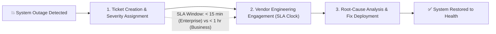
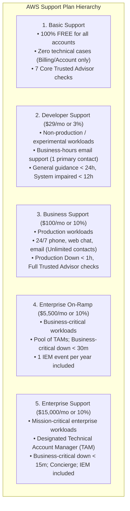
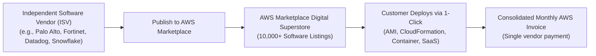
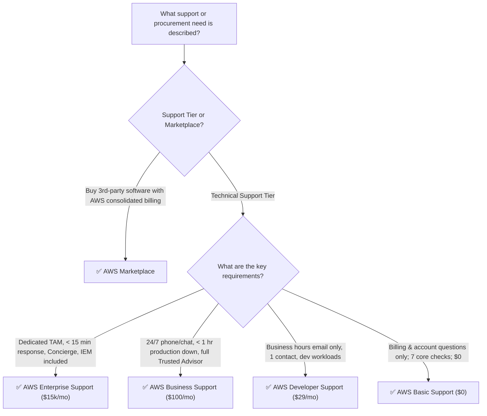

# AWS Support Plans & AWS Marketplace

> **Knowledge Area:** Billing and Pricing (Domain 4.3 & 4.4)  
> **Relevant Certifications:** [CLF-C02](../../01_Syllabus/CLF-C02_Master_Blueprint.md), SAA-C03, SOA-C02  
> **Tags:** `#aws/billing` `#support-plans` `#marketplace` `#tam` `#trusted-advisor` `#clf-c02`

---

## 💡 The Real-World Analogy (ELI5)

> **Healthcare & Medical Coverage Tiers:**
> - **Basic Support (Free for Everyone):** The emergency first-aid kit inside your bathroom cabinet. You can read the printed instruction leaflet (AWS documentation) and call customer service if your pharmacy card was billed incorrectly, but there is no nurse or doctor available to answer medical questions.
> - **Developer Support (\$29/month):** An online telehealth messaging clinic open strictly during normal business hours. One primary designated person can email non-urgent questions to a medical assistant with a 12-to-24 hour callback response window.
> - **Business Support (\$100/month+):** A 24/7 emergency urgent care clinic. An unlimited number of staff members can call or live-chat with certified doctors anytime day or night. If a critical production limb is broken, doctors guarantee a response in **under 1 hour**, and you receive a comprehensive full-body health scan (all 115+ [AWS Trusted Advisor](../../AWS_SERVICES_GLOSSARY.md#aws-trusted-advisor) checks).
> - **Enterprise Support (\$15,000/month+):** A dedicated, personal concierge physician (Technical Account Manager - TAM) assigned exclusively to your family. The TAM reviews your diet and exercise habits (architectural reviews), participates in emergency preparedness drills, assists with high-profile event planning, and if a life-threatening crisis occurs, arrives at your bedside in **under 15 minutes**.
> - **[AWS Marketplace](../../AWS_SERVICES_GLOSSARY.md#aws-marketplace):** An authorized luxury medical supply catalog and digital superstore where you can purchase specialized third-party surgical tools, software licenses, and pre-built medical kits from outside vendors, with all charges consolidated directly onto your regular hospital invoice.

---

## 1. First-Principles Computer Science & Operational Support Mechanics

Operational support in enterprise systems engineering is governed by the mathematical relationship between **Mean Time to Recovery (MTTR)** and financial downtime loss:

### 1.1 The Economics of Outage Cost vs. Support Tier Pricing
For an enterprise processing millions of dollars per hour in digital transactions:
$$\text{Cost of Downtime} = \text{MTTR (Hours)} \times \text{Hourly Business Revenue Loss}$$
* If an e-commerce platform generates $\$120{,}000/\text{hour}$ in revenue, a 1-hour delay in engaging support engineers costs $\$120{,}000$.
* Spending $\$15{,}000/\text{month}$ on **Enterprise Support** to guarantee a **$< 15\text{-minute}$ response SLA** from a designated Technical Account Manager (TAM) who already understands your system architecture provides immediate, positive return on investment during a single major incident.

### 1.2 Programmatic Incident Management via AWS Support API
* Under the **Business** and **Enterprise** support plans, engineering teams gain programmatic access to the **AWS Support API**.
* This enables integrating AWS support case management directly into corporate ticketing workflows (e.g., automatically generating AWS support tickets when Datadog, PagerDuty, or ServiceNow alerts trigger).

---

## 2. Historical IT Pain Points: Multi-Vendor Finger Pointing

Before unified cloud support and digital marketplace procurement, managing multi-vendor IT infrastructure was an operational quagmire:

| Traditional Support Challenge | Traditional On-Premises Reality | AWS Support & Marketplace Paradigm |
|---|---|---|
| **Multi-Vendor Finger Pointing** | During a database outage, the hardware vendor blamed the OS vendor, the OS vendor blamed the SAN storage vendor, and the SAN vendor blamed the database vendor. | **Single Point of Escalation**. AWS manages the physical facilities, hypervisors, and managed services; a **Technical Account Manager (TAM)** coordinates across all internal AWS engineering teams. |
| **Bizarre Support Licensing Contracts** | Enterprises negotiated separate, rigid 3-year support maintenance contracts with 15 disparate vendors, paying 20% annual maintenance fees whether cases were opened or not. | **Flexible Monthly Billing**. AWS Support is billed monthly as a percentage of actual monthly AWS consumption; customers can upgrade or downgrade tiers as workload requirements change. |
| **Procurement Red Tape for Third-Party Software** | Purchasing third-party security software or operating system licenses required 3-month legal procurement, credit checks, vendor onboarding, and separate invoices. | **[AWS Marketplace](../../AWS_SERVICES_GLOSSARY.md#aws-marketplace) Consolidated Billing**. Deploy third-party AMIs and SaaS products in 1 click; charges are billed directly on your monthly AWS invoice. |
| **Surprise Traffic Collapse on Launch Day** | Companies launched major public campaigns (e.g., Super Bowl commercial or Black Friday sale) without vendor coordination, resulting in catastrophic capacity crashes. | **Infrastructure Event Management (IEM)**. AWS engineers and TAMs provide structured architecture reviews, capacity reservations, and 24/7 real-time monitoring during major events. |

---

## 3. Deep-Dive: The 5 AWS Support Plan Tiers

AWS provides four primary commercial support plans (plus Enterprise On-Ramp) tailored to different operational maturity levels:

### 3.1 Basic Support (Free for All Accounts)
* **Cost:** **\$0.00** (Included automatically with every active AWS account).
* **Technical Case Access:** **NONE**. You cannot open technical troubleshooting tickets.
* **Included Services:** 24/7 access to customer service and billing inquiries; access to official documentation, whitepapers, and AWS re:Post community forums; access to the **7 core [AWS Trusted Advisor](../../AWS_SERVICES_GLOSSARY.md#aws-trusted-advisor) checks** and [AWS Health Dashboard](../../AWS_SERVICES_GLOSSARY.md#aws-health-dashboard).

### 3.2 Developer Support
* **Cost:** Starts at **\$29/month** (or 3% of monthly AWS usage).
* **Target Audience:** Developers experimenting with AWS or running non-production test/development environments.
* **Support Channel:** Cloud Support Associates accessible **via email during local business hours**.
* **Contact Limit:** **1 primary contact** authorized to open cases.
* **Response SLAs:** General Guidance < 24 hours; System Impaired < 12 hours.

### 3.3 Business Support
* **Cost:** Starts at **\$100/month** (tiered sliding scale: 10% down to 3% as usage scales).
* **Target Audience:** Organizations running **production workloads** on AWS.
* **Support Channel:** 24/7 access to Cloud Support Engineers via **phone, live web chat, and email**.
* **Contact Limit:** **Unlimited contacts** (any IAM user with support permissions).
* **Key Features:**
  - **Full [AWS Trusted Advisor](../../AWS_SERVICES_GLOSSARY.md#aws-trusted-advisor) Checks:** Unlocks all 115+ checks across Cost, Security, Fault Tolerance, Performance, and Quotas.
  - **Production System Down SLA:** Guaranteed response in **< 1 hour**.
  - **AWS Support API:** Programmatic case management.
  - **Infrastructure Event Management (IEM):** Available for an additional fee.

### 3.4 Enterprise Support
* **Cost:** Starts at **\$15,000/month** (tiered sliding scale based on spend).
* **Target Audience:** Enterprises running **mission-critical business workloads**.
* **Specialized Key Roles & Programs:**
  1. **Designated Technical Account Manager (TAM):** A named, dedicated senior AWS engineer assigned to your account who provides proactive architectural guidance, coordinates Well-Architected reviews, and acts as your direct advocate inside AWS.
  2. **AWS Concierge Support Team:** Dedicated billing and account specialists who assist with complex enterprise billing structures, consolidated invoice analysis, and account reorganizations.
  3. **Infrastructure Event Management (IEM):** **Included at no extra fee**. Pre-event architectural reviews, capacity reservations, and 24/7 real-time operational bridge monitoring during high-visibility business events (e.g., Black Friday, product launches).
  4. **Business-Critical System Down SLA:** Guaranteed rapid response in **< 15 minutes**.

---

## 4. Case Severity Levels & SLA Response Times

| Severity Classification | Definition / Impact | Developer | Business | Enterprise On-Ramp | Enterprise |
|---|---|:---:|:---:|:---:|:---:|
| **General Guidance** | General how-to questions, service recommendations | **< 24 hours** | **< 24 hours** | **< 24 hours** | **< 24 hours** |
| **System Impaired** | Non-critical functions abnormal; workaround exists | **< 12 hours** | **< 12 hours** | **< 12 hours** | **< 12 hours** |
| **Production System Impaired** | Production application partially degraded | N/A | **< 4 hours** | **< 4 hours** | **< 4 hours** |
| **Production System Down** | Production application completely offline for users | N/A | **< 1 hour** | **< 1 hour** | **< 1 hour** |
| **Business-Critical System Down** | Mission-critical business operations stopped; catastrophic revenue loss | N/A | N/A | **< 30 minutes** | **< 15 minutes** |

---

## 5. AWS Marketplace: Digital Catalog & Software Procurement

* **What it is:** A curated digital catalog with thousands of software listings from independent software vendors (ISVs) that makes it easy to find, test, buy, and deploy software that runs on AWS.
* **Delivery Methods:**
  - *Amazon Machine Images (AMIs):* Pre-configured virtual machines (e.g., hardened firewalls, enterprise Linux).
  - *Containers:* Ready-to-deploy Docker containers for [Amazon ECS](../../AWS_SERVICES_GLOSSARY.md#amazon-ecs) or EKS.
  - *Software-as-a-Service (SaaS):* Direct SaaS subscriptions integrated via API.
* **Key Commercial Benefits:**
  1. **Consolidated Billing:** Software subscription and usage costs appear directly as line items on your standard monthly AWS bill, eliminating the need to onboard separate third-party vendor accounts.
  2. **Private Marketplace:** Allows enterprise administrators to create a customized, curated catalog of approved third-party software that employees are authorized to procure, enforcing governance.

---

## 6. Multi-Dimensional Support Plan Comparison Matrix

| Dimension | Basic Support | Developer Support | Business Support | Enterprise Support |
|---|---|---|---|---|
| **Monthly Starting Cost** | **Free ($0)** | **\$29/month** (or 3%) | **\$100/month** (or 10%-3%) | **\$15,000/month** (or 10%-3%) |
| **Technical Support Hours** | **None** | Business hours only | **24/7 / 365** | **24/7 / 365** |
| **Technical Support Channels** | Customer service / billing only | **Email only** | **Phone, Web Chat, Email** | **Phone, Web Chat, Email** |
| **Who Can Open Cases?** | Unlimited billing contacts | **1 primary contact** | **Unlimited contacts (IAM)** | **Unlimited contacts (IAM)** |
| **Trusted Advisor Access** | 7 core security & quota checks | 7 core security & quota checks | **Full 115+ checks (All 5 pillars)** | **Full 115+ checks (All 5 pillars)** |
| **Fastest Response SLA** | N/A | < 12 hours (System impaired) | **< 1 hour (Production down)** | **< 15 minutes (Critical down)** |
| **Technical Account Manager?** | None | None | None | **Designated TAM (Named individual)**|
| **Concierge Billing Team?** | None | None | None | **Included** |
| **Infrastructure Event Mgt (IEM)?**| None | None | Available for extra fee | **Included at zero extra cost** |

---

## 7. Exam Traps & 'Clue-to-Answer' Decryption

| Question Scenario Keyword | Target Support Plan / Feature | Exam Trap & Distractor Explanation |
|---|---|---|
| *"Lowest tier providing 24/7 technical phone, email, and chat access"* | **Business Support** | Trap: Do not choose Developer Support. Developer Support provides email access during business hours only. |
| *"Guaranteed response time under 15 minutes for business-critical outages"* | **Enterprise Support** | Trap: Do not choose Business Support. Business Support provides a 1-hour response for production down; only Enterprise provides 15 minutes. |
| *"Designated Technical Account Manager (TAM) to guide architecture and operations"* | **Enterprise Support** | Trap: Do not choose Business Support. A dedicated TAM is exclusive to Enterprise Support (Enterprise On-Ramp provides a pool). |
| *"Access to all 5 categories of [AWS Trusted Advisor](../../AWS_SERVICES_GLOSSARY.md#aws-trusted-advisor) checks at lowest cost"* | **Business Support** | Trap: Basic and Developer tiers only provide 7 core checks; Business Support is the lowest tier with full checks. |
| *"Can you open technical troubleshooting tickets on the Basic Support plan?"* | **NO (Billing and account cases only)** | Trap: Basic Support has zero technical case support. |
| *"Curated digital software catalog allowing purchase of third-party software on AWS bill"* | **[AWS Marketplace](../../AWS_SERVICES_GLOSSARY.md#aws-marketplace)** | Trap: Do not choose [AWS Service Catalog](../../AWS_SERVICES_GLOSSARY.md#aws-service-catalog). Service Catalog organizes internal templates; Marketplace purchases external third-party software. |
| *"Assistance and proactive capacity planning for major business launch events"* | **Infrastructure Event Management (IEM)** | Trap: Included for free in Enterprise; available for an additional fee in Business Support. |

---

## 8. Post-Topic Question Simulation & Retention Check

### Question 1
**Which AWS Support plan is the lowest-tier plan that provides 24/7 access to Cloud Support Engineers via phone, email, and live web chat for an unlimited number of contacts?**
- A) Developer Support
- B) Business Support
- C) Basic Support
- D) Enterprise On-Ramp

<b>Click to View Answer & Detailed Distractor Analysis</b>

**Correct Answer:** **B) Business Support**

* **Why it's correct:** The Business Support plan is the entry-level tier for production workloads, offering 24/7 technical support access to Cloud Support Engineers via phone, email, and web chat for an unlimited number of IAM users, along with a 1-hour response SLA for production system outages and access to the full suite of [AWS Trusted Advisor](../../AWS_SERVICES_GLOSSARY.md#aws-trusted-advisor) checks.
* **Distractor Analysis:**
  - *A is incorrect:* Developer Support provides technical support via email only during local business hours for a single primary contact.
  - *C is incorrect:* Basic Support does not include any technical support case access (customer service and billing inquiries only).
  - *D is incorrect:* Enterprise On-Ramp provides 24/7 access, but costs a minimum of $5,500/month, making Business Support ($100/month) the lowest-cost tier with this capability.

---

### Question 2
**An enterprise running mission-critical workloads on AWS requires a designated Technical Account Manager (TAM) to conduct proactive architectural reviews, assist with operational planning, and coordinate expert resources. Which support plan must they purchase?**
- A) Business Support
- B) Enterprise Support
- C) Developer Support
- D) Basic Support

<b>Click to View Answer & Detailed Distractor Analysis</b>

**Correct Answer:** **B) Enterprise Support**

* **Why it's correct:** The Enterprise Support plan includes a dedicated, designated Technical Account Manager (TAM) who serves as the customer's primary technical advisor, conducts Well-Architected reviews, oversees incident escalations, and assists with proactive operational planning.
* **Distractor Analysis:**
  - *A is incorrect:* Business Support does not provide a Technical Account Manager (TAM).
  - *C is incorrect:* Developer Support does not provide a Technical Account Manager (TAM).
  - *D is incorrect:* Basic Support is the free tier and provides zero technical advisory services.

---

### Question 3
**What response time SLA does the AWS Enterprise Support plan guarantee for a declared "Business-Critical System Down" support case?**
- A) Under 15 minutes
- B) Under 1 hour
- C) Under 4 hours
- D) Under 24 hours

<b>Click to View Answer & Detailed Distractor Analysis</b>

**Correct Answer:** **A) Under 15 minutes**

* **Why it's correct:** Under the AWS Enterprise Support plan, when a customer opens a ticket classified as "Business-Critical System Down" (mission-critical business operations stopped), AWS guarantees a response from a senior engineer in **less than 15 minutes**, 24 hours a day, 7 days a week.
* **Distractor Analysis:**
  - *B is incorrect:* Under 1 hour is the response SLA for "Production System Down" under the Business Support plan.
  - *C is incorrect:* Under 4 hours is the response SLA for "Production System Impaired" under Business and Enterprise plans.
  - *D is incorrect:* Under 24 hours is the response SLA for "General Guidance" across Developer, Business, and Enterprise plans.

---

### Question 4
**What is the primary function of [AWS Marketplace](../../AWS_SERVICES_GLOSSARY.md#aws-marketplace)?**
- A) A physical hardware store for purchasing and renting AWS Snowball appliances
- B) A curated digital software catalog that allows customers to find, test, buy, and deploy thousands of third-party software products with integrated billing on their AWS invoice
- C) An e-commerce website for purchasing Amazon consumer retail electronics
- D) A freelance directory for hiring independent cloud certified consultants

<b>Click to View Answer & Detailed Distractor Analysis</b>

**Correct Answer:** **B) A curated digital software catalog that allows customers to find, test, buy, and deploy thousands of third-party software products with integrated billing on their AWS invoice**

* **Why it's correct:** [AWS Marketplace](../../AWS_SERVICES_GLOSSARY.md#aws-marketplace) is an online digital software store that enables customers to find, buy, and immediately deploy third-party software (such as Cisco virtual appliances, Datadog agents, Snowflake data platforms, and WordPress AMIs) that run on AWS, with all software subscription charges consolidated directly onto the customer's regular monthly AWS bill.
* **Distractor Analysis:**
  - *A is incorrect:* AWS Snowball appliances are ordered directly through the [AWS Snow Family](../../AWS_SERVICES_GLOSSARY.md#aws-snow-family) console, not via [AWS Marketplace](../../AWS_SERVICES_GLOSSARY.md#aws-marketplace).
  - *C is incorrect:* [AWS Marketplace](../../AWS_SERVICES_GLOSSARY.md#aws-marketplace) is strictly for enterprise cloud software, not consumer electronics.
  - *D is incorrect:* Hiring certified cloud professionals is coordinated through AWS IQ or the AWS Partner Network (APN), not [AWS Marketplace](../../AWS_SERVICES_GLOSSARY.md#aws-marketplace).

---

### Question 5
**Which AWS Support tier includes full access to all 5 categories of [AWS Trusted Advisor](../../AWS_SERVICES_GLOSSARY.md#aws-trusted-advisor) best-practice recommendations at the lowest financial cost?**
- A) Developer Support
- B) Business Support
- C) Basic Support
- D) AWS Free Tier

<b>Click to View Answer & Detailed Distractor Analysis</b>

**Correct Answer:** **B) Business Support**

* **Why it's correct:** While the Basic and Developer Support tiers only include access to the 7 core security and service quota checks, the **Business Support** plan (starting at $100/month) is the lowest-tier plan that unlocks the full library of 115+ automated [AWS Trusted Advisor](../../AWS_SERVICES_GLOSSARY.md#aws-trusted-advisor) checks across all five pillars: Cost Optimization, Security, Fault Tolerance, Performance, and Service Quotas.
* **Distractor Analysis:**
  - *A is incorrect:* Developer Support only includes the 7 core security and service quota checks.
  - *C is incorrect:* Basic Support only includes the 7 core security and service quota checks.
  - *D is incorrect:* The AWS Free Tier provides limited free usage of AWS services, but does not alter the 7 core check limitation of Basic Support.

---

## 🧠 Master MCQ Solving Blueprint: Pattern Decryption & Elimination Tricks

> *This blueprint distills recurring patterns, keyword triggers, and trap options extracted from over 350 questions on AWS Support Plans (Basic, Developer, Business, Enterprise) and [AWS Marketplace](../../AWS_SERVICES_GLOSSARY.md#aws-marketplace) across the official CLF-C02 question bank.*

### 1. The "Clue-to-Service" Linguistic Decryption Matrix
When reading a question scenario, search for these exact phrasing triggers:

| If You See This Trigger Phrase in the Question Stem... | The Correct Support Plan / Service Is... | Trap Distractor to Immediately Discard |
|---|---|---|
| *"Dedicated Technical Account Manager (TAM) assigned to account; < 15-minute response for business-critical down"* | **AWS Enterprise Support** | *AWS Business Support* (Business does NOT provide a dedicated TAM!) |
| *"Production system down < 1-hour response SLA; 24/7 phone/chat/email; full Trusted Advisor checks; Support API"* | **AWS Business Support** | *AWS Developer Support* (Developer is business hours email only) |
| *"Experimental or non-production workloads; business hours email-only access; 1 primary contact; < 12-24 hr response"* | **AWS Developer Support** | *AWS Basic Support* (Basic allows zero technical support cases) |
| *"Billing and account questions only; access to documentation and 7 core Trusted Advisor checks; $0 cost"* | **AWS Basic Support** | *AWS Developer Support* |
| *"Curated digital catalog to find, test, buy, and deploy third-party software with charges on AWS monthly bill"* | **[AWS Marketplace](../../AWS_SERVICES_GLOSSARY.md#aws-marketplace)** | *AWS Snowball* or *[AWS Systems Manager](../../AWS_SERVICES_GLOSSARY.md#aws-systems-manager)* |
| *"Architectural review and operational support for planned high-traffic marketing events or flash sales"* | **AWS Infrastructure Event Management (IEM)** | *[AWS Trusted Advisor](../../AWS_SERVICES_GLOSSARY.md#aws-trusted-advisor)* (IEM is a human engagement; included in Enterprise) |
| *"Dedicated billing and account specialist team for enterprise customers"* | **AWS Concierge Support Team** | *AWS TAM* (TAM is technical; Concierge is for billing/accounts) |
| *"Lowest cost support tier providing full access to all 115+ [AWS Trusted Advisor](../../AWS_SERVICES_GLOSSARY.md#aws-trusted-advisor) checks"* | **AWS Business Support** | *AWS Developer Support* (Developer has only 7 core checks!) |

### 2. The 3-Step Rapid Elimination Heuristic
When evaluating an AWS Support Plan question:
1. **Step 1: Check for "Dedicated Human Roles":**
   - Mentions a **dedicated Technical Account Manager (TAM)** → **Enterprise Support** (Instant answer!).
   - Mentions a **dedicated Concierge billing team** → **Enterprise Support**.
   - Mentions **AWS Infrastructure Event Management (IEM)** included for free → **Enterprise Support**.
2. **Step 2: Check Incident Response SLA Speed:**
   - **< 15 minutes** (Business-critical system down) → **Enterprise Support**.
   - **< 1 hour** (Production system down) → **Business Support**.
   - **< 12 to 24 hours** (General guidance / non-production system impaired) → **Developer Support**.
   - **Zero technical cases** (Billing and account questions only) → **Basic Support**.
3. **Step 3: Check Channels & Contacts:**
   - **24/7 phone, live chat, and web tickets** with **unlimited contacts** → **Business** or **Enterprise**.
   - **Business hours email only** with **1 primary contact** → **Developer Support**.

### 3. High-Frequency Decoy Autopsy: Why AWS Tries to Trick You
* **Decoy #1: "Business Support" vs. "Enterprise Support" (The TAM Trap)**
  - *The Trap:* A scenario says: "A company needs 24/7 technical support by phone and chat, and wants a dedicated individual to help design their architecture."
  - *The Autopsy:* While Business Support gives you 24/7 phone/chat, it connects you to a **general pool** of AWS cloud support engineers. Only **Enterprise Support** assigns a **designated Technical Account Manager (TAM)** dedicated to your organization.
* **Decoy #2: "Developer Support" vs. "Business Support" (Trusted Advisor Checks)**
  - *The Trap:* Which is the lowest-tier support plan that unlocks all [AWS Trusted Advisor](../../AWS_SERVICES_GLOSSARY.md#aws-trusted-advisor) best practice checks?
  - *The Autopsy:* Candidates frequently pick Developer Support because it's the cheapest paid plan (\$29/mo). But Developer Support **only includes the 7 core checks**. You must upgrade to **Business Support** (\$100/mo) to unlock the full suite of checks.
* **Decoy #3: "[AWS Marketplace](../../AWS_SERVICES_GLOSSARY.md#aws-marketplace)" vs. "AWS Partner Network (APN)"**
  - *The Trap:* A company wants to purchase a third-party firewall appliance or SaaS software and pay through AWS.
  - *The Autopsy:* **[AWS Marketplace](../../AWS_SERVICES_GLOSSARY.md#aws-marketplace)** is the digital software store to purchase third-party software products. The **AWS Partner Network (APN)** is a global community of consulting and technology partners you hire for professional services.

### 4. 10-Second Visual Decision Flowchart

