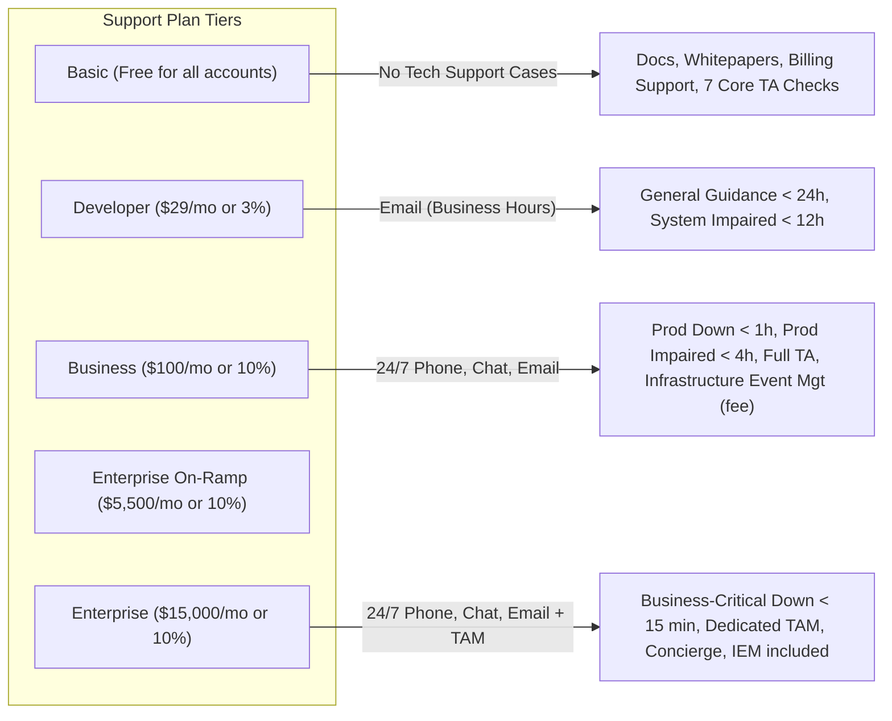

# AWS Support Plans

> **Category:** Billing & Cost Management / Customer Support  
> **Service Type:** Technical Assistance, SLA Response Times & Architectural Guidance  
> **Key Certifications:** AWS Certified Cloud Practitioner (CLF-C02) — High Yield Topic!

---

## 💡 The Real-World Analogy (ELI5)

> **Healthcare Coverage Tiers:**
> - **Basic Support (Free):** The emergency first-aid kit in your home cabinet. You can read the instruction manual and call billing if your card is charged wrongly, but you cannot call a nurse.
> - **Developer Support (9/mo):** Telehealth clinic during business hours. 1 primary contact can ask general guidance questions with a 12–24 hour callback time.
> - **Business Support (00/mo+):** 24/7 urgent care emergency room. Unlimited contacts can call or live chat anytime; doctors arrive within 1 hour if your production system is down. Full Trusted Advisor health checks.
> - **Enterprise Support (5,000/mo+):** A personal, dedicated concierge doctor (Technical Account Manager - TAM) living on your property who reviews your architecture, participates in disaster game days, and rushes into the room in under 15 minutes if a crisis occurs.

---

## 1. Overview & Comparison Matrix

AWS provides four primary commercial support tiers designed to meet varying business needs, from hobbyists and experimenters to mission-critical global enterprises.

---

## 2. Detailed Breakdown of Each Plan

| Feature | Basic | Developer | Business | Enterprise On-Ramp | Enterprise |
| :--- | :--- | :--- | :--- | :--- | :--- |
| **Monthly Cost** | Free ($0) | Starting at $29/mo (or 3% of spend) | Starting at $100/mo (or sliding %: 10% to 3%) | Starting at $5,500/mo (or 10% of spend) | Starting at $15,000/mo (or sliding %: 10% to 3%) |
| **Technical Support Access** | **None** (Customer service & billing inquiries only) | Cloud Support Associates (Business hours via email) | Cloud Support Engineers (24/7 via phone, web chat, and email) | Cloud Support Engineers (24/7 via phone, web chat, and email) | Cloud Support Engineers (24/7 via phone, web chat, and email) |
| **Number of Case Contacts** | Unlimited billing contacts | 1 primary contact | Unlimited contacts / IAM users | Unlimited contacts | Unlimited contacts |
| **AWS Trusted Advisor** | 7 core security & quota checks | 7 core security & quota checks | **Full checks** (500+ checks across all 5 pillars) | **Full checks** | **Full checks** |
| **Technical Account Manager (TAM)** | None | None | None | **Pool of TAMs** | **Designated TAM** (Named individual) |
| **Concierge Support Team** | None | None | None | **Yes** (Billing & account specialists) | **Yes** (Billing & account specialists) |
| **Infrastructure Event Management (IEM)** | None | None | Available for additional fee | 1 event included per year | **Included** (Architecture planning for launches) |

---

## 3. SLA Case Severity Response Times

| Severity Level | Definition | Basic | Developer | Business | Enterprise On-Ramp | Enterprise |
| :--- | :--- | :--- | :--- | :--- | :--- | :--- |
| **General Guidance** | How-to questions, service recommendations. | N/A | **< 24 hours** | **< 24 hours** | **< 24 hours** | **< 24 hours** |
| **System Impaired** | Non-critical functions abnormal. | N/A | **< 12 hours** | **< 12 hours** | **< 12 hours** | **< 12 hours** |
| **Production System Impaired** | Core business application partially degraded. | N/A | N/A | **< 4 hours** | **< 4 hours** | **< 4 hours** |
| **Production System Down** | Workload completely offline for users. | N/A | N/A | **< 1 hour** | **< 1 hour** | **< 1 hour** |
| **Business-Critical System Down** | Mission-critical operations stopped; business revenue lost. | N/A | N/A | N/A | **< 30 minutes** | **< 15 minutes** |

---

## 4. Specialized Roles in Support Plans

### Technical Account Manager (TAM)
- **Role:** Direct technical advisor and advocate within AWS.
- **Activities:** Conducts architectural reviews, coordinates Well-Architected Framework reviews, oversees incident escalation, and assists with proactive operational planning.
- **Availability:** Only included in **Enterprise Support** (Dedicated/Designated) and **Enterprise On-Ramp** (Pool of TAMs).

### AWS Concierge Support
- A specialized team of billing and account experts assigned to Enterprise and Enterprise On-Ramp customers to answer billing inquiries, consolidate invoicing, and assist with account migrations.

### Infrastructure Event Management (IEM)
- Structured program where AWS engineers and TAMs prepare your architecture for high-traffic events (e.g., Black Friday, Super Bowl, national product launches), ensuring capacity reservations and active 24/7 monitoring.

---

## 5. Exam Essentials (CLF-C02 Tips)

> [!IMPORTANT]
> - *Who provides 24/7 access to Cloud Support Engineers via phone?* **Business Support** and higher (Developer is business hours email only).
> - *What is the response time for a Production System Down?* **< 1 hour** (Business & Enterprise).
> - *What is the response time for Business-Critical System Down?* **< 15 minutes** (Enterprise Support only; 30 min for Enterprise On-Ramp).
> - *Which plan includes a designated Technical Account Manager (TAM)?* **Enterprise Support**.
> - *Can you open technical support cases on the Basic Plan?* **NO**. Only billing, account management, and service quota requests.
---

## 7. Post-Topic Question Simulation & Retention Check

Test your understanding of AWS Support Plans & Marketplace with these 5 exam-style questions:

## 🎯 Exam Traps & 'Clue-to-Answer' Trigger Words

| Support Plan Feature | Developer | Business | Enterprise On-Ramp | Enterprise |
| :--- | :---: | :---: | :---: | :---: |
| **Technical Account Manager (TAM)** | No | No | Pool of TAMs | **Dedicated TAM** |
| **Critical System Down SLA** | None | < 1 hr (Production down) | < 30 min (Business-critical) | **< 15 min** (Business-critical) |
| **Who can open support cases?** | 1 primary contact | Unlimited contacts | Unlimited contacts | Unlimited contacts |
| **Support Channels** | Business hours email | 24/7 phone, web, chat | 24/7 phone, web, chat | 24/7 phone, web, chat |
| **Infrastructure Event Management (IEM)** | No | Available for fee | 1 event / year | **Included** |
| **AWS Trusted Advisor** | 7 core checks | **Full 115+ checks** | **Full 115+ checks** | **Full 115+ checks** |

---

### Question 1
**Which AWS Support plan is the lowest-tier plan that provides 24/7 access to Cloud Support Engineers via phone, email, and chat for an unlimited number of contacts?**
- A) Developer Support
- B) Business Support
- C) Basic Support
- D) Enterprise On-Ramp

<b>Click to View Answer & Explanation</b>

**Correct Answer:** **B) Business Support**  
- **Why it's correct:** The Business Support plan is the entry tier for production workloads, offering 24/7 phone/chat/email technical support with 1-hour response times for production system outages and full access to all AWS Trusted Advisor checks.
- **Distractor Analysis:**
  - *A is incorrect:* Developer Support provides business-hours email support only for a single primary contact.

### Question 2
**An enterprise running mission-critical workloads on AWS requires a designated Technical Account Manager (TAM) to provide proactive architectural guidance and operational reviews. Which support plan must they purchase?**
- A) Business Support
- B) Enterprise Support
- C) Developer Support
- D) Basic Support

<b>Click to View Answer & Explanation</b>

**Correct Answer:** **B) Enterprise Support**  
- **Why it's correct:** The Enterprise Support plan includes a dedicated Technical Account Manager (TAM), consultative architectural reviews, Infrastructure Event Management (IEM), and a 15-minute response SLA for business-critical outages.

### Question 3
**What response time SLA does the AWS Enterprise Support plan guarantee for a "Business-Critical System Down" support case?**
- A) Under 15 minutes
- B) Under 1 hour
- C) Under 4 hours
- D) Under 24 hours

<b>Click to View Answer & Explanation</b>

**Correct Answer:** **A) Under 15 minutes**  
- **Why it's correct:** Enterprise Support provides a guaranteed response time of less than 15 minutes for business-critical outages (Enterprise On-Ramp guarantees < 30 minutes).

### Question 4
**What is AWS Marketplace?**
- A) A physical hardware store for purchasing AWS Snowball devices
- B) A digital catalog featuring thousands of software listings from third-party independent software vendors (ISVs) that run on AWS with integrated billing
- C) A retail website for purchasing Amazon consumer electronics
- D) A forum for hiring freelance cloud consultants

<b>Click to View Answer & Explanation</b>

**Correct Answer:** **B) A digital catalog featuring thousands of software listings from third-party independent software vendors (ISVs) that run on AWS with integrated billing**  
- **Why it's correct:** AWS Marketplace is an online store where customers can find, test, buy, and deploy third-party software, AMIs, containers, and SaaS solutions with charges appearing directly on their AWS invoice.

### Question 5
**Which AWS support tier includes full access to all 5 categories of AWS Trusted Advisor best-practice checks at the lowest cost?**
- A) Developer Support
- B) Business Support
- C) Basic Support
- D) AWS Free Tier

<b>Click to View Answer & Explanation</b>

**Correct Answer:** **B) Business Support**  
- **Why it's correct:** While Basic and Developer plans only include the 7 core security and service quota checks, Business Support unlocks the full library of all Trusted Advisor checks across Cost Optimization, Security, Fault Tolerance, Performance, and Service Quotas.

