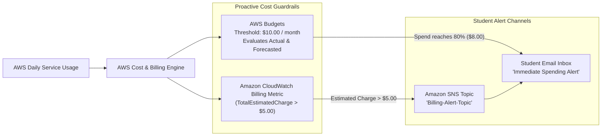

# Lab 4: Setting Up Proactive Billing Alerts with AWS Budgets & CloudWatch

> **Course:** AWS Certified Cloud Practitioner (CLF-C02)  
> **Domain Focus:** Domain 4 (Billing, Pricing, and Support)  
> **Estimated Duration:** 20–30 minutes  
> **Level:** Foundational (Student Hands-On)  
> **Cost to Student:** **\$0.00 (First 2 AWS Budgets are Free)**

---

## 🎯 Lab Objectives

In this hands-on lab, students will implement financial guardrails to prevent surprise cloud bills:
1. Enable **Receive CloudWatch Billing Alerts** in the AWS Billing preferences.
2. Create an **AWS Budget** with an actual and forecasted monthly threshold (e.g., \$10.00).
3. Configure automated email notifications when spending exceeds 80% of budget.
4. Create an **Amazon CloudWatch Billing Alarm** integrated with **Amazon SNS** to alert on total charges.

---

## 🏗️ Architecture Diagram

---

## 📋 Prerequisites
* An active AWS Account.
* Access to your personal email inbox to confirm SNS and Budgets subscriptions.

---

## 🛠️ Step-by-Step Instructions

### Step 1: Enable CloudWatch Billing Alerts in Billing Console
1. In the top AWS search bar, type **Billing** and navigate to the **Billing and Cost Management Console**.
2. In the left navigation pane, under **Preferences**, click **Billing preferences**.
3. Under **Alert preferences**, verify that **Receive AWS Free Tier alerts** is checked.
4. Check **Receive CloudWatch billing alerts**.
5. Click **Save preferences**.

---

### Step 2: Create a Monthly Cost Budget in AWS Budgets
1. In the left navigation pane of the Billing console, click **Budgets** (or navigate to **AWS Budgets** via search).
2. Click **Create budget**.
3. Under **Budget setup**, choose **Customize (advanced)** -> **Cost budget - Recommended**, and click **Next**.
4. Configure the budget parameters:
   * **Budget name:** `Student-Monthly-Safety-Budget`.
   * **Period:** `Monthly`.
   * **Budget renewal type:** `Recurring budget`.
   * **Budgeting method:** `Fixed`.
   * **Enter your budgeted amount (\$):** `10.00`.
5. Click **Next** to configure **Set alert thresholds**.
6. Under **Alert 1**:
   * Set **Threshold:** `80` % of budgeted amount (\$8.00).
   * Trigger: **Actual**.
   * Email recipients: Enter your personal email address.
7. Click **Add alert threshold** for **Alert 2**:
   * Set **Threshold:** `100` % of budgeted amount (\$10.00).
   * Trigger: **Forecasted** *(alerts you if AWS predicts your spending will breach \$10 by month's end!)*.
   * Email recipients: Enter your personal email address.
8. Click **Next**, review your budget settings, and click **Create budget**.

---

### Step 3: Verify the Safety Guardrail
1. In the AWS Budgets dashboard, you will now see `Student-Monthly-Safety-Budget` with a green progress bar showing current actual spend versus your \$10.00 limit.
2. Check your email inbox. You will receive an immediate confirmation email confirming your subscription to the budget notification channel.

---

## 🧹 Clean-Up (Optional)
* *Recommendation:* **DO NOT DELETE THIS BUDGET!** Keep this budget active on your AWS account throughout your certification study and student teaching to ensure you are never surprised by unexpected cloud charges.
