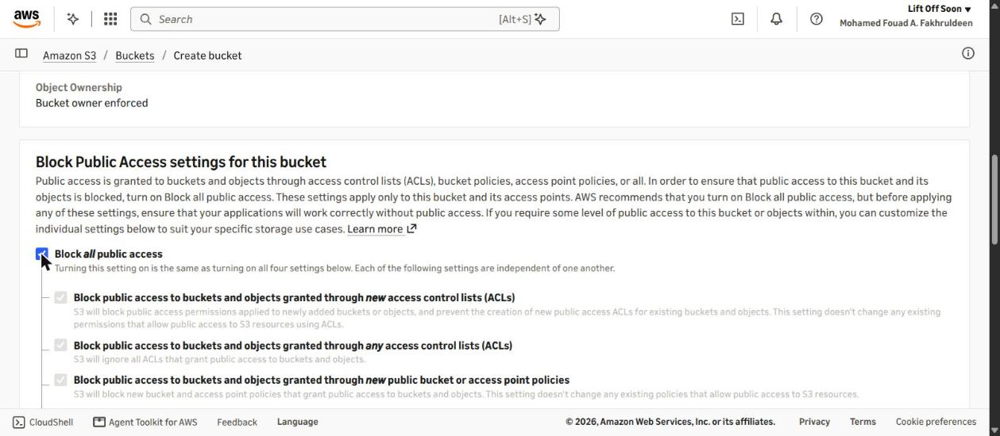
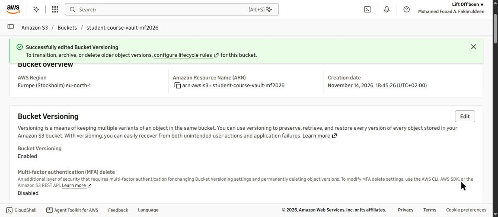
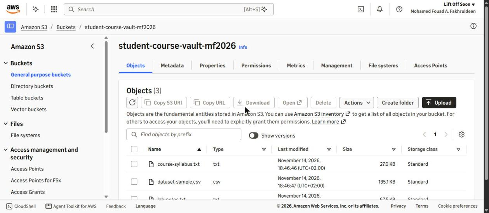
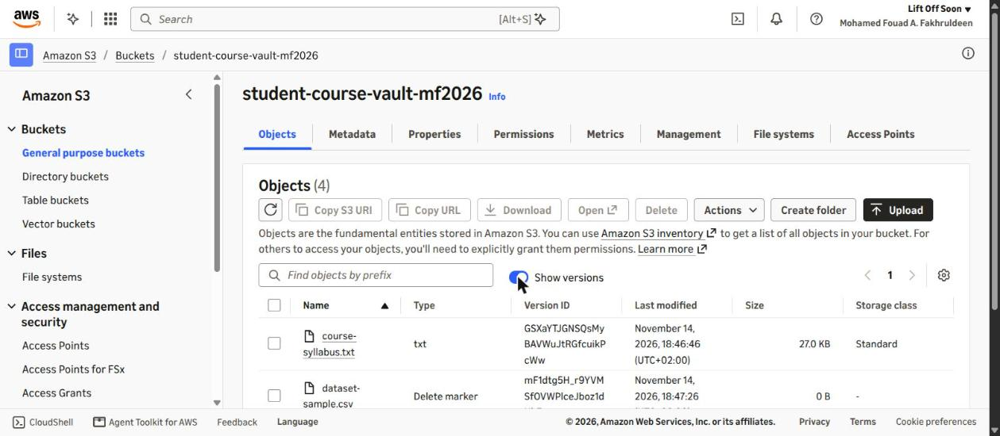
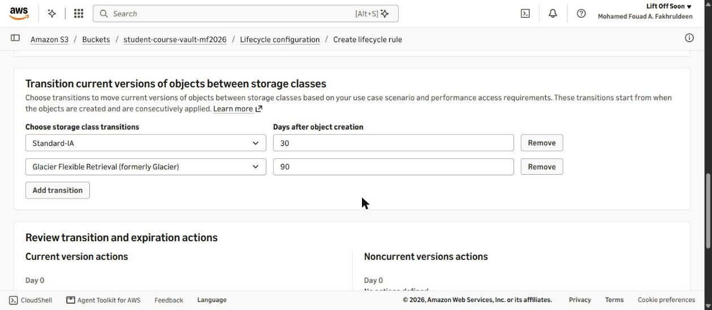
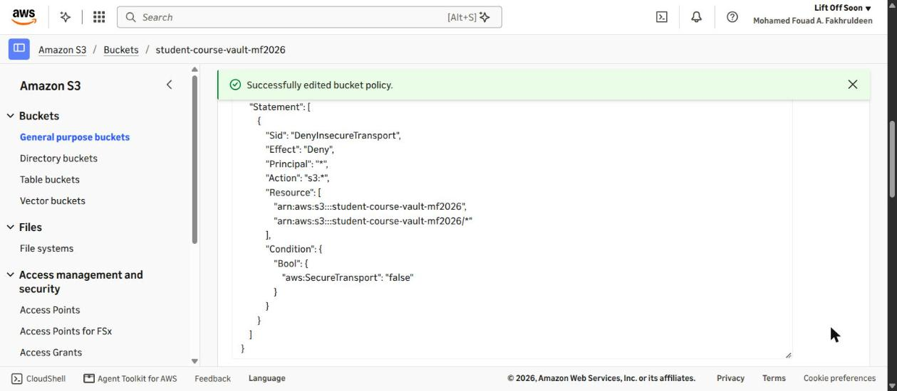

# Lab 07: Object Storage (Amazon S3, Versioning & Lifecycle Policies)

> **Focus:** Amazon S3, Storage Classes, Bucket Versioning, Delete Markers, Lifecycle Transition Rules, and Bucket Policies  
> **Region:** Global (Data resident in `eu-north-1`)  
> **Course Domain:** Domain 3: Cloud Technology & Services  
> **Associated Vault Note:** [Amazon_S3](../09_Notes_and_Cheatsheets/services/Storage/Amazon_S3.md)  

---

## 🧭 Prerequisite Concept Refresher: Object Storage Architecture

### 1. Object Storage vs. Block/File Storage
- **Object Storage (S3):** Stores data as independent **objects** (data file + rich metadata + unique key) inside a flat hierarchy called a **bucket**. Objects are accessed via HTTP REST APIs (`GET`, `PUT`, `DELETE`). S3 offers virtually unlimited capacity without pre-provisioning storage volumes.
- **Durability vs. Availability:**
  - **Durability ($99.999999999\%$ / 11 9s):** AWS automatically redundantly replicates your objects across at least **3 separate physical Availability Zones** within the Region. If you store 10,000,000 files, you would statistically expect to lose a single file once every 10,000 years!
  - **Availability ($99.9\%$ to $99.99\%$):** The percentage of time the S3 API endpoint is reachable to return requests.

### 2. S3 Storage Classes Tiering Matrix
| Storage Class | Use Case & Retrieval | Minimum Billable Duration | Retrieval Fee? |
| :--- | :--- | :--- | :--- |
| **S3 Standard** | Active, frequently accessed data | None | ❌ No |
| **S3 Intelligent-Tiering** | Unknown or unpredictable access patterns (Auto-tiers to save costs) | None | ❌ No retrieval fee |
| **S3 Standard-IA** | Infrequently accessed data, rapid ms retrieval | 30 days | ✅ Yes (per GB retrieved) |
| **S3 One Zone-IA** | Non-critical, easily reproducible data (Single AZ) | 30 days | ✅ Yes |
| **S3 Glacier Flexible Archive**| Long-term compliance backups (Minutes to hours retrieval)| 90 days | ✅ Yes |
| **S3 Glacier Deep Archive**| Lowest cost storage in the cloud (Retrieval in 12–48 hours) | 180 days | ✅ Yes |

### 3. S3 Versioning & Delete Markers
When **Versioning** is enabled, deleting an object does **not** destroy the underlying data. Instead, S3 inserts a lightweight pointer called a **Delete marker**. To restore the accidentally deleted file, you simply delete the Delete marker!

---

## 🛠️ Step-by-Step Console Walkthrough

### Step 1: Create an Amazon S3 Bucket
1. In the AWS Management Console, navigate to the **S3 Console**.
2. Click the orange **Create bucket** button.
3. Configure the bucket:
   - **Bucket name:** Must be **globally unique** across all AWS accounts worldwide (e.g., `student-cloud-vault-2026-yourname`).
   - **AWS Region:** Select `Europe (Stockholm) eu-north-1`.
   - **Block Public Access settings for this bucket:** Ensure **Block *all* public access** is **checked** (defense in depth).
4. Click **Create bucket**.


*Figure 7.1: Creating a globally unique, private S3 bucket in Stockholm.*

---

### Step 2: Enable S3 Bucket Versioning
1. Click on your newly created bucket name in the list.
2. Navigate to the **Properties** tab.
3. In the **Bucket Versioning** card, click **Edit**.
4. Select **Enable** and click **Save changes**.


*Figure 7.2: Enabling bucket versioning to protect against accidental deletion and overwrites.*

---

### Step 3: Upload Sample Files & Inspect Metadata
1. Click on the **Objects** tab -> Click **Upload**.
2. Click **Add files**, choose one or two sample text or image files, and click **Upload**.
3. Select an uploaded object to inspect its **Details**:
   - Notice the **S3 URI** (`s3://bucket-name/file.txt`).
   - Notice the **Object URL** (`https://bucket-name.s3.eu-north-1.amazonaws.com/file.txt`).
   - Notice the assigned **Storage class** (`Standard`) and **ETag** (MD5 checksum).


*Figure 7.3: Uploaded objects with standard storage class and metadata.*

---

### Step 4: Demonstrate Versioning & Delete Marker Recovery
1. In the **Objects** tab, select one of your uploaded files and click **Delete**.
2. Type `delete` in the confirmation dialog and confirm.
3. In the bucket's Objects tab, toggle the **Show versions** switch to ON.
4. You will observe:
   - The file is still there!
   - A **Delete marker** sits above the original file version.
5. Select the **Delete marker** and click **Delete** (permanently deleting the marker).
6. Toggle **Show versions** to OFF. The original file immediately reappears in your active file list!


*Figure 7.4: Recovering an accidentally deleted file by removing its S3 Delete marker.*

---

### Step 5: Configure S3 Lifecycle Transition Rules
Automate moving aging data to lower-cost archival storage classes:
1. Navigate to the **Management** tab of the bucket.
2. In the **Lifecycle rules** section, click **Create lifecycle rule**.
3. Configure the rule:
   - **Lifecycle rule name:** `AutoArchiveOldLogs`
   - **Rule scope:** Apply to all objects in the bucket (check the acknowledgement box).
   - Under **Lifecycle rule actions**, check:
     - *Move current versions of objects between storage classes*
     - *Permanently delete noncurrent versions of objects*
   - Set transitions:
     - **Transition to Standard-IA:** After `30` days.
     - **Transition to Glacier Flexible Archive:** After `90` days.
4. Click **Create rule**.


*Figure 7.5: Automated tiering policy transitioning objects across storage classes over time.*

---

### Step 6: Enforce In-Transit Encryption via Bucket Policy
1. Navigate to the **Permissions** tab.
2. In the **Bucket policy** section, click **Edit**.
3. Paste the following JSON policy requiring secure HTTPS (`aws:SecureTransport: true`):

```json
{
  "Version": "2012-10-17",
  "Statement": [
    {
      "Sid": "EnforceTLSRequestsOnly",
      "Effect": "Deny",
      "Principal": "*",
      "Action": "s3:*",
      "Resource": [
        "arn:aws:s3:::YOUR-BUCKET-NAME",
        "arn:aws:s3:::YOUR-BUCKET-NAME/*"
      ],
      "Condition": {
        "Bool": {
          "aws:SecureTransport": "false"
        }
      }
    }
  ]
}
```
*(Replace `YOUR-BUCKET-NAME` with your actual bucket name).*
4. Click **Save changes**. Unencrypted HTTP connections are now blocked.


*Figure 7.6: JSON bucket policy denying all unencrypted in-transit HTTP requests.*

---

## 💻 AWS CLI Verification Commands

```bash
# 1. List S3 buckets in your account
aws s3 ls --profile aws-notes

# 2. Upload a file directly via AWS CLI
echo "Testing AWS S3 CLI upload" > test-file.txt
aws s3 cp test-file.txt s3://YOUR-BUCKET-NAME/test-file.txt --profile aws-notes

# 3. View object versions and delete markers
aws s3api list-object-versions \
  --bucket "YOUR-BUCKET-NAME" \
  --profile aws-notes
```

---

## 🎯 Exam Practice: Scenarios & Traps

| Exam Scenario | Correct Recommendation | Why Distractors Fail |
|---|---|---|
| *"A company has unpredictable data access patterns where some files are read daily while others remain untouched for months. They want to minimize costs with zero management overhead."* | **S3 Intelligent-Tiering** | S3 Standard-IA charges retrieval fees if access becomes frequent. S3 Intelligent-Tiering automatically moves data between frequent and infrequent access tiers without retrieval fees. |
| *"A healthcare provider must archive X-ray images for 10 years to meet compliance mandates. Data is almost never accessed, but when requested, a 12-hour retrieval window is acceptable. Lowest cost is the primary factor."* | **S3 Glacier Deep Archive** | S3 Glacier Flexible Retrieval is more expensive per GB. S3 Glacier Deep Archive offers the absolute lowest storage cost in the entire AWS Cloud. |
| *"An employee accidentally deletes an essential file from an S3 bucket with Versioning enabled. How can the file be restored?"* | **Delete the Delete Marker associated with that file** | In a versioned bucket, a DELETE operation simply places a Delete Marker at the top of the version stack. Removing the marker makes the previous version active again. |
| *"A financial institution requires that audit records stored in S3 cannot be deleted, altered, or overwritten by ANY user, including the AWS account Root user, for 7 years."* | **S3 Object Lock in Compliance Mode** | S3 Versioning can be disabled by Root. Governance Mode allows privileged users to delete files. Compliance Mode enforces strict WORM (Write Once, Read Many) compliance that cannot be overridden by anyone. |

---

## 🧹 Free Tier Cleanup & Cost Safeguard
> [!CAUTION]
> An S3 bucket cannot be deleted if it contains objects or past versions!

1. In the **S3 Console**, select your bucket.
2. Click **Empty** -> Type `permanently delete` to wipe all objects and version histories.
3. Select the empty bucket -> Click **Delete** -> Type the bucket name to confirm deletion.
