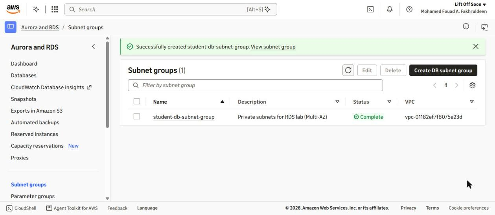
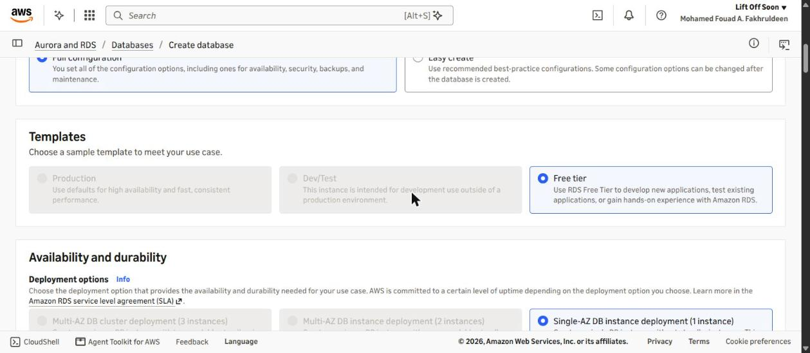
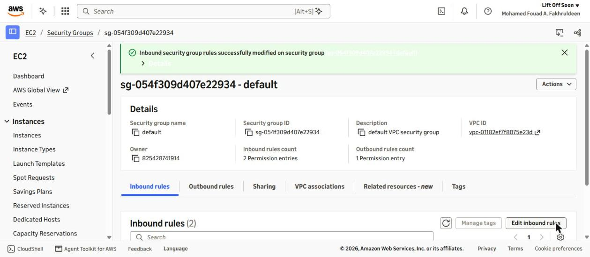
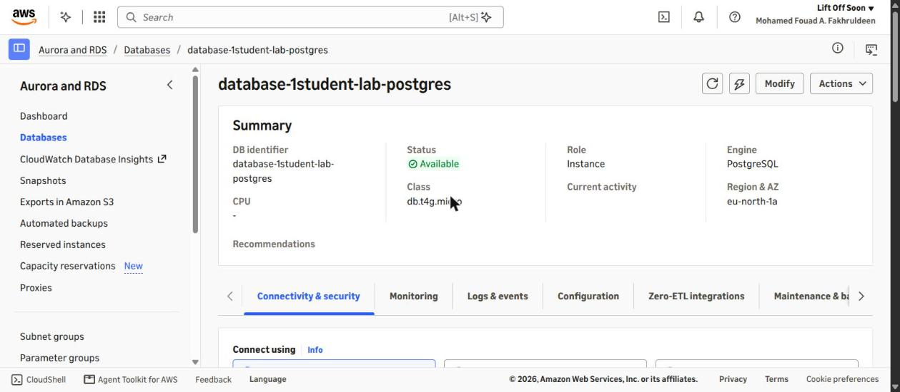

# Lab 09: Relational Databases (Amazon RDS Multi-AZ & Read Replicas)

> **Focus:** Amazon Relational Database Service (RDS), DB Subnet Groups, PostgreSQL Engine, Multi-AZ High Availability, and Read Replicas  
> **Region:** `eu-north-1` (Stockholm)  
> **Course Domain:** Domain 3: Cloud Technology & Services  
> **Associated Vault Notes:** [Amazon_RDS](../09_Notes_and_Cheatsheets/services/Database/AWS_Databases_Overview.md)  

---

## 🧭 Prerequisite Concept Refresher: Relational Cloud Architecture

### 1. What is Amazon RDS?
Amazon RDS is a managed service that automates time-consuming database administrative tasks:
- **Managed Tasks (AWS Responsibility):** Hardware provisioning, operating system installation and patching, database engine minor version upgrades, automated daily backups, multi-AZ synchronous replication, and automated storage volume expansion.
- **Customer Tasks (Your Responsibility):** Schema design, SQL indexing, query optimization, database tuning parameters, network placement, and IAM/database credential security.

### 2. Multi-AZ Failover vs. Read Replicas (The Essential Exam Distinction)
| Feature | Amazon RDS Multi-AZ | Amazon RDS Read Replicas |
| :--- | :--- | :--- |
| **Primary Goal** | **High Availability & Disaster Recovery** | **Read Scalability & Query Offloading** |
| **Replication Method** | **Synchronous** (Zero data loss) | **Asynchronous** (Eventual consistency) |
| **Active / Passive** | **Passive Standby** (Cannot serve queries) | **Active** (Serves read-only SQL queries) |
| **Failover Mechanism** | **Automatic DNS failover** (under 60s) | Manual promotion to standalone database |
| **Cross-Region?** | No (Within same Region across 2 AZs) | **Yes** (Supports Cross-Region Read Replicas) |

### 3. What is a DB Subnet Group?
A DB Subnet Group is a collection of private subnets that you define in an Amazon VPC. AWS mandates that a DB Subnet Group must span **at least two Availability Zones** in the Region. This allows RDS to automatically deploy or fail over to a standby database instance in another AZ without network reconfiguration.

---

## 🛠️ Step-by-Step Console Walkthrough

### Step 1: Create an RDS DB Subnet Group
1. In the AWS Management Console, navigate to the **Amazon RDS Console** in `eu-north-1`.
2. In the left navigation pane, click **Subnet groups**.
3. Click **Create DB subnet group**:
   - **Name:** `student-db-subnet-group`
   - **Description:** `Private database subnets across 2 AZs`
   - **VPC:** Select `student-lab-vpc`.
   - **Availability Zones:** Select `eu-north-1a` and `eu-north-1b`.
   - **Subnets:** Select the two **Private Subnets** created in Lab 01.
4. Click **Create**.


*Figure 9.1: Creating a multi-AZ DB subnet group spanning private subnets.*

---

### Step 2: Configure Database Engine & Tier
1. In the left navigation pane, click **Databases** -> Click **Create database**.
2. Choose **Standard create**.
3. Under **Engine options**, select **PostgreSQL**.
4. Under **Templates**, select **Free tier** (automatically selects single-AZ `db.t3.micro`/`db.t4g.micro` to maintain zero-cost learning).
5. Set **DB instance identifier:** `student-order-db`.
6. Set **Master username:** `dbadmin` and enter a strong master password.


*Figure 9.2: Selecting PostgreSQL under the Free Tier template.*

---

### Step 3: Configure Network Placement & Security Group
1. Under **Connectivity**:
   - **Virtual Private Cloud (VPC):** `student-lab-vpc`.
   - **DB subnet group:** `student-db-subnet-group`.
   - **Public access:** **No** (database instances must NEVER be assigned public IPs).
2. Under **VPC security group (firewall)**:
   - Select **Create new** or choose an existing database security group (`rds-postgres-sg`).
   - Configure an inbound rule permitting **PostgreSQL (TCP port 5432)** with the source set to **`web-tier-sg`** (ensuring only your EC2 web instances can communicate with the database).


*Figure 9.3: Restricting database ingress strictly to port 5432 from the web tier security group.*

3. Scroll to the bottom and click **Create database**.

---

### Step 4: Verify Database Availability & Extract Endpoint
1. In the **Databases** list, wait until the status transitions from *Creating* to **Available** (typically 5–8 minutes).
2. Click on `student-order-db` to open its summary dashboard:
   - Notice the **Endpoint** (e.g., `student-order-db.xxxxxxxx.eu-north-1.rds.amazonaws.com`).
   - Notice the **Port** (`5432`).
   - Notice the **Automated backups: Enabled** (point-in-time recovery).


*Figure 9.4: Available database cluster showing connection endpoint and network configuration.*

---

### Step 5: Multi-AZ & Read Replica Considerations
> [!NOTE]
> Under production workloads (Standard Dev/Test or Production templates):
> - **Multi-AZ:** You can select *Multi-AZ DB instance* during creation or modify an existing DB to enable it with zero downtime.
> - **Read Replica:** Under **Actions** -> **Create read replica**, you can launch up to 15 read replicas to offload reporting queries.

---

## 💻 AWS CLI Verification Commands

```bash
# 1. Inspect RDS database status and endpoint
aws rds describe-db-instances \
  --db-instance-identifier "student-order-db" \
  --query "DBInstances[*].{ID:DBInstanceIdentifier,Engine:Engine,Status:DBInstanceStatus,Endpoint:Endpoint.Address,MultiAZ:MultiAZ}" \
  --output table \
  --region eu-north-1 \
  --profile aws-notes

# 2. Verify DB Subnet Group coverage
aws rds describe-db-subnet-groups \
  --db-subnet-group-name "student-db-subnet-group" \
  --region eu-north-1 \
  --profile aws-notes
```

---

## 🎯 Exam Practice: Scenarios & Traps

| Exam Scenario | Correct Recommendation | Why Distractors Fail |
|---|---|---|
| *"A business needs its relational MySQL database to achieve high availability with zero data loss and automated failover in case an Availability Zone suffers an outage."* | **Enable Amazon RDS Multi-AZ Deployment** | Read Replicas are asynchronous and designed for read scaling, not immediate automated failover. S3 backups take hours to restore. |
| *"A reporting dashboard is causing severe CPU contention on the primary production database due to heavy read-only SQL queries. How can this be resolved without downtime?"* | **Create one or more Amazon RDS Read Replicas and point the reporting dashboard to the read replica endpoints** | Multi-AZ standby instances are synchronous disaster recovery copies and cannot accept read queries. Upgrading instance size requires brief maintenance downtime. |
| *"Which cloud-native AWS database engine replicates 6 copies of data across 3 Availability Zones and delivers up to 5x the throughput of standard MySQL?"* | **Amazon Aurora** | Standard Amazon RDS MySQL stores data on single-AZ EBS volumes with optional synchronous replication to one standby. Aurora replicates 6 ways across 3 AZs by default. |
| *"What administrative task remains the customer's responsibility when running Amazon RDS under the Shared Responsibility Model?"* | **Optimizing database queries, building schema tables, and managing database user credentials** | AWS manages OS installation, OS security patches, underlying hardware, and automated disk storage backups. |

---

## 🧹 Free Tier Cleanup & Cost Safeguard
> [!CAUTION]
> Even under the Free Tier, keeping active RDS instances running long-term will exhaust your 750 monthly free hours. Always delete when done.

1. In the **RDS Console**, select `student-order-db`.
2. Click **Actions** -> **Delete**.
3. **Uncheck** *Create final snapshot?* (for temporary lab databases).
4. Acknowledge the permanent deletion prompt, type `delete me`, and confirm.
5. In **Subnet groups**, select `student-db-subnet-group` -> Click **Delete**.
