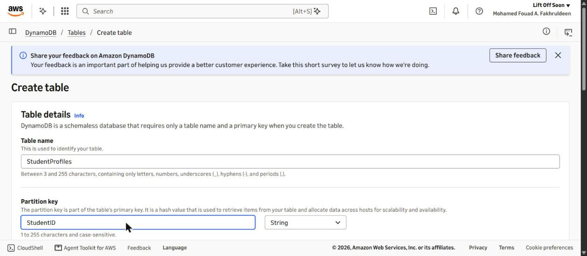
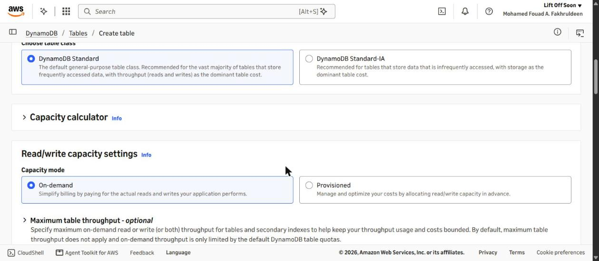
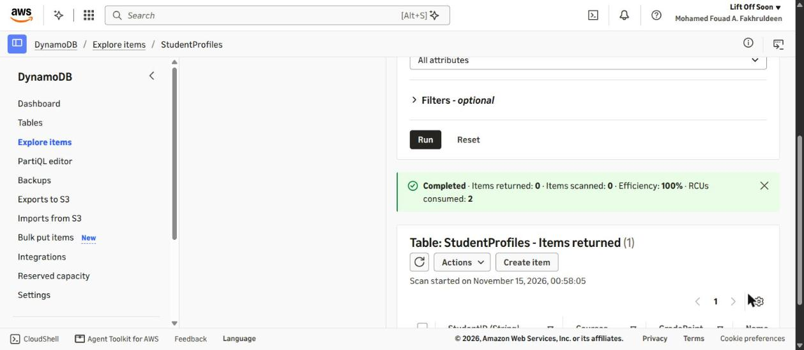
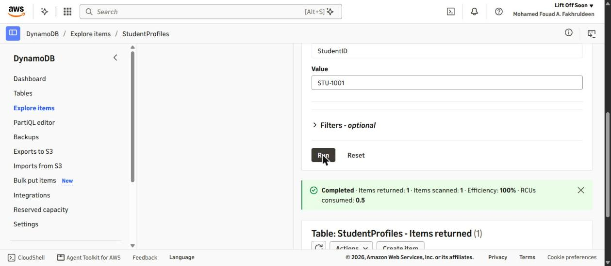
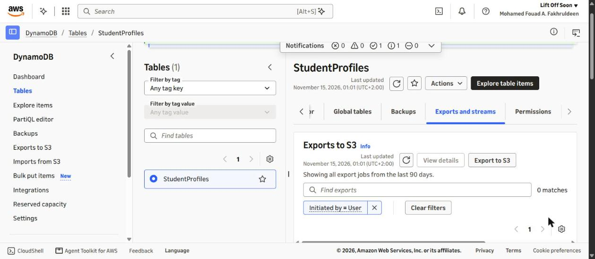

# Lab 10: NoSQL & In-Memory Caching (DynamoDB & DAX)

> **Focus:** Amazon DynamoDB, Key-Value Data Modeling, Partition Keys, On-Demand Capacity, Query vs. Scan, and DynamoDB Streams  
> **Region:** `eu-north-1` (Stockholm)  
> **Course Domain:** Domain 3: Cloud Technology & Services  
> **Associated Vault Notes:** [Amazon_DynamoDB](../09_Notes_and_Cheatsheets/services/Database/AWS_Databases_Overview.md)  

---

## 🧭 Prerequisite Concept Refresher: NoSQL Foundations

### 1. Relational (RDS) vs. Non-Relational (DynamoDB)
- **Relational Databases (RDS):** Built for structured tabular data with rigid schemas, foreign keys, and complex multi-table `JOIN` operations. Scales primarily vertically (larger compute instances).
- **Non-Relational Databases (DynamoDB):** Built for massive scale, unstructured or semi-structured data, and high-concurrency throughput. Delivers **consistent single-digit millisecond latency at any scale** (from 10 items to 10 billion items). Scales horizontally across partitions automatically.

### 2. Primary Keys in DynamoDB
- **Partition Key (Simple Primary Key):** A single attribute (e.g., `StudentID`). DynamoDB runs the partition key value through an internal hash function to determine the exact physical storage partition where the item is stored.
- **Partition Key + Sort Key (Composite Primary Key):** Composed of two attributes (e.g., `CustomerID` [Partition Key] + `OrderTimestamp` [Sort Key]). All items with the same partition key are stored together in sorted order by the sort key.

### 3. Query vs. Scan (The Classic Exam Performance Distinction)
- **Query:** Searches items using the Primary Key. It directly hits the physical hash partition and retrieves only the matching items. **Ultra-fast, predictable single-digit ms latency, highly cost-efficient**.
- **Scan:** Traverses and reads **every single item** in the entire table from beginning to end, and then filters the results. **Slow, computationally expensive, exhausts throughput**. *Rule of thumb: Always design tables to use Query instead of Scan.*

### 4. DynamoDB Accelerator (DAX)
A fully managed, highly available, in-memory cache purpose-built for DynamoDB that delivers up to a 10x performance boost—taking latency from milliseconds to **microseconds** (sub-millisecond) for read-heavy workloads.

---

## 🛠️ Step-by-Step Console Walkthrough

### Step 1: Create a DynamoDB Table
1. In the AWS Management Console, navigate to the **DynamoDB Console** in `eu-north-1`.
2. Click the orange **Create table** button.
3. Configure table settings:
   - **Table name:** `StudentProfiles`
   - **Partition key:** `StudentID` (Type: `String`).
   - Leave Sort key blank (simple primary key).


*Figure 10.1: Defining the table name and partition key in the DynamoDB console.*

---

### Step 2: Configure On-Demand Capacity Mode
1. Under **Table settings**, select **Customize settings**.
2. Under **Read/write capacity settings**, select **On-demand**:
   - Automatically adapts instantly to your application's read and write request volume.
   - You pay strictly per request with **zero capacity planning, zero throttling, and zero idle costs**.
3. Under **Secondary indexes**, review GSI/LSI options.
4. Under **Encryption at rest**, keep default (AWS owned KMS key).
5. Click **Create table**. The table becomes active within 5–10 seconds!


*Figure 10.2: Selecting serverless On-Demand capacity mode.*

---

### Step 3: Insert Heterogeneous JSON Items
Because DynamoDB is schema-less, each item can possess completely different attributes:
1. In the left navigation pane, click **Explore items** -> Select `StudentProfiles`.
2. Click **Create item**.
3. Insert attributes for Student 1:
   - `StudentID` (String): `STD-1001`
   - Click **Add new attribute** -> `String`: `Name` = `Alice Johnson`
   - Add new attribute -> `Number`: `GPA` = `3.95`
   - Add new attribute -> `List`: `EnrolledCourses` = `["AWS-Cloud", "DevOps"]`
4. Click **Create item**.
5. Repeat to add Student 2 (`STD-1002`, `Bob Smith`), adding a unique attribute `GraduationYear` = `2026`.


*Figure 10.3: Creating semi-structured items with flexible attributes in DynamoDB.*

---

### Step 4: Execute a Targeted Query vs. Scan
1. In the **Explore items** pane for `StudentProfiles`:
2. Toggle the action from **Scan** to **Query**:
   - In the **Partition key** box, enter `STD-1001`.
   - Click **Run**.
3. Notice that DynamoDB performs a direct hash lookup and returns the single matching record in **1 millisecond**, reading only 1 item.
4. Now toggle back to **Scan** and click **Run**. Notice how it reads every record in the table.


*Figure 10.4: Targeted Query execution retrieving specific items by Partition Key.*

---

### Step 5: Enable DynamoDB Streams for Event-Driven Architectures
DynamoDB Streams captures a time-ordered log of item-level modifications (inserts, updates, deletes) for up to 24 hours:
1. Click on the **Exports and streams** tab of `StudentProfiles`.
2. In the **DynamoDB stream details** section, click **Turn on**.
3. Select **New and old images** (captures both the previous state and new state of modified items).
4. Click **Turn on stream**. This stream can now directly trigger AWS Lambda functions to build real-time reactive pipelines!


*Figure 10.5: Enabling DynamoDB Streams to capture real-time item modifications.*

---

## 💻 AWS CLI Verification Commands

```bash
# 1. Query an item using the AWS CLI
aws dynamodb get-item \
  --table-name "StudentProfiles" \
  --key '{"StudentID": {"S": "STD-1001"}}' \
  --region eu-north-1 \
  --profile aws-notes

# 2. Inspect table status and billing mode
aws dynamodb describe-table \
  --table-name "StudentProfiles" \
  --query "Table.{Name:TableName,Status:TableStatus,Billing:BillingModeSummary.BillingMode,ItemCount:ItemCount}" \
  --region eu-north-1 \
  --profile aws-notes
```

---

## 🎯 Exam Practice: Scenarios & Traps

| Exam Scenario | Correct Recommendation | Why Distractors Fail |
|---|---|---|
| *"An application requires a serverless NoSQL database that can store JSON user profile documents and guarantees single-digit millisecond response times at massive scale."* | **Amazon DynamoDB** | Amazon RDS and Aurora are relational SQL engines requiring schema migrations and instance management. DynamoDB is serverless NoSQL. |
| *"A gaming leaderboard running on DynamoDB requires sub-millisecond (microsecond) read response times during international tournaments."* | **Amazon DynamoDB Accelerator (DAX)** | ElastiCache Redis requires application code refactoring. DAX is a seamless, API-compatible in-memory cache purpose-built for DynamoDB. |
| *"A mobile app experiences unpredictable, spiky viral traffic bursts with long quiet periods. How should DynamoDB capacity be configured to optimize cost?"* | **On-Demand Capacity Mode** | Provisioned capacity requires estimating RCUs/WCUs and will either throttle during sudden spikes or waste money during quiet periods. |
| *"An enterprise must deploy a multi-region active-active database that allows users in Tokyo, London, and Virginia to read and write locally with automatic multi-directional replication."* | **Amazon DynamoDB Global Tables** | Amazon RDS Multi-AZ does not support multi-master writes across multiple global AWS regions. DynamoDB Global Tables provides fully managed multi-region active-active replication. |

---

## 🧹 Free Tier Cleanup & Cost Safeguard
> [!NOTE]
> DynamoDB provides **25 GB of storage** and 25 WCU/RCU in the Always Free tier.

1. In the **DynamoDB Console**, click **Tables**.
2. Select `StudentProfiles` -> Click **Delete**.
3. Type `delete` in the confirmation box and click **Delete table**.
