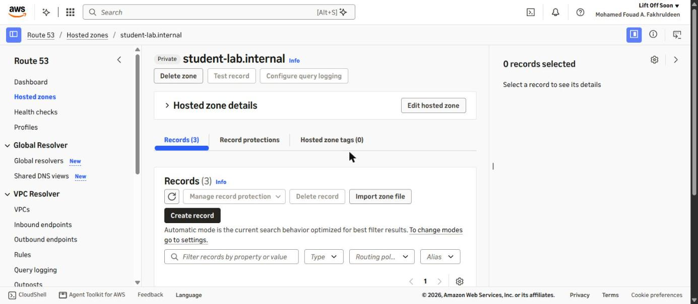
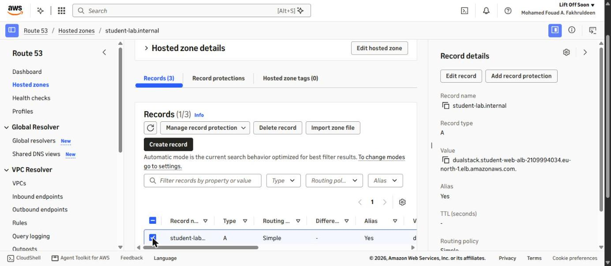
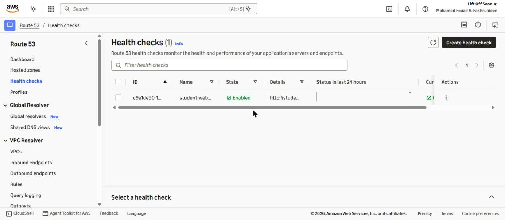
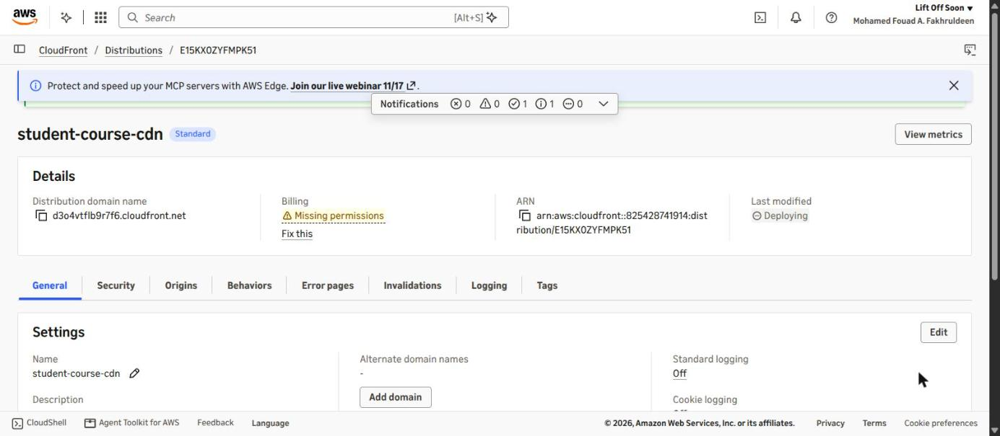
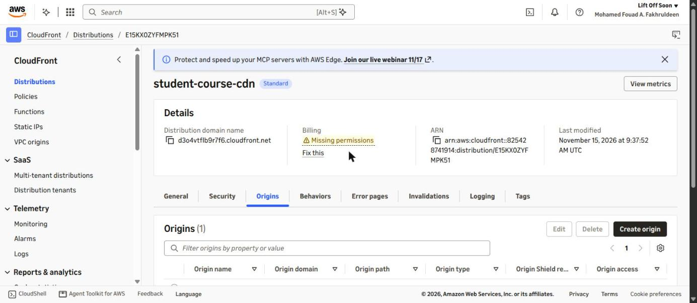
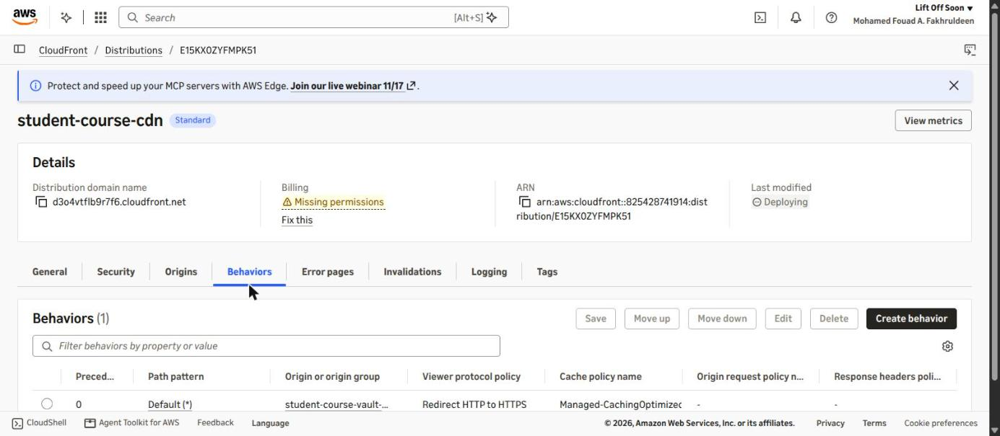
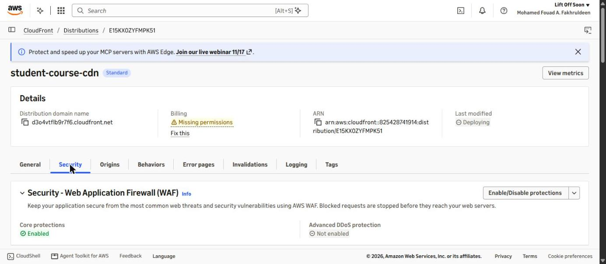

# Lab 11: Edge Acceleration & Global DNS (Route 53 & CloudFront)

> **Focus:** Amazon Route 53, Public Hosted Zones, Alias Records, Amazon CloudFront CDN, Origin Access Control (OAC), and AWS WAF  
> **Region:** Global (Edge Locations worldwide)  
> **Course Domain:** Domain 3: Cloud Technology & Services  
> **Associated Vault Notes:** [Amazon_Route_53](../09_Notes_and_Cheatsheets/services/Networking_ContentDelivery/Amazon_VPC_and_Networking.md), [Amazon_CloudFront](../09_Notes_and_Cheatsheets/services/Networking_ContentDelivery/Amazon_CloudFront_and_Global_Accelerator.md), [AWS_WAF](../09_Notes_and_Cheatsheets/services/Security_Identity_Compliance/AWS_Security_Services.md)  

---

## 🧭 Prerequisite Concept Refresher: Global Edge Networking

### 1. The Global Edge Network
AWS maintains hundreds of **Edge Locations** and **Regional Edge Caches** across the world connected directly to the AWS global private fiber network. Edge services (Route 53, CloudFront, AWS WAF, AWS Shield) run directly on these edge servers close to end users, minimizing latency and terminating security threats before they reach origin servers.

### 2. Route 53: Alias Records vs. CNAME Records
- **CNAME (Canonical Name):** A standard DNS record that maps one hostname to another (e.g., `www.example.com` $\to$ `alb-1234.amazonaws.com`). **Cannot be used for the Zone Apex / Root Domain** (e.g., `example.com` without `www`).
- **Alias Record (AWS Proprietary):** An AWS extension to DNS. Can map the **Zone Apex (`example.com`) directly to AWS resources** (ALB, CloudFront, S3 Website, API Gateway). Dynamically updates if the underlying resource IP changes. **DNS queries to AWS Alias records are completely free of charge!**

### 3. Amazon CloudFront & Origin Access Control (OAC)
- **CloudFront CDN:** Caches static web content (images, videos, HTML) and accelerates dynamic API responses by onboarding traffic onto the AWS fiber backbone at the nearest edge location.
- **Origin Access Control (OAC):** Secures Amazon S3 origins behind CloudFront. Ensures that **users cannot bypass CloudFront** to read files directly from the S3 bucket URL.

---

## 🛠️ Step-by-Step Console Walkthrough

### Step 1: Create a Route 53 Public Hosted Zone
1. In the AWS Management Console, navigate to the **Route 53 Console**.
2. In the left navigation pane, click **Hosted zones** -> Click **Create hosted zone**:
   - **Domain name:** Enter a simulated domain (e.g., `studentcoursecloud.com`).
   - **Type:** **Public hosted zone** (accessible via the public internet).
3. Click **Create hosted zone**. Route 53 automatically provisions default **NS (Name Server)** and **SOA (Start of Authority)** records.


*Figure 11.1: Public hosted zone created with standard NS and SOA authoritative records.*

---

### Step 2: Create a Route 53 Alias Record for Zone Apex
1. Inside the hosted zone, click **Create record**.
2. Configure the record:
   - **Record name:** Leave blank (routes the root zone apex `studentcoursecloud.com`).
   - **Record type:** `A - Routes traffic to an IPv4 address and some AWS resources`.
   - Toggle **Alias** to **ON**:
     - **Route traffic to:** Select *Alias to Application and Classic Load Balancer*.
     - **Region:** `Europe (Stockholm) [eu-north-1]`.
     - **Choose load balancer:** Select `student-web-alb` (created in Lab 04).
   - **Routing policy:** `Simple routing`.
3. Click **Create records**.


*Figure 11.2: Creating a zero-cost Alias record mapping the zone apex directly to an ALB.*

---

### Step 3: Configure a Route 53 Health Check
1. In the left navigation pane, click **Health checks** -> Click **Create health check**.
2. Configure:
   - **Name:** `alb-web-health-check`
   - **What to monitor:** `Endpoint`
   - **Specify endpoint by:** `Domain name` (paste the ALB DNS name).
   - **Protocol:** `HTTP`, **Port:** `80`, **Path:** `/`.
   - **Request interval:** `Standard (30 seconds)`.
3. Click **Next** -> Click **Create health check**.


*Figure 11.3: Route 53 Health Check actively polling application availability for failover routing.*

---

### Step 4: Create a CloudFront Distribution with S3 Origin
1. Navigate to the **CloudFront Console**.
2. Click **Create distribution**.
3. Under **Origin domain**, select your S3 bucket (created in Lab 07, `student-course-vault-...`).


*Figure 11.4: CloudFront distribution creation targeting Amazon S3 as the origin.*

---

### Step 5: Configure Origin Access Control (OAC)
1. Under **Origin access**, select **Origin access control settings (recommended)**.
2. Click **Create new OAC** -> Set Signing behavior: *Always sign requests* -> Click **Create**.
3. AWS displays a yellow notification banner: *"You must update the S3 bucket policy"*. CloudFront provides a button to copy the policy statement granting read permissions strictly to this CloudFront distribution ARN.


*Figure 11.5: Origin Access Control configuration securing S3 content behind edge endpoints.*

---

### Step 6: Configure HTTPS Redirection & Caching Behavior
1. In the **Default cache behavior** section:
   - **Viewer protocol policy:** Select **Redirect HTTP to HTTPS** (ensures all traffic is encrypted in transit).
   - **Allowed HTTP methods:** `GET, HEAD`.
   - **Cache key and origin requests:** Select **CachePolicy: CachingOptimized** (recommended default).
2. Click **Create distribution** at the bottom of the page.


*Figure 11.6: Enforcing HTTPS viewer protocol redirection at the CloudFront edge.*

---

### Step 7: Attach AWS WAF for Edge Layer 7 Protection
1. Navigate to **AWS WAF & Shield**.
2. Click **Create web ACL**:
   - **Resource type:** `Amazon CloudFront distributions`.
   - **Region:** `Global (CloudFront)`.
   - **Associated AWS resources:** Select your newly created CloudFront distribution.
3. In **Add rules and rule groups**, click **Add managed rule groups**:
   - Add **AWSManagedRulesCommonRuleSet** (protects against OWASP Top 10 vulnerabilities including SQL injection and Cross-Site Scripting / XSS).
   - Add **AWSManagedRulesAmazonIpReputationList** (blocks known botnets and malicious scanners).
4. Click through to **Create web ACL**.


*Figure 11.7: AWS WAF Web ACL inspecting Layer 7 traffic directly at global edge locations.*

---

## 💻 AWS CLI Verification Commands

```bash
# 1. List Route 53 hosted zones
aws route53 list-hosted-zones --profile aws-notes

# 2. List CloudFront distributions and verify edge domain name
aws cloudfront list-distributions \
  --query "DistributionList.Items[*].{Id:Id,Domain:DomainName,Status:Status,Enabled:Enabled}" \
  --output table \
  --profile aws-notes

# 3. Test HTTP to HTTPS redirection using curl
curl -I http://YOUR-CLOUDFRONT-DOMAIN.cloudfront.net
# Output should display: HTTP/1.1 301 Moved Permanently -> Location: https://...
```

---

## 🎯 Exam Practice: Scenarios & Traps

| Exam Scenario | Correct Recommendation | Why Distractors Fail |
|---|---|---|
| *"A website needs to point its root apex domain name (`example.com`) directly to an Application Load Balancer. Standard DNS CNAME records cannot be used at the root level. What should be configured?"* | **Create an Amazon Route 53 Alias Record** | DNS RFC prohibits CNAME records on the zone apex. Route 53 Alias records are AWS-native pointers that work seamlessly at the root level and update automatically when underlying ALB IPs change. |
| *"A media streaming website has global users in Australia and Europe complaining of slow video buffering from a centralized S3 bucket in Virginia. How can latency be reduced globally?"* | **Deploy an Amazon CloudFront Distribution in front of the S3 bucket** | Moving the S3 bucket to Australia only harms European users. CloudFront caches content at 600+ Points of Presence worldwide, serving data from local edge caches. |
| *"How can a company strictly enforce that users cannot bypass a CloudFront CDN and access the underlying private Amazon S3 bucket directly?"* | **Configure Origin Access Control (OAC) on the CloudFront distribution and restrict the S3 bucket policy** | Bucket policies alone without OAC will either block CloudFront or expose the bucket publicly. OAC signs requests from CloudFront to S3. |
| *"What is the primary difference between Amazon CloudFront and AWS Global Accelerator?"* | **CloudFront caches content (HTTP/S) at Edge Locations; Global Accelerator does NOT cache, but provides 2 static Anycast IPs to route TCP/UDP traffic over AWS's private network** | Both leverage AWS global edge infrastructure, but Global Accelerator is for non-HTTP routing and static IP preservation without content caching. |

---

## 🧹 Free Tier Cleanup & Cost Safeguard
> [!NOTE]
> Route 53 charges \$0.50 per hosted zone per month. Delete hosted zones when testing is complete.

1. In the **CloudFront Console**, select your distribution -> Click **Disable** -> Once disabled, click **Delete**.
2. In **AWS WAF**, select your Web ACL -> Disassociate the distribution -> Click **Delete**.
3. In **Route 53**, select your Health Check -> Click **Delete**.
4. In **Hosted zones**, delete any custom records you created, then select the hosted zone and click **Delete zone**.
