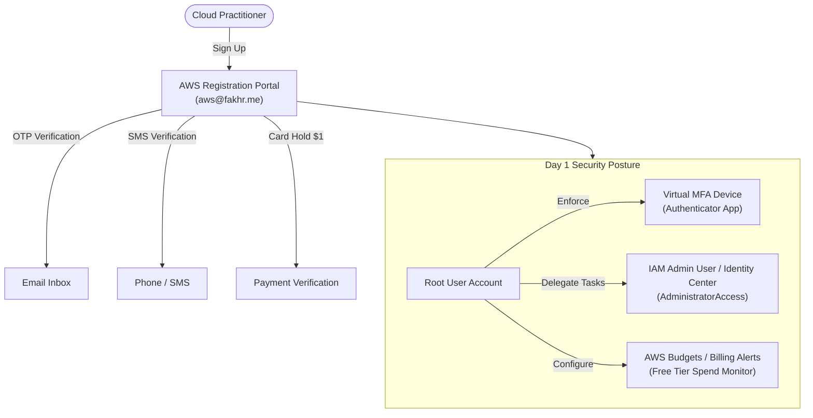
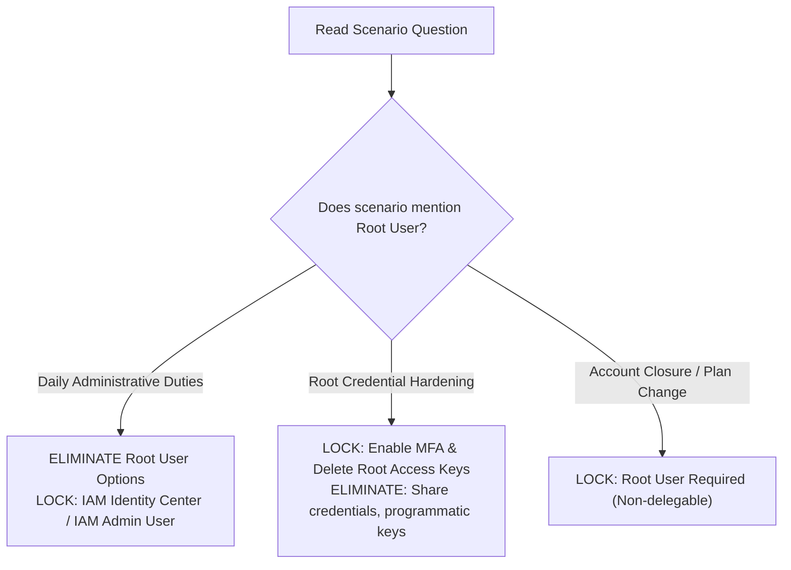
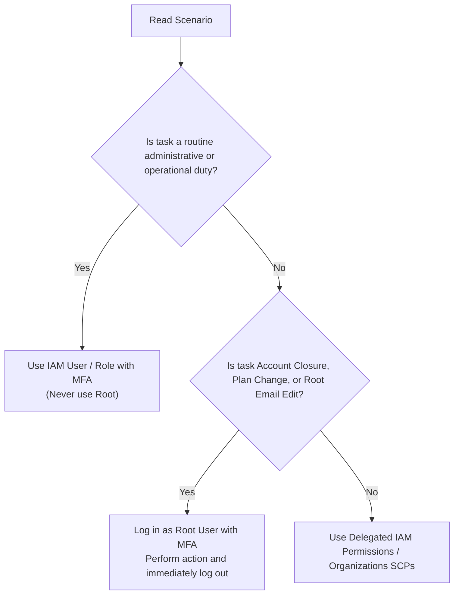

# Tutorial 00: AWS Account Creation & Security Baseline

This tutorial walks through the foundational process of creating a new AWS Free Tier account, securing the root user with Multi-Factor Authentication (MFA), and creating an administrative identity for day-to-day operations.

---

## 📌 Associated Notes & Blueprints
- [Shared_Responsibility_Model](../09_Notes_and_Cheatsheets/concepts/Shared_Responsibility_Model.md)
- [AWS_IAM](../09_Notes_and_Cheatsheets/services/Security_Identity_Compliance/AWS_IAM_and_Identity.md)
- [Cloud_Economics_and_Billing_Models](../09_Notes_and_Cheatsheets/concepts/Cloud_Economics_and_Billing_Models.md)
- [CLF-C02_Master_Blueprint](../01_Syllabus/CLF-C02_Master_Blueprint.md)

---

## 🏗️ Architecture Overview



---

## 🚀 Execution Steps

### Step 1: Account Creation Walkthrough
Follow the complete registration walkthrough documented in the work repository:
👉 `work/07_Hands_On_Labs/00_Account_Creation_Walkthrough.md`

### Step 2: Essential Day-1 Security Configurations

#### 1. Enable Root Multi-Factor Authentication (MFA)
Under the AWS Shared Responsibility Model, customer security starts with locking down the root credentials:
1. Navigate to the **IAM Console**.
2. Click **Security Credentials** on the top right account dropdown.
3. In the **Multi-factor authentication (MFA)** section, click **Assign MFA**.
4. Select **Authenticator app** and scan the QR code using Google Authenticator or 1Password.
5. Enter two consecutive 6-digit MFA codes and click **Add MFA**.

#### 2. Configure AWS Free Tier Spend Alerts
1. Open the **Billing and Cost Management Console**.
2. Under **Preferences**, select **Billing Preferences**.
3. Enable:
   - **Receive Free Tier Usage Alerts**
   - **Receive Billing Alerts**
4. Set email to receive alerts: `aws@fakhr.me`.

---

## 💻 CLI Verification Commands

Once your credentials are authenticated with your profile (`aws-notes`):

```bash
# Verify caller identity and account number
aws sts get-caller-identity --profile aws-notes

# Verify default region assignment
aws configure get region --profile aws-notes

# Confirm CloudWatch alarms or billing metric accessibility
aws cloudwatch list-metrics --namespace "AWS/Billing" --region us-east-1 --profile aws-notes
```


---

## 4. 🎯 Authentic Architecture Exam Practice
> Practice real-world scenarios tested on official AWS examinations that directly apply the architectural patterns built in this tutorial.

### Scenario Practice 1: CLF-C02-ET-Q053
**Question:**  
A company is using AWS Identity and Access Management (IAM).

Who can manage the access keys of the AWS account root user?

**Options:**
- A) IAM users in the same account that have been granted permission
- B) IAM roles in any account that have been granted permission
- C) IAM users and roles that have been granted permission
- D) The AWS account owner

<details>
<summary><b>View Verified Answer & Solution Analysis</b></summary>

**Correct Answer:** `D`  
**Peer Consensus:** `100%` agreement.  

**Architectural Breakdown & Distractor Analysis:**
- **Option A is INCORRECT:** Even IAM users with full `AdministratorAccess` policies cannot view, generate, or delete access keys for the root user. Root credentials operate outside standard IAM policy evaluation.
- **Option B is INCORRECT:** IAM roles cannot assume or manage root user security credentials.
- **Option C is INCORRECT:** AWS security architecture strictly prevents any delegation of root key management to users or roles.
- **Option D is CORRECT:** Only the AWS account owner, logging in directly with the root email address and password, can manage root user credentials (and AWS strongly recommends deleting all root access keys entirely).

</details>

### Scenario Practice 2: CLF-C02-ET-Q229
**Question:**  
Which actions are best practices for an AWS account root user? (Choose two.)

**Options:**
- A) Share root user credentials with team members.
- B) Create multiple root users for the account, separated by environment.
- C) Enable multi-factor authentication (MFA) on the root user.
- D) Create an IAM user with administrator privileges for daily administrative tasks, instead of using the root user.
- E) Use programmatic access instead of the root user and password.

<details>
<summary><b>View Verified Answer & Solution Analysis</b></summary>

**Correct Answer:** `C` and `D`  
**Peer Consensus:** `100%` agreement.  

**Architectural Breakdown & Distractor Analysis:**
- **Option A is INCORRECT:** Sharing root credentials violates individual identity accountability and creates an unmitigated enterprise risk.
- **Option B is INCORRECT:** Each AWS account has exactly one root user identity irrevocably bound to the account signup email. Multiple root users cannot exist.
- **Option C is CORRECT:** Enforcing Multi-Factor Authentication (MFA) on the root user is mandatory to protect against credential stuffing and brute-force compromise.
- **Option D is CORRECT:** Root credentials should be locked away. Routine administrative duties must be conducted via IAM users or IAM Identity Center administrative roles with logged actions in CloudTrail.
- **Option E is INCORRECT:** Creating programmatic access keys for the root user is an extreme security hazard; AWS Security Hub flags root access keys as a high-severity finding.

</details>

---

## 🎓 Master Architecture MCQ Blueprint: Account Security & Root Governance

> Pattern recognition rules mined from the master question bank to solve account governance and root security questions in under 15 seconds.

### Layer 1: "Clue-to-Service" Linguistic Decryption Matrix

| If Scenario Text Mentions... | Target Architecture / Action | Why (The Core Mechanism) | Decoy Trap to Avoid |
| :--- | :--- | :--- | :--- |
| **"First action after creating a new AWS account"** | **Enable MFA on Root & Lock Root Away** | Adds second-factor physical/virtual authentication token; prevents account takeover. | Creating access keys for root (dangerous security anti-pattern). |
| **"Daily administration of AWS resources"** | **IAM User / IAM Identity Center Role** | Enforces individual user accountability and least-privilege permissions. | Using root user with a strong password (root should never be used daily). |
| **"Who can manage root access keys?"** | **The AWS Account Owner Only** | IAM permissions cannot be delegated to manage root credentials. | IAM Administrator user (cannot see or manage root keys). |
| **"Tasks requiring the AWS account root user"** | **Change account plan, close account, change root email** | Only a tiny handful of non-delegable operations require root credentials. | Creating EC2 instances or S3 buckets (should be done via IAM). |
| **"Protecting against stolen root password"** | **Hardware / Virtual MFA** | Requires physical possession of FIDO token or authenticator app. | IP allowlisting alone (does not satisfy the multi-factor mandate). |

---

### Layer 2: 3-Step Rapid Elimination Heuristic



1. **Step 1: Identify the Identity Context:**
   - If the task is operational, provisioning, or daily management $\to$ **Eliminate any option that uses the root user**.
2. **Step 2: Check for Security Anti-Patterns:**
   - Eliminate options suggesting "sharing credentials", "creating multiple root users" (impossible), or "creating root access keys".
3. **Step 3: Check for Root-Exclusive Tasks:**
   - On the exam, root is ONLY legitimate for: closing the account, changing support plans, editing root email/billing details, and restoring IAM permissions if an admin locks themselves out.

---

### Layer 3: High-Frequency Decoy Autopsy

#### Decoy Trap: "Create Root Access Keys for Programmatic Automation"
* **The Exam Trap:** A question asks how a system administrator should automate infrastructure creation using the AWS CLI or Terraform.
* **The Decoy:** Option B: "Generate an Access Key ID and Secret Access Key for the root user."
* **The Fatal Flaw:** Never create access keys for root. If a root access key leaks on GitHub, attackers gain irreversible, unrestricted control over the entire AWS billing account.
* **The Correct Choice:** Create an IAM role or IAM user with scoped administrator permissions and short-lived credentials.

---

### Layer 4: 10-Second Visual Decision Flowchart


