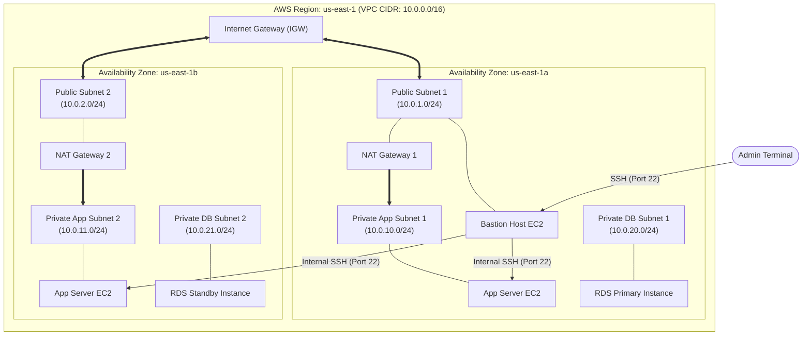
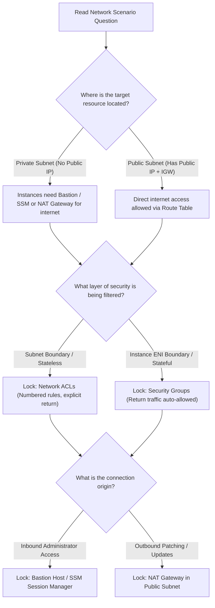
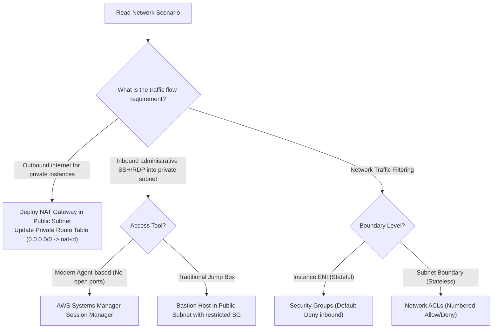

# Tutorial 01: Multi-Tier VPC Network Architecture & Bastion Host

> **Vault Section:** `04_Tutorials/`  
> **Topic:** Networking & Infrastructure Isolation  
> **Source Reference:** Rajesh Daswani (*Packt, 2026*), Project Tasks 7.1–7.3; Tom Taulli (*O'Reilly, 2026*), Ch 12.  
> **Associated Certifications:** [CLF-C02](../01_Syllabus/CLF-C02_Master_Blueprint.md), SAA-C03

---

## 1. Architectural Blueprint & Scenario

In this tutorial, you build a production-grade, multi-tier Amazon VPC designed for high availability and zero-trust perimeter isolation across two Availability Zones (`us-east-1a` and `us-east-1b`).



---

## 2. Step-by-Step Implementation Guide

### Step 1: Create the Amazon VPC
1. Open the Amazon VPC Console.
2. Select **Create VPC** -> **VPC only**.
3. Configure settings:
   - **Name tag:** `Production-VPC`
   - **IPv4 CIDR block:** `10.0.0.0/16` (provides 65,536 private IP addresses)
   - **Tenancy:** Default
4. Choose **Create VPC**.
5. Under **Actions**, select **Edit VPC settings**, enable **Enable DNS hostnames**, and save changes.

### Step 2: Provision Subnets Across Availability Zones
Create 6 distinct subnets:

| Subnet Name | Availability Zone | IPv4 CIDR Block | Role |
| :--- | :--- | :--- | :--- |
| `Public-Subnet-1a` | `us-east-1a` | `10.0.1.0/24` | Public Ingress / ALBs / NAT Gateway 1 / Bastion |
| `Public-Subnet-1b` | `us-east-1b` | `10.0.2.0/24` | Public Ingress / ALBs / NAT Gateway 2 |
| `Private-App-1a` | `us-east-1a` | `10.0.10.0/24` | Application Backend Fleet (EC2 / Containers) |
| `Private-App-1b` | `us-east-1b` | `10.0.11.0/24` | Application Backend Fleet (EC2 / Containers) |
| `Private-DB-1a` | `us-east-1a` | `10.0.20.0/24` | Database Subnet Group (RDS / Aurora Primary) |
| `Private-DB-1b` | `us-east-1b` | `10.0.21.0/24` | Database Subnet Group (RDS / Aurora Standby) |

*(Note: In each `/24` subnet, AWS reserves 5 IP addresses: `.0` Network, `.1` VPC router, `.2` DNS server, `.3` Future use, `.255` Broadcast. Net usable IPs = 251).*

### Step 3: Attach Internet Gateway & Configure Public Route Table
1. Under **Internet Gateways**, choose **Create internet gateway** (`Prod-IGW`).
2. Attach `Prod-IGW` to `Production-VPC`.
3. Create Route Table `Public-RT`:
   - Add Route: Destination `0.0.0.0/0` -> Target `Prod-IGW`.
   - Associate with `Public-Subnet-1a` and `Public-Subnet-1b`.

### Step 4: Deploy NAT Gateways for Private Egress
1. Navigate to **NAT Gateways** -> **Create NAT gateway**.
2. Name: `NAT-GW-1a`. Subnet: `Public-Subnet-1a`. Allocate an **Elastic IP**.
3. Create Route Table `Private-RT-1a`:
   - Add Route: Destination `0.0.0.0/0` -> Target `NAT-GW-1a`.
   - Associate with `Private-App-1a`.
4. *(Repeat for AZ 1b for full Multi-AZ egress redundancy).*

### Step 5: Configure Layered Security Groups
1. **Bastion-SG:**
   - Inbound: SSH (Port 22) -> Source: `YOUR_OFFICE_PUBLIC_IP/32` (Never `0.0.0.0/0`).
   - Outbound: All traffic.
2. **App-SG:**
   - Inbound: SSH (Port 22) -> Source: `Bastion-SG` (Security Group reference!).
   - Inbound: HTTP (Port 80) -> Source: `ALB-SG`.
   - Outbound: All traffic (reaches internet via NAT Gateway).
3. **Database-SG:**
   - Inbound: MySQL (Port 3306) or PostgreSQL (Port 5432) -> Source: `App-SG`.
   - Outbound: None.

### Step 6: Launch and Test Bastion Connectivity
1. Launch an Amazon Linux 2023 EC2 instance in `Public-Subnet-1a` attached to `Bastion-SG` and assign a public IP.
2. Launch a private backend EC2 instance in `Private-App-1a` attached to `App-SG` with **no public IP**.
3. From your local terminal:
   ```bash
   # Connect to the private instance using SSH Agent Forwarding through the Bastion
   ssh -A -i my-key.pem ec2-user@<BASTION_PUBLIC_IP>
   
   # From Bastion terminal, connect to the private backend IP
   ssh ec2-user@10.0.10.X
   
   # Test outbound internet connectivity from the private instance via NAT Gateway
   curl -I https://aws.amazon.com
   ```

---

## 3. Key Takeaways & Exam Distinctions
- **NAT Gateways MUST reside in a Public Subnet** and require an **Elastic IP address**.
- **Private instances communicate with NAT Gateways via private RFC 1918 IPs.** The NAT Gateway translates this to its public Elastic IP before forwarding packets to the Internet Gateway.
- **Security Group Chaining:** By referencing `Bastion-SG` as the source in `App-SG`, access is restricted to authenticated bastion traffic regardless of whether instances are replaced or scale out.


---

## 4. 🎯 Authentic Architecture Exam Practice
> Practice real-world scenarios tested on official AWS examinations that directly apply the architectural patterns built in this tutorial.

### Scenario Practice 1: CLF-C02-ET-Q026
**Question:**  
A company is using Amazon DynamoDB.
Which task is the company’s responsibility, according to the AWS shared responsibility model?

**Options:**
- A) Patch the operating system.
- B) Provision hosts.
- C) Manage database access permissions.
- D) Secure the operating system.

<details>
<summary><b>View Verified Answer & Solution Analysis</b></summary>

**Correct Answer:** `C`  
**Peer Consensus:** `100%` agreement.  

**Architectural Breakdown & Distractor Analysis:**
- **Option A is INCORRECT:** Amazon DynamoDB is a fully managed serverless NoSQL database service; AWS handles 100% of the underlying operating system maintenance and patching.
- **Option B is INCORRECT:** Hardware provisioning, server rack installation, and hypervisor scaling are managed entirely by AWS.
- **Option C is CORRECT:** Under the Shared Responsibility Model, data security "IN the cloud" remains the customer's responsibility. The customer must configure IAM access policies, resource-based policies, and table access controls.
- **Option D is INCORRECT:** Securing and hardening the host operating system of managed services belongs strictly to AWS.

</details>

### Scenario Practice 2: CLF-C02-ET-Q051
**Question:**  
Which of the following actions are controlled with AWS Identity and Access Management (IAM)? (Choose two.)

**Options:**
- A) Control access to AWS service APIs and to other specific resources.
- B) Provide intelligent threat detection and continuous monitoring.
- C) Protect the AWS environment using multi-factor authentication (MFA).
- D) Grant users access to AWS data centers.
- E) Provide firewall protection for applications from common web attacks.

<details>
<summary><b>View Verified Answer & Solution Analysis</b></summary>

**Correct Answer:** `A` and `C`  
**Peer Consensus:** `100%` agreement.  

**Architectural Breakdown & Distractor Analysis:**
- **Option A is CORRECT:** IAM policies define fine-grained authorization rules that govern which principals can invoke specific AWS service APIs against designated resource ARNs.
- **Option B is INCORRECT:** Automated threat detection and anomalous behavioral monitoring are delivered by Amazon GuardDuty.
- **Option C is CORRECT:** IAM natively provides and enforces Multi-Factor Authentication (MFA) configuration for root and IAM users.
- **Option D is INCORRECT:** Physical security and access to AWS biometric-controlled data centers is strictly restricted to authorized AWS infrastructure personnel. Customers are never granted data center access.
- **Option E is INCORRECT:** Web application firewall inspection against Layer 7 exploits (SQL injection, XSS) is provided by AWS WAF.

</details>

---

## 🎓 Master Architecture MCQ Blueprint: Multi-Tier VPC & Bastion Host Architectures

> Pattern recognition rules mined from the master question bank to solve network segmentation, bastion hosts, and security control questions in under 15 seconds.

### Layer 1: "Clue-to-Service" Linguistic Decryption Matrix

| If Scenario Text Mentions... | Target Architecture / Service | Why (The Core Mechanism) | Decoy Trap to Avoid |
| :--- | :--- | :--- | :--- |
| **"Securely administer private EC2 instances without internet exposure"** | **Bastion Host / EC2 Instance Connect / SSM Session Manager** | Hardened jump box in public subnet proxying SSH/RDP into private subnets. | Opening SSH (port 22) to `0.0.0.0/0` on private instances. |
| **"Private subnet database needs outbound patches only"** | **NAT Gateway in Public Subnet** | Allows one-way outbound internet traffic while blocking inbound connections. | Internet Gateway attached to private subnet (exposes instances to inbound attacks). |
| **"Stateless packet filtering at the subnet boundary"** | **Network Access Control Lists (NACLs)** | Evaluates inbound/outbound rules by number order; requires explicit return rules. | Security Groups (which are stateful at the ENI instance level). |
| **"Stateful firewall operating at the instance virtual network interface (ENI)"** | **Security Groups** | Return traffic is automatically allowed regardless of inbound rules. | NACLs (which are stateless at the subnet level). |
| **"Connect on-premises data center to AWS VPC over public internet with encryption"** | **AWS Site-to-Site VPN** | IPsec encrypted tunnel terminating on Virtual Private Gateway (VGW) or Transit Gateway. | AWS Direct Connect (dedicated private physical fiber, not internet-based). |

---

### Layer 2: 3-Step Rapid Elimination Heuristic



1. **Step 1: Check Resource Subnet Tier:**
   - Database / Backend application? MUST be in private subnet.
   - Load Balancer / NAT Gateway / Bastion? MUST be in public subnet.
2. **Step 2: Check Stateful vs. Stateless:**
   - Mentions "stateful" or "instance level"? $\to$ **Security Group**.
   - Mentions "stateless", "subnet level", or "explicit ephemeral port return rules"? $\to$ **Network ACL**.
3. **Step 3: Check Directionality:**
   - Outbound-only from private instances? $\to$ **NAT Gateway** (never IGW).
   - Inbound management? $\to$ **Bastion Host** or **AWS Systems Manager Session Manager**.

---

### Layer 3: High-Frequency Decoy Autopsy

#### Decoy Trap: Security Group vs. NACL Return Traffic
* **The Exam Trap:** A security engineer configures an inbound HTTP rule allowing port 80 traffic into an EC2 instance, but forgets to configure an outbound return rule. The question asks whether the client receives the web page response.
* **The Decoy:** "The client request times out because outbound port 80 traffic is not allowed."
* **The Fatal Flaw:** **Security Groups are stateful.** If traffic is permitted inbound, the return connection is tracked and automatically allowed outbound, regardless of outbound rules.
* **The Correct Choice:** The response succeeds because Security Groups automatically allow response traffic for established sessions.

---

### Layer 4: 10-Second Visual Decision Flowchart


