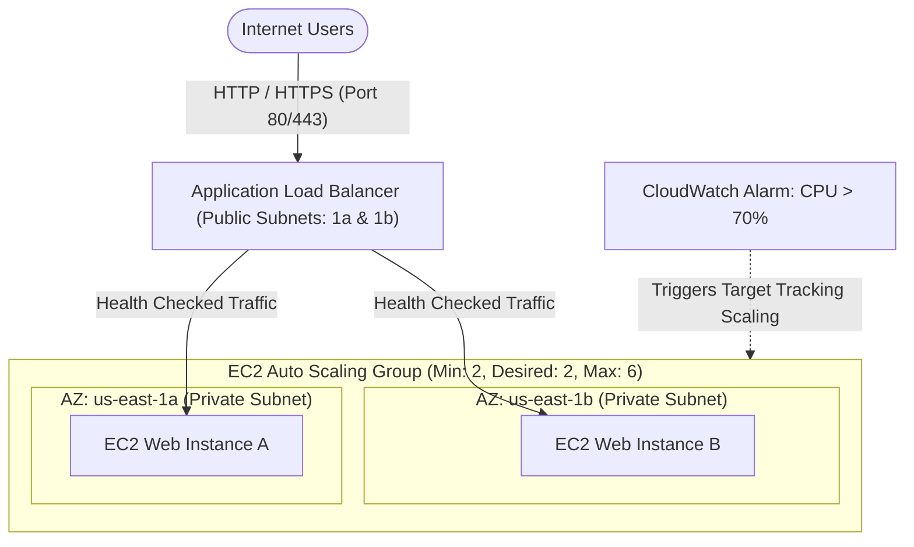
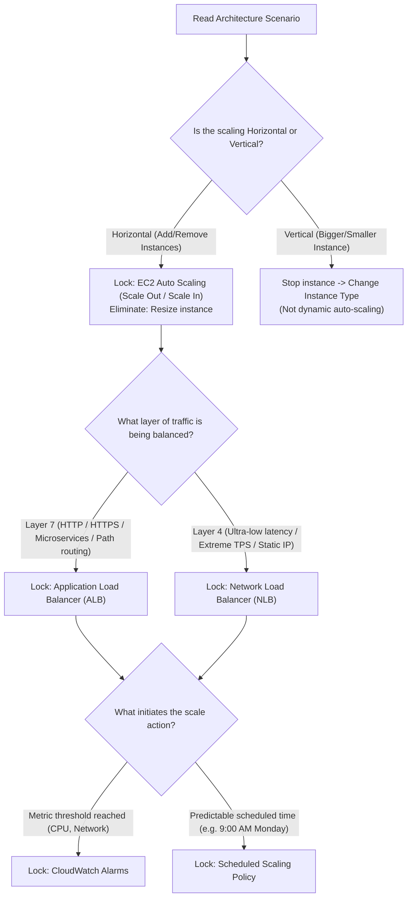
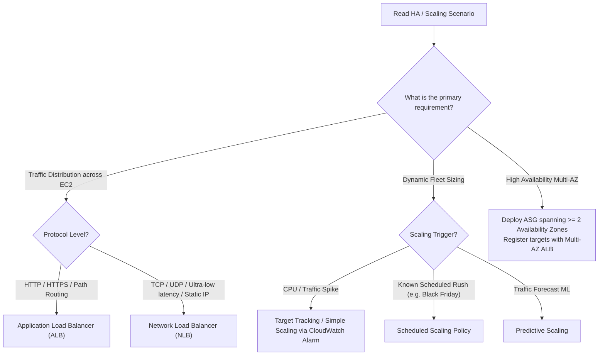

# Tutorial 02: Highly Available Auto Scaling Web Tier with Application Load Balancer

> **Vault Section:** `04_Tutorials/`  
> **Topic:** Elasticity & High Availability  
> **Source Reference:** Rajesh Daswani (*Packt, 2026*), Project Tasks 10.1–10.4; Tom Taulli (*O'Reilly, 2026*), Ch 9.  
> **Associated Certifications:** [CLF-C02](../01_Syllabus/CLF-C02_Master_Blueprint.md), SAA-C03

---

## 1. Architectural Blueprint & Scenario

In this tutorial, you deploy a fault-tolerant web application tier that automatically scales up during traffic surges and contracts during idle periods across two Availability Zones, fronted by an Application Load Balancer (ALB).



---

## 2. Step-by-Step Implementation Guide

### Step 1: Create an EC2 Launch Template
1. Open the Amazon EC2 Console -> **Launch Templates** -> **Create launch template**.
2. **Template name:** `WebTier-LaunchTemplate`.
3. **AMI:** Amazon Linux 2023 AMI.
4. **Instance type:** `t3.micro` (Free-Tier eligible).
5. **Key pair:** Optional (or select your management key pair).
6. **Network settings:**
   - Security Group: `Web-Instance-SG` (Allows inbound HTTP port 80 only from `ALB-SG`).
7. **Advanced Details -> User Data Script:**
   ```bash
   #!/bin/bash
   dnf update -y
   dnf install -y httpd
   systemctl start httpd
   systemctl enable httpd
   
   # Extract instance metadata to display dynamic Availability Zone on web page
   TOKEN=`curl -s -X PUT "http://169.254.169.254/latest/api/token" -H "X-aws-ec2-metadata-token-ttl-seconds: 21600"`
   AZ=`curl -s -H "X-aws-ec2-metadata-token: $TOKEN" http://169.254.169.254/latest/meta-data/placement/availability-zone`
   INSTANCE_ID=`curl -s -H "X-aws-ec2-metadata-token: $TOKEN" http://169.254.169.254/latest/meta-data/instance-id`
   
   echo "<h1>Hello from AWS High-Availability Web Tier</h1>" > /var/www/html/index.html
   echo "<p>Serving from <b>Availability Zone:</b> $AZ</p>" >> /var/www/html/index.html
   echo "<p>Instance ID: $INSTANCE_ID</p>" >> /var/www/html/index.html
   ```
8. Choose **Create launch template**.

### Step 2: Create ALB Target Group & Health Check
1. Under **Target Groups**, choose **Create target group**.
2. Target type: **Instances**.
3. Name: `WebTier-TargetGroup`. Protocol: **HTTP**, Port: **80**, VPC: `Production-VPC`.
4. Health check settings:
   - Protocol: `HTTP`, Path: `/index.html`
   - Healthy threshold: `3`, Unhealthy threshold: `2`, Timeout: `5s`, Interval: `15s`.
5. Select **Create target group** (instances will be registered dynamically by the Auto Scaling Group).

### Step 3: Provision the Application Load Balancer
1. Navigate to **Load Balancers** -> **Create load balancer** -> **Application Load Balancer**.
2. Name: `WebTier-ALB`. Scheme: **Internet-facing**. IP address type: IPv4.
3. Network mapping: Select `Production-VPC` and both public subnets (`Public-Subnet-1a` and `Public-Subnet-1b`).
4. Security Group: Select `ALB-SG` (Allows inbound HTTP 80 and HTTPS 443 from `0.0.0.0/0`).
5. Listeners and routing:
   - Protocol: `HTTP`, Port: `80` -> Default action: Forward to `WebTier-TargetGroup`.
6. Choose **Create load balancer**.

### Step 4: Configure the EC2 Auto Scaling Group (ASG)
1. Navigate to **Auto Scaling Groups** -> **Create Auto Scaling group**.
2. Name: `WebTier-ASG`. Select `WebTier-LaunchTemplate`.
3. Network: Select `Production-VPC` and the **Private App Subnets** (`Private-App-1a` and `Private-App-1b`).
4. Load balancing: Attach to an existing load balancer -> Select `WebTier-TargetGroup`.
5. Health checks: Enable **ELB Health Checks** (ensures ASG replaces instances that fail ALB HTTP checks, not just EC2 hypervisor crashes).
6. Group size:
   - Desired capacity: `2`
   - Minimum capacity: `2`
   - Maximum capacity: `6`
7. Scaling policies: Choose **Target Tracking Scaling Policy**:
   - Metric type: **Average CPU utilization**
   - Target value: `70%`
8. Review and choose **Create Auto Scaling group**.

### Step 5: Verification & Load Testing
1. Wait 2 minutes for instances to initialize. In the Target Group console, verify that both EC2 instances show a health status of **Healthy**.
2. Copy the **DNS Name** of the ALB (`WebTier-ALB-xxx.us-east-1.elb.amazonaws.com`) into your browser.
3. Refresh the page multiple times. Observe that the reported **Availability Zone** alternates between `us-east-1a` and `us-east-1b`, proving active load balancing.
4. Simulate instance failure: Manually terminate one EC2 instance in the console. Observe that the ALB immediately routes 100% of traffic to the remaining healthy instance, while the Auto Scaling Group automatically launches a replacement instance to maintain the desired capacity of 2.

---

## 3. Key Takeaways & Exam Distinctions
- **Application Load Balancers require at least two subnets in different Availability Zones** to be provisioned.
- **ELB vs. EC2 Health Checks:** EC2 health checks only detect hardware or hypervisor faults. Enabling **ELB health checks** on an Auto Scaling Group ensures that if the Apache web server process crashes or returns HTTP 500 errors, the ASG terminates and replaces the instance.


---

## 4. 🎯 Authentic Architecture Exam Practice
> Practice real-world scenarios tested on official AWS examinations that directly apply the architectural patterns built in this tutorial.

### Scenario Practice 1: CLF-C02-ET-Q311
**Question:**  
Which of the following is a way to use Amazon EC2 Auto Scaling groups to scale capacity in the AWS Cloud?

**Options:**
- A) Scale the number of EC2 instances in or out automatically, based on demand.
- B) Use serverless EC2 instances.
- C) Scale the size of EC2 instances up or down automatically, based on demand.
- D) Transfer unused CPU resources between EC2 instances.

<details>
<summary><b>View Verified Answer & Solution Analysis</b></summary>

**Correct Answer:** `A`  
**Peer Consensus:** `100%` agreement.  

**Architectural Breakdown & Distractor Analysis:**
- **Option A is CORRECT:** Amazon EC2 Auto Scaling performs **horizontal scaling** by automatically adjusting the number of EC2 instances (scaling out by provisioning instances when demand rises; scaling in by terminating instances when load decreases).
- **Option B is INCORRECT:** Amazon EC2 instances are virtual compute servers requiring AMI and instance type selection. Serverless compute on AWS is provided by AWS Lambda.
- **Option C is INCORRECT:** Changing the hardware capacity or size of a single instance (e.g. upgrading from `t3.micro` to `t3.large`) is **vertical scaling**, which typically mandates stopping the instance and is not the mechanism of EC2 Auto Scaling groups.
- **Option D is INCORRECT:** CPU clock cycles and hardware threads cannot be pooled or transferred dynamically between running virtual machines.

</details>

### Scenario Practice 2: CLF-C02-ET-Q438
**Question:**  
An ecommerce company wants to use Amazon EC2 Auto Scaling to add and remove EC2 instances based on CPU utilization.

Which AWS service or feature can initiate an Amazon EC2 Auto Scaling action to achieve this goal?

**Options:**
- A) Amazon Simple Queue Service (Amazon SQS)
- B) Amazon Simple Notification Service (Amazon SNS)
- C) AWS Systems Manager
- D) Amazon CloudWatch alarm

<details>
<summary><b>View Verified Answer & Solution Analysis</b></summary>

**Correct Answer:** `D`  
**Peer Consensus:** `100%` agreement.  

**Architectural Breakdown & Distractor Analysis:**
- **Option A is INCORRECT:** Amazon SQS buffers asynchronous messages; while queue backlog metrics can be tracked, the actual scaling trigger must be evaluated and initiated by a CloudWatch metric alarm.
- **Option B is INCORRECT:** Amazon SNS distributes pub/sub notifications to subscribers and does not evaluate performance metrics.
- **Option C is INCORRECT:** AWS Systems Manager manages node configurations and automated runbooks rather than metric-based auto-scaling actions.
- **Option D is CORRECT:** **Amazon CloudWatch alarms** monitor metric dimensions (such as average `CPUUtilization` across an ASG), crossing predefined upper or lower thresholds to execute Auto Scaling step or target tracking policies.

</details>

---

## 🎓 Master Architecture MCQ Blueprint: Elasticity, Load Balancing, and High Availability

> Pattern recognition rules mined from the master question bank to solve Auto Scaling and Application Load Balancer questions in under 15 seconds.

### Layer 1: "Clue-to-Service" Linguistic Decryption Matrix

| If Scenario Text Mentions... | Target Architecture / Service | Why (The Core Mechanism) | Decoy Trap to Avoid |
| :--- | :--- | :--- | :--- |
| **"Distribute incoming HTTP/HTTPS traffic across multiple targets in multiple AZs"** | **Application Load Balancer (ALB)** | Layer 7 load balancer supporting path-based routing, host-based routing, and target health checks. | Network Load Balancer (Layer 4 TCP/UDP for extreme throughput/low latency). |
| **"Scale out/in based on demand without overpaying"** | **EC2 Auto Scaling Group (ASG)** | Elasticity: maintains optimal capacity automatically matching fluctuating traffic. | Resizing instances manually (vertical scaling with downtime). |
| **"Replace unhealthy instances automatically"** | **ASG Health Checks (EC2 / ELB status)** | Terminates failed instances and launches fresh replacements in healthy AZs. | CloudWatch auto-recovery alone (recovers same host; does not scale). |
| **"Metric trigger to execute scaling policies"** | **Amazon CloudWatch Alarms** | Fires actions when metrics (CPU, RequestCountPerTarget, NetworkIn) cross thresholds. | SQS alone (queue buffers data; CloudWatch alarms evaluate depth). |
| **"Ensure minimum, maximum, and desired capacity"** | **ASG Capacity Settings** | Min prevents total outage, Max prevents runaway billing, Desired sets steady-state. | Hardcoding instance counts in scripts. |

---

### Layer 2: 3-Step Rapid Elimination Heuristic



1. **Step 1: Check Scaling Direction:**
   - Mentions "scale in / scale out", "elasticity", "add/remove instances"? → **Horizontal Auto Scaling**.
   - Mentions "scale up / scale down", "more RAM/CPU on existing server"? → **Vertical Scaling**.
2. **Step 2: Check Load Balancer Type:**
   - Web application, URL routing, microservices, containerized targets? → **ALB**.
   - Millisecond gaming, extreme millions of requests/sec, static IP required? → **NLB**.
3. **Step 3: Check Fault Tolerance Requirement:**
   - High availability mandates spreading targets across at least **2 Availability Zones** within a Region.

---

### Layer 3: High-Frequency Decoy Autopsy

#### Decoy Trap: Horizontal vs. Vertical Scaling
* **The Exam Trap:** An application experiences traffic surges during Black Friday. A developer proposes increasing the size of the EC2 instance from `m5.large` to `m5.4xlarge`.
* **The Decoy:** Option C: "Configure EC2 Auto Scaling to vertically scale instance size during the event."
* **The Fatal Flaw:** EC2 Auto Scaling **cannot** dynamically change instance types on running servers without disruption. Furthermore, vertical scaling has a hard hardware ceiling and represents a single point of failure.
* **The Correct Choice:** Use an Auto Scaling group to horizontally scale out by launching additional instances across multiple AZs behind an Application Load Balancer.

---

### Layer 4: 10-Second Visual Decision Flowchart


