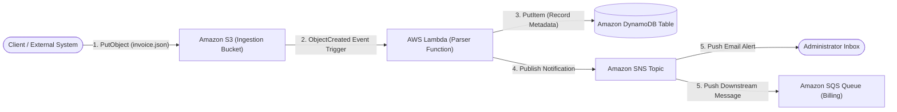
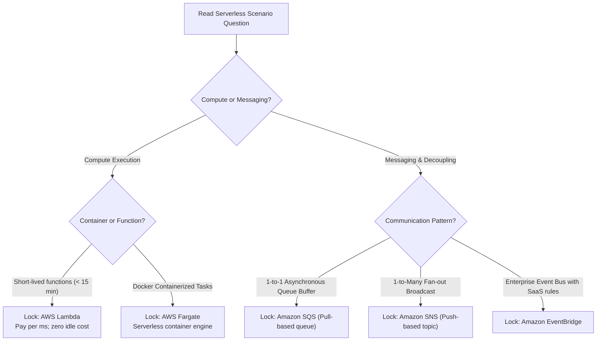
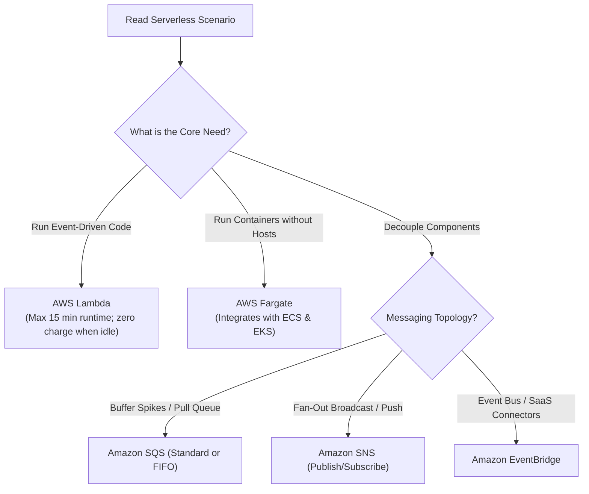

# Tutorial 04: Serverless Event-Driven Pipeline with S3, Lambda, DynamoDB & SNS

> **Vault Section:** `04_Tutorials/`  
> **Topic:** Serverless & Event-Driven Architecture  
> **Source Reference:** Rajesh Daswani (*Packt, 2026*), Project Tasks 12.1–12.3 & 14.1; Tom Taulli (*O'Reilly, 2026*), Ch 9 & 11.  
> **Associated Certifications:** [CLF-C02](../01_Syllabus/CLF-C02_Master_Blueprint.md), [AIF-C01](../../../../AI/Practitioner/AIF-C01/01_Syllabus/AIF-C01_Exam_Guide_and_Blueprint.md), SAA-C03

---

## 1. Architectural Blueprint & Scenario

In this tutorial, you build a completely serverless, decoupled event-driven data ingestion pipeline. When a user uploads a new file (e.g., an invoice JSON or customer document) to an Amazon S3 bucket, S3 automatically publishes an object-creation event that triggers an AWS Lambda function. Lambda parses the payload, stores the structured record in Amazon DynamoDB, and publishes a completion notification to an Amazon SNS topic.



---

## 2. Step-by-Step Implementation Guide

### Step 1: Create the Amazon DynamoDB Table
1. Open the Amazon DynamoDB Console -> **Create table**.
2. **Table name:** `InvoicesProcessed`.
3. **Partition key:** `InvoiceID` (String).
4. **Sort key:** `Timestamp` (Number).
5. **Table settings:** Select **Default settings** (or On-Demand capacity mode for true serverless billing).
6. Choose **Create table**.

### Step 2: Create the Amazon SNS Notification Topic
1. Open the Amazon SNS Console -> **Topics** -> **Create topic**.
2. **Type:** Standard.
3. **Name:** `InvoiceProcessedTopic`.
4. Choose **Create topic**.
5. Choose **Create subscription**:
   - **Protocol:** Email.
   - **Endpoint:** Enter your personal email address.
6. Open your email inbox and click **Confirm subscription** in the confirmation message sent by AWS.

### Step 3: Create the Ingestion Amazon S3 Bucket
1. Open the Amazon S3 Console -> **Create bucket**.
2. **Bucket name:** `invoice-ingest-bucket-<your-account-id>` (must be globally unique).
3. **Region:** `us-east-1`.
4. Leave **Block Public Access** enabled (best practice).
5. Enable default encryption with Amazon S3 managed keys (SSE-S3).
6. Choose **Create bucket**.

### Step 4: Write and Deploy the AWS Lambda Function
1. Open the AWS Lambda Console -> **Create function**.
2. Choose **Author from scratch**:
   - **Function name:** `InvoiceIngestionHandler`
   - **Runtime:** Python 3.12 (or 3.11)
   - **Architecture:** `x86_64` (or `arm64` Graviton2)
3. Under **Permissions**, choose **Create a new role with basic Lambda permissions**.
4. Once created, attach inline permissions to allow Lambda to read from S3, write to DynamoDB, and publish to SNS:
   ```json
   {
     "Version": "2012-10-17",
     "Statement": [
       {
         "Effect": "Allow",
         "Action": ["s3:GetObject"],
         "Resource": "arn:aws:s3:::invoice-ingest-bucket-*/*"
       },
       {
         "Effect": "Allow",
         "Action": ["dynamodb:PutItem"],
         "Resource": "arn:aws:dynamodb:us-east-1:*:table/InvoicesProcessed"
       },
       {
         "Effect": "Allow",
         "Action": ["sns:Publish"],
         "Resource": "arn:aws:sns:us-east-1:*:InvoiceProcessedTopic"
       }
     ]
   }
   ```
5. Replace the default function code with the following Python handler:
   ```python
   import json
   import urllib.parse
   import boto3
   import time

   s3 = boto3.client('s3')
   dynamodb = boto3.resource('dynamodb')
   sns = boto3.client('sns')

   TABLE_NAME = 'InvoicesProcessed'
   TOPIC_ARN = 'arn:aws:sns:us-east-1:YOUR_ACCOUNT_ID:InvoiceProcessedTopic'

   def lambda_handler(event, context):
       table = dynamodb.Table(TABLE_NAME)
       
       # Extract bucket and object key from the incoming S3 event record
       for record in event['Records']:
           bucket = record['s3']['bucket']['name']
           key = urllib.parse.unquote_plus(record['s3']['object']['key'])
           size = record['s3']['object']['size']
           
           # Generate unique invoice metadata
           timestamp = int(time.time())
           invoice_id = f"INV-{key.split('.')[0]}-{timestamp}"
           
           # Write metadata record to DynamoDB
           table.put_item(
               Item={
                   'InvoiceID': invoice_id,
                   'Timestamp': timestamp,
                   'SourceBucket': bucket,
                   'FileKey': key,
                   'FileSizeBytes': size,
                   'Status': 'PROCESSED'
               }
           )
           
           # Publish completion alert to SNS Topic
           message = f"Successfully processed invoice {key} ({size} bytes). Recorded in DynamoDB as {invoice_id}."
           sns.publish(
               TopicArn=TOPIC_ARN,
               Subject="New Invoice Ingested Successfully",
               Message=message
           )
           
       return {
           'statusCode': 200,
           'body': json.dumps('Invoice ingestion pipeline complete!')
       }
   ```
6. Choose **Deploy**.

### Step 5: Configure S3 Event Notification Trigger
1. In the Lambda function overview, choose **Add trigger**.
2. Select **S3**.
3. Bucket: Select `invoice-ingest-bucket-<your-account-id>`.
4. Event type: **All object create events** (`s3:ObjectCreated:*`).
5. Prefix: Optional (e.g., `uploads/`).
6. Suffix: `.json`.
7. Acknowledge recursive invocation risk and choose **Add**.

### Step 6: End-to-End Verification
1. Create a local test file `test-invoice.json`:
   ```json
   {
     "customer": "Acme Corp",
     "amount": 1250.00,
     "items": ["Cloud Consulting", "Architecture Review"]
   }
   ```
2. Upload `test-invoice.json` to your S3 bucket.
3. Verify Execution:
   - Check **AWS CloudWatch Logs** for the Lambda function: Observe execution metrics and timestamps.
   - Check **Amazon DynamoDB**: Navigate to `InvoicesProcessed` -> **Explore table items**. Notice the newly inserted record with `InvoiceID`, `FileKey`, and `FileSizeBytes`.
   - Check your **Email Inbox**: Verify receipt of the SNS alert notification titled *"New Invoice Ingested Successfully"*.

---

## 3. Key Takeaways & Exam Distinctions
- **Zero Infrastructure Maintenance:** This entire architecture is 100% serverless; no virtual servers, OS patches, or idle costs exist. When no files are uploaded, billing is strictly zero.
- **Event-Driven Coupling:** The S3 bucket does not know or care how Lambda processes the file; Lambda does not manage email delivery directly (SNS handles fan-out delivery).
- **Idempotency & Deduplication:** In production systems, ensure Lambda functions are **idempotent** (can be executed multiple times with identical results) since event delivery guarantees are at-least-once.


---

## 4. 🎯 Authentic Architecture Exam Practice
> Practice real-world scenarios tested on official AWS examinations that directly apply the architectural patterns built in this tutorial.

### Scenario Practice 1: CLF-C02-ET-Q018
**Question:**  
Which AWS service provides serverless compute for use with containers?

**Options:**
- A) Amazon Simple Queue Service (Amazon SQS)
- B) AWS Fargate
- C) AWS Elastic Beanstalk
- D) Amazon SageMaker

<details>
<summary><b>View Verified Answer & Solution Analysis</b></summary>

**Correct Answer:** `B`  
**Peer Consensus:** `100%` agreement.  

**Architectural Breakdown & Distractor Analysis:**
- **Option A is INCORRECT:** Amazon Simple Queue Service (SQS) is a fully managed message queuing service for decoupling application components, not a container compute engine.
- **Option B is CORRECT:** **AWS Fargate** is a purpose-built serverless compute engine for containers that integrates with Amazon Elastic Container Service (ECS) and Amazon Elastic Kubernetes Service (EKS), executing container tasks without managing EC2 virtual servers.
- **Option C is INCORRECT:** AWS Elastic Beanstalk is an application deployment service (PaaS) that provisions and configures underlying EC2 virtual machine clusters.
- **Option D is INCORRECT:** Amazon SageMaker is a machine learning platform for authoring, training, and deploying predictive and generative AI models.

</details>

### Scenario Practice 2: CLF-C02-ET-Q132
**Question:**  
Which AWS services are serverless? (Choose two.)

**Options:**
- A) AWS Fargate
- B) Amazon Managed Streaming for Apache Kafka
- C) Amazon EMR
- D) Amazon S3
- E) Amazon EC2

<details>
<summary><b>View Verified Answer & Solution Analysis</b></summary>

**Correct Answer:** `A` and `D`  
**Peer Consensus:** `100%` agreement.  

**Architectural Breakdown & Distractor Analysis:**
- **Option A is CORRECT:** **AWS Fargate** provides serverless execution for container workloads without requiring customers to configure, patch, or scale virtual machine hosts.
- **Option B is INCORRECT:** Standard Amazon MSK provisions dedicated broker instances and requires capacity planning for clusters.
- **Option C is INCORRECT:** Amazon EMR provisions clusters of EC2 instances to execute Hadoop and Spark jobs.
- **Option D is CORRECT:** **Amazon S3** is the quintessential serverless object storage service: storage capacity scales automatically, high availability is built-in across 3+ AZs, and customers pay strictly for storage used and requests processed with zero server administration.
- **Option E is INCORRECT:** Amazon EC2 is an Infrastructure-as-a-Service (IaaS) offering requiring explicit selection and management of virtual machine instances and guest operating systems.

</details>

---

## 🎓 Master Architecture MCQ Blueprint: Serverless & Event-Driven Architectures

> Pattern recognition rules mined from the master question bank to solve Lambda, SQS, SNS, EventBridge, and Fargate questions in under 15 seconds.

### Layer 1: "Clue-to-Service" Linguistic Decryption Matrix

| If Scenario Text Mentions... | Target Architecture / Service | Why (The Core Mechanism) | Decoy Trap to Avoid |
| :--- | :--- | :--- | :--- |
| **"Run code in response to events without managing servers"** | **AWS Lambda** | Event-driven serverless compute; scales from 0 to thousands of concurrent executions; pay per millisecond. | Amazon EC2 (requires managing servers, patching OS, paying when idle). |
| **"Decouple microservices using a message queue buffer"** | **Amazon SQS** | Pull-based asynchronous queue buffering spikes and preventing consumer overload. | Amazon SNS (push-based publish/subscribe topic; does not buffer messages). |
| **"Publish a message to multiple heterogeneous subscribers (fan-out)"** | **Amazon SNS** | Push-based pub/sub topic broadcasting events to SQS queues, Lambda functions, emails, and SMS. | Amazon SQS alone (one message consumed by one worker). |
| **"Serverless event bus routing events between AWS services & SaaS apps"** | **Amazon EventBridge** | Schema-driven event bus filtering and routing JSON events with declarative rules. | Amazon SQS (point-to-point message queue). |
| **"Run Docker containers serverlessly without EC2 hosts"** | **AWS Fargate** | Managed container compute runtime for Amazon ECS and EKS. | Amazon EC2 launch type (requires provisioning and patching EC2 host instances). |

---

### Layer 2: 3-Step Rapid Elimination Heuristic



1. **Step 1: Check Compute vs. Messaging:**
   - Need to run custom application code without servers? $\to$ **AWS Lambda**.
   - Need to run Docker images without servers? $\to$ **AWS Fargate**.
2. **Step 2: Check Messaging Pattern:**
   - Buffer traffic to protect a database/worker? $\to$ **Amazon SQS** (Pull).
   - Send one notification to multiple destinations (email, mobile, queue)? $\to$ **Amazon SNS** (Push / Fan-out).
   - Route third-party SaaS events (Shopify, Datadog) into AWS? $\to$ **Amazon EventBridge**.
3. **Step 3: Check Cost & Serverless Attribute:**
   - Serverless = Zero idle charge + automatic scaling + no OS patching + built-in high availability.

---

### Layer 3: High-Frequency Decoy Autopsy

#### Decoy Trap: Amazon SQS vs. Amazon SNS
* **The Exam Trap:** An application needs to notify 5 different downstream services simultaneously whenever a customer places an order.
* **The Decoy:** Option A: "Place the order into an Amazon SQS queue."
* **The Fatal Flaw:** SQS is a point-to-point queue. When one consumer pulls and deletes a message from the queue, that message is gone; other consumers cannot receive it.
* **The Correct Choice:** Publish the order event to an **Amazon SNS topic**, which uses the **SNS Fan-out pattern** to broadcast copies of the message to multiple SQS queues simultaneously.

---

### Layer 4: 10-Second Visual Decision Flowchart


