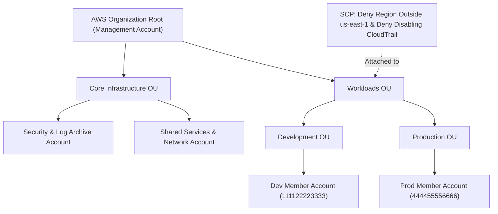
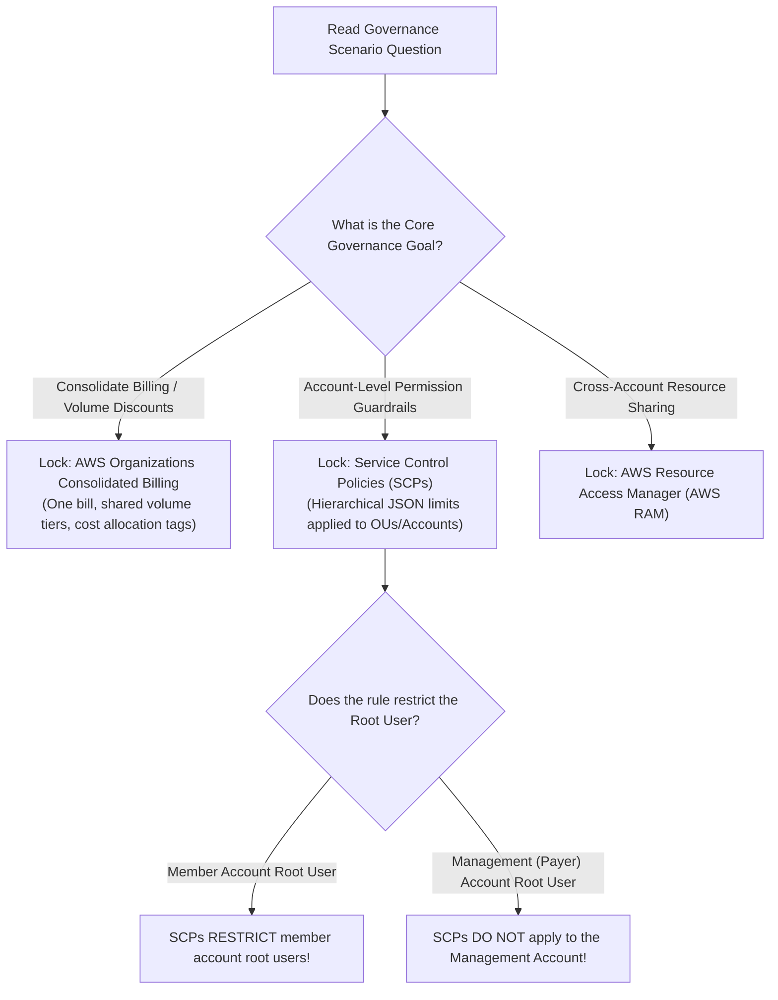
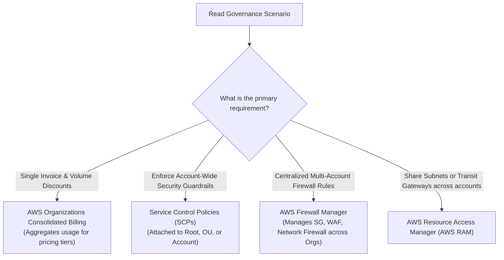

# Tutorial 06: Enterprise Multi-Account Governance with AWS Organizations & Service Control Policies (SCPs)

> **Vault Section:** `04_Tutorials/`  
> **Topic:** Security, Multi-Account Governance & Cost Management  
> **Source Reference:** Rajesh Daswani (*Packt, 2026*), Project Tasks 4.1–4.4; Tom Taulli (*O'Reilly, 2026*), Ch 5 & 15.  
> **Associated Certifications:** [CLF-C02](../01_Syllabus/CLF-C02_Master_Blueprint.md), SAA-C03

---

## 1. Architectural Blueprint & Scenario

In this tutorial, you implement an enterprise multi-account hierarchy using **AWS Organizations**. You will establish Organizational Units (OUs), configure consolidated billing, and enforce non-negotiable security guardrails using **Service Control Policies (SCPs)** to prevent administrators in child accounts from disabling security tools or deploying unauthorized high-cost resources.



---

## 2. Step-by-Step Implementation Guide

### Step 1: Create an AWS Organization
1. Sign in to the AWS Management Console using the **Management Account** (the designated root billing account).
2. Open the **AWS Organizations** Console -> **Create an organization**.
3. Confirm that **All features** are enabled (required for Service Control Policies; consolidated billing alone does not support SCPs).
4. Verify the organization root email address.

### Step 2: Establish the Organizational Unit (OU) Hierarchy
Organize your cloud environment into logical business and environment boundaries:
1. Under **Root**, choose **Actions** -> **Create new OU**:
   - Name: `Core` (for security tooling, log archives, transit gateways).
   - Name: `Workloads` (for application workloads).
2. Under `Workloads`, create nested child OUs:
   - `Development`
   - `Production`
3. Create or invite member accounts and move them into their respective OUs.

### Step 3: Enable Service Control Policies (SCPs)
1. In the left navigation pane, choose **Policies** -> **Service control policies**.
2. Choose **Enable service control policies**.
3. Note that by default, every OU and account has the AWS-managed policy `FullAWSAccess` attached, which allows all actions.

### Step 4: Author and Attach Enterprise SCP Guardrails

#### Policy 1: Geographic Region Restriction SCP
Prevent developers and workloads from spinning up expensive resources in unauthorized AWS regions (e.g., restrict everything outside `us-east-1` and `us-west-2` while exempting global services like IAM, Route 53, CloudFront, and Support):

```json
{
  "Version": "2012-10-17",
  "Statement": [
    {
      "Sid": "DenyAllOutsideApprovedRegions",
      "Effect": "Deny",
      "NotAction": [
        "iam:*",
        "route53:*",
        "cloudfront:*",
        "support:*",
        "health:*",
        "budgets:*",
        "organizations:*"
      ],
      "Resource": "*",
      "Condition": {
        "StringNotEquals": {
          "aws:RequestedRegion": [
            "us-east-1",
            "us-west-2"
          ]
        }
      }
    }
  ]
}
```

#### Policy 2: Prevent Disabling AWS CloudTrail & GuardDuty
Ensure local root or administrator accounts cannot disable audit trails or threat detection:

```json
{
  "Version": "2012-10-17",
  "Statement": [
    {
      "Sid": "PreventDisablingSecurityServices",
      "Effect": "Deny",
      "Action": [
        "cloudtrail:DeleteTrail",
        "cloudtrail:StopLogging",
        "cloudtrail:UpdateTrail",
        "guardduty:DeleteDetector",
        "guardduty:DisassociateFromMasterAccount",
        "guardduty:StopMonitoringMembers"
      ],
      "Resource": "*"
    }
  ]
}
```

### Step 5: Attach and Test the Policies
1. In the Policies console, choose **Create policy** and paste the JSON statements above. Name it `EnforceApprovedRegionsAndAudit`.
2. Navigate back to **AWS accounts**, select the `Development` OU, and switch to the **Policies** tab.
3. Choose **Attach policy** and select `EnforceApprovedRegionsAndAudit`.
4. **Testing in Member Account:**
   - Log into the development member account with full `AdministratorAccess`.
   - Switch the AWS Console region to `eu-central-1` (Frankfurt) or `ap-southeast-1` (Singapore).
   - Attempt to launch an Amazon EC2 instance or create an S3 bucket.
   - Observe that the operation is **immediately blocked with an explicit AccessDenied error**:
     `"You are not authorized to perform this operation because of a Service Control Policy."`
   - Attempt to stop logging on AWS CloudTrail. Observe that even the root user of the member account is blocked!

---

## 3. Key Takeaways & Exam Distinctions
- **SCPs NEVER Grant Permissions; They Only Set Guardrails:** An SCP defines the maximum permissions boundary. A user in a member account still requires an IAM policy explicitly granting access. If an action is denied by an SCP, no IAM policy in the member account can override it.
- **Root User of Member Accounts is Constrained:** Unlike standard IAM policies that cannot restrict the root user of an account, **SCPs DO constrain the root user of a member account**.
- **Management Account Immunity:** SCPs do **NOT** apply to the management account of the organization itself.
- **Consolidated Billing Benefits:**
  - One monthly invoice for all member accounts.
  - Automatic **volume tiering discounts** across all aggregated S3 and EC2 usage.
  - Automatic sharing of **Reserved Instances and Savings Plans discounts** across accounts in the organization.


---

## 4. 🎯 Authentic Architecture Exam Practice
> Practice real-world scenarios tested on official AWS examinations that directly apply the architectural patterns built in this tutorial.

### Scenario Practice 1: CLF-C02-ET-Q297
**Question:**  
A company needs to centrally configure and manage Amazon VPC security groups across multiple AWS accounts within an organization in AWS Organizations.

Which AWS service should the company use to meet these requirements?

**Options:**
- A) AWS Firewall Manager
- B) Amazon GuardDuty
- C) Amazon Detective
- D) AWS WAF

<details>
<summary><b>View Verified Answer & Solution Analysis</b></summary>

**Correct Answer:** `A`  
**Peer Consensus:** `100%` agreement.  

**Architectural Breakdown & Distractor Analysis:**
- **Option A is CORRECT:** **AWS Firewall Manager** provides centralized security administration across multi-account environments. When integrated with AWS Organizations, it allows security teams to centrally configure, deploy, and enforce security policies (VPC Security Groups, AWS WAF rules, AWS Shield Advanced, and AWS Network Firewall) across all member accounts automatically.
- **Option B is INCORRECT:** Amazon GuardDuty is an intelligent threat detection and anomaly monitoring service, but does not deploy or enforce security group firewall rules.
- **Option C is INCORRECT:** Amazon Detective simplifies investigation of security incidents using graph analytics, but does not configure or manage network rules.
- **Option D is INCORRECT:** AWS WAF is a web application firewall that inspects HTTP/HTTPS traffic at Layer 7; centrally managing WAF rules across multiple accounts requires AWS Firewall Manager.

</details>

### Scenario Practice 2: CLF-C02-ET-Q127
**Question:**  
A company that has multiple business units wants to centrally manage and govern its AWS Cloud environments. The company wants to automate the creation of AWS accounts, apply service control policies (SCPs), and simplify billing processes.

Which AWS service or tool should the company use to meet these requirements?

**Options:**
- A) AWS Organizations
- B) AWS Cost Explorer
- C) AWS Budgets
- D) AWS Trusted Advisor

<details>
<summary><b>View Verified Answer & Solution Analysis</b></summary>

**Correct Answer:** `A`  
**Peer Consensus:** `100%` agreement.  

**Architectural Breakdown & Distractor Analysis:**
- **Option A is CORRECT:** **AWS Organizations** is the central governance and account management service that provides automated account creation, hierarchical grouping via Organizational Units (OUs), centralized policy enforcement using Service Control Policies (SCPs), and consolidated billing with volume discounts.
- **Option B is INCORRECT:** AWS Cost Explorer is a financial reporting tool for visualizing, understanding, and forecasting historical and future cloud spending.
- **Option C is INCORRECT:** AWS Budgets sets custom cost and usage limits, triggering alerts when spending exceeds defined thresholds; it cannot manage accounts or enforce SCPs.
- **Option D is INCORRECT:** AWS Trusted Advisor evaluates your AWS environment against architecture best practices (cost, security, fault tolerance, performance, quotas), but does not provision accounts or enforce governance guardrails.

</details>

---

## 🎓 Master Architecture MCQ Blueprint: AWS Organizations, SCPs, and Multi-Account Governance

> Pattern recognition rules mined from the master question bank to solve Organizations, SCP, and Consolidated Billing questions in under 15 seconds.

### Layer 1: "Clue-to-Service" Linguistic Decryption Matrix

| If Scenario Text Mentions... | Target Architecture / Service | Why (The Core Mechanism) | Decoy Trap to Avoid |
| :--- | :--- | :--- | :--- |
| **"Consolidate multiple AWS accounts into a single bill with volume discounts"** | **Consolidated Billing (AWS Organizations)** | Aggregates usage across all member accounts to share tiered pricing discounts (e.g. S3 storage tiers). | Separate standalone AWS accounts (which pay higher per-GB tiers individually). |
| **"Set maximum permission boundaries across accounts in an organization"** | **Service Control Policies (SCPs)** | Centralized JSON policies that define the guardrail ceiling; restricts even member account root users. | IAM Policies alone (which can be modified or overridden by member account admins). |
| **"Do SCPs grant permissions to users?"** | **NO (SCPs never grant permissions)** | SCPs only specify the *maximum allowable* permissions. Users still require an IAM policy to perform actions. | Believing an `Allow` in an SCP grants access without an IAM policy. |
| **"Centrally configure security groups across all accounts in an organization"** | **AWS Firewall Manager** | Enforces security policies (Security Groups, WAF, Shield) across accounts in AWS Organizations. | AWS Shield alone (DDoS protection service). |
| **"Share software licenses, subnets, and Transit Gateways across accounts"** | **AWS Resource Access Manager (AWS RAM)** | Enables secure cross-account resource sharing without replicating infrastructure. | VPC Peering for every subnet (creates complex mesh overhead). |

---

### Layer 2: 3-Step Rapid Elimination Heuristic



1. **Step 1: Check Governance vs. Financial:**
   - Multi-account billing, single invoice, aggregated volume pricing? → **AWS Organizations Consolidated Billing**.
   - Multi-account security ceiling, disable regions, block S3 deletion? → **Service Control Policies (SCPs)**.
2. **Step 2: Remember the SCP Golden Rules:**
   - SCPs **never grant permissions**; they only filter/limit.
   - SCPs **apply to member account root users**.
   - SCPs **do not apply to the management (payer) account**.
3. **Step 3: Central Security Enforcement:**
   - If managing firewalls, WAF, or Security Groups across accounts → **AWS Firewall Manager**.

---

### Layer 3: High-Frequency Decoy Autopsy

#### Decoy Trap: Do Service Control Policies (SCPs) Grant Permissions?
* **The Exam Trap:** A security administrator attaches an SCP to an Organizational Unit (OU) stating `Allow: ec2:*`. Can users in that account immediately launch EC2 instances?
* **The Decoy:** "Yes, because the SCP explicitly allows EC2 access."
* **The Fatal Flaw:** **SCPs are guardrails, not grants.** An SCP acts as a filter over IAM. Even if the SCP allows EC2, a user cannot perform any action until their IAM user or role is granted an explicit IAM policy permitting `ec2:RunInstances`.
* **The Correct Choice:** No; users still require an IAM identity-based policy granting permission. An action is allowed ONLY if permitted by BOTH the SCP AND the IAM policy.

---

### Layer 4: 10-Second Visual Decision Flowchart


