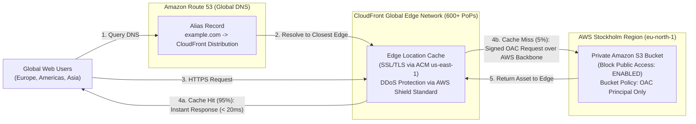
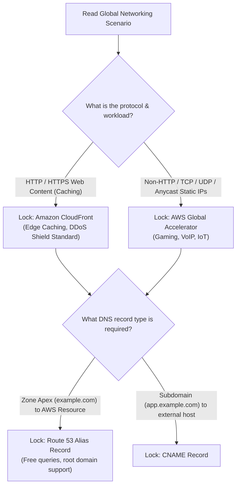
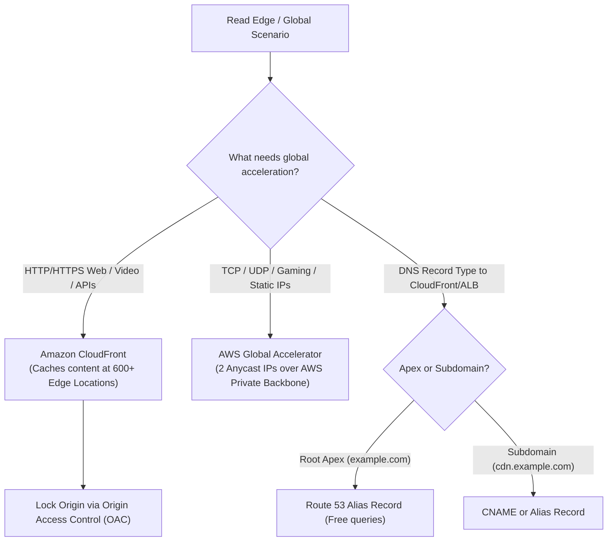

# Tutorial 07: Global Content Delivery with CloudFront, Route 53 & S3 Origin Access Control (OAC)

> **Architecture Build Tutorial:** `Tutorial_07_Global_Content_Delivery_CloudFront_Route53_S3.md`  
> **Course:** AWS Certified Cloud Practitioner (`CLF-C02`)  
> **Services Integrated:** Amazon S3, Amazon CloudFront, AWS Certificate Manager (ACM), Amazon Route 53, Origin Access Control (OAC)  
> **Level:** Multi-Service Production Architecture Blueprint

---

## 🏛️ Executive Architecture Context

Enterprises host web applications and media assets that must be served to a global user base with millisecond latency, rock-solid security, and high availability. 

### Why This Architecture Matters
1. **The Public S3 Bucket Anti-Pattern:** A naive implementation makes the S3 bucket public (`0.0.0.0/0`), exposing assets to data scrapers, accidental data leaks, and direct S3 GET request egress costs.
2. **The CloudFront + S3 OAC Standard:** By placing **Amazon CloudFront** in front of a private S3 bucket and enforcing **Origin Access Control (OAC)**, the S3 bucket is completely locked down. Users can ONLY access assets through CloudFront's global network of 600+ Edge Locations.
3. **High-Performance DNS Routing:** **Amazon Route 53** provides authoritative DNS routing using **Alias Records** (free DNS queries when targeting AWS resources like CloudFront) and intelligent routing policies (Latency, Geolocation, Failover).



---

## 🛠️ Step-by-Step Implementation Guide

### Step 1: Create the Private S3 Origin Bucket
Create an S3 bucket with all public access strictly blocked:

```bash
# 1. Create S3 Bucket in Stockholm (eu-north-1)
aws s3api create-bucket \
    --bucket enterprise-static-origin-prod-2026 \
    --region eu-north-1 \
    --create-bucket-configuration LocationConstraint=eu-north-1 \
    --profile aws-notes

# 2. Enforce Block Public Access (Default Security Standard)
aws s3api put-public-access-block \
    --bucket enterprise-static-origin-prod-2026 \
    --public-access-block-configuration \
        "BlockPublicAcls=true,IgnorePublicAcls=true,BlockPublicPolicy=true,RestrictPublicBuckets=true" \
    --profile aws-notes

# 3. Upload a sample index.html page
echo "<h1>Welcome to Enterprise CloudFront + S3 with OAC!</h1>" > index.html
aws s3 cp index.html s3://enterprise-static-origin-prod-2026/index.html \
    --profile aws-notes
```

---

### Step 2: Create CloudFront Origin Access Control (OAC)
Origin Access Control (OAC) authenticates CloudFront requests to Amazon S3 using AWS Signature Version 4 (SigV4):

```bash
aws cloudfront create-origin-access-control \
    --origin-access-control-config '{
        "Name": "S3-OAC-Enterprise-Origin",
        "Description": "OAC for enterprise private S3 bucket",
        "SigningProtocol": "sigv4",
        "SigningBehavior": "always",
        "OriginAccessControlOriginType": "s3"
    }' \
    --profile aws-notes
```

---

### Step 3: Create the Amazon CloudFront Distribution
Configure a global distribution pointing to the S3 bucket origin with OAC enabled:

```bash
# Obtain the S3 regional domain name
# enterprise-static-origin-prod-2026.s3.eu-north-1.amazonaws.com

aws cloudfront create-distribution \
    --distribution-config '{
        "CallerReference": "'$(date +%s)'",
        "Origins": {
            "Quantity": 1,
            "Items": [{
                "Id": "S3-Private-Origin",
                "DomainName": "enterprise-static-origin-prod-2026.s3.eu-north-1.amazonaws.com",
                "OriginAccessControlId": "YOUR_OAC_ID",
                "S3OriginConfig": {
                    "OriginAccessIdentity": ""
                }
            }]
        },
        "DefaultCacheBehavior": {
            "TargetOriginId": "S3-Private-Origin",
            "ViewerProtocolPolicy": "redirect-to-https",
            "AllowedMethods": {
                "Quantity": 2,
                "Items": ["GET", "HEAD"]
            },
            "ForwardedValues": {
                "QueryString": false,
                "Cookies": {"Forward": "none"}
            },
            "MinTTL": 0,
            "DefaultTTL": 86400,
            "MaxTTL": 31536000
        },
        "Comment": "Global CDN with OAC",
        "Enabled": true
    }' \
    --profile aws-notes
```

---

### Step 4: Lock Down the S3 Bucket Policy to CloudFront OAC
Attach an S3 bucket policy allowing **ONLY** your CloudFront distribution ARN to read objects:

```json
{
  "Version": "2012-10-17",
  "Statement": [
    {
      "Sid": "AllowCloudFrontServicePrincipalReadOnly",
      "Effect": "Allow",
      "Principal": {
        "Service": "cloudfront.amazonaws.com"
      },
      "Action": "s3:GetObject",
      "Resource": "arn:aws:s3:::enterprise-static-origin-prod-2026/*",
      "Condition": {
        "StringEquals": {
          "AWS:SourceArn": "arn:aws:cloudfront::YOUR_ACCOUNT_ID:distribution/YOUR_DISTRIBUTION_ID"
        }
      }
    }
  ]
}
```

---

### Step 5: Configure Amazon Route 53 Alias Record
In Amazon Route 53, map your apex custom domain (`example.com`) to the CloudFront distribution using an **Alias Record**:

* **Record Name:** `example.com`
* **Record Type:** `A (IPv4 Address)`
* **Alias:** `Yes`
* **Route traffic to:** `Alias to CloudFront distribution`
* **Target:** `d111111abcdef8.cloudfront.net`
* **Routing Policy:** `Simple routing`
* **Evaluate Target Health:** `No` (CloudFront manages edge health globally)

> [!TIP]
> **Exam Tip:** Route 53 **Alias Records** pointing to AWS resources (CloudFront, ALBs, S3 Website endpoints) are billed at **zero query fees**, unlike standard CNAME records! Furthermore, an Alias record can be created at the **zone apex** (`example.com`), whereas standard DNS standards forbid CNAME records at the root zone apex.

---

## 💻 CLI Verification & Smoke Testing

```bash
# 1. Verify direct S3 access is strictly BLOCKED (Expected: 403 Forbidden)
curl -I https://enterprise-static-origin-prod-2026.s3.eu-north-1.amazonaws.com/index.html
# Output: HTTP/1.1 403 Forbidden

# 2. Verify CloudFront Edge access SUCCEEDS (Expected: 200 OK + X-Cache Hit/Miss)
curl -I https://d111111abcdef8.cloudfront.net/index.html
# Output:
# HTTP/2 200
# content-type: text/html
# x-cache: Hit from cloudfront
# via: 1.1 xxxxxxxxx.cloudfront.net (CloudFront)
```

---

## 🧹 Free Tier Cleanup & Cost Safeguard

1. **Disable CloudFront Distribution:**
   ```bash
   # CloudFront distributions must be disabled before deletion
   aws cloudfront update-distribution --id YOUR_DIST_ID --if-match ETAG ...
   aws cloudfront delete-distribution --id YOUR_DIST_ID --if-match ETAG
   ```
2. **Delete S3 Bucket Objects & Bucket:**
   ```bash
   aws s3 rm s3://enterprise-static-origin-prod-2026/ --recursive
   aws s3 rb s3://enterprise-static-origin-prod-2026
   ```

---

## 🎯 Authentic Architecture Exam Practice

### Scenario Practice 1: CLF-C02-ET-Q044
**Question:**  
A company wants to distribute content to global users with low latency while protecting its origin servers from direct public access.

Which combination of AWS services should the company use to meet these requirements? (Choose two.)

**Options:**
- A) Amazon CloudFront
- B) Amazon Route 53
- C) Amazon S3 with public read access
- D) Origin Access Control (OAC) with private Amazon S3
- E) AWS Direct Connect

<details>
<summary><b>View Verified Answer & Solution Analysis</b></summary>

**Correct Answer:** `A` and `D`  
**Peer Consensus:** `100%` agreement.  

**Architectural Breakdown & Distractor Analysis:**
- **Option A is CORRECT:** **Amazon CloudFront** is a global Content Delivery Network (CDN) that caches content at edge locations worldwide, delivering media with ultra-low latency.
- **Option B is INCORRECT:** Route 53 provides DNS resolution and traffic routing; it does not cache content or prevent direct origin access.
- **Option C is INCORRECT:** Making S3 public violates security best practices and exposes the origin directly to the internet.
- **Option D is CORRECT:** **Origin Access Control (OAC)** restricts access to the S3 bucket so that only the designated CloudFront distribution can fetch objects, keeping the origin completely private.
- **Option E is INCORRECT:** AWS Direct Connect is a dedicated physical network link between on-premises data centers and AWS, unrelated to global public web caching.

</details>

### Scenario Practice 2: CLF-C02-ET-Q168
**Question:**  
Why is an Amazon Route 53 Alias record preferred over a standard CNAME record when routing traffic to an Amazon CloudFront distribution?

**Options:**
- A) Alias records support encryption in transit, while CNAME records do not.
- B) Alias records can be used for the zone apex (root domain) and Route 53 does not charge for queries to Alias records for AWS resources.
- C) Alias records automatically translate IPv4 addresses into IPv6 addresses.
- D) Alias records prevent DDoS attacks automatically without AWS Shield.

<details>
<summary><b>View Verified Answer & Solution Analysis</b></summary>

**Correct Answer:** `B`  
**Peer Consensus:** `100%` agreement.  

**Architectural Breakdown & Distractor Analysis:**
- **Option A is INCORRECT:** DNS records map domain names to IP addresses or hostnames; encryption in transit is handled by TLS/HTTPS certificates, not DNS record types.
- **Option B is CORRECT:** **Route 53 Alias records** offer two decisive advantages over CNAMEs: they can be mapped to the **zone apex** (`example.com` without a `www` prefix), and Route 53 **charges zero query fees** for queries targeting AWS resources like CloudFront distributions and ALBs.
- **Option C is INCORRECT:** Dual-stack IPv6 routing is handled by AAAA records, not automatic Alias conversion.
- **Option D is INCORRECT:** DDoS mitigation is delivered by AWS Shield Standard and Shield Advanced, not DNS record types.

</details>

---

## 🎓 Master Architecture MCQ Blueprint: Edge Networking & Global Acceleration

> Pattern recognition rules mined from the master question bank to solve CloudFront, Route 53, and Global Accelerator questions in under 15 seconds.

### Layer 1: "Clue-to-Service" Linguistic Decryption Matrix

| If Scenario Text Mentions... | Target Architecture / Service | Why (The Core Mechanism) | Decoy Trap to Avoid |
| :--- | :--- | :--- | :--- |
| **"Cache static and dynamic web content globally with low latency"** | **Amazon CloudFront** | 600+ Edge Locations cache content close to viewers; terminates TCP handshakes near users. | S3 Cross-Region Replication (replicates entire buckets; does not cache at edge). |
| **"Lock down S3 origin so users cannot bypass CDN"** | **Origin Access Control (OAC)** | Restricts S3 bucket policy to CloudFront service principal using SigV4 signing. | S3 Bucket Policy with `Principal: *` (leaves bucket public). |
| **"Route DNS traffic to zone apex (root domain) for an ALB or CloudFront"** | **Route 53 Alias Record** | AWS-specific DNS extension; works at zone apex (`example.com`); zero query fee. | CNAME record (cannot be created at zone apex under RFC standards). |
| **"Route users to the closest AWS Region with lowest network latency"** | **Route 53 Latency-Based Routing** | Directs users to the AWS Region providing the lowest round-trip latency. | Geolocation Routing (routes by geographic boundary, not network speed). |
| **"Accelerate non-HTTP / TCP / UDP gaming or VoIP traffic globally"** | **AWS Global Accelerator** | Uses 2 static anycast IP addresses routing over AWS global private fiber backbone. | Amazon CloudFront (optimized for HTTP/HTTPS web caching). |

---

### Layer 2: 3-Step Rapid Elimination Heuristic



1. **Step 1: Protocol & Traffic Type Triage:**
   - Web assets, images, video streaming, API caching? → **Amazon CloudFront**.
   - Gaming, VoIP, TCP/UDP requiring 2 fixed static Anycast IPs? → **AWS Global Accelerator**.
2. **Step 2: DNS Routing Policy Triage:**
   - Lowest network delay? → **Latency Routing**.
   - Legal/regulatory compliance (keep EU users in EU)? → **Geolocation Routing**.
   - Active-Passive Disaster Recovery? → **Failover Routing**.
3. **Step 3: Edge Security Standards:**
   - Always pair CloudFront with **AWS WAF** (Layer 7 filtering) and **Origin Access Control (OAC)** for private S3 origins.

---

### Layer 3: High-Frequency Decoy Autopsy

#### Decoy Trap: CloudFront vs. AWS Global Accelerator
* **The Exam Trap:** An online gaming company needs to route UDP multiplayer packet streams to EC2 game servers across the globe with minimal packet loss and static IP addresses.
* **The Decoy:** Option A: "Deploy an Amazon CloudFront distribution in front of the game servers."
* **The Fatal Flaw:** Amazon CloudFront is a Content Delivery Network designed for **HTTP/HTTPS caching**. It does NOT support raw UDP game traffic, nor does it provide static Anycast IP addresses.
* **The Correct Choice:** **AWS Global Accelerator** provides two static anycast IP addresses that ingest UDP/TCP traffic at edge locations and route packets over AWS's dedicated congestion-free fiber backbone.

---

### Layer 4: 10-Second Visual Decision Flowchart


