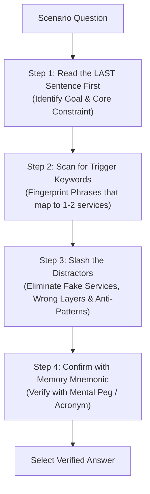

# AWS Certified Cloud Practitioner (CLF-C02) — Exam Decryption Playbook & Memory Mnemonics

> **Target Exam:** AWS Certified Cloud Practitioner (`CLF-C02`)  
> **Purpose:** Master question-answering heuristics, fingerprint trigger keywords, memory mnemonics, and distractor elimination tactics to answer scenario questions in under 45 seconds with 100% accuracy.  
> **Author & Lead Trainer:** Mohamed Fakhruldeen  

---

## ⚡ The 4-Step Exam Decryption Engine

When faced with scenario-based multiple-choice questions on CLF-C02, do NOT read the question linearly from start to finish. Follow this 4-step algorithm:



### Step 1: The Inverted Read (Read the Last Sentence First)
The final sentence always contains the **governing constraint**. Identify which constraint is being tested:
- *"With the least operational overhead / minimal management"* ⇒ Reject custom scripts, EC2, cron jobs; look for **AWS managed or serverless services** (e.g., S3, RDS, Lambda, Secrets Manager).
- *"At the lowest cost / most cost-effective"* ⇒ Reject Multi-AZ, Provisioned IOPS, On-Demand; look for **S3 Intelligent-Tiering / Glacier Deep Archive**, **EC2 Spot**, or **Consolidated Billing**.
- *"In real time / immediate notification"* ⇒ Reject batch polling; look for **Amazon SNS**, **Amazon EventBridge**, or **CloudWatch Alarms**.
- *"To decouple components"* ⇒ Look for **Amazon SQS** or **Amazon SNS**.

### Step 2: Scan for Trigger Keywords (Fingerprinting)
AWS exam writers use specific canonical terms. Once you spot a trigger keyword, your brain should immediately isolate the corresponding service (see the [Trigger Keyword Master Index](#-the-clf-c02-trigger-keyword-master-index) below).

### Step 3: Slash Distractors (The Elimination Playbook)
Cross off wrong options using these 4 elimination rules:
1. **The Absolute Words Trap:** Options containing *"always"*, *"never"*, *"all data is publicly accessible by default"*, or *"AWS manages customer encryption keys by default"* are almost always wrong.
2. **The Fictitious Service Trap:** AWS invents plausible-sounding names that do not exist (e.g., *"AWS CloudDatabase"*, *"AWS Security Scanner"*, *"Amazon AutoBackup"*, *"AWS VPC Firewall Manager Gateway"*). If you have never studied it, it is likely fake!
3. **The Wrong Layer / Tier Trap:** If the question asks for Layer 7 web application protection (SQL injection, XSS), eliminate Network ACLs and Security Groups immediately (they are Layer 4). Choose **AWS WAF**.
4. **The Overkill Trap:** If the question asks to store static images for a website, eliminate Amazon EBS or Amazon EFS; choose **Amazon S3**.

### Step 4: Confirm with Memory Mnemonic
Verify your choice against the memorized mental acronyms detailed below.

---

## 🧠 Master Mnemonics Suite for CLF-C02

### 1. The 6 Well-Architected Framework Pillars: `P-E-R-C-O-S` or `STOPS-C`

```
  P ── Performance Efficiency  (Right-sizing, modern compute Graviton, caching)
  E ── Excellence (Operational) (IaC, automation, learning from failures)
  R ── Reliability             (Multi-AZ, Auto Scaling, decoupled queues, self-healing)
  C ── Cost Optimization       (Spot, Savings Plans, Glacier Deep Archive, rightsizing)
  S ── Security                (Least privilege, KMS encryption, defense-in-depth)
  S ── Sustainability          (Reducing carbon footprint, maximize utilization)
```
* **Memory Peg:** *"A **PERC**fectly **O**ptimized **S**ystem never crashes."*

---

### 2. The 6 Cloud Adoption Framework (CAF) Perspectives: `B-P-G-P-S-O`

```
  "Big People Get Promoted So Often"
  
  B ── Business     (Business value, ROI, strategy, budget alignment)
  P ── People       (Culture, skills, workforce transformation, training)
  G ── Governance   (Program management, prioritization, cloud portfolio)
  ──────────────────────────────────────────────────────────────────────────
  P ── Platform     (Architecture, cloud environments, migration patterns)
  S ── Security     (Identity, data protection, compliance, threat detection)
  O ── Operations   (Service monitoring, incident management, reliability)
```
* **Exam Distinction:** 
  - **Business Perspectives:** Business, People, Governance.
  - **Technical Perspectives:** Platform, Security, Operations.

---

### 3. The 6 Strategies for Cloud Migration (The 6 R's)

```
  "Real People Really Prefer Rapid Rest"

  1. Rehost       (Lift & Shift)       ── Move to EC2 without changing architecture.
  2. Replatform   (Lift, Tinker & Shift) ── Minor optimization (e.g., move self-managed MySQL to Amazon RDS).
  3. Refactor     (Re-architect)       ── Native cloud rewrite (e.g., monolith to microservices/Lambda).
  4. Repurchase   (Drop & Shop)        ── Switch to a commercial SaaS product (e.g., Salesforce, Workday).
  5. Retain       (Revisit)            ── Keep on-premises for now (legacy, compliance, depreciation).
  6. Retire       (Decommission)       ── Turn off unnecessary, redundant applications.
```

---

### 4. The Shared Responsibility Model: The "IN" vs. "OF" Rule

$$
\text{Security \textbf{OF} the Cloud (AWS)} \quad \longleftrightarrow \quad \text{Security \textbf{IN} the Cloud (Customer)}
$$

| Dimension | AWS Responsibility (**OF** the Cloud) | Customer Responsibility (**IN** the Cloud) |
|---|---|---|
| **Physical Facilities** | Data centers, biometric doors, cameras, power, HVAC | None (cannot access physical centers) |
| **Hardware & Disks** | Rack servers, storage arrays, degaussing/destroying drives (NIST 800-88) | None |
| **Virtualization / Hypervisor**| Patching and isolating the Xen / Nitro hypervisor | None |
| **Operating System** | Managed services OS only (RDS, Lambda, Fargate) | **EC2 Operating System patches & updates!** |
| **Network & Firewall** | AWS physical backbone cable lines | **Security Groups & Network ACL configuration!** |
| **Identity & Access** | IAM infrastructure uptime | **Creating users, passwords, MFA, least privilege!** |
| **Customer Data** | Storage durability hardware | **Data encryption (at rest & transit) & classification!** |

* **Golden Rule:** *"If you can touch it with your physical hands, AWS owns it. If you can configure it via the AWS console, CLI, or code, you own it!"*

---

### 5. S3 Storage Class Temperature Hierarchy: `S-I-G-G`

```
  [HOT]    S ── Standard             (Active data, millisecond access, 11 9s durability)
  [WARM]   I ── Intelligent-Tiering  (Unpredictable access, auto-tiering, ZERO retrieval fees)
  [COLD]   G ── Glacier Flexible     (Archives, minutes to hours retrieval, 90-day minimum)
  [FROZEN] G ── Glacier Deep Archive (Lowest cost in AWS: $0.00099/GB, 12-48h retrieval)
```
* **Exam Clue:**
  - *"Unknown or changing access patterns, no operational overhead, no retrieval fees"* ⇒ **S3 Intelligent-Tiering**.
  - *"Lowest storage cost across all AWS, retrieval within 12 hours acceptable"* ⇒ **S3 Glacier Deep Archive**.
  - *"Single Availability Zone, lower cost, data easily reproducible"* ⇒ **S3 One Zone-IA**.

---

### 6. AWS Support Plans Ladder: `B-D-B-E`

```
  B ── Basic       (Free, 7 Trusted Advisor core checks, docs/billing support only)
  D ── Developer   ($29/mo, 1 primary contact, business hours email, <12h general, <24h impaired)
  B ── Business    ($100/mo, 24/7 phone/chat, ALL Trusted Advisor checks, <1h production down)
  E ── Enterprise  ($15,000/mo, TAM, Concierge, Infrastructure Event Management, <15min down)
```
* **Memory Trigger:**
  - Need a **TAM** (Technical Account Manager)? ⇒ **Enterprise Support** ONLY!
  - Need **24/7 phone access** or **all Trusted Advisor checks**? ⇒ **Business Support** (or Enterprise).

---

## 🔍 The CLF-C02 Trigger Keyword Master Index

### Domain 1: Cloud Concepts (24%)

| If you see this exact phrase in the question... | The Answer is ALWAYS: |
|:---|:---|
| *"Trade capital expense for variable expense (CapEx to OpEx)"* | **Cloud Economics Advantage** |
| *"Deploy applications globally in minutes with minimal latency"* | **AWS Global Infrastructure** |
| *"Scale resources up or down automatically based on demand"* | **Elasticity** |
| *"Ability to withstand failures and recover automatically"* | **Resilience / High Availability** |
| *"Pay only for what you consume with volume tiering"* | **Pay-As-You-Go Pricing** |
| *"Focus on business value instead of data center maintenance"* | **Stop spending money on undifferentiated heavy lifting** |

---

### Domain 2: Security and Compliance (30%)

| If you see this exact phrase in the question... | The Answer is ALWAYS: |
|:---|:---|
| *"Audit API calls", "who made what API request and when"* | **AWS CloudTrail** |
| *"Evaluate configuration drift over time", "compliance rules"* | **AWS Config** |
| *"Download AWS SOC 1/2/3 compliance reports and PCI-DSS agreements"* | **AWS Artifact** |
| *"Automatically rotate database credentials without downtime"* | **AWS Secrets Manager** |
| *"DDoS protection for web apps with 24/7 Response Team (SRT)"* | **AWS Shield Advanced** |
| *"Free, automatic DDoS mitigation for Layer 3/4"* | **AWS Shield Standard** |
| *"Inspect Layer 7 HTTP/HTTPS requests for SQLi and XSS"* | **AWS WAF** |
| *"Centralized access to AWS accounts and business cloud apps"* | **AWS IAM Identity Center (SSO)** |
| *"Dedicated, single-tenant hardware security module (FIPS 140-2 Level 3)"* | **AWS CloudHSM** |
| *"Managed service to generate, store, and control encryption keys"* | **AWS KMS (Key Management Service)** |
| *"Intelligent threat detection analyzing VPC Flow Logs, DNS & CloudTrail"* | **Amazon GuardDuty** |
| *"Discover and protect sensitive Personally Identifiable Information (PII) in S3"*| **Amazon Macie** |
| *"Automated vulnerability scanning of EC2 instances and ECR container images"* | **Amazon Inspector** |
| *"Secure shell/browser access to private EC2 instances without port 22 or bastion"*| **AWS Systems Manager Session Manager** |
| *"Centrally apply maximum permission guardrails across multi-account organization"*| **Service Control Policies (SCPs) in AWS Organizations**|

---

### Domain 3: Cloud Technology and Services (34%)

| If you see this exact phrase in the question... | The Answer is ALWAYS: |
|:---|:---|
| *"Decouple application tiers asynchronously with message buffering"* | **Amazon SQS** |
| *"Publish/subscribe (Pub/Sub) notifications to mobile, email, or SQS"* | **Amazon SNS** |
| *"Serverless event bus routing events from SaaS partners and AWS services"* | **Amazon EventBridge** |
| *"Coordinate multi-step distributed workflows into a state machine"* | **AWS Step Functions** |
| *"Serverless compute executing code in response to events (under 15 mins)"* | **AWS Lambda** |
| *"Serverless container execution without managing EC2 instances"* | **AWS Fargate** |
| *"Run Docker containers with deep AWS service integration"* | **Amazon ECS** |
| *"Managed Kubernetes cluster"* | **Amazon EKS** |
| *"POSIX-compliant shared network file system for multiple Linux EC2 instances"* | **Amazon EFS** |
| *"Persistent, block-level storage volume attached to a single EC2 instance"* | **Amazon EBS** |
| *"Temporary, non-persistent, ephemeral block storage directly attached to host"* | **EC2 Instance Store** |
| *"Object storage with 11 9s durability (99.999999999%)"* | **Amazon S3** |
| *"Automated failover relational database across multiple AZs"* | **Amazon RDS Multi-AZ** |
| *"High-performance cloud-native MySQL/PostgreSQL with 6 storage copies across 3 AZs"*| **Amazon Aurora** |
| *"Fully managed NoSQL key-value and document database with single-digit ms latency"*| **Amazon DynamoDB** |
| *"In-memory caching engine to accelerate read-heavy databases"* | **Amazon ElastiCache** |
| *"Petabyte-scale analytical data warehouse"* | **Amazon Redshift** |
| *"Ad-hoc serverless SQL queries directly against data in Amazon S3"* | **Amazon Athena** |
| *"Global Content Delivery Network (CDN) caching content at edge locations"* | **Amazon CloudFront** |
| *"Highly available, scalable cloud Domain Name System (DNS) web service"* | **Amazon Route 53** |
| *"Dedicated, physical fiber-optic private network connection from on-prem to AWS"* | **AWS Direct Connect** |
| *"Private connection between VPC and AWS services without internet gateway"* | **VPC Endpoints (Gateway / Interface)** |
| *"Physical shippable storage appliances to migrate 80+ TB of data"* | **AWS Snow Family (Snowball Edge / Snowmobile)** |
| *"Automated code deployment service to EC2, on-prem, or Lambda"* | **AWS CodeDeploy** |
| *"Infrastructure as Code (IaC) provisioning AWS resources via JSON/YAML"* | **AWS CloudFormation** |

---

### Domain 4: Billing, Pricing, and Support (12%)

| If you see this exact phrase in the question... | The Answer is ALWAYS: |
|:---|:---|
| *"Combine bills across multiple accounts to receive volume discounts"* | **AWS Organizations Consolidated Billing** |
| *"Visualize, analyze, and forecast historical cloud costs and spending patterns"* | **AWS Cost Explorer** |
| *"Set custom cost and usage limits and receive email alerts before exceeding"* | **AWS Budgets** |
| *"Estimate the cost of architecture solutions before creating resources"* | **AWS Pricing Calculator** |
| *"Get ML-driven right-sizing recommendations for over-provisioned EC2 and EBS"* | **AWS Compute Optimizer** |
| *"Automated cloud advisor checking cost, security, fault tolerance, performance"*| **AWS Trusted Advisor** |
| *"Up to 90% discount for fault-tolerant, stateless batch workloads that can be interrupted"*| **EC2 Spot Instances** |
| *"Commitment-based discount for consistent compute usage over 1 or 3 years"* | **Compute Savings Plans / Reserved Instances** |
| *"View the current status of all AWS public services across all regions"* | **AWS Health Dashboard (Service Health)** |
| *"Personalized view of the status of AWS services powering your specific resources"*| **AWS Health Dashboard (Your Account Health)** |

---

## 🚫 Common CLF-C02 Trap Pairs (Distinction Tables)

### Trap 1: CloudTrail vs. CloudWatch vs. AWS Config
- **CloudTrail:** *"Who did what and when?"* (API audit history, user logins, SDK calls).
- **CloudWatch:** *"How is it performing right now?"* (CPU metrics, memory logs, alarms, dashboards).
- **AWS Config:** *"Did the resource configuration change over time, and does it break compliance?"* (Resource history, compliance rules, security group drift).

### Trap 2: Security Groups vs. Network ACLs
- **Security Groups:** Stateful, operates at the instance/ENI level, only has `ALLOW` rules, return traffic is automatically permitted.
- **Network ACLs:** Stateless, operates at the subnet boundary, has numbered rules with explicit `ALLOW` and `DENY` rules, ephemeral return ports must be opened.

### Trap 3: IAM Role vs. IAM User vs. IAM Group
- **IAM User:** A permanent person or application identity with long-term credentials (password, access keys).
- **IAM Group:** A collection of users to attach common policies to (groups cannot be principals in policies!).
- **IAM Role:** An identity with temporary, short-lived credentials assumed by trusted entities (EC2 instances, Lambda functions, cross-account administrators).

### Trap 4: S3 Gateway Endpoint vs. Interface Endpoint
- **Gateway Endpoint:** Free! Routes via route table. Supported ONLY for **S3** and **DynamoDB**.
- **Interface Endpoint (PrivateLink):** Costs hourly + per-GB data processing. Uses private ENIs. Used for all other services (and optionally S3).
