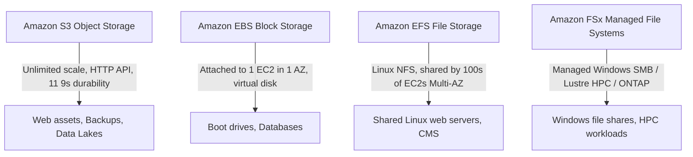

# AWS CLF-C02 Complete Rapid Review Cheatsheet (All 4 Domains)

> **Role:** Complete, ultra-dense, high-yield cheatsheet covering **100% of CLF-C02 exam domains, task statements, services, and exam traps**.  
> **Exam Snapshot:** 65 questions (50 scored + 15 unscored) · 90 minutes · Passing score **700 / 1000** · No penalty for guessing.  
> **Domain Weights:** **D1** Cloud Concepts (**24%**) · **D2** Security & Compliance (**30%**) · **D3** Cloud Technology & Services (**34%**) · **D4** Billing, Pricing & Support (**12%**)

---

## 🧭 Domain 1: Cloud Concepts (24%)

### 1.1 The 6 Advantages of Cloud Computing

| Advantage | Plain-English Meaning | Exam Keyword Clue |
| :--- | :--- | :--- |
| **Trade CapEx for OpEx** | Pay monthly for what you consume instead of buying servers upfront. | *"Pay-as-you-go"*, *"Variable expense"* |
| **Massive Economies of Scale** | Millions of customers aggregated = AWS repeatedly cuts prices (130+ cuts). | *"Lower variable cost than on-prem"* |
| **Stop Guessing Capacity** | Scale out/in automatically to match demand; zero idle headroom. | *"Over-provisioning / under-provisioning"*, *"Elasticity"* |
| **Increase Speed & Agility** | Provision resources in minutes instead of waiting weeks for hardware. | *"Faster experimentation"*, *"Minutes vs weeks"* |
| **Stop Undifferentiated Heavy Lifting** | AWS handles racking, power, cooling, and failed disks. | *"Focus on customers/business, not data centers"* |
| **Go Global in Minutes** | Deploy worldwide across AWS Regions & Edge Locations in clicks. | *"Low latency for global users"* |

- **Cloud Service Models:** **IaaS** (EC2, VPC, EBS — max control) · **PaaS** (Elastic Beanstalk, RDS — focus on code/data) · **SaaS** (WorkMail, Salesforce — ready-to-use app).
- **Cloud Deployment Models:** **Cloud-Native** (100% AWS) · **Hybrid** (On-prem + AWS connected via VPN/DX/Outposts) · **On-Premises / Private Cloud** (dedicated local infrastructure).

---

### 1.2 AWS Well-Architected Framework (6 Pillars + 6 General Principles)

- **6 Pillars Mnemonic — `C-R-O-P-S-S`** (*"Healthy Cloud CROPS + Sustainability"*):

| Pillar | 3-Word Hook | Key Design Principles | Core Services |
| :--- | :--- | :--- | :--- |
| **Cost Optimization** | *Spend less money* | FinOps, consumption model, measure efficiency, stop heavy lifting, attribute spend | Cost Explorer, Budgets, Savings Plans, Spot, Trusted Advisor |
| **Reliability** | *Recover from failure* | Auto-recover, test recovery, scale horizontally, stop guessing capacity, automate change | Auto Scaling, ELB, Route 53, AWS Backup, Multi-AZ |
| **Operational Excellence** | *Run & improve smoothly* | Operations as code, small reversible changes, refine runbooks, anticipate failure, learn from failures (RCA) | CloudFormation, Systems Manager, CloudWatch, Config |
| **Performance Efficiency** | *Fast, right-sized tech* | Democratize tech, go global in minutes, serverless, experiment often, **mechanical sympathy** | Lambda, Fargate, CloudFront, ElastiCache, Compute Optimizer |
| **Security** | *Lock everything down* | Strong identity, **enable traceability**, defense in depth, automate, encrypt in transit & at rest, keep people away from data | IAM, KMS, WAF, Shield, GuardDuty, Inspector, Macie, CloudTrail |
| **Sustainability** | *Go green, save energy* | Understand impact, set goals, maximize utilization, **Graviton** hardware, managed services, shrink downstream | Customer Carbon Footprint Tool, AWS Graviton |

- **6 General Design Principles (`S-T-A-E-D-G`):** **S**top guessing capacity · **T**est at production scale · **A**utomate experimentation · **E**volutionary architectures · **D**rive with data · **G**ame days.
- **AWS Well-Architected Tool:** **Free** console tool that reviews workloads against the 6 pillars and flags **HRIs** (High-Risk Issues) & **MRIs** with an Improvement Plan.

---

### 1.3 AWS Cloud Adoption Framework (AWS CAF 3.0)

- **6 Perspectives — `B-P-G` (Business) + `P-S-O` (Technical):**
  - **Business (`B-P-G` — *"Big People Govern"*):**
    - **Business:** ROI, revenue, business strategy, product management.
    - **People:** Workforce readiness, cloud training, bridging skill gaps, culture & change management.
    - **Governance:** Portfolio & program management, risk management, cloud financial management.
  - **Technical (`P-S-O` — *"Please Secure Ops"*):**
    - **Platform:** Cloud architecture, landing zones, CI/CD, data architecture, migration architecture.
    - **Security:** CISO, identity & access, data protection, compliance, incident response.
    - **Operations:** SREs, observability, monitoring, configuration management, SLAs.
- **4 Transformation Phases (`E-A-L-S` — *"Every Architect Loves Scaling"*):**
  1. **Envision** *(tie cloud to 4 business outcomes)* → 2. **Align** *(find capability gaps across 6 perspectives)* → 3. **Launch** *(ship production pilots)* → 4. **Scale** *(expand enterprise-wide)*.
- **4 Business Outcomes:** Reduced Business Risk · Improved ESG · Increased Revenue · Increased Operational Efficiency.

---

### 1.4 The 7 Rs of Cloud Migration & Migration Services

| Strategy | Nickname | One-Line Rule | Primary Tool |
| :--- | :--- | :--- | :--- |
| **Rehost** | Lift-and-Shift | Move as-is, zero code changes (fastest). | **AWS MGN** (Application Migration Service) |
| **Replatform** | Lift, Tinker & Shift | Minor optimization (e.g., move DB to **Amazon RDS**). | AWS DMS, RDS, Elastic Beanstalk |
| **Refactor** | Rearchitect | Rewrite fully cloud-native (serverless/microservices). | Lambda, ECS/EKS, DynamoDB |
| **Repurchase** | Drop and Shop | Abandon custom app and buy a **SaaS** product. | AWS Marketplace |
| **Relocate** | Hypervisor Shift | Move **VMware** VMs untouched at hypervisor level. | VMware Cloud on AWS |
| **Retain** | Revisit Later | Keep on-premises for now (compliance/legacy). | Hybrid VPN / Direct Connect |
| **Retire** | Decommission | Shut down unused/redundant applications. | AWS Application Discovery Service |

- **Migration Toolkit:** **Migration Hub** *(single tracking dashboard)* · **Application Discovery Service** *(scans on-prem servers & dependencies)* · **Migration Evaluator** *(TCO business case)* · **AWS MGN** *(rehost servers)* · **AWS DMS** *(live online DB migration — homogeneous & heterogeneous)* · **AWS SCT** *(converts schemas for heterogeneous DBs like Oracle → Aurora)* · **AWS DataSync** *(fast online file transfer)* · **Snow Family** *(offline physical hardware: **Snowcone** 8 TB → **Snowball Edge** 80–210 TB → **Snowmobile** 100 PB truck)*.

---

### 1.5 Global Infrastructure & Disaster Recovery

- **AWS Region:** Geographic area with **≥ 3 isolated Availability Zones** (choose by: Compliance, Latency, Service availability, Pricing).
- **Availability Zone (AZ):** 1 or more discrete data centers with redundant power/networking, linked by low-latency fiber inside a Region.
- **Edge Locations (PoPs):** 600+ global points powering **CloudFront** (caching), **Route 53** (DNS), **WAF**, **Shield**, and **Global Accelerator**.
- **AWS Local Zones:** Extend an AWS Region closer to major metro cities for **single-digit millisecond latency**.
- **AWS Wavelength:** Embeds AWS compute/storage at the edge of **5G telecom networks** for ultra-low-latency mobile/IoT.
- **AWS Outposts:** Physical AWS hardware racks installed **in your own on-premises data center** for true hybrid / data residency.
- **DR Strategies (Cheapest/Slowest → Priciest/Fastest):**
  1. **Backup & Restore** *(hours RTO/RPO, lowest cost)* → 2. **Pilot Light** *(DB replicates live, compute off)* → 3. **Warm Standby** *(scaled-down live copy)* → 4. **Multi-Site Active/Active** *(near-zero RTO/RPO, highest cost)*.
  - **RTO** = Recovery **Time** Objective *(max acceptable downtime)* · **RPO** = Recovery **Point** Objective *(max acceptable data loss in time)*.

---

## 🔒 Domain 2: Security & Compliance (30%)

### 2.1 Shared Responsibility Model ("Security OF vs. IN the Cloud")

| AWS Responsibility (*Security **OF** the Cloud*) | Customer Responsibility (*Security **IN** the Cloud*) |
| :--- | :--- |
| Physical data centers, guards, power, cooling, hardware | Customer data (classification, encryption config) |
| Hypervisor, virtualization layer, network cabling | IAM users, roles, MFA, least-privilege policies |
| Disk destruction / degaussing (NIST 800-88) | **EC2 guest OS patching** & firewall (**Security Groups / NACLs**) |
| Managed service OS & DB engine patching (**RDS, Lambda, S3**) | Client-side & server-side encryption settings, network traffic config |

> **Shared Controls** *(both AWS and Customer do their own layer)*: **Patch Management**, **Configuration Management**, **Awareness & Training**.

---

### 2.2 Identity, Access & Multi-Account Governance

- **AWS Root User:** Lock away! Enable **MFA**, **never** create root access keys, use IAM Admin user/role for daily tasks.
- **IAM Users** *(people/long-term creds)* · **IAM Groups** *(collections of users — cannot nest)* · **IAM Roles** *(temporary STS credentials for EC2, Lambda, cross-account — **best practice**)* · **IAM Policies** *(JSON least-privilege permissions; **Explicit Deny always wins**)* · **MFA** *(mandatory for root & admins)*.
- **AWS IAM Identity Center (SSO):** Centralized workforce single sign-on across multiple AWS accounts and cloud business apps.
- **Amazon Cognito:** Authentication & user pools for **external web/mobile app end-users** (Google/Facebook/Apple/SAML sign-in).
- **AWS IAM Access Analyzer:** Identifies resources (S3, KMS, IAM roles) accidentally shared with **external entities** and generates least-privilege policies from CloudTrail.
- **AWS Organizations:** Multi-account management, **Consolidated Billing**, Organizational Units (OUs), and **Service Control Policies (SCPs)** *(guardrails that set maximum allowed permissions across member accounts)*.
- **AWS Control Tower:** Fastest way to set up and govern a secure, compliant **multi-account Landing Zone** with pre-built guardrails.
- **AWS Directory Service:** Managed Microsoft Active Directory in AWS.

---

### 2.3 Security Services in One Sentence

| Service | One-Line Exam Trigger |
| :--- | :--- |
| **AWS KMS** | Managed encryption keys (AES-256) integrated with S3, EBS, RDS; AWS manages hardware. |
| **AWS CloudHSM** | Dedicated, single-tenant physical hardware security module (**FIPS 140-2 Level 3**); customer controls keys exclusively. |
| **AWS Certificate Manager (ACM)** | Free provisioning & auto-renewal of public/private **SSL/TLS certificates** (HTTPS). |
| **AWS Secrets Manager** | Stores & **automatically rotates** database passwords and API keys (paid). |
| **SSM Parameter Store** | Hierarchical config & secret storage (**free standard tier**, no built-in auto-rotation). |
| **AWS Shield Standard** | **Free, automatic** L3/L4 DDoS protection on all AWS accounts (CloudFront, Route 53). |
| **AWS Shield Advanced** | Paid (\$3,000/mo): 24/7 **Shield Response Team (SRT)** + **DDoS cost protection** credit. |
| **AWS WAF** | **Layer 7** web firewall blocking **SQL Injection, XSS**, bad IPs, geo-blocking, rate limits (ALB, CloudFront, API GW). |
| **AWS Network Firewall** | Managed VPC-level stateful L3–L7 network firewall inspecting traffic across subnets/VPCs. |
| **AWS Firewall Manager** | Centrally configures WAF, Shield, and Security Group rules across **all AWS Organizations accounts**. |
| **Amazon GuardDuty** | ML-powered **continuous threat detection** analyzing CloudTrail, VPC Flow Logs, DNS logs (crypto-mining, stolen creds). |
| **Amazon Inspector** | Automated **vulnerability scanner (CVEs)** for **EC2 instances, ECR container images, and Lambda functions**. |
| **Amazon Macie** | ML scanner discovering **sensitive data / PII** (SSNs, credit cards) inside **Amazon S3**. |
| **Amazon Detective** | Visualizes root cause & security investigation graphs after a GuardDuty/Security Hub finding. |
| **AWS Security Hub** | **Single pane of glass** aggregating security findings (GuardDuty, Inspector, Macie, Access Analyzer) + compliance checks. |
| **AWS Artifact** | Self-service portal to download **AWS compliance reports** (SOC 1/2/3, PCI DSS, ISO) and sign BAAs. |
| **AWS Audit Manager** | Continuously maps AWS usage to compliance frameworks (HIPAA, GDPR, PCI) to prepare audit evidence. |

---

### 2.4 Security Groups vs. Network ACLs (NACLs)

| Feature | Security Group (SG) | Network ACL (NACL) |
| :--- | :--- | :--- |
| **Level** | **Instance / ENI** level | **Subnet** level |
| **State** | **Stateful** *(return traffic auto-allowed)* | **Stateless** *(must allow both inbound & outbound)* |
| **Rules** | **Allow rules ONLY** *(implicit deny)* | **Allow AND Deny rules** *(evaluated in number order)* |

---

### 2.5 Monitoring, Auditing & Governance Trio

| Service | Question It Answers | Key Exam Trigger |
| :--- | :--- | :--- |
| **Amazon CloudWatch** | *"How is my system performing?"* | **Metrics** (CPU, network), **Logs**, **Alarms**, Dashboards. |
| **AWS CloudTrail** | *"Who did what, when, from where?"* | **API audit logs** (governance, compliance, who deleted an S3 bucket). |
| **AWS Config** | *"What changed in my resource config?"* | **Configuration history** & compliance rules (detects when S3 becomes public). |
| **AWS Trusted Advisor** | *"Am I following AWS best practices?"* | Checks across **6 categories**: Cost, Performance, Security, Fault Tolerance, Service Limits, Operational Excellence. |
| **AWS Health Dashboard** | *"Is AWS having an outage?"* | Real-time status of AWS services (**Global** + **Account-specific** alerts & maintenance). |
| **AWS Systems Manager (SSM)** | *"How do I patch/manage EC2 fleets at scale?"* | **Patch Manager**, **Session Manager** (no SSH/bastion needed!), **Run Command**, Parameter Store. |

---

## ⚙️ Domain 3: Cloud Technology & Services (34%)

### 3.1 Compute & Containers

| Service | What It Is & When to Pick It |
| :--- | :--- |
| **Amazon EC2** | Virtual servers (IaaS) — full OS control. Instance families: **T/M** (General), **C** (Compute), **R/X** (Memory), **I/D** (Storage), **P/G** (GPU/ML). |
| **AWS Lambda** | **Serverless** event-driven functions — pay per request & ms duration, **max 15 min timeout**, zero server management. |
| **AWS Elastic Beanstalk** | **PaaS** — upload web app code; AWS auto-provisions EC2, ELB, Auto Scaling, RDS (service is free, pay for underlying resources). |
| **Amazon Lightsail** | Predictable flat-rate monthly VPS bundles for simple websites, blogs, and dev/test. |
| **Amazon ECS** | AWS-native managed Docker container orchestrator. |
| **Amazon EKS** | Managed **Kubernetes** container orchestrator. |
| **AWS Fargate** | **Serverless compute engine for containers** (works with ECS & EKS — no EC2 nodes to manage). |
| **Amazon ECR** | Private Docker container image registry. |
| **AWS Batch** | Fully managed **batch computing** jobs (dynamically provisions EC2/Spot for large parallel jobs). |
| **Amazon EC2 Auto Scaling** | Automatically adds/removes EC2 instances based on demand or schedules (**Elasticity & Reliability**). |
| **Elastic Load Balancing (ELB)** | Distributes traffic across Multi-AZ targets: **ALB** *(HTTP/HTTPS Layer 7)* · **NLB** *(Ultra-fast TCP/UDP Layer 4)* · **GWLB** *(3rd-party virtual appliances)*. |

---

### 3.2 Storage Services & S3 Storage Classes

- **Amazon S3 Storage Classes (11 9s = `99.999999999%` durability; object size 0 B to 5 TB):**
  1. **S3 Standard:** Frequent access, ≥ 3 AZs, instant retrieval.
  2. **S3 Intelligent-Tiering:** **Unknown/changing access patterns** — auto-moves tiers, **zero retrieval fees**.
  3. **S3 Standard-IA:** Infrequent access (≥ 30 days), ≥ 3 AZs, lower storage cost + per-GB retrieval fee.
  4. **S3 One Zone-IA:** Infrequent access in **1 AZ only** (20% cheaper; data lost if AZ fails — reproducible data only).
  5. **S3 Glacier Instant Retrieval:** Archive accessed once a quarter, **millisecond retrieval** (90-day min).
  6. **S3 Glacier Flexible Retrieval:** Archive with **minutes to 12 hours** retrieval (90-day min).
  7. **S3 Glacier Deep Archive:** **Lowest-cost storage in AWS** (~\$0.00099/GB/mo), **12–48 hours** retrieval (180-day min).
- **Instance Store:** Ephemeral (temporary) physically attached NVMe disk — **data lost when EC2 stops/terminates** (great for scratch/cache).
- **AWS Storage Gateway:** Hybrid bridge connecting on-premises apps to AWS cloud storage (File, Volume, Tape gateways).
- **AWS Backup:** Centralized, automated backup policy & compliance across EC2, EBS, EFS, RDS, DynamoDB, FSx.

---

### 3.3 Databases (SQL vs. NoSQL vs. Purpose-Built)

| Service | Type | Exam Trigger / Use Case |
| :--- | :--- | :--- |
| **Amazon RDS** | Managed Relational (SQL) | MySQL, PostgreSQL, MariaDB, Oracle, SQL Server. **Multi-AZ** = High Availability (failover); **Read Replicas** = Read scaling. |
| **Amazon Aurora** | Cloud-Native Relational | MySQL/PostgreSQL compatible; **5× faster** than MySQL, 6 copies across 3 AZs, auto-scales up to 128 TB, **Aurora Serverless**. |
| **Amazon DynamoDB** | Serverless NoSQL (Key-Value) | **Single-digit ms latency** at any scale; **DAX** = microsecond in-memory cache; **Global Tables** = multi-Region active-active. |
| **Amazon ElastiCache** | In-Memory Cache | Managed **Redis/Valkey** & **Memcached** — sub-ms caching to offload heavy DB reads & store web sessions. |
| **Amazon Redshift** | Data Warehouse (OLAP) | Petabyte-scale SQL **business intelligence & analytics** (columnar storage — NOT for OLTP transactions). |
| **Amazon DocumentDB** | Document NoSQL | Managed **MongoDB**-compatible JSON document database. |
| **Amazon Neptune** | Graph Database | Highly connected data: **social networks, fraud rings, recommendation graphs**. |
| **Amazon MemoryDB** | Durable In-Memory DB | Redis-compatible primary database with Multi-AZ durability. |

---

### 3.4 Networking & Content Delivery

| Requirement | Correct Service |
| :--- | :--- |
| Isolated private virtual network (subnets, route tables, CIDR) | **Amazon VPC** *(5 IPs reserved per subnet)* |
| Connect public subnet to the Internet | **Internet Gateway (IGW)** |
| Let **private** instances download OS patches without inbound exposure | **NAT Gateway** *(deployed in a public subnet)* |
| Privately connect 2 VPCs (non-transitive) | **VPC Peering** |
| Central hub connecting 100s of VPCs + on-prem networks | **AWS Transit Gateway** |
| Privately access S3 / DynamoDB / AWS APIs without the Internet | **VPC Endpoints** *(Gateway for S3/DDB; Interface/PrivateLink for others)* |
| Dedicated physical private fiber from HQ to AWS (consistent, no internet) | **AWS Direct Connect (DX)** |
| Fast-to-setup encrypted IPsec tunnel over the public internet | **AWS Site-to-Site VPN** |
| Global **CDN** caching static/dynamic web content at Edge Locations | **Amazon CloudFront** |
| Global static **Anycast IPs** routing TCP/UDP over AWS backbone | **AWS Global Accelerator** |
| Managed **DNS** + domain registration + health checks + routing policies | **Amazon Route 53** |

---

### 3.5 Application Integration, DevOps, Analytics, AI/ML & End-User Computing

- **Decoupling & Integration:**
  - **Amazon SQS:** Managed **message queue** (pull-based decoupling; Standard vs FIFO).
  - **Amazon SNS:** **Pub/Sub** notification service (push fan-out to SMS, email, SQS, Lambda).
  - **Amazon EventBridge:** Serverless **event bus** routing AWS/SaaS/custom events by rules.
  - **AWS Step Functions:** Visual **serverless workflow orchestrator** (state machines).
  - **Amazon API Gateway:** Managed front door to create, publish, throttle, and secure REST/HTTP/WebSocket APIs.
- **Infrastructure as Code (IaC) & DevOps:**
  - **AWS CloudFormation:** Provision AWS resources using **YAML/JSON** templates.
  - **AWS CDK:** Define IaC using familiar programming languages (Python, TypeScript, Java) → synthesizes to CloudFormation.
  - **CI/CD Suite:** **CodeBuild** *(compile/test)* · **CodeDeploy** *(automate deployment)* · **CodePipeline** *(end-to-end CI/CD orchestrator)* · **AWS Amplify** *(full-stack web/mobile hosting)* · **AWS Device Farm** *(test apps on real phones/tablets)* · **AWS CloudShell** *(browser-based CLI)*.
- **Analytics:**
  - **Amazon Athena:** **Serverless SQL queries directly on Amazon S3** (pay per TB scanned).
  - **AWS Glue:** Serverless **ETL** (Extract, Transform, Load) + Data Catalog.
  - **Amazon EMR:** Managed **Apache Hadoop & Spark** big data clusters.
  - **Amazon Kinesis:** Real-time **streaming data** ingestion (*Data Streams* for real-time processing; *Data Firehose* to deliver streams to S3/Redshift).
  - **Amazon QuickSight:** Serverless **BI dashboards** & visualizations.
  - **Amazon OpenSearch Service:** Full-text search & log analytics.
- **AI / ML & Generative AI:**
  - **Amazon Bedrock:** Serverless **Generative AI** API for Foundation Models (Claude, Titan, Llama, Nova) + RAG Knowledge Bases + Agents.
  - **Amazon Q:** Generative AI assistant for business (**Q Business**) and developers (**Q Developer**).
  - **Amazon SageMaker:** End-to-end platform to **build, train, and deploy custom ML models**.
  - **Pre-trained AI APIs:** **Rekognition** *(images/video)* · **Textract** *(extract text/tables from PDFs/forms)* · **Comprehend** *(NLP sentiment/entities)* · **Polly** *(text → speech)* · **Transcribe** *(speech → text)* · **Translate** *(language translation)* · **Lex** *(chatbots/voice bots)* · **Kendra** *(enterprise search)* · **Personalize** *(recommendations)*.
- **End-User Computing & Customer Engagement:**
  - **Amazon WorkSpaces:** Managed cloud **virtual desktops (VDI)** — persistent Windows/Linux desktops.
  - **Amazon AppStream 2.0:** Streams **individual desktop applications** securely to any web browser (non-persistent).
  - **Amazon Connect:** Omnichannel **cloud contact center** (pay-per-minute voice/chat).
  - **Amazon SES:** High-volume transactional & bulk **email** sending.

---

## 💰 Domain 4: Billing, Pricing & Support (12%)

### 4.1 AWS Pricing Pillars & Data Transfer Rules

- **3 Pricing Pillars (`C-S-D`):** **C**ompute *(time)* · **S**torage *(GB-month)* · **D**ata Transfer **OUT** *(egress to Internet)*.
- **Data Transfer Golden Rule — *"FREE IN · FREE SAME-AZ · PAY TO CROSS OR LEAVE"*:**
  - Internet → AWS (**Inbound**): **\$0 (ALWAYS FREE)**
  - Same Region + Same AZ: **\$0 (FREE)**
  - Cross-AZ (same Region): **Small fee** (~\$0.01/GB)
  - Cross-Region: **Paid**
  - AWS → Internet (**Outbound**): **Paid** *(volume tiered — cheaper per GB at higher volume)*
- **AWS Free Tier (3 Types):** **Always Free** *(Lambda 1M req, DynamoDB 25 GB)* · **12-Month Free** *(EC2 750 hrs t2/t3.micro, S3 5 GB)* · **Short-Term Trials** *(SageMaker, Inspector, Lightsail)*.

---

### 4.2 EC2 Pricing Models & Licensing

| Model | Discount | Best For |
| :--- | :---: | :--- |
| **On-Demand** | 0% | Short-term, spiky, unpredictable workloads; zero commitment. |
| **Savings Plans** *(Compute / EC2 Instance)* | Up to **72%** | Flexible **\$/hour** commitment (1-yr or 3-yr). **Compute SP** applies across EC2, **Fargate, AND Lambda**! |
| **Reserved Instances (RIs)** | Up to **72%** | Steady-state 1-yr or 3-yr workloads (*Standard* = max discount; *Convertible* = change family; *All/Partial/No Upfront*). |
| **Spot Instances** | Up to **90%** | Fault-tolerant, stateless, batch jobs (**AWS can reclaim with 2-min warning**). |
| **Dedicated Hosts** | Physical server | **BYOL** (per-socket/per-core software licenses) & strict regulatory compliance. |
| **Dedicated Instances** | Single-tenant HW | Hardware isolation without per-socket visibility. |

- **Licensing:** **License Included** *(bundled into AWS hourly rate)* vs. **BYOL** *(reuse existing Microsoft/Oracle/SAP licenses on **Dedicated Hosts** + track via **AWS License Manager**)*.

---

### 4.3 Billing, Cost Management & Marketplace

| Tool | Exact Exam Trigger |
| :--- | :--- |
| **AWS Pricing Calculator** | Estimate costs **BEFORE** deploying (*"What-if"* modeling; no AWS account needed). |
| **AWS Cost Explorer** | Visualize/analyze **past 13 months** of spend + forecast next **18 months** (*AFTER* deploying). |
| **AWS Budgets** | Set spend/usage thresholds and send **email/SNS alerts** when actual or forecasted cost exceeds budget. |
| **AWS Cost Anomaly Detection** | Uses **ML** to detect unexpected spend spikes and identify root causes. |
| **AWS Cost & Usage Report (CUR)** | Most **granular, raw hourly** billing CSV/Parquet files delivered to S3 (query with Athena/QuickSight). |
| **AWS Compute Optimizer** | ML recommendations to **right-size** over/under-provisioned EC2, EBS, Lambda, ECS. |
| **Cost Allocation Tags** | Tag resources (`Department`, `Project`) + **activate in Billing Console** to split costs by team. |
| **Consolidated Billing (Organizations)** | **One combined bill** + pooled volume discounts + shared RI/Savings Plan discounts across accounts. |
| **AWS Marketplace** | Digital catalog to buy/deploy 3rd-party ISV software & SaaS (billed directly on your AWS invoice). |

---

### 4.4 AWS Support Plans Matrix

| Plan | Cost | Support Access | Fastest SLA | Trusted Advisor | Signature Exam Clue |
| :--- | :---: | :--- | :---: | :---: | :--- |
| **Basic** | **\$0** | Billing & account only | N/A | 7 core checks | Free for all accounts |
| **Developer** | **\$29/mo** | Business-hours email (1 contact) | **< 12 hrs** *(System impaired)* | 7 core checks | Testing/early development |
| **Business** | **\$100/mo** | 24/7 phone/chat/email (unlimited) | **< 1 hr** *(Prod system down)* | **Full checks** + API | Lowest plan with **24/7 support & full Trusted Advisor** |
| **Enterprise On-Ramp** | **\$5,500/mo** | 24/7 + pooled TAMs | **< 30 min** *(Business-critical)* | Full checks + API | Pooled TAMs, Concierge Support |
| **Enterprise** | **\$15,000/mo** | 24/7 + **Dedicated TAM** | **< 15 min** *(Mission-critical)* | Full checks + API | **Named Dedicated TAM**, Concierge, **IEM** (Infrastructure Event Management) |

---

## 🎯 Final Exam-Day Trap-Busters & Must-Know Numbers

### Top 10 "X vs. Y" Exam Tie-Breakers
1. **CloudFront vs. Global Accelerator:** Static/dynamic **content caching** = CloudFront · Non-HTTP/TCP/UDP **Anycast IP routing** = Global Accelerator.
2. **Pricing Calculator vs. Cost Explorer vs. Budgets:** Estimate *before* = Calculator · Analyze *past/forecast* = Cost Explorer · *Alert* on limit = Budgets.
3. **CloudWatch vs. CloudTrail vs. Config:** *Performance metrics/logs* = CloudWatch · *Who called what API* = CloudTrail · *Resource config history* = Config.
4. **GuardDuty vs. Inspector vs. Macie:** *Account/log threats* = GuardDuty · *EC2/ECR/Lambda CVEs* = Inspector · *S3 PII discovery* = Macie.
5. **WAF vs. Shield:** *L7 SQLi/XSS* = WAF · *L3/L4 DDoS* = Shield.
6. **Secrets Manager vs. Parameter Store:** Need **automatic rotation** = Secrets Manager · Simple/free config values = Parameter Store.
7. **IAM Identity Center vs. Cognito:** *Internal workforce multi-account SSO* = IAM Identity Center · *External app/mobile users* = Cognito.
8. **DMS vs. SCT:** Moves *data* online = DMS · Translates *schema* (Oracle → Aurora) = SCT.
9. **WorkSpaces vs. AppStream 2.0:** Full persistent *virtual desktop* = WorkSpaces · Stream *individual apps* to browser = AppStream 2.0.
10. **Compute Savings Plans vs. EC2 Instance Savings Plans:** Need flexibility across **EC2 + Fargate + Lambda + Regions** = Compute SP (up to 66%) · Max discount locked to 1 family/Region = EC2 Instance SP (up to 72%).

### Must-Know Exam Numbers
- **700 / 1000** = Passing score (**65** questions, **90** minutes, **15** unscored).
- **≥ 3 AZs** = Minimum AZs in a standard AWS Region.
- **5 IPs** = Reserved by AWS in every VPC subnet.
- **99.999999999% (11 9s)** = Amazon S3 durability (max single object = **5 TB**).
- **15 minutes** = Max AWS Lambda execution timeout.
- **2 minutes** = Spot Instance interruption warning.
- **13 months / 18 months** = Cost Explorer history / forecast window.
- **< 15 min / < 30 min / < 1 hr / < 12 hrs** = Enterprise / On-Ramp / Business / Developer fastest SLAs.
